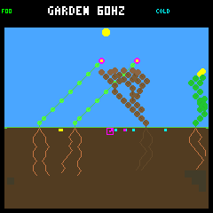
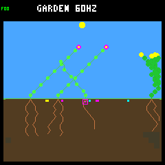

# Seasonal Garden v1: renewal and controller evaluation

Bounded follow-up to [winter/drought implementation](../../docs/garden-seasons.md).
Default device-sized ecology: 256 nodes, eight plant slots, eight seeds, no gardener
or recurring irrigation. Climate remains v1 (2–4-day drought); no tuning is promoted.

Start with the [roadmap checkpoint](../../docs/garden-alife-roadmap.md#current-checkpoint)
for the current findings and next step, and the
[integration guide](../../docs/garden-research-integration.md) for what is built
and checked. The [adult resources and renewal checkpoint](../../docs/garden-adult-resources-checkpoint.md)
keeps that earlier review's scope, grouped findings and limitations. This page
is a detailed evidence index in investigation order, not a list of current tasks.

The [whole-population comparison](leaf-population.md) gives every family the
same controller through day 1376. Both finalists keep higher late renewal and
no garden empties, but Search 1 loses 19 of 32 founder families, including every
shrub family, against 11 for fixed wear. Its single-case follow-up traces one
matched shrub loss through [family losses](leaf-population-losses.md), a
[winter trace](leaf-population-trace.md),
[same-observation decisions](leaf-population-shadow.md) and
[repair gates](leaf-population-gates.md) with their
[day-608](leaf-population-gates-long.md),
[second-seed](leaf-population-gates-transfer.md),
[four-seed](leaf-population-gates-panel.md) and
[early-life](leaf-population-gates-early.md) follow-ups. It continues through
[purchase sites](leaf-population-purchases.md),
[fewer-blocker placement](leaf-population-fallback.md) and its
[regression](leaf-population-fallback-loss.md),
[reproduction order](leaf-population-reproduction.md), the
[step budget](leaf-population-budget.md), [dawn income](leaf-population-dawn.md),
[leaf uptake](leaf-population-foliage.md),
[light exposure](leaf-population-exposure.md),
[shadow sources](leaf-population-canopy.md) and
[repair opportunities](leaf-population-repair-opportunities.md). Each keeps its
protocol and offline verifier. The
[integration guide](../../docs/garden-research-integration.md#single-case-follow-up)
summarizes every finding in one table.

The latest [competitive-renewal follow-up](landing-competitive-renewal.md)
completes all 60 planned calls through day 512. All twelve worlds pass population
viability and retain existing species/families, but none passes sustained renewal.
Cursor primary-cohort 32-day survivors are four versus two under fixed order;
no post-day-384 recruit produces a child. The subsequent
[offline recruit seed audit](landing-recruit-seeds.md) separates purchase access
from establishment across all fifteen recruits. Two expired seeds face full
living capacity throughout; a third remains spacing-blocked during a vacancy.
The fourth leaves 63 unresolved checks before an older seed fills the same
landing. The subsequent [passive handoff diagnostic](landing-seed-handoff.md)
completes two exact frozen replays. The dead parent retains its slot and 32 nodes
through all 63 checks, and the older seed consumes the opening in the reclamation
step. All four expired cases now have sufficient capacity/spacing explanations;
the pending seed remains censored. The subsequent
[full-life non-buyer diagnostic](landing-nonbuyer.md) completes two exact replays:
the 97-day-old recruit becomes fertile within one day but loses thirteen
otherwise eligible openings to earlier buyers. Nine openings reach it while
energy alone blocks purchase. The subsequent
[waiting-time priority comparison](landing-seed-wait.md) completes all 48 calls.
Primary-cohort 32-day survivors rise from four to five, but neither arm gains a
child of any post-day-384 recruit or passes sustained renewal. Waiting priority
adds two natural deaths and leaves one endpoint with seven plants instead of
eight; all twelve worlds remain viable and retain baseline variety. All twelve
new paired endpoint images and compact results are retained alongside the older
24-frame panel. The subsequent [recurring winter comparison](landing-patch-recurring.md)
completes all 48 calls with four additional spatial diebacks. Primary 32-day
survivors rise from 4 to 25, and every treatment produces a child of a new
recruit. Only two of six pass sustained renewal, so the broad-signal gate fails.
All populations stay viable and retain baseline variety, but the hazard kills
28 plants, two young, and natural deaths rise from 8 to 14. Six parent–child
links have living children too young to assess. All twelve new endpoint images
and compact receipts are retained. The subsequent
[day-544 offspring follow-up](landing-recurring-followup.md) resolves all six
links with five established children and one killed by the next patch at age
29.133 days. Ten of eleven late-born survivors establish. All six populations
stay viable and end at eight, but the interval has eight imposed deaths,
three natural deaths and one founder-family loss after its last seed expires.
All baseline species remain represented. All 24 calls and paired images verify;
the earlier 2-of-6 result stays closed. The subsequent
[fresh-weather comparison](landing-recurring-fresh.md) completes all 66 calls
with unchanged model/cadence and prospectively wider 64-day birth windows.
All six recurring gardens pass renewal versus none of the stopped controls;
32-day primary survivors are 44 of 52 versus two of two, with 21 established
parent–child links. All populations remain viable, but there are 50 imposed
deaths, five young; seven natural deaths versus one; and one founder-family
extinction. All six fresh gardens were already flower-only before the arms
diverged. This passes the declared renewal screen, not mixed-species
qualification. All 24 paired images and compact receipts verify. Next review
this checkpoint and propose a separate offline species-loss audit; no rule,
controller or training objective is promoted.

The preceding [neighbor-shade attribution](landing-cursor-shade.md) confirms that
the new neighbor accounts for all 30 missing winter energy units in the cursor
comparison's extra adult death. Two passive replays reproduce the original
results and pixels; omitting only that neighbor's shade restores the paired
income at every sampled pre-death step. This confirms local competition, not
a simulated rescue or long-run viability. It motivated the
[competitive-renewal protocol](landing-competitive-renewal-protocol.md), which
allows individual deaths while assessing population-level outcomes. The original
cursor experiment's failed harm gate is unchanged.
The preceding [offline adult diagnosis](landing-cursor-energy.md) rules out
an unrecovered seed expense and retains the matched resource budgets.
The preceding [purchase-driven seed priority comparison](landing-seed-cursor.md) has
six offspring in the fixed day-320-to-352 birth cohort survive 32 days versus
zero under fixed order. Three gardens improve, but one extra pre-existing adult
dies energy-short, failing the declared harm gate. All 36 calls and twelve
endpoint images are retained. No experimental rule is promoted.
The preceding [offline renewal audit](landing-patch-renewal.md) found:
the failed replacement runs out of energy in winter with ample water, while
unused space is separated into capacity, spacing and queued-parent reach
barriers. Ordered seed-bank access excludes some otherwise eligible parents.
The [day 352 follow-up](landing-patch-followup.md) still has only one new birth,
which dies young. The [fresh-condition confirmation](landing-patch-confirmation.md) remains
the unchanged six-pair day 320 comparison, including its harms and species loss.
Earlier reports' next-step proposals and test counts describe their own
checkpoints.

The preceding [pending-seed competition audit](landing-seed-competition.md)
reanalyzes all ten saved histories without simulation. Mature seeds sometimes
have alternative landings, but each opening admits at most one plant; the two
new recruit seeds are still dormant at refill. The subsequent
[fixed environmental turnover test](landing-patch-sweep.md) completes all 25
calls: every treatment gains 8–11 qualifying pairs versus zero in controls,
with four-plant established ancestry chains and no empty worlds. The approved
continuation preserves the original twelve calls and recorded auditor correction.
Repeats, observer-free checks, raw accounting and all ten endpoint images verify.
The [confirmation](landing-patch-confirmation.md) adds three new seeds and both
layouts, with the original W2 recipe unchanged. All 26 calls verify; every
treatment gains 9–10 pairs versus zero in controls. Established chains span
two to four plants, with deeper births sometimes still censored. All twelve
frames and complete resource audits are retained. The [follow-up](landing-patch-followup.md)
completes 36 calls with no additional sweep events: established pairs rise from
56 to 64 through maturation of existing offspring, not new durable recruitment.
The [saved-trace audit](landing-patch-renewal.md) now explains that failure and
the remaining gaps across all twelve histories. The subsequent
[seed-bank cursor comparison](landing-seed-cursor.md) improves recruitment but
retains an adult-survival regression. The [paired resource diagnosis](landing-cursor-energy.md)
isolates the terminal income deficit, and the [passive shadow diagnostic](landing-cursor-shade.md)
attributes it exactly to the new neighbor. No protection rule, gate revision
or training follows automatically.
[Storage compaction](../../docs/artifact-storage.md)
reclaims 257.7 GiB from verified duplicate traces; compressed evidence remains.

The [landing-aware renewal training pilot](landing-training.md) completes the
63-candidate off/current/history comparison with three search seeds, exact
capture-free repetition and 108 generation-review images. Current-only improves
survival consistency in this development panel, but substantial zero-renewal
windows remain. Models, histories and all nine contact sheets are retained;
no controller or ecology change is promoted.

The [frozen-finalist validation and input ablations](landing-validation.md) add
four world seeds, 304 matched primary runs and 76 fixed images. All three current
finalists retain established descendants at every endpoint; same-weight inputs
help two and hurt one under the unchanged renewal objective. Roughly half their
late windows still earn no renewal credit, mostly in steady climates. Complete
results, explicit derived models and every gallery are retained and independently
reproduced; no training or promotion occurs in this step.

The [signal-content probe](landing-signals.md) separates occupancy from joint
water/light inputs in 480 matched worlds using the three unchanged current-only
finalists. Fixed substitutes sometimes retain survival and improve aggregate
scores, while individual worlds regress; blanket input zeroing does not establish
useful interpretation of changing environmental information. All sixty fixed
screenshots and complete outcomes are retained. No steady world earns credit in
all four late windows, and no probe/controller is promoted. Next discuss a
same-state decision trace before expanding training.

That [same-state trace](landing-decisions.md) now preserves all 48 live worlds
exactly and checks 31,872 native probe results on 1,992 retained decisions.
Water/light substitutions change rankings, priorities and memory, but no action
category in the 976 sampled stem queries. Raw 128 lies outside every observed
common-water range; added light is absent from one controller, while another's
common-water unit remains inactive. Complete traces and all-query histograms
are retained. These are sensitivity diagnostics, not useful-sensing or fitness
proof. Next discuss a bounded live-versus-fixed-input training control before
expanding the search; no controller, ecology or device change is made here.

The [matched live/fixed-input pilot](landing-controls.md) now runs that control:
42 candidates with identical initial weights and mutation budgets, 368 scored
runs and 72 generation-review images. On four new evaluation seeds, live wins
one of three paired aggregates and loses two; its established endpoint coverage
falls to 40/64, 48/64 and 56/64 from 64/64 on the earlier panel. The consistency
gate fails, and no tested steady world has renewal credit in every window.
This motivates broader training-condition coverage, not automatic sensor/model
changes or promotion. The complete one-worker repeat matches exactly.
Independent frozen verification also reproduces every model and all 72 frames;
portable records and gallery-pixel regression checks retain the evidence.

The [five-seed follow-up](landing-multiseed.md) keeps the network and 42-candidate
budget, but uses five times as many training worlds and a fresh common
evaluation panel for old/new finalists. Live training improves two of three
aggregate rankings through better terminal persistence, but loses the third;
fixed training has two losses and one exact tie. All five changed finalists
lose weakest-window renewal credit, and no tested steady world has credit in
every late window. Neither breadth gate passes. All 1,136 scored runs repeat
exactly, and independent frozen execution reproduces all models and 72 review
frames. Next diagnose persistent-but-not-renewing worlds from the saved ledgers
before enlarging the search or revising the environment/objective. No promotion.

The [saved-ledger renewal audit](landing-renewal-audit.md) now accounts for all
224 evaluated histories / 896 windows without native runs. All 390 windows
with established endpoints but zero renewal credit still produce seeds, though
some only from founders. In each improved live finalist's 26 steady examples,
208 carried-in seeds expire without germinating; the 3 and 14 new seedlings
all die before first-day confirmation. Pending seeds remain censored, not
failures. Aging explains persistent occupancy without fresh credit, not the
cause of blocked recruitment. Scores and comparisons reproduce unchanged.
Next discuss a bounded germination/first-day trace before changing ecology,
scoring or the search budget.

The [matched recruitment trace](landing-recruitment-trace.md) now replays twelve
fixed old/new live cases unchanged. Every one of 192 late-expiring seeds in the
six steady worlds is spacing-blocked at every mature check; moisture/light
often overlap, but plant/node capacity does not block these seeds. All 343 late
expiries across both climates have an open column elsewhere at some check,
without proof their parent could reach it. Of 127 late-born seedlings, 55
establish and 72 die (43 water, 22 energy, seven combined shortages). Exact
stage budgets distinguish growth/upkeep/overflow and retain successful growth.
All historical results, repeats, untraced controls and independent frozen traces
match. Next investigate placement opportunity versus dispersal reach before a
placement-only comparison; keep first-day resource policy a separate question.

The [parent-specific reach trace](landing-reach.md) resolves that distinction:
170/192 late-expiring steady seeds have every reachable column spacing-blocked
throughout maturity; only 22 ever have a viable reachable alternative. Seasonal
cases have alternatives for 80/151 seeds, with 44 persistently spacing-blocked
across their entire support. Six steady and 21 seasonal seeds have reachable
alternatives at purchase. All historical worlds and raw traces remain identical.
Next test the existing wider-scattering rule as an isolated, host-only placement
A/B, retaining successes/regressions; no destination oracle, model/score change
or promotion. First-day resource survival remains a separate problem.

The [frozen-finalist range A/B](landing-range.md) fails that screen: late births
rise 127 → 268, but first-day survivors only 55 → 60 and deaths 72 → 208.
Steady survivors fall 4 → 3; both climate score keys worsen, including a seasonal
window with no established descendants. No new empty world appears. The coherent
wide option changes both dispersal and range-aware observations, with weights
fixed; it does not isolate physical landing from neural response. Keep narrow
defaults and discuss first-day establishment next. All contrary cases, exact
resource budgets and 24 fixed screenshots are retained; no retraining/promotion.

The [ordinary first-day allocation diagnosis](landing-establishment.md) now
separates water allocation from night-energy failures. Of 43 water-only deaths,
42 never extend their starting roots; 2,050 of their 2,070 growth-water units
fund shoots. At the same one-eighth-day age, before any death, 47/55 early root
expanders survive versus 8/72 still on starting roots, with contrary cases
retained. All 29 energy-related deaths occur in the dark. Budgets and unchanged
scores recompute without simulation. Next discuss the existing water-only
first-day reserve probe on these frozen neural models under ordinary ecology;
no guard, forced-root policy, training or promotion is implemented here.

The [frozen-model water-reserve screen](landing-water.md) now tests that probe.
Late survivors rise 55 → 60 overall but steady survivors fall 4 → 1, and one
seasonal checkpoint loses established descendants. Both climate score keys
worsen; the screen fails. Water-only deaths fall 43 → 28 while energy-related
deaths increase. Among 1,282 selected guarded WAITs, 680 leave a water-funded
wetter-root proposal unexecuted because the rejected bid retains priority.
These are local opportunities, not proven rescues. All historical controls,
repeats and independent frozen replays match; all 24 fixed frames are retained.
Next discuss arbitration using the saved receipts before another intervention.
No model, score, default or firmware change is promoted.

The [saved refusal-streak diagnosis](landing-stalls.md) now follows all 262 late
children without new experimental runs. The guarded arm's 680 missed-root
decisions form 174 streaks (median two decisions, maximum 25); 66 end in root
growth, 70 in shoot growth and 38 in continued waiting without a funded wetter
root. Of 77 affected children, 38 survive and 39 die. Seventy-three encounter
their first conflict before expanding roots, and 59 grow roots later; those
roots do not guarantee survival. All five affected steady children die, a small
subgroup rather than proof of rescue. Scores and budgets remain unchanged.
Next discuss one eligibility-aware arbitration comparison, not forced roots,
an energy guard, retraining or promotion.

The [water-eligible arbitration screen](landing-arbitration.md) completes that
comparison but fails retention. Late first-day survivors rise 60 → 62 and
water-only deaths fall 28 → 8 versus the veto, while late births fall 135 → 101.
The seasonal renewal key regresses, and ordinary behavior still wins the
retention checks. Of 252 changed late-child selections, 114 grow roots and 138
choose genuine neural WAITs; no forced fallback leaves an eligible bid unused.
The new single /34 day-128 established-descendant gap and opposing /35 outcomes
remain visible in the evidence. All twelve historical veto controls and traced,
untraced and repeated pixels match, as does independent frozen verification;
151 host CTests pass. Keep this host-only and next inspect the saved renewal
gap before another policy intervention.

The [offline turnover diagnosis](landing-turnover.md) finds that the single /34
gap lasts 2.0391 Garden days with seeds continuously available. The old cohort
dies before replacements establish; the first wave fails energy-related, and
even saving it would confirm too late for day 128 under the observed birth
timings. Single /35 instead has a 41.3164-day birth-to-birth interval despite a
7–8-seed bank, with five complete seed lifetimes always spacing-blocked. Multi
/35's veto births frequently fail their first day. All 24 histories and 96
periods recompute; eight offline tests pass. Next trace mature resource budgets
and concurrent seed blockers before another policy. No promotion or new runs.

The subsequent [adult resource trace](landing-adult-resources.md) closes that
missing accounting on the frozen single /34 pair. All four lost adults die
energy-short with substantial stored water, without growth/reproduction spending
from day 124 to death. Every mature seed check during days 123–126 is
spacing-blocked; cold and later dry landing sites delay replacements further.
Two control adults bridge winter despite identical node/leaf counts. Both full
collections preserve historical state, repeated traces and fourteen fixed
screenshots. Next discuss maintenance-aware body growth as a single controlled
intervention; no new policy, storage rule or ecology default is adopted.

The [32-node construction comparison](landing-growth.md) now runs that fixed
twelve-pair test. All six seasonal score comparisons improve versus eligible
control, and late survivors rise 61 → 107. But steady renewal credit falls to
zero in every late period, failing retention against eligible, veto and ordinary
baselines. The selected winter gap closes with a different species/body mix,
while an earlier drought gap lengthens. Historical controls, repeat traces,
resource accounts and all prescribed images match. The cap remains host-only.
The [offline species audit](landing-species.md) finds that capped seasonal
flowers produce no seeds, while ground cover supplies 100 of 107 late renewal
confirmations. All capped steady founders survive 192 days; four worlds
produce seeds but never recruit, with every mature check spacing-blocked.
The [matched founder trace](landing-founders.md) now identifies the construction
failure: eleven capped seasonal flowers stop below flowering depth, and one
reaches the threshold but never finishes its shoot. None forms a flower;
763 visits have no other reproduction blocker. Two capped steady founders
finish their shoots before exhausting the budget and do reproduce.
The subsequent [shoot-reservation comparison](landing-budget.md) restores
flowering and seeds in all 22 flower founders, with no early founder deaths,
but fails the unchanged renewal screen. Seasonal late survivors fall 107 → 41,
four final periods have zero credit, and steady renewal remains stalled.
The eligibility-only control exactly matches the old cap in all twelve worlds;
all 48 histories and fixed galleries verify. Keep the policy host-only.
The [offline final-period germination audit](landing-budget-germination.md)
now identifies living-neighbor spacing in all 261,888 mature checks across the
four zero-credit periods, including 1,779 spacing-only checks. The two /34
worlds also produce no new first-day survivors; their credit is carried in.
All six reserved worlds have only aged-out established descendants at day 190.
The [parent-reach follow-up](landing-budget-reach.md) now preserves all twelve
historical results, raw recruitment traces and endpoint pixels. In the final
reserved periods, 78 of 97 seeds have their entire reachable support blocked
by spacing at every mature check. Nine of 49 new purchases have a spacing-clear
alternative to the blocked actual landing, but only one has a fully open site
at purchase. The [spacing-aware comparison](landing-placement.md) now tests
that isolated rule with unchanged costs, fallback, draws and renewal gates.
It redirects 49 of 712 purchases; 42 germinate, but only 17 children survive
their first day. Seasonal late survivors fall 41 → 39 versus reservation, and
the four zero-credit periods shift from /33 and /35 to /34 and /35. Greater
total credit does not offset worse individual-world continuity. Both seasonal
retention screens fail; the one steady renewal confirmation is not sustained
recovery. All 108 full replays, controls, purchase masks and fixed endpoint
images verify. Keep the candidate host-only. The subsequent
[offline turnover diagnosis](landing-placement-turnover.md) finds no new
first-day confirmations or established-plant deaths in any final seasonal
period of either arm. The /33 gains are carry-in credit that expires later;
the /34 candidates retain older occupants whose credit already expired.
All 261,888 mature checks in the four focal candidates have spacing-blocked
actual landings and entirely spacing-blocked reachable support. Living-neighbor
witnesses explain every actual landing block. Both seedling exceptions and
all unchanged scores are retained. The
[controlled-vacancy follow-up](landing-vacancy.md) now runs all six pairs through
day 256. Early vacancy births rise 1 → 20 versus control, with five first-day
survivors but zero seed purchases by those replacements. Extended controls
also resume reproduction after natural deaths around day 200. Across the full
follow-up, reproducing new parents remain 27 → 27, and final-window confirmations
fall 4 → 2. All 108 calls and their historical controls, repeats, raw traces and
48 images verify. The [recovery-gate follow-up](landing-recovery-gates.md) finds
ready flowers on all five early replacements and 3,394 bank-only production
blocks. Their deaths and all 31 old-control deaths are verified water shortages,
including the one control surviving until the next drought. All 36 unchanged
replays, historical pixels, raw receipts and 167 host suites pass. Next audit
saved bank ownership and released-slot access; no mortality, capacity or
scoring change is promoted. The [offline bank-access audit](landing-bank-access.md)
now finds only 16 lost openings among 3,394 otherwise-eligible focal blocks;
3,378 begin with a full bank. Incumbents own all seeds resident during the
five replacement lifetimes, yet those seeds later yield 23 posthumous births
and 19 first-day survivors. Long residence has both costs and renewal value.
The [rotating-order comparison](landing-order.md) now changes visit order alone,
with the same capacity, viability and fees. It passes the aggregate screen:
early parents with established children 0 → 4, all new reproducing parents
54 → 66, closing confirmations 6 → 9. This is not uniform retention:
no-removal closing confirmations fall 4 → 2, S34 vacancy loses its early
survivor, and total first-day deaths rise 73 → 84. A rotated plant with evenly
distributed time ranks still loses all four actual openings. All 120 declared
calls, historical controls, repeats, raw reanalysis and twelve galleries verify.
The [saved-event regression audit](landing-order-regressions.md) now separates
S34's changed release/refill sequence and longer incumbent survival from S35's
late seedling failures and M33's bank-only missed turns. Ten offline tests and
exact re-extraction of 734 event observations verify the diagnosis with no
new simulation. The [late-resource extension](landing-late-resources.md) now
fills the S35 gap using four unchanged replays: all three late failures start
with water shortages and never grow beyond two roots. Six of all eleven late
births establish, three die and two remain pending. Historical ledgers, pixels,
overlap and repeats match exactly. Water bounds resolve eighteen affordable
root opportunities: seventeen lose to shoots, one to WAIT. All 172 host suites
and twelve focused offline tests passed that step. The
[one-root-choice counterfactual](landing-root-choice.md) then gives each failed
seedling one early root: water income increases, but all three die earlier
from energy shortage. Two successful harm checks still establish. All 40
fixed calls, shared prefixes, historical controls and exact repeats verify.
No controller, ecology or firmware rule was promoted. The subsequent
[first-day energy comparison](landing-root-energy.md) rescues one of those
failures through day 256; two live longer but still die overnight. Both
successful checks are unchanged. The remaining failures cross the eight-to-nine
node maintenance threshold after overestimated future income. Forty fixed calls,
historical controls, repeats and offline reanalysis are retained with screenshots.
The rescued plant still produces no seeds; the population policy remains unqualified.
The [saved maintenance-forecast audit](landing-energy-audit.md) then reconciles
all ten focal histories (eight after exact duplicate removal), including
successful growth. Two clean afternoon errors are entirely overestimated income;
six successful morning maintenance increases also require future income.
The offline tool retains all events and rejected opportunities, without new
simulations or policy changes. The subsequent
[afternoon maintenance comparison](landing-afternoon.md) completes all forty
fixed calls: one further seedling survives through day 256, one survives its
first night but dies in the second, and all three successful checks are unchanged.
The remaining failure buys a seventeenth node on the exact step protection
expires. The new survivor still produces no seeds, and some other plants' seed
production changes. Raw reanalysis and 177 host CTests pass. The subsequent
[continuous energy comparison](landing-continuous-energy.md) completes forty
calls: the remaining failure improves from 1.445 to 2.570 days, then dies in
its third night; four successful checks are physically unchanged. The final
purchase overestimates future income by 57 energy with no later spending.
Other plants' lifetimes, seed records and all final paired screenshots match.
Complete focal histories, raw reanalysis and 178 passing host CTests are retained.
The [daylight income audit](landing-light-audit.md) now checks all 49,152 saved
samples, including successful growth. Globally unproductive light accounts for
50 of the final 57-energy forecast error. A current-light correction reduces that
error to 4, but worsens overall mean absolute income error and would reject one
successful purchase. The next paired test should evaluate its spending decisions,
not presume a rescue. Exact night funding also leaves one dawn unfunded before
useful light returns. This step adds no simulation or population/default policy.
The subsequent [daylight spending comparison](landing-daylight.md) completes all
forty paired calls. Rotating 49 now survives to day 256 at age 19.9140625 days;
three survivor histories stay identical, and the fourth survives with altered
roots after a two-step delay. All focal seed counts remain zero. The rescue
preserves 54 energy by postponing growth, but still has dawn shortages and changes
other plants' seed production and later recruitment. Complete raw/portable
verification, paired screenshots and the 180-test pre-capture host suite are
retained. The [subsequent dawn audit](landing-dawn-audit.md) finds two shortage
episodes among 133 distinct morning windows. Their additional post-dawn needs
are 21 and 15 energy, separate from a two-energy sunset forecast error in the
second episode. One current-light reserve diagnostic would restrict five
purchases on the rescued plant and two on a different survivor; it sometimes
underestimates the later morning need. No policy changes or new simulations are
made by that audit. The [paired dawn-reserve test](landing-dawn.md) now completes
that forty-call replay: energy-shortage payments fall from eleven to zero on
rotating 49; rotating 50 has four rather than six water shortages and two fewer
final root nodes. All five survive, with unchanged life/seed ledgers and closing
credit, and still no focal seeds. Full raw/portable verification, archived-source
hashes, paired screenshots and the 182-test pre-capture host suite pass. The
candidate stays host-only; next define a population-level qualification panel,
including simultaneous offspring protection and fresh weather, without further
tuning this selected panel or changing seed-bank rules at the same time.

The [population qualification screen](landing-population.md) completes that
next step with 32 fixed calls: one diagnostic and three fresh weather seeds,
two reproduction orders, both arms and exact repeats. Only two of eight pairs
pass the harm checks. Six pairs improve unpaid-unit rates, but reproduction and
survival tradeoffs remain; f7ee4528 worsens both energy and water shortage rates.
The candidate is not promoted. The [saved population audit](landing-population-audit.md)
finds improved matched-cohort resources but deficits in different later cohorts,
including finished bodies with no recent construction or seed spending. It
retains every shortage window and performs no new simulation. The subsequent
[passive uptake attribution](landing-uptake.md) reproduces those four worlds in
eight observer-on/off calls and reconstructs every sampled light/root transfer.
Self and live-neighbor shade both matter; selected water failures show locally
dry soil rather than same-step consumption by other plants. Inspect existing
construction choices before another reserve or ecology change. The subsequent
[direction audit](landing-directions.md) completes that check with eight neutral
replays and 3,952 paid-event receipts. In the fixed candidate, 106 of 476 root
additions pass up a legal, affordable endpoint with higher immediate uptake
potential. The highlighted light-failing plants never pass up a brighter legal
shoot endpoint during construction. The subsequent
[root-only ranking comparison](landing-root-direction.md) completes sixteen
fixed calls with exact controls/repeats and first-effect witnesses. None of
four pairs passes the existing harm checks; all lose descendant seed parents.
Gross descendant water uptake rises slightly, but retained water falls in
three pairs. The candidate stays opt-in. The
[saved first-day audit](landing-root-direction-audit.md) finds one shared early
A/B pair, not four independent trials: 87 extra water units taken up become
108 extra overflow units, and no founder retains more. Earlier flower readiness,
not a resource gate rescue, enables the earlier seed. Both arms produce seven
first-day seeds and one eventual matched recruit. Twelve offline tests and
raw/portable reanalysis pass. The [root allocation protocol](
landing-root-allocation-protocol.md) now fixes a focal income-versus-maintenance
test with sixteen fixed calls. The [completed comparison](landing-root-allocation.md)
finds one root-for-shoot substitution per candidate world: focal lifespan rises
from 13.97 to about 45.15 garden days, seeds rise one to two, and equal-exposure
water shortages disappear. All four focal checks pass, but all four population
checks fail as offspring water-shortage rates rise. Exact historical controls,
repeats, complete receipts and paired final frames are retained; 191 host CTests
pass. The [offline population decomposition](landing-root-allocation-audit.md)
finds both changed cohorts and matched resource regressions: equal-exposure
nonfocal water shortfalls rise by 36/15 units under daylight/dawn guards.
Earlier death hides much of this in full-lifetime totals; two later matched
failures also spend an extra seed's water. Fourteen focused tests, raw/portable
verification and byte-identical repeated exports pass without new simulations.
The [saved seed-spending follow-up](landing-seed-spending-audit.md) shows those
costs refill within half a garden day. After later shared full stores, with no
more construction or seeds, candidates retain 40/23 fewer water units. Fifteen
new tests pass. The [passive drying capture](landing-drydown.md) now completes
sixteen historically neutral replays. Both pairs have identical root endpoints,
no foreign-root visits to those cells and complete extraction of their water
each step. Reduced local supply explains the 40/23 retained-unit losses;
the cause of that reduced supply remains open. All primary observations and
raw/portable verification pass, as do fourteen new tests and all four related
CTest entries. The [offline soil reconstruction](landing-soil-audit.md) then
matches all 1728 transitions at every cell. Equal rain and reduced lateral
inflow explain most of the gross supply difference. At the endpoint, 89–92%
of soil water is below the selected roots, with no upward transport in the
existing model. Raw/portable verification and identical exports pass without
new simulation. The [root reachability audit](landing-root-reachability.md)
then reconstructs both bodies and finds they already reach their maximum
possible soil row. The bottom two rows are beyond every allowed genome and
hold 54–59% of remaining soil water in these worlds. Seventeen new tests pass
without new simulations. The [late upward-transfer experiment](landing-wicking.md)
then completes 24 trials with exact controls/repeats and 11,156,992 independently
reconstructed cell transitions. Selected plants gain 0.11–0.33 garden days but
no seeds; 72–95% of extra common-window uptake is discarded at full storage.
All eight comparisons improve water-shortfall rates, but none passes the whole
population screen. Keep wicking off by default. The [late uptake-cap comparison](
landing-uptake-limit.md) completes that 2×2 test in 48 calls. All rebuilt controls
and candidate repeats match; post-onset overflow disappears and water-shortfall
rates improve in all 16 cap comparisons. Some selected flowers survive at least
102.19 days rather than about 14 days, but every comparison loses seed-producing
descendant parents and neither capped variant has births in the last 32 days.
No comparison passes all population checks. Full living-body capacity does not
explain every stalled world. The [offline renewal-gate audit](landing-renewal-gates.md)
then reconciles all 32 primary worlds: every capped final-period mature seed
check fails spacing against another living plant, while each world still buys
and expires eight seeds. Banks remain essentially full. With both rules,
moisture blocks no such check; with the cap alone, actual pool capacity blocks
none. The [offline dispersal and timing audit](landing-dispersal-timing.md) then
finds all 128 late capped purchases already blocked, with spacing-clear columns
elsewhere for 112. Bounds from recorded landings prove most later globally open
sites outside the parent's reach, while retaining missing-trait uncertainty and
one reachable-vacancy exception. The [late broader-dispersal comparison](landing-late-dispersal.md)
then completes 48 trials retaining spacing, costs and viability. Post-onset
births rise 36 → 66 with the cap alone and 18 → 37 with both water rules;
confirmed 32-day survivors rise 32 → 48 and 12 → 22. Only four of sixteen
comparisons pass every harm check: ten worsen energy-shortfall rates, and the
fuller populations frequently exhaust plant slots. The [offline energy audit](
landing-dispersal-energy-audit.md) reconciles all 877 plant histories and finds
67% of the broader worlds' post-intervention energy deficits in confirmed
32-day recruits. Ten comparisons contain a matched individual regression over
equal exposure and demand, including one aggregate-screen pass. Prior occupants
improve in aggregate but not universally. Nineteen new tests, related offline
checks and byte-identical exports pass without simulation. The [selected mature
plant's saved energy history](landing-energy-history.md) then identifies reduced
winter income after common full stores, with no intervening growth or seed
spending. Morning income falls 189 → 77 units; equal overnight costs leave the
broader-world plant short at dawn, before it recovers. Nineteen further tests,
raw/portable verification and identical exports pass without simulation. The
[winter-light follow-up](landing-winter-light.md) then performs two neutral
replays of archived binaries. A surviving offspring to the parent's left
accounts for every observed target-leaf light difference; target geometry and
self-shade are unchanged, and no dead foliage contributes. Frozen omission of
that child's shade restores all 1,560 target leaf samples to the control.
Nineteen new tests, four related offline CTests, raw/portable verification and
byte-identical exports pass. The [placement-information audit](
landing-placement-information.md) then finds only one reachable spacing-clear
choice, so light-aware ranking alone would not change that landing. The child
survives 86.11 observed days and produces nine seeds, but no grandchildren before
the horizon; five seeds expire and four remain pending. Its 54,324 mature seed
checks all fail spacing and all but one also find full plant slots. Twenty-three
new tests, four related offline CTests, full raw reconciliation and identical
exports pass without simulation. The [vacancy-sequence audit](landing-vacancy-sequence.md)
then reconciles all 32 primary worlds and 16,640,021 seed checks. All 153
post-onset deaths are reclaimed within 0.20–0.25 garden days. Broader worlds
have 89 replacements in newly clear columns; 47 make seeds and 26 produce a
germinated child. Five broader release events retain any clear column, four
opening within roughly the last day. Empty ground can still wait for a plant
slot elsewhere, while node limits also matter. Twenty-three tests, three related
offline CTests and byte-identical raw/portable exports pass without simulation.
The [day-288 follow-up](landing-followup.md) now completes 68 planned runs,
preserving every day-256 baseline and all four exact repeats. All seven young
replacements survive to age 32 days, but only two of the eleven late-born
plants produce seeds and none produce a child. The extension has four births,
no deaths and expiry of all 256 old pending seeds. Sixteen new tests pass;
the only C change is the host CLI limit. The [reproductive-access audit](
landing-reproductive-access.md) now finds 4,567 otherwise-eligible visits among
the seven survivors, but only two seed purchases. Banks are full at 4,544 of
those visits; earlier buyers fill openings at 21 more. Both seeds remain
pending, with every mature check blocked by plant capacity and spacing. No
water gate fails in these focal attempts. Sixteen tests and byte-identical
offline raw re-extraction pass without simulation. The next proposed diagnostic
is a controlled single vacancy, retaining decomposition and all pool sizes;
no light, spacing or climate rule changes yet. These remain
examined histories, not a promotion or fresh generalization panel.
The [single-death comparison](landing-disturbance.md) now completes 20 planned
calls with exact controls, repeats and observer neutrality. Normal decomposition
frees a slot in each of five worlds, and a pre-event seed replaces the killed
plant in every case. None is a child of the seven focal survivors. Two newcomers
make seeds, none make children, and focal seed purchases fall from two to one
with mixed per-world outcomes. No new natural deaths or maintenance shortfalls
occur, but full-bank/full-stand stasis resumes. The report includes all five
paired endpoint images and portable offline accounting. The subsequent
[second opening through day 320](landing-second-opening.md) completes 25 calls
with archived-identical baselines, exact repeats and observer neutrality.
All five openings refill, two from post-event purchases, but none of the first
recruits has a child. Their 32-day survival is confirmed; their two old seeds
expire with persistent spacing blocks. New purchase affordability and later
ordered bank access are distinct constraints. No new natural mortality or
maintenance shortfalls occur. The subsequent
[offline opportunity audit](landing-opening-opportunities.md) retains
all twelve followed parents and both arms. It finds 49 eligible visits with
reachable space; 35 also pass current mature-seed gates, all in W5. Every one
faces a bank full at entry, with no same-tick order loss. Other visits remain
energy-limited or out of reach. Unknown traits are bounded rather than guessed.
The subsequent [paid-own-seed replacement test](landing-seed-replacement.md)
completes twenty calls with unchanged pools, viability and reserves. Four
replacements let two first recruits buy seeds, but older competing seeds fill
the openings while those seeds remain dormant. No first recruit gains a child;
each world still establishes one offspring from the same parent. W5 refills
about 0.99 days sooner, with no additional establishment. Both arms make 42
post-onset purchases, with no new natural deaths or maintenance shortfalls.
Exact controls, repeats and observer checks pass; the useful-result criterion
does not. Keep the rule off and inspect pending-seed competition before another
ecological intervention. No default change follows. The original direction
ranking and all spending guards remain unchanged. Canopy planning
remains a separate unsolved question.

The [subsequent recruitment diagnosis and wider-scattering screen](recruitment.md)
find usable sites in every late seasonal world. Its frozen wider-scattering
candidate also passes a [fresh eight-seed confirmation](dispersal-confirmation.md):
late day survivors rise 14 → 20, but survival fractions fall and four weather
seeds regress. All 32 fresh seasonal endpoints have only one viable species.
The candidate remains experimental; normal host/device defaults are unchanged.
The [saved-history offspring audit](offspring-outcomes.md) separates the extra
early deaths from surviving plants without recorded offspring. The subsequent
[fixed seedling resource replays](seedling-resources.md) reconcile an energy
failure, a water failure and surviving examples: growth consumes most of each
failure's limiting resource, while surviving plants can fund growth from income.
The [fixed first-day reserve counterfactual](seedling-reserve.md) now rescues both
selected failures through day 128 while retaining the selected survivor, but an
existing parent dies later in one treatment and final populations/diversity do
not increase. The [fixed component comparison](seedling-components.md) now shows
energy-only rescues the energy failure and water-only rescues the water failure;
neither alone rescues both. The survivor lives in every arm, but water-only has
the same later parent death as combined. Keep both checks as the host candidate;
the [all-offspring matched screen](seedling-population.md) now passes its fixed
aggregate gates: late day survivors 20/37 → 33/44, historical durable parents
211 → 271. Five worlds still lose late survivors, two weather blocks regress,
and 31/33 late survivors have no child. The two multi-species endpoints are
seed-bank-only; all living endpoints remain single-species. The subsequent
[fresh reserve confirmation](seedling-confirmation.md) also passes all nine gates:
late survival 38/71 → 55/62, late durable parents 5 → 6 and historical parents
276 → 285. The reproduction gain is smaller: ten worlds lose historical parents,
48/55 late survivors have no child, and all endpoints are single viable species.
Keep the candidate host-only. Next discuss a saved-trace reproductive bottleneck
audit, separating seed production, germination and offspring survival before
further tuning or training. That [read-only funnel audit](reproduction-funnel.md)
now attributes the 55 guarded late survivors: 35 produced no seed (33 with flower
tissue), thirteen have only pending seeds, six have a day-surviving child and
one has a living young child. Whole-history seed-producing established parents
barely change, 419 → 415, despite establishment rising 748 → 839. Exact production
eligibility needs observation before any further policy change.
The [exact production-gate observer](production-gates.md) now identifies the
eight-slot seed bank as the immediate limit: 33 of the 35 guarded late
nonproducers have ready-flower daylight windows; the bank is full on
5,947/5,999 visits, and 31 parents have a visit where bank capacity is the sole
failed condition. All 64 observed trajectories match the saved states and seed
histories. Next discuss an isolated eight-versus-sixteen bank comparison with
unchanged lifespan/resources, measuring durable renewal rather than seed count.
The [isolated eight-versus-sixteen screen](seed-bank-capacity.md) now tests that
proposal. Historical durable parents rise 285 → 401, but late durable parents
fall 6 → 4 and late survival declines 55/62 → 63/73, failing two predeclared gates.
The larger bank is still full in 97.90% of closing post-step samples; 57 matched
incumbents die earlier. All trajectories repeat, and rebuilt eight-slot controls
match the prior confirmation. Storage grows by 160 bytes per world and 16 per
snapshot. The explicit sixteen-slot host option remains OFF in normal builds;
there is no device/default promotion. Next discuss bank ownership, seed residence
and incumbent resource costs from the saved evidence before another policy change.
That [read-only bank diagnosis](seed-bank-diagnosis.md) now reconciles all 4,966
seeds and 132 shared incumbents. Expiring seeds consume 60.69% of sixteen-slot
occupation, with dry/spacing/light constraints dominating retained mature seeds.
Yet 805/1,368 births occur after the parent dies, and 472 seeds wait at least
sixteen days before germinating. Extra spending alone is not established as the
cause of earlier deaths: seven of 57 affected incumbents spend no more on seeds,
and all 21 later-lived incumbents spend more. No new experimental simulation or
rule change.
Following the placement-behavior discussion, the next experiment uses the actual
producing flower as the dispersal origin, rather than drifting landed seeds.
That [isolated flower-origin screen](flower-origin.md) is complete. Branch
geometry now affects placement in an explicit host-only option, but the unchanged
controllers lose births (1,009 → 839), historical durable parents (285 → 265),
and closing durable parents (6 → 2), failing four gates. Ground cover improves
while flowers/shrubs regress. All trajectories repeat, base controls match saved
evidence and raw reanalysis agrees. No RAM increase, firmware/default promotion,
training, release action or flash.
The [read-only flower-site audit](flower-sites.md) now reconciles all 3,576 saved
purchases. In the flower-origin arm, 1,310/1,710 purchases have only one eligible
flower; another flower opens otherwise closed reach at just 39 purchases. There
are 373 purchases with openings outside every eligible flower's reach and 967
with no currently open column. Nevertheless, 465 seeds from that last group
later germinate and 145 offspring become durable parents. Do not turn present
blockage into a release veto. All 64 observed trajectories/repeats match saved
states, reanalysis agrees, and no simulation rules or device behavior change.
The [exact waiting-period audit](seed-waits.md) now reconciles 16,553,918 checks
without changing any world. Among those 465 births, 345 seeds encounter occupied
spacing and wait for verified dead-neighbor reclamation, but spacing is the last
blocker for only seven. Water/light threshold crossings are the final changes
for 456 births; the median total wait is 7.875 Garden days. Cold affects 215
successful seeds earlier, never as the final blocker. Expired/pending histories
remain separate; 244 of the 342 expired seeds never see spacing open after
dormancy. Rain association is not cell-level water attribution, and light
recovery does not prove disappearing canopy. Both arms/repeats match saved
states, raw reanalysis agrees, and 121 default / 121 older-research CTests pass.
Next discuss a compact landing-neighborhood observation contract that separates
slow occupancy changes from water/light windows, reusing existing local signals,
solar context and memory. No new policy inputs/actions or device behavior yet.
That [landing-neighborhood design](../../docs/garden-landing-observation.md) now
has an executable reference: eight signals per tip/growth endpoint, a proposed
316-byte shared terrain-history cache and a 52-byte packet. Geometry/history and
host/Cortex-M0+ layout tests pass. It explicitly separates shared virtual sensing
from private neural memory and joint resource opportunities from misleading
separate wet/light averages.
The [shadow observer checkpoint](landing-shadow.md) is now complete: 16 fixed
worlds repeat, all 524,304 original state hashes and 160,477 bids match, and every
packet agrees with the independent reference. Flower-origin available endpoints
differ in 75.6% of eligible queries; base-origin correctly shows no positional
benefit. Dead-only readings are rare. The declared host case takes 319.3 ms with
the defensive observer versus 233.8 ms normally; this is not device timing.
Portable daily evidence, raw identities, CPU repetitions and ARM frame sizes are
retained. All 124 default / 123 older-research CTests and the firmware build pass.
No active neural input, policy, ecology default or device behavior changes.
The [host-only encoding checkpoint](landing-encoding.md) now preserves all 77
legacy feature bytes and adds an explicitly masked 49-byte extension. Every one
of 802,385 saved-packet encodings agrees with the independent reference and
repeats. Current-only distinguishes 57.9% of eligible flower-origin choices;
history raises that to 75.6%, mostly through small byte differences, not demonstrated
fitness gains. Three legacy controllers retain identical 32-day worlds and model
files remain unchanged. All 126 default / 124 older-research CTests pass.
The [host inference/model checkpoint](../../docs/garden-landing-inference.md)
now adds the separate 1,416-byte model and 1,448-byte container, explicit legacy
import, and complete world/history/model checkpoints. Zero-extra imports retain
3,072 decisions and three 32-day worlds; 512 extended decisions match independent
integer arithmetic. Synthetic nonzero-history cases change choices and resume
deterministically. All 128 default / 124 older-research CTests and focused
wide/flower tests pass. No player/trainer/default change or new ecological claim.
The [next tooling checkpoint](../../docs/garden-landing-tools.md) now exposes
explicit import/inspect/replay, exact lifetime outcomes, and fixed-checkpoint
PNG bundles with repeat and frozen-binary verification. Matched extended-policy
training/input ablations remain next, without changing mechanics or adding a
new fitness score here.

## Fresh eight-year panel

Four predeclared world/weather seeds from base `0x73656132`, two layouts, two
reference policies and four climates: 64 runs of 128 Garden days. Layouts and
policies share seeds; these are four weather replicates, not 64 independent ones.
All 64 worlds retained living plants; none reached an observed empty world.

| Climate | Worlds reproducing in final year | Final-year births | Final-year full-day survivors | Final-year durable parents | Multi-species endpoints, including seeds |
|---|---:|---:|---:|---:|---:|
| Steady | 1/16 | 1 | 0 | 0 | 13/16 |
| Winter | 2/16 | 7 | 3 | 0 | 5/16 |
| Drought | 8/16 | 36 | 30 | 6 | 0/16 |
| Both | 8/16 | 37 | 30 | 6 | 1/16 |

“Final-year” cohorts are born strictly after day 112. A durable parent is a
descendant which survived a full day and had a child which also survived a full
day. Recent births without a full day of possible follow-up are censored. These
are cumulative achievements within the cohort, not a promise of future survival.

The combined arm produces 583 births and 157 historical durable parents over
eight years, versus 100 and eight for steady controls. This demonstrates real
descendant reproduction, but does **not** qualify broad ecological variety:
15/16 combined worlds lose all but one species even counting unexpired seeds.
In 8/16 combined worlds every mature seed observed in the final year was
spacing-blocked. Shade and water blockers often overlap; one combined world also
shows node pressure. Increasing RAM alone would not resolve all of these cases.

Controller decisions matter. On `rainfed / ed52188b`, baseline ends in ground-cover
and adaptive in flowers under identical climate/rain. They produce 15 versus eight
historical durable parents; neither reproduces in the final year. This is a matched
policy comparison, not proof that a particular action caused the difference or
that baseline is generally superior.

## Initial diagnosis and isolated tuning

The original two-seed, 64-day panel was repeated with ancestry and uniform seed
site sampling. Of eight combined worlds, all had one living species; seven also
had only one viable species when seeds were counted. Six had every final-year
mature seed spacing-blocked, with no node-capacity blocker anywhere in that arm.

Selected 8-day death audits (`rainfed / fb4118d5`, baseline and adaptive) reconcile
all 13 natural-death receipts. Baseline's shrub and ground-cover founders die of
energy shortage during spring, before either hazard. Adaptive keeps those founders
until the first drought, when both die water-starved despite retaining substantial
energy: terminal pre-step reserves are 216 and 229 energy, zero water, with six
water upkeep due. These are terminal-step receipts, not complete lifetime budgets.

One isolated worktree of the evaluator checkpoint (rebased as `89cd384`) changes
only drought duration to 1–2 days.
The [exact patch](short-drought.patch) is retained and **not applied to production**.
All 32 day-0-through-4 prefixes and all 16 complete steady/winter negative controls
match exactly, including state histories and trace SHA-256s.

| Combined climate, 64 days | Original | Short drought |
|---|---:|---:|
| Multiple viable species at end | 1/8 | 2/8 |
| Worlds reproducing in final year | 2/8 | 2/8 |
| Final-year full-day offspring survivors | 3 | 5 |
| Final-year durable parents | 0 | 1 |
| Historical durable parents | 15 | 11 |

The candidate fails the predeclared historical-renewal retention gate. It is a
tradeoff, not a universal improvement. No fresh candidate run or second parameter
search follows that failed screen. Keep the original settings; discuss spatial
recruitment/dispersal and the desired renewal/diversity tradeoff separately.

## Real rendered checkpoints

Fixed first fresh seed `ed52188b`, rainfed/adaptive, combined climate. Images come
from the production renderer; each replay matches its recorded world hash and
RGB565 framebuffer CRC. They are not selected for best outcome.

| Winter, day 14 | Spring, day 16 | End of year eight, day 128 |
|---|---|---|
|  |  |  |

The late frame illustrates persistent spatial occupancy; plant survival and a
stocked seed bank are not equivalent to continuing renewal.

## Saved-model bridge

The evaluator, matched bundles, deep traces, seed-site audits and galleries now
carry explicit climate identity/version and seed lifetime. Steady remains the
evaluation default; the trainer and its objective are unchanged.

An existing model, CRC `01b9d94a` (`r2-n.tgm` from prior research), was evaluated
without retraining: two fresh seeds from `0x73656133`, two layouts, 32 days,
combined climate. All 12 evaluator trajectories validate; two selected detailed
replays, eight seed-site audits and 18 real rendered frames reproduce their
recorded hashes, with the gallery additionally replayed byte-for-byte.
This is a workflow/compatibility check, **not model promotion**. The old model
goes extinct in one of four layout/seed cases, versus zero for adaptive.

## Retained evidence and reproduction

- [Fresh 128-day summary](fresh-128.json): all 64 endpoints, per-case cohort and
  blocker metrics, source/binary hashes and original full-report SHA-256.
- [Short-drought screen](short-drought-screen.json): both 32-case panels, named
  gates, exact-prefix/negative-control checks and provenance.
- Full daily/event reports, raw frames and death traces remain in ignored
  `artifacts/garden-seasons-diagnosis`, `artifacts/garden-seasons-fresh-128` and the
  isolated treatment worktree. Frame paths in JSON refer to those original bundles.
- Saved-model bundles remain under `artifacts/garden-seasonal-model-{eval,gallery,sites}`.

```sh
make host-seasons-garden GARDEN_SEASONS_OUT=artifacts/new-baseline \
  GARDEN_SEASONS_ARGS="--days 64 --trials 2 --jobs 4 --seed-audit --screenshots"
make host-seasons-garden GARDEN_SEASONS_OUT=artifacts/new-fresh \
  GARDEN_SEASONS_ARGS="--days 128 --trials 4 --seed-base 0x73656132 --jobs 4 --seed-audit --screenshots"
python3 sim/garden_season_report.py --control artifacts/new-fresh/results.json \
  --out artifacts/new-fresh-summary.json
```

For the treatment, use a separate worktree at `89cd384`, apply the retained patch
with `git apply --unidiff-zero /path/to/short-drought.patch`, build there, and rerun
the baseline command. Summarize with `--control`,
`--candidate` and a new `--out`; the script rejects mismatched panels, changed
negative controls and changed early prefixes. Source/collector changes can alter
byte-level provenance even when authoritative world hashes remain unchanged.

This closes a bounded seasonal-environment implementation and evaluation pass.
It does not close roadmap #30's environment-qualification or training milestones.
All 100 default and 105 research host tests pass; standalone checks and a pristine
Zephyr build also pass. The conservative firmware uses 257,596 bytes of flash and
223,004 bytes of main RAM. The recommended `make build-fast` image uses 263,516
bytes of flash and 255,772 bytes of its 255 KiB main RAM region (5,348 bytes of
linker headroom). Both retain the separate 8 KiB Core 1 reservation. Host-only
evaluation/analysis adds no device storage or model-ABI changes.

## Physical PIM559 check

On 2026-09-25, the device eventually appeared over USB after an interval with no
host attachment events. Both ROM bootloader and normal application enumeration
were observed. The running shell then accepted a software bootloader request,
and the seasonal `build-fast` image flashed and re-enumerated successfully.
This confirms a working update path, not the cause or resolution of the earlier
intermittent connection problem.

The PL022/DMA 62.5 MHz, core-1-rendering image is built from `e6c7078`; its UF2
SHA-256 is `6a7844cd30e4bde113761b465b87020dd95715546e2307e7cf04eda5de3f40d5`.
Two unchanged canned sequences pass on the device:

| Sequence | Tick | State hash | Framebuffer CRC-32 |
|---|---:|---|---|
| `garden-smoke.json` | 930 | `da79a9d8` | `fc95584f` |
| `garden-mature.json` | 3,771 | `f7c895f8` | `1f128cce` |

The ordinary lifecycle runner stopped after a reply without a parseable state
line. A read-only state query found tick 4,230 / `aca05c93`; the failure capture's
CRC `89fd28c0` and that state both match an independent native replay. A local
continuation harness verifies this checkpoint before resuming bounded steps. It
logs unexpected replies and reconciles them with a read-only state query, never
blindly retrying a potentially completed step. USB has remained attached since
the flash; the original malformed reply's contents were not retained.

At tick 38,310 the continuation captured a premature reply containing a battery
log followed by `toy-factory:~$ picosystem game step 120`, but no result. The
read-only query confirmed the completed tick at hash `697eb956`. The original reader
could mistake an asynchronous log's prompt redraw for command completion before
the step response arrives. This explains that captured interruption, not the
earlier USB attachment failure. These checks did not silently retry mutations.

The continued device state also matches the host at drought day 5, tick 19,590 /
`ed7ea849`, and at the reconciled tick 38,310. Both later endpoints pass state and
framebuffer assertions:

| Continued lifecycle checkpoint | Tick | State hash | Framebuffer CRC-32 |
|---|---:|---|---|
| Winter, year 0 / day 14 | 54,030 | `a2d73157` | `7b6918c7` |
| First spring, year 1 / day 0 | 61,440 | `1f28bcf4` | `c86ee370` |

Downloaded winter and spring PNGs are also byte-for-byte identical to their
native reference images. Winter reports light 60% and cold germination blocking;
spring restores light 100% and clears that blocker. Both endpoints have two
living plants, eight banked seeds, five deaths/reclaimed plants, three
germinations and maximum generation one. Seed viability is reported as 32 days.
The spring reference repeats `garden-lifecycle.json`'s actions but extends its
final neutral span to 61,410 ticks (61,440 total), covering one full seasonal year.

Continuation from tick 4,230 through spring, including captures/status queries,
took 637 seconds and required one read-only reply reconciliation. This exercises
bounded USB stepping, not normal presentation cadence or headless throughput;
the pause/step window's reported Hz/fps are not live-performance measurements.

After resetting Garden and restoring physical input, a 3,598-tick live window
held 60.0 Hz simulation and 29.8 fps presentation, with zero skipped or
over-budget updates and maximum backlog one. Complete updates averaged 0.840 ms
and peaked at 8.429 ms; display transfer was 18.351 ms. Main/render stack
high-water marks were 3,932/5,120 and 3,196/5,120 bytes; core 1 reported ready,
no error, and 296/4,096 bytes of stack. The fresh three-plant Garden is left
running with the auto-gardener off and physical controls enabled. This short
live window is a smoke check, not a worst-case scene performance bound.

Local logs, reference JSON, captures, and the continuation harness are retained
in `artifacts/garden-seasons-device`. These input fixtures test deterministic
host/device compatibility; their manual/automatic gardener actions are not the
unassisted rainfed ecology panel above. User playtesting remains separate.

### USB reader follow-up

The host reader now requires an idle prompt at the end of the current terminal
line. It recognizes Zephyr's cursor-left/erase repaint sequence, retains partial
ANSI escapes until complete, and revokes a candidate prompt when a later fragment
adds command text. Existing absolute timeouts and no-retry behavior are unchanged;
there is no firmware/protocol or simulation change.

Seventeen reader tests cover the captured battery-log race, delayed results,
fragmented prompts/ANSI escapes, in-place repainting, legacy prompts, bounded
timeouts, and exactly one command submission on both success and failure.
The ordinary runner then passed the complete 54,030-tick lifecycle replay without
the recovery harness or retries:

```sh
make sim-test SEQUENCE=scripts/sequences/garden-lifecycle.json
# PASS garden-death-decomposition-reclamation: tick=54030 hash=a2d73157 framebuffer_crc32=7b6918c7
```

The fixed-reader run is retained as
`artifacts/garden-seasons-device/reader-fixed-lifecycle.log`. The device was reset
to a fresh Garden with physical controls and real-time scheduling restored.
`make check` passed standalone checks, all 100 default host tests and the pristine
firmware build; `make host-research-check` passed all 105 tests, and
`make host-player-check` passed its dummy-display smoke test. The focused reader,
sequence and capture suites passed 17, 15 and six tests respectively. A host-side
C assertion also received a formatting-only correction during the final checks.
