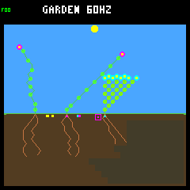
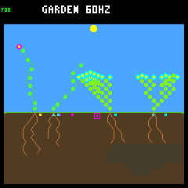
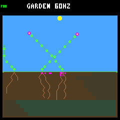
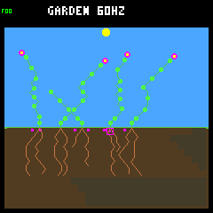
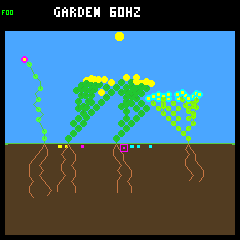
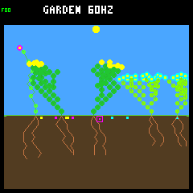
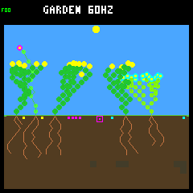
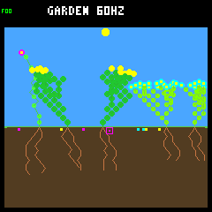

# Wider scattering: aggregate confirmation, uneven survival

The frozen wider-scattering candidate passes the unchanged renewal screen on
eight fresh weather seeds. The result supports more establishment in aggregate,
not a general improvement in survival or a qualified training environment.
**Keep normal host/device scattering unchanged.** No model was trained, no
parameter was retuned and no firmware was flashed.

The subsequent [saved-history offspring audit](offspring-outcomes.md) separates
early death from reproductive follow-through: 17/37 eligible wide late seedlings
die within a day, while 18/20 day survivors have no recorded germinated child yet.

The [protocol](dispersal-confirmation-protocol.md) was fixed before collection:
128 trajectories, eight seeds × two layouts × two reference policies × steady
or combined climates × narrow or wide scattering. Each trajectory runs 128
Garden days, or eight seasonal years. There are 32 worlds per climate/rule, but
only **eight weather replicates**; layouts and policies sharing a seed are not
independent weather observations. The earlier exploratory panel is not pooled
into this decision.

## Fresh seasonal results

| Metric, across 32 matched worlds per arm | Narrow | Wider |
|---|---:|---:|
| Worlds with final-year births | 17/32 | 21/32 |
| Final-year births | 22 | 50 |
| Final-year offspring with a full day of possible follow-up | 16 | 37 |
| Final-year offspring surviving a full day | 14 | 20 |
| Final-year durable descendant parents | 0 | 1 |
| Whole-run durable descendant parents | 163 | 211 |
| Multiple viable species at endpoint, including seeds | 0/32 | 0/32 |
| Observed living-plus-seed empty worlds | 0/32 | 0/32 |

All seven predeclared gates pass: retain each of the five renewal/diversity
counts, strictly improve at least one closing-renewal measure, and introduce no
new empty world in either climate. The diversity gate merely retains zero here;
it is not evidence of coexistence.

Final-year cohorts are born strictly after day 112. Six narrow and thirteen
wide births are too recent for a full-day check, and are excluded from its
denominator. Death exactly on the full-day boundary fails survival. A durable
parent and at least one child each survive a day; neither is promised to remain
alive indefinitely or even at the endpoint.

Whole-run births increase **697 → 1,077** and full-day survivors **442/691
eligible → 594/1,064**. The survival fraction falls **64.0% → 55.8%**. For
final-year offspring it falls **87.5% → 54.1%** despite six more survivors.
Natural deaths rise **703 → 1,045**, including founders as well as descendants.
These are cohort fractions and counts, not exposure-normalized mortality rates.
More births alone should not be treated as better ecology.

## Where the gains and regressions occur

| Seasonal subgroup | Late-birth worlds, narrow → wide | Late day survivors | Historical durable parents |
|---|---:|---:|---:|
| Rainfed | 10 → 10 | 8 → 14 | 89 → 121 |
| Rainfed-crowded | 7 → 11 | 6 → 6 | 74 → 90 |
| Baseline policy | 9 → 12 | 7 → 14 | 72 → 101 |
| Adaptive policy | 8 → 9 | 7 → 6 | 91 → 110 |

The original crowded-layout regression does not repeat in aggregate on these
new seeds, but that layout gains no late day survivors. Adaptive loses one late
survivor; the net survival gain comes from baseline. These two layout partitions
and two policy partitions describe the same 32 worlds, not additional trials.

| Weather seed, four seasonal worlds each | Late births, narrow → wide | Late day survivors | Historical durable parents |
|---|---:|---:|---:|
| `ed52188d` | 2 → 6 | 0 → 0 | 6 → 20 |
| `4f0b9246` | 4 → 1 | 3 → 1 | 28 → 28 |
| `a9c30c1f` | 3 → 9 | 2 → 5 | 27 → 31 |
| `0bb887d0` | 3 → 15 | 1 → 8 | 44 → 67 |
| `647001a9` | 1 → 7 | 1 → 3 | 26 → 29 |
| `c629bb62` | 4 → 4 | 3 → 2 | 16 → 16 |
| `20e1353b` | 3 → 5 | 2 → 1 | 12 → 11 |
| `82deacfc` | 2 → 3 | 2 → 0 | 4 → 9 |

Late survivors improve for **three seeds**, tie for one and worsen for four.
Across individual matched seasonal worlds, the counts are **9 improved / 15
tied / 8 worsened**. Late births improve/tie/worsen in 17/6/9 worlds; historical
durable parents in 18/3/11. No pair gains endpoint viable-species count.

A descriptive, post-collection sensitivity check shows the limitation: removing
`0bb887d0`, which supplies seven additional late survivors, changes the remaining
sum from **13 narrow to 12 wide**. This does not rewrite the predeclared pass or
exclude that seed; it shows why the aggregate result is not robust evidence of
uniformly better late survival. No significance claim or new pass threshold is
derived from this panel.

## Steady controls and startup

Steady worlds still have essentially no late renewal: zero versus one late
birth, and no late full-day survivors or durable parents in either arm.
Historical durable parents rise **15 → 18**, but multi-species endpoints fall
**32/32 → 31/32**. Neither arm has an observed empty world. The screen's diversity
retention gate is seasonal, so the steady diversity loss is a reported tradeoff,
not a hidden gate failure.

| First-year cohort, across 32 worlds | Births, narrow → wide | Day survivors / eligible | Durable parents | Natural deaths |
|---|---:|---:|---:|---:|
| Steady | 144 → 190 | 58/143 → 74/190 | 6 → 10 | 143 → 180 |
| Combined | 291 → 387 | 151/280 → 179/357 | 21 → 34 | 302 → 372 |

The earlier four-seed screen separately found late survivors **30 → 36** and
late durable parents **6 → 8**, with multiple viable species in **1/16 → 1/16**
worlds. The fresh panel confirms the direction of the aggregate screen, but its
much weaker late-parent and diversity results prevent treating the original
counts as typical or guaranteed.

## Fixed visual review

First seed `ed52188d`, rainfed/adaptive, chosen before outcomes. Both seasonal
worlds have one final-year birth too recent to assess full-day survival; both end
with only flowers, including the banked seeds. Wider has five living plants
versus three, but a fuller frame is not evidence of durable late reproduction.

| Checkpoint | Narrow | Wider |
|---|---|---|
| Combined, day 16 |  |  |
| Combined, day 128 |  |  |
| Steady, day 16 |  |  |
| Steady, day 128 |  |  |

All eight PNGs use the production native renderer. They are selected checkpoints,
not a video or a representative sample of all outcomes.

## Evidence and verification

The [compact evidence](dispersal-confirmation-summary.json) retains all 128 case
identities, endpoints, lifetime cohorts, seed-site summaries, trace digests,
16,512 daily hashes, paired breakdowns, repeat receipts and image checksums.
Full histories were collected in the ignored
`artifacts/garden-seasonal-wide-confirmation/results.json`; its SHA-256 is
`2e6a1eb37d7eee860120f762c05f4c1b5e5f045b52cc942e229005aefaec6d7f`.
The subsequent offspring audit also preserves this exact input as a
[compressed archive](dispersal-confirmation-histories.json.gz) (about 845 KiB),
so offline lifetime analysis does not depend on retaining ignored artifacts.
The compact file is byte-identical to the collector's `summary.json`, SHA-256
`b3df99994b6b5494b8141cee88bed770fb9f17964d280cc55dd24c5fe8dbefc9`.
Frame paths in JSON name the original capture files; the repo copies use the
`confirmation-{control,wide}-` prefixes above.

- All initial states match across scattering rules. Offered rainfall, deposited
  plus runoff, matches every seed/day/climate across both rules/layouts/policies.
- Each trajectory's separate seed-site replay matches every daily world hash.
  Birth/death histories and final-year cohorts reconcile. Seed-site observations
  here are post-step samples, not the exact decision receipts of the earlier
  recruitment investigation.
- The first seed's four seasonal cases repeat exactly in **both** arms: eight
  additional trajectory/site-audit runs. The eight fixed frame replays each
  match their world hash and framebuffer CRC, and render byte-identically twice.
- Frozen C/header/shared-collector sources and wide executable bytes match the
  original screen. The normal arm disables every research flag; the wide arm
  enables only wider scattering. All frozen source/support files, executables,
  build caches and protocol remain identical at collection start and finish.
- Offline verification recomputes lifetime cohorts, all gates, paired analyses,
  matched rainfall and the compact/full-report digest, and checks all 16 image
  files including repeat captures. Synthetic tests reject incomplete/duplicate
  panels, changed initial states, unmatched rainfall, wrong capacities/climates,
  broken cohort/site counts and altered candidate sources/binaries/flags.

`make check` passes all **105 default host tests**, standalone checks and the
pristine firmware build. All **108 research tests** and the host-player smoke
test pass. Firmware remains **257,596 B flash / 223,004 B main RAM**, plus the
separate 8 KiB Core 1 reservation. An earlier default-suite run correctly rejected
report edits made during its gallery experiment; the final full run passed with
the working tree held fixed. No reproducibility guard was weakened.

Recheck the retained full bundle without simulation calls:

```sh
docker compose run --rm -T firmware python3 -W error sim/garden_season_confirmation.py verify \
  --bundle artifacts/garden-seasonal-wide-confirmation
```

To recollect using the same source revision and pinned builder, first prepare
normal and isolated wide executables. The wide build directory/flags below match
the frozen experiment; the collector deliberately rejects changed wide binary
bytes rather than silently treating a changed toolchain as the same candidate.

```sh
make host-build
docker compose run --rm -T firmware bash -c '
  source scripts/container/host-garden-defaults.sh
  cmake -S sim -B artifacts/build-host-seasonal-wide -G Ninja \
    "${garden_default_cmake_options[@]}" \
    -DTOY_FACTORY_GARDEN_WIDE_DISPERSAL=ON \
    -DTOY_FACTORY_SIMULATOR_SANITIZERS=ON \
    -DTOY_FACTORY_SIMULATOR_PROFILING=OFF
  cmake --build artifacts/build-host-seasonal-wide \
    --target toy-factory-garden-inspect toy-factory-garden-replay
'
docker compose run --rm -T firmware python3 -W error sim/garden_season_confirmation.py collect \
  --out artifacts/new-dispersal-confirmation --jobs 4
```

The output directory must be new. These commands reconstruct the fixed panel,
not an adjustable seed/parameter search. Compact evidence is sufficient to
compare regenerated case metrics/hashes, but cannot reconstruct the omitted
full histories. The compressed archive retains those exact original histories
for offline lifetime recomputation, even if the ignored collection is removed.
Recollection can change provenance metadata as the analysis tooling evolves;
do not equate a changed full-report digest with changed simulation trajectories.

## Decision and next discussion

The candidate has passed both the exploratory and fresh-seed aggregate screens.
Keep it experimental: diversity remains absent under seasons, late durable
renewal is rare, survival fractions fall, and per-seed/policy regressions remain.
No training-environment qualification milestone is closed.

Initial next step: before discussing default adoption or another ecology change, use the saved
paired histories to distinguish extra establishment from seedling survival and
later reproduction: when do the additional offspring die, under which climate
phases, and which cohorts become parents? Predeclare any deeper replay panel
and keep its causal claims limited to the observations available. Do not respond
to these results by fishing for a different scattering range or more favorable
weather seeds.

That read-only [offspring outcome audit](offspring-outcomes.md) is now complete;
its report proposes a bounded resource-budget replay before any further tuning.
