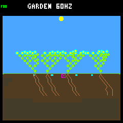
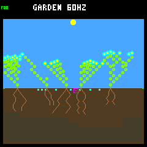
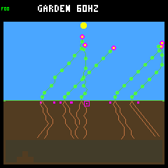

# Producing-flower seed placement

The host-only mechanic works: the producing flower's horizontal position now
determines the scattering origin, so branch growth can affect where offspring
land. **It does not pass the recruitment screen with the existing controllers.**
Keep it experimental; ordinary host/device behavior is unchanged. No flash,
training, release action, directed placement or post-landing drift was added.

This follows the [bank-residence diagnosis](seed-bank-diagnosis.md) and discussion
of placement as a behavior, replacing the proposed drift experiment. The
[predeclared protocol](flower-origin-protocol.md) changes only origin, using the
eight-slot wide-scattering control and unchanged first-day offspring guard. The
sixteen-slot experiment remains separate. All 32 known cases run for 128 Garden
days: eight shared weather seeds, two layouts and two controllers. These are eight
weather replicates, not 32 independent weather draws or a fresh confirmation.

## Results

| Measure, summed over 32 worlds | Base origin | Flower origin |
| --- | ---: | ---: |
| Seeds produced | 1,866 | 1,710 |
| Germinated offspring | 1,009 | 839 |
| Whole-run full-day survivors / eligible | 839 / 996 | 733 / 832 |
| Historical durable parents | 285 | 265 |
| Closing births (strictly after day 112) | 75 | 41 |
| Closing full-day survivors / eligible | 55 / 62 | 30 / 34 |
| Closing censored births | 13 | 7 |
| Closing durable parents | 6 | 2 |
| Closing two-day survivors / eligible | 53 / 62 | 28 / 34 |
| Worlds with closing births | 23 | 17 |
| Living plants at day 128 | 180 | 133 |
| Expired seeds / pending seeds | 601 / 256 | 615 / 256 |
| Closing post-step samples with a full bank | 98.64% | 99.42% |
| Multi-living-species endpoints | 0 | 0 |
| Multi-viable-species endpoints, including seeds | 0 | 1 |

Four gates fail: closing durable-parent improvement, closing survivor retention,
closing survival-fraction retention (88.71% → 88.24%), and historical durable-parent
retention. Whole-run first-day survival **fraction** improves (84.24% → 88.10%),
but fewer offspring are born and fewer survive in absolute terms. A durable parent
is a descendant that survived a full day and had a child survive a full day; this
is a historical achievement, not a claim it is still alive at the endpoint.

No world becomes empty or ends without living plants. Final viable-species counts
do not fall in any matched world. The one additional viable mix is seed-bank-only,
in `rainfed/baseline/82deacfd`; it does not establish living coexistence.

The changes are not uniformly bad across species:

| Species | Births, base → flower origin | Durable parents, base → flower origin |
| --- | ---: | ---: |
| Flower | 528 → 311 | 143 → 93 |
| Shrub | 155 → 140 | 42 → 28 |
| Ground cover | 326 → 388 | 100 → 144 |

Historical durable parents increase in eight worlds, tie in six and decrease in
18. Closing full-day survivors increase in three, tie in 14 and decrease in 15.
Both controller groups lose births and historical durable parents. Among the
128 identical living incumbents at the first divergence, 22 die earlier, 26
later and 80 at the same time. Total deaths decline 957 → 834 alongside fewer
births; that is not evidence of an across-the-board longevity improvement.

## What this establishes—and what it does not

The first changed state in every pair is a new seed landing in a different
column, at tick 540–720, with identical reported plant states, costs, decisions
and weather. Edge reflection can amplify a shift: a landing moves by as much as
13 columns when translating the origin changes whether the draw reflects off a
boundary. Reflection itself is unchanged and covered by the native tests.

This establishes a growth-to-placement consequence, **not learned placement**.
Existing controllers still grow their bodies as before and reproduction still
chooses the first mature, unspent flower automatically. They were not trained
or given new observations/actions for reproductive site quality. The experiment
therefore cannot establish that flower-based placement is inherently unsuitable,
nor that a trained controller will successfully exploit it.

The next proposed investigation is read-only: at actual production opportunities,
compare the reachable soil columns of each eligible flower with moisture, light
and spacing constraints. Determine whether another flower offers better sites or
all available flowers face the same limitation. Those are current-site diagnostics,
not guarantees that a dormant seed will later establish. Discuss that evidence
before adding flower selection or release-versus-wait; do not automatically move
landed seeds to rescue them or combine this with a capacity change.

## Integrity, cost and validation

All 64 trajectories repeat byte-for-byte; rebuilt base-origin traces match the
previous eight-slot controls exactly. Every live/terminal resource budget,
ancestry record and seed lifecycle reconciles. Independent reanalysis from the
unchanged raw traces reproduces the histories and summary exactly. All cases and
regressions are retained, without post-hoc threshold changes.

The native fixtures compare entire worlds after normalizing only a moved flower
and seed column, including hidden RNG and mutation state that ordinary traces do
not expose. They exercise all 256 horizontal pixels, all five dispersal traits,
every direction/distance choice, selected-flower ownership, maturity boundaries,
spent/dead flowers, costs/cooldowns and stationary landed seeds. Site diagnostics
use the same next eligible flower (zero reach if absent), without asserting that
resource/cooldown/daylight gates permit release.

No added world or snapshot storage: measured host sizes remain 4,352 bytes/world,
1,624 bytes/garden snapshot and 1,664 bytes/scene snapshot. The ordinary firmware
build remains 257,596 bytes flash, 223,004 bytes main RAM and 8 KiB core-1 RAM.
The new option is rejected in Zephyr and incompatible research configurations;
normal build wrappers explicitly reset it OFF. The embedded-C checks guided the
bounded, allocation-free implementation and boundary/state-preservation tests.

Validation: five focused native tests in each comparison build, six experiment
tests (including portable evidence and native metadata/repeatability), all 118
default and 119 older-research CTests, and the normal firmware build pass.

## Fixed screenshots

First weather seed `ed52188c`, baseline controller. All eight frames were checked
against trace hashes, framebuffer CRCs, and visually; base frames also match the
saved capacity-control pictures. Images are fixed examples, not selected winners.

| Day 128 | Base origin | Flower origin |
| --- | --- | --- |
| Rainfed |  |  |
| Crowded |  |  |

Day-16 frames: [base rainfed](frames/origin-base-rainfed-day-16.png),
[flower rainfed](frames/origin-flower-rainfed-day-16.png),
[base crowded](frames/origin-base-rainfed-crowded-day-16.png),
[flower crowded](frames/origin-flower-rainfed-crowded-day-16.png).

## Reproduction

Build two separate directories with all `host-garden-defaults.sh` options OFF,
then enable `TOY_FACTORY_GARDEN_WIDE_DISPERSAL` in both and
`TOY_FACTORY_GARDEN_FLOWER_DISPERSAL` in only the treatment. Use RelWithDebInfo,
sanitizers ON, player/profiling OFF. Build `toy-factory-garden-inspect`,
`toy-factory-garden-replay`, `toy-factory-garden-capacity-test` and the native test
targets. Flags, source hashes, cache hashes and binary hashes are in the summary.

```sh
docker compose run --rm -T firmware python3 sim/garden_season_flower_origin.py collect \
  --base artifacts/build-host-flower-origin-base \
  --flower artifacts/build-host-flower-origin-flower \
  --out artifacts/garden-seasonal-flower-origin --jobs 4
docker compose run --rm -T firmware python3 sim/garden_season_flower_origin.py verify \
  --out artifacts/garden-seasonal-flower-origin --jobs 4
```

`collect` requires a new output directory. `verify` reanalyzes existing raw traces
without running simulation/replay trajectories. The small capacity-test executable
is run to verify build storage. Raw traces stay in ignored artifacts; portable
[histories/seed ledgers](flower-origin-histories.json.gz) and
[summary](flower-origin-summary.json) are retained here. Their SHA-256 identities:

- Decompressed histories: `7ef2def2a33d1c3ebc3840f19d648501d412c40d28dbaa14897f0532c93e9230`.
- Summary bytes: `2fd62e50bdccb720ce4986deb34d15e9dd2e826cc9b4e677a67bfe5dc75f4ee9`.
