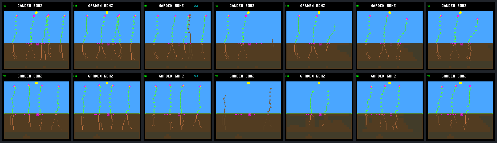

# Adult energy budgets and the seasonal generation gap

**The four older plants in the failing pair die energy-short, not water-short.**
They have stopped growing long before the decline, and spend nothing on growth
or reproduction from day 124 until death. Low-light income, ongoing maintenance
and finite energy storage explain their measured reserve loss. A last-minute
optional-spending veto would have no purchases to stop in that interval.

This closes the missing-accounting question from the
[turnover diagnosis](landing-turnover.md), not environmental qualification.
The [fixed protocol](landing-adult-resources-protocol.md) selects one previously
observed failure and its control. No controller, ecology, scoring, firmware or
training changes are made. Findings do not establish a rescue or generalization
across the wider panel; its failed retention gates remain failed.

## What was measured

Replay `single-s6d697834-live` in `rainfed-crowded-seasonal-940cfdc4` with both
existing water-arbitration modes. Every run continues to day 192. Record every
ecology step from day 96 through day 130 inclusive: adult and seedling resource
stages, actual uptake/overflow, upkeep, growth/reproduction, death discard,
stress and simultaneous seed checks. IDs identify lineages, not reusable slots.

Both arms have 8,705 ecology samples. The control has 37,817 plant and 68,331 seed
samples; the eligible arm has 32,234 plant and 66,816 seed samples. Every resource
balance and complete in-window plant/seed inventory reconciles. Left-censored
plants already alive at day 96 retain that label; their captured totals are not
whole-lifetime budgets. A plant's eventual death after day 130 is known from the
ledger, but its cause is not inferred from this window.

The extended publisher reuses existing host receipts without changing the
simulation core. The old first-day trace bytes stay unchanged. All living
plants and same-step deaths are retained; older corpses are excluded. Morphology
counts are post-step diagnostics and do not describe the productive leaves on
a death step, when decomposition countdowns replace growth progress.

## The older cohort loses energy despite stored water

At day 120, each of these plants has 36 nodes, including 20 roots and eight
active leaves. Ordinary energy upkeep is five units every four ecology steps,
or 320 per full Garden day. These counts alone do not describe leaf geometry,
shading or the timing of productive light.

| Arm and plant | Base column | Energy at the end of day 125 | Death in Garden days | Measured terminal shortage | Water discarded at death |
|---|---:|---:|---:|---|---:|
| Eligible 25 | 3 | 122 | 126.796875 | Energy | 510 |
| Eligible 26 | 15 | 70 | 126.625000 | Energy | 461 |
| Eligible 27 | 10 | 70 | 126.625000 | Energy | 468 |
| Eligible 28 | 22 | 113 | 126.812500 | Energy | 510 |
| Veto 28 | 11 | 128 | After captured window | Not observed here | Not applicable |
| Veto 29 | 3 | 130 | Still alive at day 192 | Not applicable | Not applicable |

The four eligible plants were born at days 104.8516–104.8555. Their last growth
purchases are at days 105.1172–105.2539, over 21 days before death. The last
reproductive purchase among them is plant 25's at day 123.9375; plant 28 makes
none in its captured lifetime. From day 124 onward, there is no optional
spending to blame for their final decline. Each terminal receipt records
unpaid energy upkeep and paid water upkeep, with remaining water then cleared
by natural death.

The control is not uniformly successful: three other mature plants die
energy-short during the same winter. Plants 28 and 29 bridge the generation
gap; 28 reaches stress seven but recovers, while 29 records no shortage in the
window. IDs are local to each arm, not individually matched rescues. Differences
in geometry, placement and prior history require a separate causal test.

## Income timing and storage matter

During the day-125 interval, eligible plant 28 starts with 252 energy units,
collects 333 and pays 320 upkeep, without growth or reproductive spending.
Yet its stores fall to 113:

`252 + 333 - 152 overflow - 320 upkeep = 113`

Daily gross income exceeding upkeep therefore does not guarantee survival.
Storage is capped at 256, so surplus collected while full cannot pay later
maintenance. This trace measures that loss; it does not prove that raising the
cap, changing architecture or moving a leaf would rescue the plant after the
resulting policy/competition feedback.

## Why seeds did not overlap the dying adults

In the eligible arm, all 6,136 mature seed checks during days `[123,126)` are
spacing-blocked. Light and moisture blockers often overlap. The bank remains
full at eight seeds; neither plant-slot nor node capacity blocks these checks.
Cold also blocks germination from day 124.36328125 through the sample before
126.8203125, just after the last old plant dies at 126.8125.

From that last death until the first birth at 127.06640625, all 520 mature seed
checks include insufficient moisture at their actual landing sites. These
65 ecology samples have no open site elsewhere under the recorded site checks
either. This does not establish what an earlier differently placed seed or a
different canopy would do.

The first replacement wave then suffers the previously measured seedling
failures. The next wave restores established descendants at day 128.8515625.
Seed production is not the missing resource; adult energy endurance and the
timing of viable germination windows are separate links in the failure.

## Visual timeline

Rows: veto control, then eligible selection. Columns: days 120, 124, 126.5,
127, 128, 129 and 130. These are selected diagnostic examples, not an unseen
evaluation panel. The day-127 eligible image shows decomposing remnants,
not living adults; the day-128 plants are still unconfirmed recruits.



## Construction comparison

The agreed [32-node construction test](landing-growth.md) is now complete as a
separate host-only experiment. It improves seasonal results but fails steady
retention. Its species/body changes and drought counterexample prevent treating
the winter improvement as a matched rescue or promoting the cap. The rationale
below records the hypothesis motivating that fixed comparison.

Test maintenance-aware body growth, not another late spending veto. A bounded
host-only probe could stop additional growth before crossing the 32-to-33-node
upkeep tier: four instead of five energy units per payment. It must act during
body construction, without deleting mature tissue or gifting resources.
Fewer nodes could also reduce water/light acquisition, so this is a hypothesis,
not an automatically beneficial change or a proposed permanent 32-node limit.

The comparison keeps frozen controllers,
weather, scoring and ordinary/experimental controls, and use the existing
whole-panel retention checks. A selected-case rescue alone would not justify
promotion. Energy-storage changes are an alternative hypothesis, not a second
variable to change in the same comparison.

## Validation and reproduction

Two full collections reproduce every result, trace and image. Each collection
checks traced, untraced and repeated day-192 runs against the historical complete
results and framebuffer bytes, and checks trace-on/off pixels at all fourteen
window captures. Offline verification recomputes all resource/inventory accounts.
Tests cover partial windows, founders, births/deaths, censoring, retained stress
flags, corrupt/missing/duplicate data, unchanged first-day traces, exclusive
output creation and retained-image hashes.

All 153 ordinary host CTests pass, including the seven new adult-trace tests.
The four build-default tests, changed-C formatting check, shell syntax checks
and Python compilation also pass. Firmware is unchanged and was not rebuilt
or flashed for this host-only observer change.

```sh
make host-trace-landing-adults \
  GARDEN_LANDING_ADULT_OUT=artifacts/new-adult-resource-run
docker compose run --rm -T firmware python3 -W error sim/garden_landing_adults.py \
  --verify benchmarks/garden-seasons/landing-adult-resources-results.json.gz
```

The [portable evidence](landing-adult-resources-results.json.gz) includes both
full results, raw window records, recomputable analyses, frame metadata,
source hashes and builder identity. Full binaries/source snapshots remain in
ignored `artifacts/garden-landing-adult-resources-v2/`. Provenance:

- Input arbitration archive SHA-256:
  `7e3a88e1077f0944b84c412675a6bfabc1b531da6bf21844f62be68ac7b4bec7`.
- Portable evidence SHA-256:
  `88f8468afd443d45a1aa4260052cc92b82fbbda031409837f713012955c6ad3d`.
- Full bundle manifest SHA-256:
  `a421ace2b3ab0c2a12c7f54e872443f374e11bebd38a456259171c29ac668c48`.
- Observer binary SHA-256:
  `b0cad1aaf2485bd18865eafb44ebd051923e8ae55e123f337df0f178011adc5a`.

No device was flashed or measured. Host diagnostics and accounting evidence
do not establish device timing or ecological viability beyond this selected pair.
