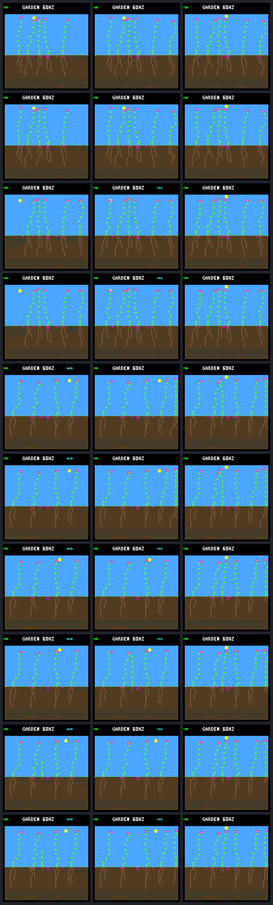

# Afternoon maintenance reserve results

Requiring stored energy for afternoon maintenance increases rescues one of the
two remaining first-night failures through day 256. The other survives its first
night but dies during the second. Both successful checks and the previously
rescued seedling remain unchanged. The new survivor produces no seeds, so this
is another survival improvement, not demonstrated autonomous renewal.

The [prospective protocol](landing-afternoon-protocol.md) fixed one rule, five
cases and forty native experiment calls. All calls completed without tuning or
reruns beyond the predeclared exact repeats. This is a selected-case diagnostic,
not independent qualification. No firmware/default behavior changed.

## Comparison and outcomes

Both arms retain the same initial paid root and the previous first-day energy
guard. Only the candidate adds stored-energy eligibility for daylight allocations
that increase maintenance at/after noon. It applies before priority arbitration,
without changing prices, proposal priorities, destinations or proposed memory.
Both energy guards still end at ecology age 257, exactly one day after birth.

| Focal case | Energy-only control | Additional afternoon condition | Seeds from focal plant |
| --- | --- | --- | ---: |
| Fixed 45 | Alive at day 256 | Identical checkpoints and captured history | 0 → 0 |
| Fixed 46 | Alive at day 256 | Identical checkpoints and captured history | 0 → 0 |
| Rotating 48 | Prior rescue, alive at day 256 | Identical checkpoints and captured history | 0 → 0 |
| Rotating 49 | Dies at age 0.6171875 days | Dies at age 1.4453125 days | 0 → 0 |
| Rotating 50 | Dies at age 0.59375 days | Alive at age 19.875 days at day 256 | 0 → 0 |

Surviving ages are right-censored by the experiment horizon. Cases are separate
paired worlds, not simultaneous interventions on all five plants. Successful
checks are exact matches after removing configuration identity and observational
annotations; no additional eligibility denial occurs in fixed 45 or fixed 46.

## The first night is funded

The first changed choice in rotating 49 is at tick 906690, phase 94; rotating 50
changes at tick 906930, phase 110. The eight and fourteen prior focal samples,
respectively, match exactly after removing the new annotation. Raw bids and
pre-action resources also match at the first changed choice.

Both would buy a ninth node under the control. That doubles maintenance from
one to two energy per payment, increasing the nominal night cost from 32 to 64.
The new stores-only margins are −47 and −25. Each candidate refuses that
purchase and uses the ordinary all-ineligible WAIT fallback, preserving the
selected proposal's next-memory behavior. Neither is given energy or water.

| First-night observation | Rotating 49 control | Rotating 49 candidate | Rotating 50 control | Rotating 50 candidate |
| --- | ---: | ---: | ---: | ---: |
| Nodes at first sunset | 9 | 8 | 9 | 8 |
| Energy at first sunset | 43 | 61 | 45 | 59 |
| Nominal night maintenance | 64 | 32 | 64 | 32 |
| Energy at next dawn | Dies beforehand | 29 | Dies beforehand | 27 |

The candidate changes seventeen arbitration decisions in each of these two
histories. Its 51 and 37 additionally denied otherwise-eligible bids are not
independent trials or additional saved plants. Later decisions already occur in
changed bodies and histories; only the first intervention is a matched-state
comparison.

Rotating 50 subsequently reaches 32 nodes, sixteen roots and one flower. Its
second sunset holds 161 energy and the next dawn 33; no energy or water shortage
occurs in its saved first two days. It remains alive through day 256, but has
no recorded seed production or descendants.

## The remaining failure exposes the age cutoff

Rotating 49 passes its first night with eight nodes. It buys the ninth node the
next morning at phase 56, when the extra afternoon condition does not apply.
It then reaches sixteen nodes but cannot fund another maintenance increase
under the extra rule before the first-day guard expires.

| Tick | Ecology age | Sun phase | Event | Energy after step |
| --- | ---: | ---: | --- | ---: |
| 910395 | 256 | 85 | Last protected step, sixteen nodes | 126 |
| 910410 | 257 | 86 | Guard expires; seventeenth node bought | 124 |
| 910680 | 275 | 104 | Twenty-fifth node bought | 128 |
| 911040 | 299 | 128 | Second sunset, thirty nodes | 59 |
| 911700 | 343 | 172 | First energy shortage, thirty-two nodes | 0 |
| 912120 | 371 | 200 | Energy-shortage death | 0 |

The seventeenth-node purchase has a stores-only margin of −5 and the
twenty-fifth −24. Both receipts correctly show the extra forecast rejecting the
purchase but actual eligibility allowing it because protection is inactive.
This is the specified age-257 cutoff, not a scope implementation bug. The original
income-credit forecast would allow both purchases, so simply restoring that
forecast without the extra condition would not reject those observed bids.

At the second sunset, maintenance is four energy per payment: 128 for the full
night, against only 59 stored. Before death, it spends 18 on two further growth
actions and pays 41 in maintenance, with no night income. These add to the full
59-energy balance; unpaid maintenance is not counted as spending. Those costs
are retained in the raw receipts and follow-up;
sunset energy alone is not being presented as a complete death counterfactual.

The evidence locates a plausible problem at the protection boundary. It does
not prove that continuous protection would rescue this plant: rejected
actions can change later growth, memory and resource competition.

## Population effects and limits

For rotating 49, other plants' recorded lifetimes and seed production, the seed
ledger and final pixels remain identical. The focal plant now crosses the
one-day establishment threshold, so closing-period confirmations rise from zero
to one and live-credit ticks rise from 508335 to 510045. The extra 1710 ticks
are brief post-establishment survival, not renewed reproduction. The number of
replacement parents with a confirmed child stays six; its parent already had
that credit.

For rotating 50, closing-period confirmations also rise from zero to one,
live-credit ticks from 508335 to 573150, and replacement parents with a confirmed
child from six to seven. Parent 47 gains a surviving child; the rescued child
itself produces no seeds. Other preexisting plants' lifetimes remain unchanged,
but seed production shifts: plant 40 goes from four to five seeds and plant 47
from four to two. Total seed records decrease from 102 to 101.

At day 254, that world has five living plants instead of four. At day 256 both
arms have six: the control contains two newly germinated, still-pending plants,
whereas the candidate retains the rescued adult and only one pending birth.
The control's later birth at column 27 is absent from the candidate. New
descendants are compared by birth event and ancestry, not reused numeric IDs.
These are changed recruitment opportunities, not evidence that fewer births
are inherently better.

## Next comparison

The next focused hypothesis is the duration of energy protection. Compare this
first-day rule with keeping both existing energy conditions active for the
same named living offspring after its birth purchase, without the one-day
cutoff. Keep the formulas and the five diagnostic cases unchanged, follow through
day 256 and check the existing successes and population effects again.

The [subsequent continuous comparison](landing-continuous-energy.md) now tests
that hypothesis: it extends the remaining failure into its third night, but
does not rescue it. The four survivors remain unchanged; an income forecast
error still permits excessive spending without another maintenance increase.
Neither result promotes a policy. Broader/fresh evaluation remains
necessary, and successful survival still has to translate into reproduction
and durable renewal.

## Captures and reproduction



Rows are fixed 45, fixed 46, rotating 48, rotating 49 and rotating 50, with
control then candidate for each case. Columns are the shared post-root state,
the one-day checkpoint and day 256. Rotating 49's one-day visual improvement
does not persist to the final column; rotating 50's does.

`make host-probe-landing-afternoon` repeats the fixed experiment with a fresh
`GARDEN_LANDING_AFTERNOON_OUT`. The pinned verified root-energy bundle supplies
historical controls. It performs twenty checkpoint calls and twenty full replays,
not training. Use offline verification to inspect the saved result without new
native calls:

```sh
docker compose run --rm -T firmware python3 sim/garden_landing_afternoon.py \
  --verify benchmarks/garden-seasons/landing-afternoon-results.json.gz
docker compose run --rm -T firmware python3 sim/garden_landing_afternoon.py \
  --verify artifacts/garden-landing-afternoon-v1
```

The [portable results](landing-afternoon-results.json.gz) preserve the complete
focal first-day and second-day receipts, arbitration changes, population summaries,
native call descriptions and provenance. The raw bundle retains source, binary,
configuration, all forty calls, repeated traces and frames. Its complete offline
reanalysis passes, including historical controls, common prefixes, forecasts,
combined eligibility, first divergences, budgets and exact repeats.

| Artifact | SHA-256 |
| --- | --- |
| Portable results | `dea464eae46233bcc2f253ae657a7b4a05e8b2d3c51a8b484f23e04c40602afc` |
| Raw manifest | `9ec0e6c08a0bf19971e89a6ffbaaef8fe97a5675c20d4d0ade390e3f3e219e82` |
| Protocol | `2da370889dc5b1fedf11b463e621d98b700e34613c30ba043cf3f391be427982` |
| Native executable | `d70b3cb42a3f8a146957485424b3bd3db2057fa8ceb4e2ea0ffe551a4251ff44` |
| Build configuration | `f93e432ba3d6c2704864bf10ffb3dddcc93e442878d605864862a5180184b0e6` |
| Screenshot gallery | `5553ac64f91fcb320a654c1a26991a43e1ce5fc9238764140776acdfa6f2680e` |

The full host suite passed 177/177 in 307.16 seconds at four workers. All eleven
focused tests, including the frozen-result cases, pass after capture. Native boundary tests
cover noon/sunset, all three maintenance thresholds, prices, exact sufficiency,
nonallocating actions, age 256/257, invalid configuration and unchanged state on
error. No device deployment or firmware build is needed for this host-only probe.
