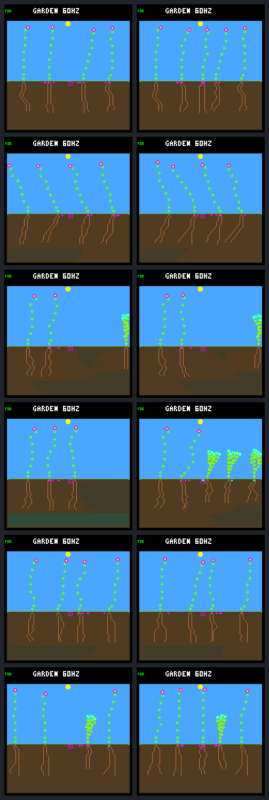
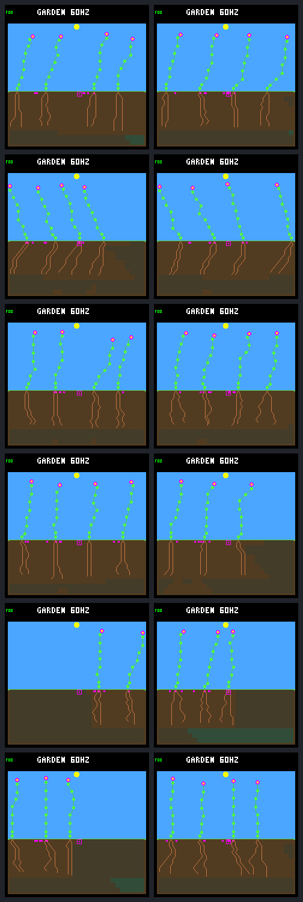

# Water eligible arbitration results

**The screen fails.** Selecting among water-eligible proposals removes the
observed arbitration blockage and slightly increases late first-day survivors,
but seasonal renewal gets worse. It also fails retention against ordinary
behavior. Keep this as host-only evidence; do not promote it to training or
firmware defaults.

This implements the single change proposed by the [streak diagnosis](landing-stalls.md),
under the predeclared [protocol](landing-arbitration-protocol.md). Twelve worlds
use the same six frozen neural models, ordinary ecology and unchanged scoring
through Garden day 192. Both arms enforce the same first-day water reserve.
The veto control chooses first and may replace the winner with WAIT; treatment
chooses the highest-ranked proposal that passes the water check.

## What changed in selection

There is no root bonus, energy guard or resource credit. Genuine neural WAIT
proposals remain eligible. Priorities retain their full int16 range and the
normal first-wins tie order. If every bid is refused, the original top proposal
becomes WAIT. Only the selected winner advances memory; candidate ordering,
nonce advancement and growth cadence remain unchanged.

Among the treatment's late-born children, **252 decisions switch away from the
original top bid**, affecting 61 children. Of those, 114 execute root extensions
and 138 select genuine neural WAITs. None switches to a shoot or tip finishing.
Those root extensions all have an available destination and reconcile with
actual node additions. The WAIT choices are not discarded by the filter.

Forced WAIT fallbacks fall from 1,282 to 70. In the veto control, 807 fallbacks
have some eligible alternative, including the previously measured 680 with a
funded wetter-root bid. In treatment, **no fallback has an eligible alternative**.
These counts describe different trajectories and exposure: 5,533 versus 3,880
late-child decisions. They are not 1,212 individually matched rescues.

## Establishment improves but recruitment changes

Late births are in (62,190] Garden days and receive complete first-day follow-up.
Ordinary behavior is the pinned archived baseline, not a third newly tuned arm.

| Late first-day cohort | Ordinary | Water veto | Eligible selection |
|---|---:|---:|---:|
| Births | 127 | 135 | 101 |
| Survivors | 55 | 60 | 62 |
| Water-only deaths | 43 | 28 | 8 |
| Energy-only deaths | 22 | 35 | 19 |
| Combined resource deaths | 7 | 12 | 12 |
| Steady-climate survivors | 4 | 1 | 1 |
| Seasonal survivors | 51 | 59 | 61 |

The treatment has fewer births as well as fewer deaths. Do not interpret the
death-count differences as direct conversions from failure to survival.
At the same one-eighth-day age, before any of these children dies, 69/135 veto
children have expanded roots, versus 71/101 treatment children. This supports
earlier root acquisition in the resulting cohorts, not a matched-child causal
estimate. First-day growth-water spending totals 16,465 versus 13,410 units;
all energy and water accounts reconcile, including upkeep, reproduction,
overflow and death discard.

Qualifying renewal confirmations use **confirmation time** in (62,190], not
birth time. They rise from 58 to 60 versus the veto control, but steady climate
still contributes only one. These counts cannot override a score regression.

## Why the renewal gates fail

The lexicographic key remains `[minimum terminal tier, summed terminal tiers,
sum of each world's weakest-period credit, total credit]`. Credit is measured
in logic ticks under the unchanged bounded-age renewal objective.

| Climate | Ordinary key | Veto key | Eligible key |
|---|---|---|---|
| Steady | `[1,24,0,456540]` | `[1,24,0,182880]` | `[1,24,0,250740]` |
| Seasonal | `[1,24,837480,5699160]` | `[0,23,867480,6183360]` | `[0,23,601350,5951190]` |

Treatment improves the steady key over the veto but remains below ordinary
behavior, with one rather than four late survivors. The seasonal key regresses
against both baselines. Across individual worlds it wins five, ties two and
loses five against the veto; against ordinary behavior it wins five and loses
seven. No arm reaches biological emptiness: living plants or banked seeds remain.
That is a weaker condition than continued established-descendant presence.

The seasonal single /34 case gains late survivors, 10 → 13, yet introduces a
day-128 checkpoint with **no established descendants**. At that checkpoint it
has two young descendants and three pending seeds, not an empty world. The
veto control retains two established descendants there. Conversely, treatment
removes the veto's day-128 gap in seasonal single /35. The failure moved; it
did not disappear across the panel.

The /35 cases also illustrate why aggregates need their individual results:
single /35 seasonal survivors fall 17 → 8, while multi /35 rises 7 → 16.
All cases and contrary outcomes are retained. Descendant IDs are not matched
between diverged arms.

## Screenshots and evidence

Both sheets show every day-192 frame: veto left, eligible right; rows are
single /33, multi /33, single /34, multi /34, single /35, multi /35. Visual review
found valid complete frames. Endpoint images cannot establish uninterrupted
renewal or reveal an earlier day-128 gap.

The [portable results](landing-arbitration-results.json.gz) retain complete
lineage/seed histories, resource accounts, every queried first-day descendant
bid, shared input memory, proposed and committed output memory, winners and
all unchanged score calculations. Twelve veto controls exactly reproduce the
historical guarded biology, resource traces, selected water receipts and pixels.
Traced, untraced and repeated traced runs match in every case.
Independent frozen verification with one worker reproduces all twelve pairs,
both trace streams and pixels exactly, and rechecks 461 artifact hashes. The
[compact summary](landing-arbitration-summary.json) retains per-case metrics,
both baseline comparisons, selection counts and evidence fingerprints.

The complete ordinary UBSan host suite passes **151/151 CTests**, including the
new native selection tests and five Python tests. Coverage includes priority
extremes, ties, real WAIT, all-refused fallback, age/founder boundaries,
winner-only memory, strict CLI identities, no-clobber, trace corruption, complete
rollback, old-mode compatibility and reconstruction of portable evidence.
The optional eligibility hook is host-only and absent from Zephyr builds.

Reproduce with the [Make target and verification command](../../docs/garden-landing-arbitration.md).
The frozen bundle is `artifacts/garden-landing-arbitration-v1`; it preserves the
binary, cache, sources, tools, inputs, protocol, raw traces and all 24 frames.
Portable result SHA-256:
`7e3a88e1077f0944b84c412675a6bfabc1b531da6bf21844f62be68ac7b4bec7`.

## Follow-up

The [completed saved-history diagnosis](landing-turnover.md) now separates the
generation gap, first-day failures and long seed-site blockage, without a new
policy or simulation. Its next proposal is adult resource accounting.

Removing this arbitration blockage is not sufficient for sustained renewal;
it does not identify the cause of each long-term regression. Preserve the
objective and controls. No extra guard, threshold change or retraining follows
automatically from this negative screen.
