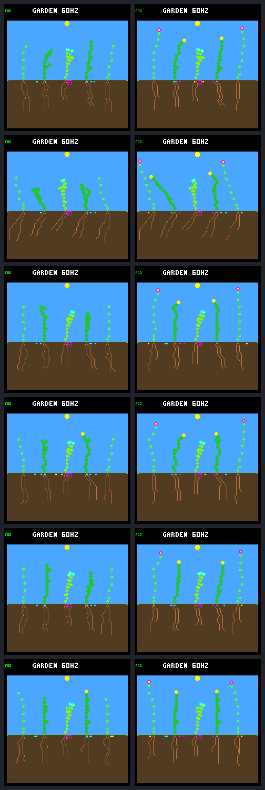
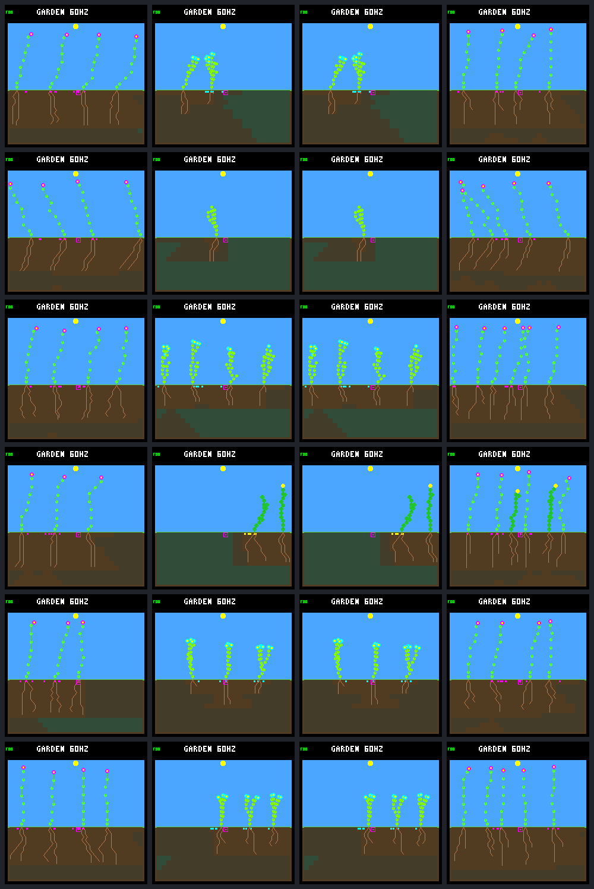

# Shoot reservation restores flowers, but loses seasonal renewal

Reserving construction space for a complete shoot fixes the capped founders'
flowering failure: **all 22 flower founders form flowers and produce seeds**,
up from two under the original 32-node cap. It retains the cap's zero founder
deaths in the first two days, versus 41 energy deaths without a cap.

That is not an overall improvement. Seasonal late offspring surviving their
first day fall **107 → 41**, and four evaluation periods lose all renewal
credit. Steady renewal remains stalled. The candidate fails the unchanged
screen against every baseline and stays host-only; no device policy, model,
ecology default or score is promoted.

## Fixed comparison

The [protocol](landing-budget-protocol.md) was frozen before collection.
The same twelve model/world pairs run for 192 Garden days in four arms:

| Arm | Construction rule |
|---|---|
| Unlimited | Existing uncapped, water-eligible policy |
| Projected 32 | Existing cap: allocating EXTEND at the limit becomes WAIT before ranking |
| Eligible 32 | Allocating bids beyond 32 nodes are ineligible before ranking |
| Reserve 32 | Eligible 32, plus space reserved for the deepest active shoot |

The reservation uses the selected shoot's actual, genome-adjusted maximum
depth, not just the minimum flowering threshold. Other growth must leave enough
nodes to complete that path. A formed flower releases the reservation.
The rule neither forces FINISH nor grants resources, changes neural priorities
or memory, or consumes an extra random draw. It preserves existing water
eligibility and the original-winner WAIT fallback when every bid is ineligible.

The eligibility-only control isolates the changed arbitration from reservation.
Its normalized complete results and endpoint pixels match projected 32 in
**all twelve worlds**. The two controls are therefore combined in the results
tables below; their experimental identities remain distinct.

## Construction and early survival

Founder construction is observed through day 64; early resource accounts cover
the first two days. Seed and lifetime ledgers continue through day 192.

| Metric | Unlimited | Both 32-node controls | Reserve 32 |
|---|---:|---:|---:|
| Steady flower founders forming flowers | 10/10 | 2/10 | 10/10 |
| Seasonal flower founders forming flowers | 12/12 | 0/12 | 12/12 |
| Steady flower-founder seed purchases through day 64 | 56 | 12 | 46 |
| Seasonal flower-founder seed purchases through day 64 | 87 | 0 | 42 |
| Founder deaths through day two, both climates | 41 | 0 | 0 |
| Steady founders alive at day 192 | 6 | 26 | 26 |
| Seasonal founders alive at day 192 | 0 | 0 | 0 |

All reserved flower founders form their first flower before one quarter of a
Garden day. They subsequently buy seeds, so this is not merely cosmetic
flowering. The original construction diagnosis was actionable within the same
32-node maintenance budget.

The fixed day-two panel shows eligible 32 on the left and reserve 32 on the
right. Rows are single /33, multi /33, single /34, multi /34, single /35,
multi /35. Magenta flower tips appear in the reserved seasonal bodies.



The [steady day-two panel](frames/landing-budget-steady-day2.png) uses the same
column and row ordering.

## Renewal still fails

Late births and their first-day survival use the unchanged (day 62, day 190]
birth cohort. Each climate has six worlds and four late evaluation periods per
world. A first-day survivor is not automatically a durable reproductive parent.

| Metric | Unlimited | Both 32-node controls | Reserve 32 |
|---|---:|---:|---:|
| Steady late births | 3 | 16 | 1 |
| Steady late first-day survivors | 1 | 1 | 0 |
| Steady late renewal confirmations | 1 | 0 | 0 |
| Steady zero-credit periods, of 24 | 18 | 24 | 24 |
| Seasonal late births | 98 | 184 | 65 |
| Seasonal late first-day survivors | 61 | 107 | 41 |
| Seasonal late renewal confirmations | 59 | 107 | 41 |
| Seasonal zero-credit periods, of 24 | 0 | 0 | 4 |
| Seasonal total credited ticks | 5,951,190 | 8,204,760 | 5,153,025 |

All six paired seasonal renewal keys lose against either capped control.
The steady keys tie at zero credit, but the candidate also loses the controls'
one late first-day survivor. No candidate world becomes biologically empty;
living plants alone do not satisfy the renewal objective.

The aggregate seasonal key does beat unlimited because the unchanged
lexicographic score prioritizes terminal coverage over credited duration.
That does not override the lost seasonal survivors or failed steady retention.
The complete screen fails separately against eligible 32, projected 32,
unlimited, the archived water-veto baseline and ordinary behavior.

### A different succession pattern, not restored diversity

The seasonal species partition makes the trade-off visible:

| Species | Late first-day survivors: eligible 32 → reserve | Seed purchases through day 192: eligible 32 → reserve |
|---|---:|---:|
| Flower | 0 → 36 | 0 → 299 |
| Shrub | 7 → 5 | 48 → 40 |
| Ground cover | 100 → 0 | 399 → 42 |

Reserved worlds finish with five flower-only populations and one flower/shrub
population. The control finishes with five ground-cover-only populations and
one shrub-only population. These are living species, not seed-bank diversity.
The histories establish changed population composition; they do not establish
whether shade, landing competition or another mechanism causes the lost
ground-cover recruitment.

At day 192, columns are unlimited, projected 32, eligible 32 and reserve 32;
rows follow the day-two ordering.



The [steady endpoints](frames/landing-budget-steady.png) use the same ordering.
All four contact sheets were visually inspected. Endpoint appearance is not a
substitute for the lifetime and renewal records.

## Next question: why do available seeds not recruit?

All four candidate zero-credit periods are the final (day 158, day 190] period:
single /33, multi /33, single /35 and multi /35. Each has eight new seed
purchases in that interval but no births; each still has living plants at
day 192. This narrows the next question beyond whether flowers can make seeds,
without yet identifying the germination blocker.

Next propose a bounded, offline audit of those saved seed lifetimes and
recruitment checks, retaining both /34 worlds as counterexamples. Separate seed
supply, mature blocked checks, actual births and first-day losses. Credit can
carry into a period from earlier births: multi /34 retains some credit despite
having no births in this same final interval.

Do not raise the cap, force flowering, retune the score or launch another
training run from this result. Restored fertility also has not solved the
separate steady founder-occupancy stall.

Follow-up: the [completed offline germination audit](landing-budget-germination.md)
finds living-neighbor spacing at every mature check in the four zero-credit
periods. The two other worlds' remaining credit is entirely carried in from
older plants; neither produces a new first-day survivor in the final period.

## Verification and reproduction

All 48 full histories retain complete score, seed and lifetime accounting.
Both new arms match repeated traced replays and untraced endpoint results and
pixels. Both legacy arms reproduce archived results, founder/resource traces
and pixels exactly. The observer records same-state proposals without another
policy call; independent analysis checks leader selection, remaining space,
eligibility arithmetic and actual founder node changes after arbitration.

The [portable result](landing-budget-results.json.gz) recomputes founder,
resource, species and score accounts plus all unchanged gates offline.
Full-bundle verification also checks all **386 retained artifacts**, including
the frozen executable, models, input archives, source snapshot, settings,
protocol, raw traces and images. Outputs are no-clobber.

```sh
make host-screen-landing-budget \
  GARDEN_LANDING_BUDGET_OUT=artifacts/new-landing-budget
docker compose run --rm -T firmware python3 -W error sim/garden_landing_budget.py \
  --verify benchmarks/garden-seasons/landing-budget-results.json.gz
# Also verify all files in the retained local bundle:
docker compose run --rm -T firmware python3 -W error sim/garden_landing_budget.py \
  --verify artifacts/garden-landing-budget-v1
```

Native tests cover cap/reservation boundaries, actual arbitration, unchanged
decisions and memory semantics, genome-adjusted depth, nonallocating cleanup,
formed-flower release, invalid inputs and transactional rollback. Python tests
cover identities, exact repeats and pixels, clipped trace windows, corrupted
receipts, CLI/file safety, and complete frozen-panel regression assertions.

All **158 ordinary host CTests pass** under UBSan (248.66 seconds), including
the new five-case Python suite's full portable-panel verification. Changed-C
formatting, `git diff --check`, and Make help/dry-run checks pass. The retained
local test log is `artifacts/garden-budget-validation.log`.

- Portable result SHA-256:
  `bad5297fa26ad52b93a899e3d0f0fcd3255a6b5e214e1120f68bc3902e455640`.
- Full bundle manifest SHA-256:
  `35ee02313a8ed5adb0ad86ce31094b5109941d50bccbd3de3f6eaebc27bf8ec2`.
- Frozen host executable SHA-256:
  `7fa193f6345e57ee692514ba3d1adf52c470a41bf86b0302e8a2b661d6140279`.

This is a reused exploratory panel, not unseen validation. There was no
training, device flash or measurement of device runtime cost.
