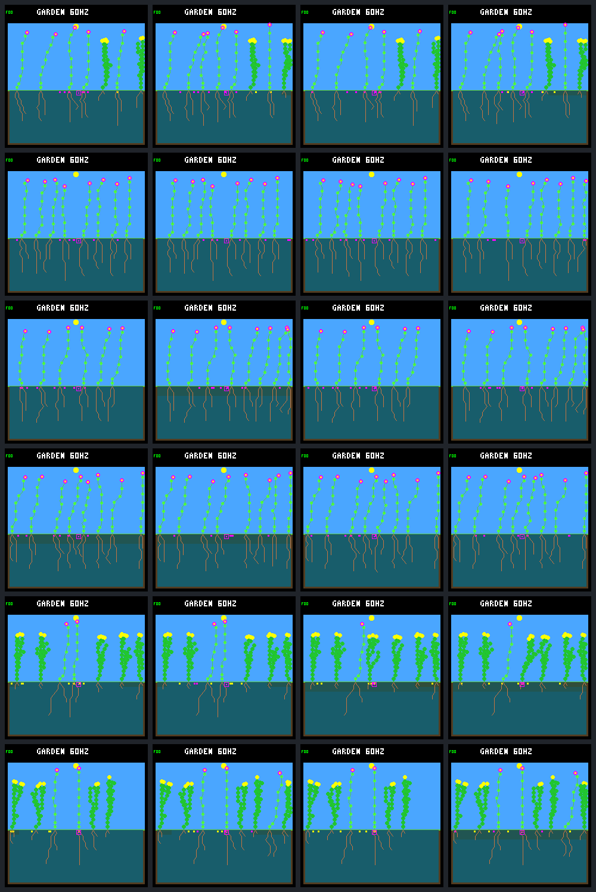

# Competitive turnover preserves populations but renewal remains sparse

All twelve gardens meet the predeclared population-viability floors through
day 512, but **none passes sustained renewal**. The purchase cursor produces
four 32-day survivors in the primary birth cohort versus two under fixed order.
However, no plant born after day 384 produces a child by day 512 in either arm.
Existing species and founder families remain represented throughout the interval.

The [protocol](landing-competitive-renewal-protocol.md) allows individual deaths;
the failure here is repeated descendant reproduction, not an adult-survival veto.
The [earlier cursor comparison](landing-seed-cursor.md) retains its original
failed harm gate. Neither result promotes a rule, qualifies the environment for
training or changes ordinary host/PicoSystem behavior.

## Same histories and eight more seasonal cycles

The comparison follows the same six paired W2 histories from days 384 to 512,
128 added Garden days. The original fifteen dieback sweeps still end on day 304;
there are no new imposed deaths, gardener actions or irrigation. Fixed order
and the cursor activated after day 320 retain their original settings and state.
Model, weather, resource/construction guards, capacities and seed lifetime are
unchanged. Only the host replay bound and help extend from 384 to 512 days.

All 60 planned calls complete with no retries:

- Twelve day-384 anchors reproduce the saved results, ledgers and pixels exactly.
- Twelve day-448 and twelve day-512 runs preserve their earlier ledger prefixes.
- Twelve endpoint repeats reproduce results and pixels exactly.
- Twelve capture-free endpoint runs reproduce everything except the absent
  framebuffer CRC, as declared.

This is a development panel of three seeds, each with two layouts sharing its
weather history. It is not twelve independent environments or a held-out test.

## Survival without sustained renewal

Primary births fall in `(384,480]`, split into three consecutive 32-day windows.
Each therefore receives complete potential follow-up through age 32 by day 512.
The renewal criterion requires a 32-day survivor in every window and a direct
parent–child pair whose two members are both born in that cohort and survive
32 days. No world satisfies either requirement across the complete window panel.

Counts below are **fixed / cursor**. S1, S2 and S3 are seeds `3a7e45e6`,
`366928c6` and `275c8982`, respectively.

| Garden | Primary births | Primary 32-day survivors | Day-512 living plants |
| --- | ---: | ---: | ---: |
| S1 ordinary | 2 / 1 | 1 / 1 | 7 / 8 |
| S1 crowded | 0 / 0 | 0 / 0 | 8 / 8 |
| S2 ordinary | 0 / 2 | 0 / 1 | 6 / 8 |
| S2 crowded | 1 / 2 | 1 / 2 | 8 / 8 |
| S3 ordinary | 0 / 0 | 0 / 0 | 7 / 7 |
| S3 crowded | 0 / 0 | 0 / 0 | 6 / 8 |
| Total | 3 / 5 | 2 / 4 | 42 / 47 |

There are three later births under fixed order and four under the cursor.
All seven remain alive at the endpoint but lack 32 days of potential follow-up;
they are censored, not failures. Confirmed survivors need not remain alive at
the endpoint: the fixed S1 ordinary survivor and cursor S1 ordinary survivor
both die after reaching age 32.

All populations stay between six and eight living plants throughout the
extension, above the four-plant mean/endpoint floors. Every 16-day block passes
the population threshold. Both arms have eight natural deaths, including five
plants alive at day 384. Two fixed-order deaths and one cursor death occur by
age 32; older deaths and successful replacements remain in the record.

All three initially multi-species gardens retain at least two species, and
all five initially multi-family gardens retain at least two founder families.
No baseline species or family has even a temporary living-representation gap.
This is retention of the existing diversity, not recovery of species already
absent on day 384 or diversity of neural controllers; every controller is W2.

## The next generation is still missing

The complete ledgers distinguish purchase access from seed establishment:

- None of the three primary-cohort fixed-order recruits buys a seed.
- Three of the five primary-cohort cursor recruits buy seeds: five purchases
  total, four expired without germinating and one still pending at day 512.
- Neither arm has any child of a post-day-384 recruit, including births after
  the primary cutoff. The pending seed is unresolved, not a failed germination.

Across all parents, fixed order buys 197 seeds during the extension and the
cursor buys 198. The issue is not simply total seed spending. Cursor gains in
durable recruitment occur in the two S2 layouts, which share a seed; neither
arm earns the protocol's broad renewal signal or demonstrates an advantage
in the number of renewal-passing worlds.

The next bounded step is an **offline recruit-to-seed-to-child audit** of these
saved ledgers: separate recruits with no purchases from seeds that expire,
align seed lifetimes with population vacancies, and retain the pending seed's
censoring. Eight living plants prove capacity blocking, but fewer living plants
do not prove that stored dead slots have been reclaimed. The subsequent
[completed audit](landing-recruit-seeds.md) also uses recorded base columns to
prove a living-neighbor spacing blocker. Other light, water and purchase-eligibility
conditions need a trace. Any necessary passive trace should target the remaining question,
not repeat another broad full-history collection or tune thresholds after seeing
the outcomes. No protection rule, larger pool or training run is introduced here.

## Fixed screenshot panel

Rows follow the six gardens in the table. Columns are day-448 fixed, day-448
cursor, day-512 fixed, day-512 cursor. All 24 frames are retained, with no
best-looking selection. The [day-384 panel](landing-seed-cursor.png) is the
earlier reference. The screenshots show occupation and shapes, not proof of
continued reproduction; the lifetime ledgers supply that distinction.

## Evidence and validation

The [portable result](landing-competitive-renewal-results.json.gz) retains every
call, complete lifetime/seed ledgers, derived metrics, comparison and source
identities. The [tool guide](../../docs/garden-landing-tools.md#competitive-renewal-follow-up)
provides fresh collection and offline verification commands.

Validation passes:

- All 60 research calls, prefix checks, repeats and capture-free comparisons.
- Nineteen focused tests covering interval arithmetic, survival boundaries,
  censoring, posthumous offspring, ancestry, diversity, population floors,
  invalid histories, altered results and missing calls.
- The four focused research CTests, three ordinary-host CLI/metric CTests,
  and two earlier energy/shade CTests. The ordinary host and research builds
  compile successfully; the new focused target is rerun after publishing data.
- Full offline bundle verification with native process execution blocked,
  including regenerated PNG/gallery bytes. Independent ecology-step census
  sums, age-32 cohorts and species checkpoints agree in all twelve endpoints.
- Formatting of the changed C file, shell syntax and `git diff --check`.

A post-capture verifier check rejects relabeling a new natural death as an
unreceipted imposed death. It changes no metric or result; the original source
snapshot, protocol, executable, model, manifests and capture remain untouched.
The pre-existing cursor C test differs from the older snapshot only in line
wrapping; standalone test executables are not part of the replay runtime check.
No firmware rebuild, device flash or new resource-budget trace was needed.

The local bundle `artifacts/garden-landing-competitive-renewal-v1/` contains
30,796,324 file bytes (about 29.4 MiB). Its source archive is 2,360,399 bytes:
actual build/analysis inputs, excluding generated trees and unrelated historical
datasets. The published result and gallery add 308,291 and 43,000 bytes.
No earlier evidence was deleted or overwritten.

| Identity | SHA-256 |
| --- | --- |
| Frozen protocol | `e9ae9a1479547b5f489f9ed06d20322a2c5ede632dbd745154fa490e571b3539` |
| Portable result | `099d2550d8037b3148b9c135a53b3fe3d5e971151234fa540ad8dbc6231073dc` |
| Local bundle manifest | `4402ad5be09ed19542d303a83015e81e376cd1b9a7efd40350eea11ac319e205` |
| Review gallery | `baf2c6171067793d38fdf6bf5bb7cd335d34f1b0ac01b3d81eb9f003c0ee2cf7` |
