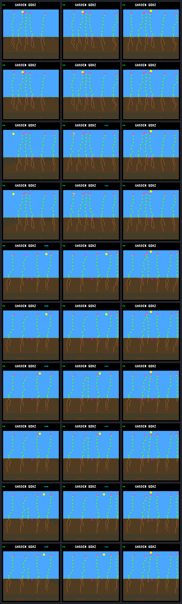

# Continuous energy protection results

Removing the first-day cutoff extends the remaining failure from 1.4453125 to
2.5703125 simulated days, but does not rescue it through day 256. The four
surviving cases retain identical physical histories and checkpoints. None of the
five focal plants produces seeds. This isolates a useful boundary problem without
demonstrating autonomous renewal or qualifying a population policy.

The [prospective protocol](landing-continuous-energy-protocol.md) fixed five
independent pairs and forty native calls. All forty completed, including the
predeclared repeats; no rule tuning or additional experiment runs were performed.
Only the duration of the two existing energy checks changed. Water protection,
the birth-time root purchase, formulas, costs and controller stayed unchanged.
No firmware or default behavior changed.

## Five paired outcomes

| Case | First-day protection | Continuous protection | Focal seeds |
| --- | --- | --- | ---: |
| Fixed 45 | Alive at age 32.078125 days | Unchanged | 0 → 0 |
| Fixed 46 | Alive at age 20.16796875 days | Unchanged | 0 → 0 |
| Rotating 48 | Alive at age 21.8515625 days | Unchanged | 0 → 0 |
| Rotating 49 | Dies at age 1.4453125 days | Dies at age 2.5703125 days | 0 → 0 |
| Rotating 50 | Alive at age 19.875 days | Unchanged | 0 → 0 |

Survivor ages are censored by the world-day-256 endpoint. These are separate
paired worlds, not five simultaneous interventions. All historical controls
reproduce the previous afternoon candidates, including complete traces and
pixels. All repeat captures agree exactly. In the four unchanged pairs, scope
annotations and configuration identities differ, but physical observations,
forecasts, actions, resources, checkpoints and pixels do not.

## The second night is funded but the third is not

The first changed choice remains the former cutoff: tick 910410, ecology age
257, sun phase 86. The preceding 256 focal samples agree, as do raw proposals
and pre-action resources at that tick. The control buys its seventeenth node;
the continuous candidate waits because the stores-only margin is −5. One step
later, after receiving seven more energy, its margin is +2 and it buys that node.

The candidate then delays the twenty-fifth node until phase 124, when its
stores-only margin is exactly zero. Equality is permitted by the frozen rule.
It reaches the second sunset with 128 energy and pays exactly 128 through dawn,
without growth or energy shortage during that interval. It starts dawn empty,
experiences six early-morning energy-shortage payments, and recovers before the
stress threshold kills it.

| Candidate event | Tick | Sun phase | Nodes | Stored energy |
| --- | ---: | ---: | ---: | ---: |
| Former cutoff purchase rejected | 910410 | 86 | 16 | 133 |
| Seventeenth node bought | 910425 | 87 | 17 | 131 |
| Twenty-fifth node bought | 910980 | 124 | 25 | 132 |
| Second sunset | 911040 | 128 | 25 | 128 |
| Next dawn | 912960 | 0 | 25 | 0 |
| Third sunset | 914880 | 128 | 32 | 72 |
| Third-night first energy shortage | 916020 | 204 | 32 | 0 |
| Death after eight shortage payments | 916440 | 232 | 32 | 0 |

Its next daylight interval earns 260 energy, pays 107 in maintenance and spends
81 on nine paid actions, leaving 72. Those actions include seven node additions
and two FINISH actions. None increases the maintenance rate: both 25 and 32
nodes cost four energy per payment. Thus the extra afternoon condition does not
apply, while the original income-credit forecast permits each purchase.

The last purchase at tick 914415, phase 97, is especially diagnostic. It grows
from 31 to 32 nodes and leaves 86 energy. The forecast credits 75 future income,
subtracts 32 daylight upkeep and predicts 129 at sunset, sufficient for the
128-energy night. Only 18 income actually arrives: `86 + 18 − 32 = 72`.
There is no subsequent growth, reproduction, overflow, discarded energy or
maintenance error in that interval. The full 57-energy prediction error is
overestimated income. During the third night there is no income or growth;
72 is paid in maintenance before energy runs out. Water is not the limiting
resource: 433 water is discarded at death after that tick's upkeep.

The continuous candidate changes 181 arbitration choices relative to applying
the old cutoff to its own proposals. Only the first is a matched-state causal
comparison; later bodies and resource histories have already diverged. The
complete focal history remains in the portable evidence, not just the first
two days.

## Population effects and remaining uncertainty

Rotating 49's extra 4320 logic ticks increase closing-window live credit from
510045 to 514365. Confirmations remain one, replacement parents with a confirmed
child remain six, and the focal plant has no seed production. Other plants'
recorded lifetimes and seed counts, the complete seed ledger, end population
and final pixels are unchanged. All four other pairs remain physically identical
to their controls. Therefore this comparison improves one short lifespan, not
renewal or the final population.

The second night also exposes a separate limitation: funding through dawn does
not fund the dim interval before photosynthesis becomes useful. The candidate
survives that interval here, so it is not the immediate fatal event. It still
belongs in the forecast audit rather than being hidden by endpoint survival.

Simply applying the stores-only test to every paid afternoon action is not yet
supported. Applying that arithmetic to the saved candidate decisions, excluding
the birth purchase, gives these counts:

| Case | Paid afternoon actions | Actions with negative stores-only margin |
| --- | ---: | ---: |
| Fixed 45 | 20 | 0 |
| Fixed 46 | 8 | 0 |
| Rotating 48 | 16 | 1 |
| Rotating 49 | 25 | 14 |
| Rotating 50 | 20 | 9 |

The broader condition would reject purchases on two successful trajectories as
well as the failure. That is a same-history arithmetic check, not proof those
survivors would fail under a new rule; their subsequent decisions would change.
It argues against assuming a broader prohibition is harmless.

## Next investigation

Audit the future-income estimate using the full saved histories, including
successful spending. The current heuristic credits half the latest income for
each remaining pre-sunset step. Actual leaf income uses integer `light / 64`,
and light varies with sun angle, season and shading. A smooth income estimate
can therefore remain positive after useful photosynthesis has stopped.

Separate quantization and dim-light effects from shade/body changes, and compare
a daylight-aware estimate against both successful and failed decisions before
choosing another counterfactual. The available receipts establish the income
error, but do not yet attribute all 57 missing energy to one lighting mechanism.
Keep morning growth, early-dawn shortages and later spending visible. Do not
introduce another arbitrary expiry, resource subsidy or species-specific fix.
This investigation is not part of this comparison. The subsequent
[offline daylight audit](landing-light-audit.md) now completes it without new
simulations: 50 of the 57-energy error is assigned to globally unproductive
light. A daylight-aware correction reduces that error but risks restricting
successful growth. The subsequent [paired counterfactual](landing-daylight.md)
now keeps the failure alive through day 256, with all previous survivors retained;
it still leaves dawn shortages and no focal reproduction.

## Evidence and reproduction



Rows are fixed 45, fixed 46, rotating 48, rotating 49 and rotating 50, control
then candidate. Columns are the post-root state, first-day checkpoint and day
256. Final screenshots match in every pair; they do not reveal the longer
intermediate survival of rotating 49. The full histories provide that evidence.

`make host-probe-landing-continuous-energy` repeats the fixed experiment using
a fresh `GARDEN_LANDING_CONTINUOUS_ENERGY_OUT`. It requires the pinned afternoon
raw bundle. To verify the saved [portable results](landing-continuous-energy-results.json.gz)
or raw capture without simulating:

```sh
docker compose run --rm -T firmware python3 sim/garden_landing_continuous_energy.py \
  --verify benchmarks/garden-seasons/landing-continuous-energy-results.json.gz
docker compose run --rm -T firmware python3 sim/garden_landing_continuous_energy.py \
  --verify artifacts/garden-landing-continuous-energy-v1
```

| Artifact | SHA-256 |
| --- | --- |
| Portable results | `143cfbb3a1064cadbe0b46b8c0907684928e7e2dc7e54b0a0502324648c3d1b5` |
| Raw manifest | `5b091e2e033fca3a0ceaeb1669646bff698fb23f675354b82ddf561ae16fa4a0` |
| Protocol | `35630a817f8cb1ebb7a7a9803330b82117c39f5e4638fd92511c53753e7c16ee` |
| Native executable | `851bc11a95ca3e58dbc1f15f61f3ca612f6951b727e1235a96e75f826c5bee4c` |
| Build configuration | `f93e432ba3d6c2704864bf10ffb3dddcc93e442878d605864862a5180184b0e6` |
| Screenshot gallery | `bc262bdb16ac8d8e620116750186bc9fe4db1551f5fcd15854fcef0cbebbf75c` |

The complete raw-bundle offline reanalysis passes. The full host suite passes
178/178 in 324.11 seconds at four workers, and all ten focused tests pass after
capture. The focused tests cover unchanged
formats and defaults, scope beyond age 256 and saturated observation age,
wrong lineage/birth/dead/founder exclusions, configuration errors, repeat and
resource corruption, complete lifetime coverage and the saved forecast error.
The source, executable, build configuration and protocol used for capture are
retained in the raw bundle; postcapture outcome tests do not change that snapshot.
