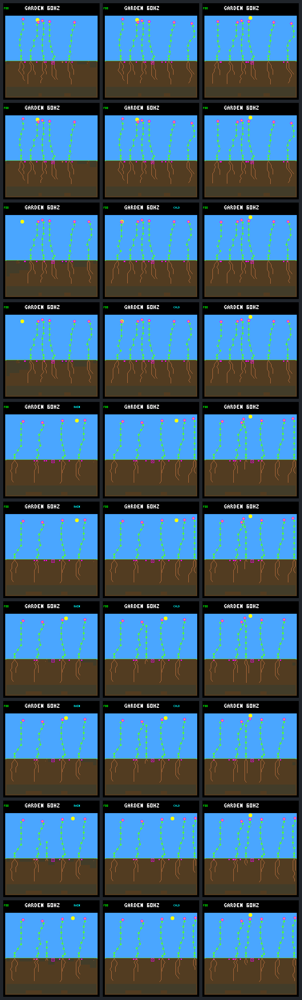

# Dawn reserve spending results

The afternoon reserve removes all eleven energy-shortage payments on rotating
49, retains all five survivors, and reduces the existing water shortages on
rotating 50. It also changes growth and root geometry. All five focal plants
still produce zero seeds; population life/seed ledgers and closing-window credit
are unchanged. This supports a candidate spending guard, not autonomous renewal
or a qualified population policy.

The [prospective protocol](landing-dawn-protocol.md) fixed five independent pairs
and forty native calls. All forty completed, including exact repeats. Control
is the previous daylight candidate. The only new condition reserves post-action
upkeep through estimated productive morning light, rounded up to a payment
boundary. It uses current global attenuation and the known daily curve, never
future weather, income or bodies. An unavailable estimate rejects the paid
afternoon bid; no active bid in this capture encountered that case.

Birth purchases, first-day water protection, morning behavior, prices, capacities,
weather, controller weights and earlier conditions remain unchanged. Only the
named living offspring is protected, not every plant or its descendants. There
was no tuning, training, extra experiment, firmware flash or default-policy change.

## Five paired outcomes

| Case | Energy-shortage payments | Water-shortage payments | Growth outcome with the dawn guard |
| --- | ---: | ---: | --- |
| Fixed 45 | 0 → 0 | 0 → 0 | Physically unchanged |
| Fixed 46 | 0 → 0 | 0 → 0 | Physically unchanged |
| Rotating 48 | 0 → 0 | 0 → 0 | Physically unchanged |
| Rotating 49 | 11 → 0 | 0 → 0 | Earlier flower; same final 32 nodes/16 roots |
| Rotating 50 | 0 → 0 | 6 → 4 | Later flower; final 31 → 29 nodes, 15 → 13 roots |

Every focal plant survives through world day 256, with zero seeds in both arms.
Their censored ages are respectively 32.078125, 20.16796875, 21.8515625,
19.9140625 and 19.875 days. These are separate paired worlds sharing a selected
weather/model context, not independent environments or simultaneous protection
of five plants. The first three retain identical physical histories.

Shortages count actual maintenance-payment events, not repeated samples of a
persisting flag. Rotating 49's unpaid energy falls from 38 units to zero.
Rotating 50's unpaid water falls from 11 units to seven. No new energy or water
shortage episode appears in the other cases.

## Rotating 49: lower night cost, not more sunset energy

The first changed choice is tick 910425, phase 87, after 257 identical focal
samples. Both plants have 140 energy and 16 nodes. The control buys a stem
extension, increasing maintenance from two to three. Its stores-only margin is
two energy; the new dawn reserve is fifteen, making that margin −13. The
candidate makes the same stem extension at 910455, two ecology steps later.
The projected-income margin alone would have allowed it.

This changes subsequent growth and income. The candidate reaches sunset with
one fewer root and stays below the next maintenance threshold:

| Energy balance from the common pre-action state | Control | Dawn candidate |
| --- | ---: | ---: |
| Starting stores at 910425 | 140 | 140 |
| Subsequent income through sunset 911040 | 103 | 91 |
| Subsequent upkeep through sunset | 34 | 32 |
| Growth spending, including first choice | 81 | 72 |
| Sunset stores | 128 | 127 |
| Sunset nodes / roots | 25 / 10 | 24 / 9 |
| Night maintenance paid | 128 | 96 |
| Stores after dawn 912960 | 0 | 31 |

There is no overflow or reproduction spending in that interval. The candidate
enters night with one less energy, but its smaller body saves 32 in upkeep.
It pays every morning bill. This is not an energy grant; nor does every later
difference correspond to a directly rejected control purchase. The early delay
changes which later actions the existing checks can afford.

At the next sunset, 914880, both have 27 nodes. The control carries 126 energy
against 128 nominal night upkeep; the candidate carries 146. They arrive at dawn
916800 with zero and eighteen respectively. The candidate funds that dim morning
too, including 917040 when the control remains short. Peak focal stress falls
from six to zero across the captured life.

The candidate flowers at 913875 instead of 914325: thirty ecology steps earlier,
despite the initial delay. Both reach 32 nodes at 917535 and end with 16 roots,
eight leaves, one flower, 252 energy and 510 water. Root geometry and flower node
indices differ. Forty candidate-state arbitration choices differ when removing
only the dawn condition; only the first has a paired identical-state interpretation.

## Rotating 50: a morphology tradeoff

The first changed choice is FINISH at 910140, phase 68, after 228 identical
focal samples. Corrected projected sunset is 109; nominal night costs 96 and the
dawn reserve adds fifteen, leaving −2. The candidate forms the same flower at
910200, four ecology steps later.

The control's 24-to-25-node root purchase is at 910530; the candidate crosses
that threshold at 910590. Their destinations differ, so this compares diverged
worlds, not the identical root purchase replayed later. There are five changed
candidate-state choices. Root growth ends at 29 nodes/13 roots instead of 31/15,
with no active tips in either endpoint. Both retain eight leaves, one flower,
252 energy and 510 water.

From the common pre-FINISH state through sunset, both receive 310 energy. Growth
spending falls from 90 to 81 and upkeep from 54 to 53; sunset energy rises from
206 to 216. The existing water-shortage sequence shrinks from six payments at
910680..910980 to four at 910800..910980. Peak stress falls from six to four.
Both survive without energy shortages. Fewer roots are not a demonstrated failure
here, but the changed morphology cannot be called harmless under unseen drought,
shading or competition.

## Population and reproduction are unchanged

Every pair has identical complete life and seed ledgers, including other plants,
and identical recorded population outcomes and period credit. No diverged births
need parent/site matching here. Rotating 49 retains five endpoint living plants,
100 seed purchases and 573300 closing live-credit ticks. Rotating 50 retains six,
101 and 573150 respectively. Changed resource histories and pixels do not
establish a population-level gain.

At each focal endpoint, the eight-slot bank is the sole recorded reproduction
blocker. Rotating 49's otherwise-eligible bank-blocked visits rise from 320 to 332;
rotating 50's rise from 357 to 358. Neither produces a seed. The bank is not
necessarily the only lifetime limitation, and these results do not justify
changing its capacity alongside the spending policy.

## Next bounded step

Keep the candidate fixed and define a small population-level qualification panel:
apply the same protection to all eligible offspring, compare with a daylight-only
population control, and include fresh weather seeds plus the diagnostic world.
Preserve shortage counts, growth/body tradeoffs, durable offspring, reproduction
and matched population harm checks. Simultaneous protection changes competition;
these single-lineage results cannot predict that effect.

Do not keep tuning the five-case panel, change the bank, or promote a device
policy at the same time. The next question is whether resource-safe construction
generalizes; autonomous renewal and a useful training environment remain open.

## Evidence and reproduction



Rows are fixed 45, fixed 46, rotating 48, rotating 49 and rotating 50, control
then candidate. Columns are post-root T, T+3840 and day 256. The gallery was
visually inspected; the final pairs show changed root geometry. Receipts, not
pixels, establish the payment and maintenance effects.

`make host-probe-landing-dawn` repeats the forty-call experiment with a fresh
`GARDEN_LANDING_DAWN_OUT`. It requires the pinned daylight raw bundle;
`--reference PATH` relocates that input. Existing evidence verifies offline:

```sh
docker compose run --rm -T firmware python3 sim/garden_landing_dawn.py \
  --verify benchmarks/garden-seasons/landing-dawn-results.json.gz
docker compose run --rm -T firmware python3 sim/garden_landing_dawn.py \
  --verify artifacts/garden-landing-dawn-v1
```

| Artifact | SHA-256 |
| --- | --- |
| [Portable results](landing-dawn-results.json.gz) | `6c35b2c53f258d0521d7b773f551158fa75770ece81b0ec4564a0b825d1c6687` |
| Raw manifest | `7bc6a7953e3ac450400c765abea2804ad6c7eb6b450466bc5f01882bd0072987` |
| Protocol | `9ad39adee7ff22db9824479dc5e598fa6ea7c3d17f7fc6038cca8fec6d85d561` |
| Native executable | `96e9e760ba6ff7c1253479c7a2c871e575654a807df32568f4b6f629bfaacf5f` |
| Build configuration | `f93e432ba3d6c2704864bf10ffb3dddcc93e442878d605864862a5180184b0e6` |
| Screenshot gallery | `d84f17d6b022b2a66b222d38d92d303096e6f353c0469eca475581bf7549ad64` |

All 182 host CTests passed before capture (376.05 seconds, four workers), with
strict warnings and undefined-behavior checks. Native tests cover every valid
phase/strength/action combination, zero/negative margins, unavailable estimates,
large arithmetic, scope, identities and output preservation. Python tests cover
CLI ordering, invalid combinations, old traces, independent receipt arithmetic
and actual energy/water payments. All eleven dawn tests pass after capture,
including frozen outcomes and deliberate evidence corruption, without skips.

Complete raw and portable verification pass: all combined choices, historical
controls, exact repeats, first-effect prefixes and full focal histories. All
2279 archived source files match their recorded hashes. Source, executable,
configuration and protocol stayed frozen during capture; this report and the
outcome-specific regression tests were added afterward.
The six postcapture CTest entries for native root choice, afternoon, continuous,
daylight, dawn audit and dawn replay also pass (75.63 seconds, four workers).
