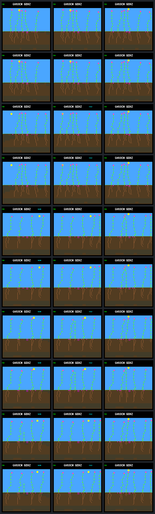

# Productive daylight spending results

The afternoon correction keeps the last failing plant alive through world day
256 while retaining all four previous survivors. It does not establish autonomous
renewal: all five focal plants still produce zero seeds, and the rescued plant
still experiences dawn shortages. The successful-growth risk case survives but
ends with one fewer root node.

The [prospective protocol](landing-daylight-protocol.md) fixed five independent
pairs and forty native calls. All forty completed, including exact repeats.
Control is the previous continuous-energy candidate. Treatment changes only
afternoon income credit, using current global light and the known daily curve
to exclude future steps estimated too dim for photosynthesis. The original
forecast remains visible alongside the additional, tighter eligibility check.
Birth-time roots, morning behavior, nominal night requirement, resource prices,
controller, weather and plant limits are unchanged. There was no tuning,
training, extra experiment, firmware deployment or default-policy change.

## Five paired outcomes

| Case | Continuous control | Daylight candidate | Focal seeds |
| --- | --- | --- | ---: |
| Fixed 45 | Alive at age 32.078125 days | Physically unchanged | 0 → 0 |
| Fixed 46 | Alive at age 20.16796875 days | Physically unchanged | 0 → 0 |
| Rotating 48 | Alive at age 21.8515625 days | Physically unchanged | 0 → 0 |
| Rotating 49 | Dies at age 2.5703125 days | Alive at age 19.9140625 days | 0 → 0 |
| Rotating 50 | Alive at age 19.875 days | Alive, altered root growth | 0 → 0 |

Survival is censored at day 256, not demonstrated indefinitely. These are five
separate paired worlds, not simultaneous protection of five plants. Every control
matches its historical continuous candidate's checkpoints, pixels and complete
traces after removing only the new observational fields. All repeats match
results, both traces and pixels exactly. The first three pairs retain identical
physical histories; the new annotations and treatment identity differ.

## Rotating 49: save energy by waiting

The first changed choice is tick 914205, phase 83, after 509 identical focal
samples. Both plants have 95 energy and 26 nodes before growth. The control pays
9 energy to FINISH its shoot; the candidate waits. The old estimate credits
132 future energy and projects 170 at sunset. The new estimate credits 66 and
projects 104, below the 128 needed for the nominal night.

The candidate completes the same shoot at tick 914325 and adds one root at
914400. It postpones the remaining root growth until the next morning. From
the common pre-action state through sunset:

| Energy balance | Control | Candidate |
| --- | ---: | ---: |
| Starting stores | 95 | 95 |
| Actual income | 97 | 97 |
| Maintenance paid | 48 | 48 |
| Growth/FINISH spending, including first choice | 72 | 18 |
| Sunset stores | 72 | 126 |
| Nodes at sunset | 32 | 27 |

Both bodies remain in the same four-energy maintenance band. The 54-energy
difference comes from six deferred paid actions, not improved light income or
lower maintenance. Later growth locations can change because the worlds have
diverged. Sixteen arbitration choices differ from removing the new condition on
the candidate's own recorded states; only the first has a matched control state.

The control dies at tick 916440 after eight consecutive unpaid maintenance
events. The candidate is still alive then, with 22 energy. It reaches dawn at
916800 with zero, survives five shortage events from 916800 through 917040,
and resumes fully paid maintenance at 917100. It reaches 32 nodes at 917535
and remains alive at the capture endpoint.

This is not a fully funded night-and-dawn reserve. The last afternoon root
purchase predicts exactly 128 at sunset using 25 future income; only 23 arrives,
leaving 126. There is no subsequent spending or upkeep error in that interval.
The earlier dawn at 912960 is also unchanged: five unpaid payments before the
first income, then a sixth shortage afterward. Treatment begins diverging only
later that day. The correction removes the large late-light error without
eliminating either small forecast errors or the separately identified dawn gap.

## Rotating 50: the risky root is delayed, not lost

At tick 910170, phase 70, the new check rejects the twentieth-node purchase
identified by the [saved-history audit](landing-light-audit.md). Its forecast
is 84 at sunset against a 96-energy nominal night; the original predicts 129.
The first 230 focal samples and the current pre-action state agree.

The candidate rejects this action twice, then buys the same root tip and
destination at 910200, two ecology steps later. Both versions survive through
day 256 without an energy-shortage payment. Later root paths and timing differ:
the candidate ends with 31 nodes, 15 roots and no active tips, versus 32 nodes,
16 roots and one active root tip. Both have a flower, eight mature leaves,
252 energy and 510 water. This is a morphology change, not physical equivalence.

All recorded lifetimes and seed records, including other plants, match exactly
in this pair. Closing-window credit and population outcomes are unchanged;
final pixels differ. The result preserves this selected survivor but does not
prove the conservative guard harmless under other weather or crowding.

## Population effects and reproduction

In rotating 49, closing-window live credit rises from 514365 to 573300 ticks;
the rescued child's contribution rises from 6030 to 64965. Closing confirmations
remain one and replacement parents with confirmed children remain six.
At day 254 the population rises from four to five, but at day 256 it is five
instead of six: two late births in the control are absent from the candidate.
Those control births share tick 982515, with parent/site pairs (41, 12) and
(47, 27). They are unresolved young recruits, not demonstrated durable replacements.

Other plants' deaths do not change. Their seed production does: parent 40 makes
five instead of four, parent 41 five instead of six, and parent 47 two instead
of four. Total seed purchases fall from 102 to 100. A rescued plant occupying
space and consuming resources changes later opportunities; endpoint headcount
alone does not measure that tradeoff.

The rescued focal plant has 320 ready, otherwise-eligible production visits
blocked only by the full eight-slot bank. At the final visit, all five candidate
plants have the bank as their sole recorded blocker. This does not mean the bank
was their only lifetime limitation, or that enlarging it would produce successful
offspring. Earlier [bank-access evidence](landing-bank-access.md) already shows
why seed residence and ordered access need separate consideration. There are no
new focal seeds or descendants to claim here.

## Next bounded step

Audit affordability through the dim interval after dawn using these saved
histories, keeping successful growth and all shortages visible. Separate the
small remaining sunset forecast error from maintenance after nominal dawn;
measure the cost of protecting that interval before selecting another rule.
Do not simply declare this selected five-case survival result a population
policy, tune a buffer to one plant, or change seed-bank rules at the same time.
Reproduction and broader environmental qualification remain separate goals.

The subsequent [saved dawn audit](landing-dawn-audit.md) now measures those
requirements without new simulation. The two stressed mornings need 21 and
15 energy after dawn, separate from the two-energy sunset error. Its one
current-light margin also restricts purchases on a successful plant and is not
a guaranteed bound. The subsequent [paired dawn-reserve replay](landing-dawn.md)
now removes those energy shortages while retaining the five survivors, with a
smaller root system in the growth-risk case and no reproduction/population gain.

## Evidence and reproduction



Rows are fixed 45, fixed 46, rotating 48, rotating 49 and rotating 50, control
then candidate. Columns are the post-root state, first-day checkpoint and day
256. The gallery was visually inspected; the final two pairs expose changed
vegetation and root patterns. Resource receipts, not pixels, establish causality.

`make host-probe-landing-daylight` repeats the forty-call experiment with a fresh
`GARDEN_LANDING_DAYLIGHT_OUT`. It requires the pinned continuous-energy raw
bundle; `--reference PATH` can relocate that input. Never reuse an output directory.
Both forms below verify existing evidence without new simulation:

```sh
docker compose run --rm -T firmware python3 sim/garden_landing_daylight.py \
  --verify benchmarks/garden-seasons/landing-daylight-results.json.gz
docker compose run --rm -T firmware python3 sim/garden_landing_daylight.py \
  --verify artifacts/garden-landing-daylight-v1
```

| Artifact | SHA-256 |
| --- | --- |
| [Portable results](landing-daylight-results.json.gz) | `9e2acb8cf141e75307020c0b854c3a76611942cec615c21b95db750c97d7748b` |
| Raw manifest | `bab1fbfa18f0430c15557de67cf26d2f351c21661e03870cb8e735ffe961dba0` |
| Protocol | `96d5d508d96b92ebbbf933554ba8df0628179edcf9beb176f2d7f974092f9da2` |
| Native executable | `509d67cade24f69d5b4dadfea1c99fa4d29387b58ca82bb7fc2268a087e41529` |
| Build configuration | `f93e432ba3d6c2704864bf10ffb3dddcc93e442878d605864862a5180184b0e6` |
| Screenshot gallery | `383b83222a7994e78094c46953afefbb23f21896ab622ff9f9a67ad2f3237418` |

Complete raw and portable verification pass, including every combined choice,
energy/water balance, historical control, repeat and first-effect prefix. The
source archive matches its recorded per-file hashes. Source, executable, build
configuration, inputs and protocol were frozen throughout capture; this report
and outcome-specific regression tests were added afterward.

The full host suite passed 180/180 CTests before capture (325.85 seconds, four
workers). Native tests cover all phase/strength/action combinations, bounds,
scope and unchanged defaults. Python integration tests exercise option order,
invalid configurations, old-format projection and output preservation. They also
cover a corrected boolean-parser increment in `--root-continuous-energy` that
previously skipped a following argument; historical captures put it last and
still reproduce exactly. Postcapture tests pin the artifact, recheck full
histories, reject corrupt evidence and assert the observed rescue, remaining
shortages, population tradeoffs and delayed-root outcome.
All 11 daylight tests pass after capture without skips, as do the five rerun
root-choice, afternoon, continuous-energy and energy/light-audit CTest entries.
