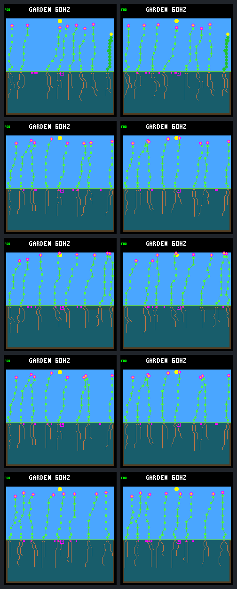

# One death creates a replacement, not sustained renewal

The [frozen single-death diagnostic](landing-disturbance-protocol.md) produced
one established replacement in each of five treated worlds, versus no births
in their unchanged controls. **None was a child of the seven focal survivors.**
Two newcomers produced a seed, but no newcomer produced a child by day 288.
Opening space worked; it did not establish repeated lineage renewal.

These are five selected histories with the **same weather seed and model**,
not five independent weather replicates or a generalization test. Defaults,
device firmware, training, pool sizes and environmental rules are unchanged.
The earlier 12/16 harm-screen failures remain unresolved.

## What occupied the opening?

After the ordinary day-256 observation, the treatment killed the oldest living
non-focal plant, retaining its body for normal decomposition and all existing
seeds. Every target had 32 nodes, 252 energy and 510 water; death discarded its
stores without refund. Each corpse's slot was reclaimed at tick **983985**,
945 logic ticks (**0.246094 simulated days**) after the event. Death and actual
space release were not the same event.

After reclamation, each eventual winner was blocked **only by light** for
157–161 ecology checks, then germinated on its first unblocked check. The
roughly 0.61–0.63-day wait after decomposition was waiting for usable daylight,
not a remaining spacing, capacity or moisture failure for those seeds.

World labels below also give the gallery's row order. `F` means the existing
focal-root allocation probe; `O` means ordinary allocation. All use capped
uptake and broader dispersal; `+wick` adds the existing wicking probe.

| World: order / guard / allocation | Killed ID, column | Replacement: parent → child, column | Seed birth day | Germination day | Newcomer's new seeds |
|---|---|---|---:|---:|---:|
| W1: fixed / dawn / F +wick | 17, 13 | 17 → 31, 7 | 255.078125 | 256.867188 | 0 |
| W2: fixed / dawn / O | 17, 13 | 24 → 35, 13 | 233.875000 | 256.875000 | 0 |
| W3: rotating / dawn / F | 20, 3 | 29 → 34, 5 | 234.875000 | 256.859375 | 1 |
| W4: rotating / dawn / O | 17, 13 | 24 → 35, 13 | 233.875000 | 256.875000 | 0 |
| W5: rotating / daylight / F +wick | 18, 9 | 19 → 31, 9 | 236.140625 | 256.875000 | 1 |

All five recruits came from **seeds already present before the event**. W1 is a
posthumous child of the killed plant. W2, W4 and W5 refilled the exact column;
W3 used another column newly cleared by decomposition. W1 consumed the global
plant slot elsewhere, leaving the killed plant's column unfilled. A visible
empty patch therefore need not mean another plant can enter the world.

All recruits survived their first day and 16 days, remaining alive at ages
31.125–31.141 days at the endpoint. Their **32-day survival is still censored**.
No recruit had a child, so there were no established grandchildren. W3 and
W5 each purchased one seed on day 281.984375; both remained pending at age
6.015625 days. Every mature check of both seeds was blocked by plant capacity
and spacing; W5's also failed node capacity throughout. Light and cold blocked
some of those same checks. There were no seed-moisture failures for these seeds.

## Did the seven focal survivors benefit?

All seven survived, but none held a seed in the bank at the event, and none
produced a child afterward. The old seeds occupied the opportunity before a
new focal seed could reach it. Reproductive readiness alone was not enough:

| Otherwise-eligible focal visits | Control | One death |
|---|---:|---:|
| Bank already full at entry | 4544 | 4567 |
| Earlier buyers filled the opening | 21 | 22 |
| Purchased a seed | 2 | 1 |
| Total | 4567 | 4590 |

The treatment reduced focal purchases from one to zero in **both W3 and W5**,
while W4 gained one. W1 and W2 remained at zero. That is not a uniform benefit,
even though all worlds gained a replacement. W4's sole focal seed was purchased
on day 287.078125 and remained pending at age 0.921875 days. Its 229 mature
checks all failed plant capacity; 204 also failed light. Spacing, node capacity,
moisture and cold did not block this seed's recorded checks.

In both W3 and W5, the same old seed expired at tick 1082820 in both arms.
The control's focal plant bought the opening; in treatment, the newcomer was
visited first and bought it. The former focal buyer was visited last with
sufficient resources and only the bank-full blocker. Those two lost purchases
were ordered-access losses, not loss of reproductive readiness.

Every world made eight new seeds in each arm. Each treated world's original
eight pending seeds became one germination and seven expiries; the controls'
eight all expired. All newly purchased seeds remained pending. The treatment
banks ended full after every ecology step except two steps in W1 (seven seeds).
Bank membership changed, but the scarcity of bank space persisted.

## Costs and per-world outcomes

There were **no new natural deaths or maintenance shortfalls in either arm**.
The imposed death is labeled separately; the lifetime totals correctly include
it and must not be called natural mortality. Each world's seven matched
pre-event survivors had 14,336 maintenance-payment observations in each arm,
with zero unpaid energy or water. Every newcomer also had zero shortfalls.
The portable audit retains individual budgets, exposure denominators and
readiness, not just these totals.

Both arms ended with eight living/stored plants and eight seeds in every world.
Final nodes were respectively **256, 251, 252, 251, 256**, identical within
pairs. These benign resource totals do not cancel the focal purchase losses
in W3/W5, prove the older harm screen passed, or isolate capacity from the
simultaneous changes in shade and competition caused by death.

## Endpoint gallery

Day 288, W1–W5 from top to bottom: **unchanged control left, one death right**.
The screenshots show rendered simulation state, not device performance. They
cannot establish lineage identity or renewal; the ledgers above provide that.

## Evidence and reproduction

Twenty full native runs completed: five archived-identical controls, five
treatments, five exact repeats and five untraced treatment checks. Controls
matched the old results, all four traces and frames. Treatment repeats matched
exactly; tracing did not change results or frame bytes. Pre-event observations
and world/run hashes matched the saved day-256 boundary.

The host-only event reuses the existing environmental-death primitive, keeping
its transaction and normal decomposition. Tests cover failure preservation,
seeds, soil, RNG, cached history, event identity and mortality classification.
The [capture](landing-disturbance-capture.json.gz) pins invocation records,
build settings, source/binary identities, ledgers and trace receipts. The
[portable audit](landing-disturbance-results.json.gz) retains all ten control
and treatment runs' complete post-event visit clocks, resource stages, bodies, seed checks,
simultaneous site masks and purchases. The raw bundle also retains direction
traces, original trace files, binaries, model and paired frames (about 2.3 GiB).

The [tool guide](../../docs/garden-landing-tools.md#test-a-single-death-with-normal-decomposition)
separates native capture from offline extraction and verification. No simulator
is needed for portable reanalysis or raw re-extraction. The frozen protocol and
earlier artifacts are retained unchanged.

Validation: the seven collector/CLI tests and eleven offline accounting tests
pass. The native transaction test passes in the ordinary and both research
builds. A second raw extraction with subprocess launches forbidden produces
byte-identical portable output. The broad host sweep passed 210/211 CTests;
its gallery smoke test correctly refused a source snapshot while documentation
was being edited, then passed when rerun against the stable tree. Formatting,
shell syntax, target dry-runs and diff checks pass. No device run was required
for this host-only diagnostic.

After capture, only the CLI's adjacent help descriptions were reordered to
make export versus retained-body death unambiguous. The archived sources and
executables remain the exact versions used for the 20 runs.

| Artifact | SHA-256 |
|---|---|
| Frozen protocol | `e193885119bfc3b394074b1a2d2791c612c344d5023efadcb88d68cf7f4fba61` |
| Raw manifest | `0726b1cf464c09e0d835aa2e888a10e8e1ff38d959ec5a7b17b7186b1206d712` |
| Portable capture | `8677447bbb1609522e48c25a425a17e0dbbb9efa5c133810b1a72a8204750e39` |
| Portable audit | `0cd9571fa218c7c511db98572c15a56d3982ea66129b748c4919302c614f66d2` |
| Paired gallery | `074d1521ff47b29e866e4b4ea212b9e6b505bed5df3ee2a302522d97610eb3bd` |

## Next decision

A useful next bounded test is **one more controlled opening at day 288**,
compared with continuing each of these same five treated worlds unchanged,
and followed to day 320. Keep normal decomposition, the existing seed bank and
the same predeclared target-selection rule. This would test whether seeds
from the new generation can themselves establish—not merely whether another
incumbent's seed fills the slot—and finish the newcomers' 32-day follow-up.
Retain all five worlds, not only the two new seed producers.

That is a proposal, not a second experiment performed here. A recurring hazard,
new fitness score or promoted ecology rule needs its own decision; this one-off
refill is not evidence that those choices are solved.

Follow-through: the [second-opening comparison](landing-second-opening.md) is
now complete. It confirms the first recruits' 32-day survival but no children;
all five openings refill, two from newly purchased seeds. The new report
separates persistent spacing blocks, protected purchase affordability and later
bank-order losses rather than treating them as one bottleneck.
