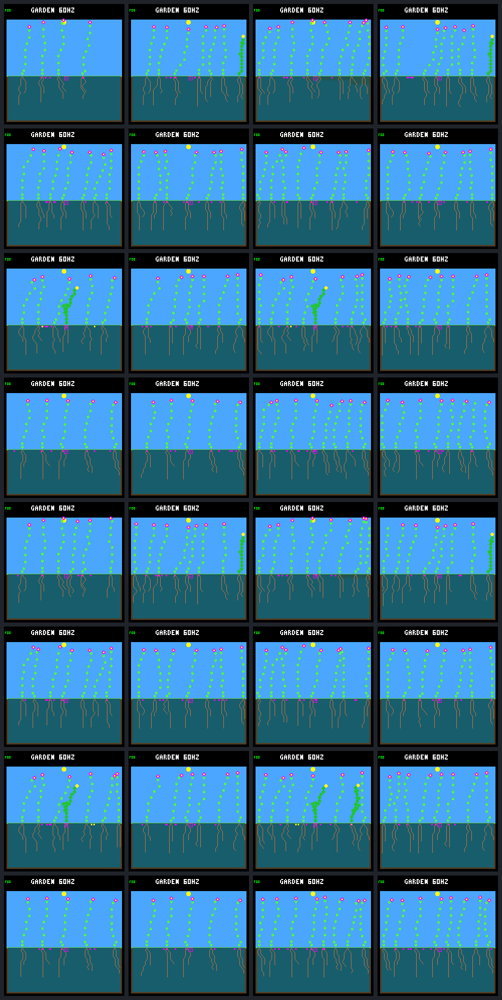

# Garden persistence through day 288

The seven late replacements that were still too young to judge at day 256 all
survive to age 32 days. That is real establishment, but not yet sustained
renewal: the next 32 days contain only four new births and no deaths across
the 32 worlds. All 256 seeds pending at the old cutoff expire without a child.

This completes the [frozen follow-up](landing-followup-protocol.md) to the
[vacancy audit](landing-vacancy-sequence.md). The model, weather, growth guards,
capacity and ecology are unchanged. These worlds share one weather seed and
are paired configurations, not 32 independent environmental replicates.

## Young plants establish but rarely reproduce

Cohort membership was fixed from the saved day-256 ledgers. Eleven offspring
were born in (224,256]; four had already died before day 256. The other seven
were direct replacements whose 32-day survival was previously censored. All
seven now pass that survival check, including the generation-five plant at
column 6 that waited about 15 days in the seed bank before germinating.

| Outcome for the frozen late cohort | cap | cap with wicking | broader cap | broader cap with wicking |
|---|---:|---:|---:|---:|
| Born in days 224 to 256 | 0 | 0 | 7 | 4 |
| Survived to age 1 day | 0 | 0 | 7 | 4 |
| Survived to age 16 days | 0 | 0 | 5 | 2 |
| Survived to age 32 days | 0 | 0 | 5 | 2 |
| Died before age 32 days | 0 | 0 | 2 | 2 |
| Parents producing seeds by day 288 | 0 | 0 | 1 | 1 |
| Parents with a germinated child | 0 | 0 | 0 | 0 |

The two seed-producing cohort plants each purchase one seed during the
extension. The other five surviving cohort plants buy none. No cohort plant
has a child, so none has a child surviving one day either. The selected column-6
plant survives without producing a seed. These observations do not identify
whether morphology, resource readiness or competition for the seed bank prevents
reproduction; the saved traces can distinguish those stages next.

## Activity during the added 32 days

Each column below contains eight worlds. Counts cover (256,288], excluding the
shared day-256 boundary. The interval spans two complete seasonal cycles, but
zero deaths in this interval does not establish permanent occupancy or prove
that winter can never cause turnover.

| Outcome | cap | cap with wicking | broader cap | broader cap with wicking |
|---|---:|---:|---:|---:|
| New births | 3 | 0 | 0 | 1 |
| New deaths | 0 | 0 | 0 | 0 |
| Reclaimed plant slots | 0 | 0 | 0 | 0 |
| New seed purchases | 67 | 64 | 64 | 65 |
| Old pending seeds that expire | 64 | 64 | 64 | 64 |
| Old pending seeds that germinate | 0 | 0 | 0 | 0 |
| Final living plants per world | 4–7 | 5–8 | 8 | 7–8 |

All four new births come from seeds purchased after day 256. They occupy
previously available slots; there is no new death-created vacancy in this
interval. Every broader-cap world retains eight living occupants throughout.
The narrower worlds can retain fewer than eight, so plant capacity alone is
not a universal explanation for failed germination. Spacing, site conditions
and the actual banked seed locations remain separate constraints.

The complete [portable result](landing-followup-results.json.gz) retains each
world's ledgers, frozen cohorts, pending-seed outcomes, reclamation events,
living/stored occupancy and per-run verification receipts. It is about 205 KiB.

## Verification and host limits

All 68 planned simulations complete: 32 rebuilt day-256 identity checks, 32
day-288 runs and four exact repeats. Before any extension runs, all baselines
match their saved complete results, raw framebuffer hashes and full reach
traces. Their final stand, adult and direction records also match exactly.

Every extended run reproduces the complete earlier reach-row prefix and shared
boundary records. Truncating its ledgers to day 256 exactly recovers the old
lineages, purchases and pending fates. All four fixed repeat worlds reproduce
results, pixels and all captured traces. The new windows retain every ecology
step, with valid completion records and occupancy reconciled to the lifetimes.

Only the host landing CLI ceiling changes, to 1,105,920 logic ticks or 288
garden days. The general evaluator/training limit stays at 256 days. Plant ages
already use 32 bits; no simulation, observer, ledger size or firmware change
was needed. Maximum observed host ledger usage is 34 of 4,096 lineages and
98 of 65,536 purchases. Capacity exhaustion still fails explicitly.

Sixteen follow-up tests pass, including portable reanalysis without native
launches. Eleven selected Docker CTests pass, covering CLI bounds, tracing,
age wrap, lifetime ledgers, climate, growth, placement and the prior vacancy
audit. Each of the four research builds also passes its three focused native
tests. Full raw verification passes; offline re-extraction and repeat exports
are checked against the retained portable bytes. All earlier artifacts remain.
The CLI also rejects broken output symlinks before path resolution. That
post-capture path check leaves analysis unchanged; verification explicitly
recognizes the archived collector hash without rewriting its evidence.

## Screenshots and next decision

Columns are cap, cap with wicking, broader cap, and broader cap with wicking.
Rows 1–4 use fixed reproduction order and rows 5–8 use rotating order. Within
each group the guard/allocation combinations are dawn/focal, dawn/ordinary,
daylight/focal, daylight/ordinary. These are fixed endpoint captures, not
selected best runs or evidence of continuous movement.

The longer observation resolves the young plants' survival, but does not clear
the original harm checks: 12 of 16 earlier comparisons failed those checks,
which are not waived or re-scored here. No rule or controller is promoted.

Next, use the saved resource, reproduction and seed-check traces to audit the
seven surviving late replacements. Separate failure to become seed-ready from
failure to enter the seed bank, then separate seed production from successful
germination. That is an offline question with no additional native run budget.
It should inform the next intervention before changing weather, capacity or
placement rules. **Completed:** the [reproductive-access audit](
landing-reproductive-access.md) finds plentiful instantaneous readiness but
almost no seed-bank access, followed by overlapping establishment barriers
for both purchased seeds. No additional simulation or rule change was needed.

Reproduction commands are in the [tool guide](../../docs/garden-landing-tools.md#follow-late-replacements-to-day-288).
The local raw bundle is `artifacts/garden-landing-followup-v1`; it is not included
in git. The frozen protocol, portable result and gallery are retained in the repo.

| Artifact | SHA-256 |
|---|---|
| Frozen protocol | `f0093cf4b36d6b137b1ea51face77d9386ae15cb20befa8eeb9d7a90060d7d9b` |
| Raw manifest | `4b544d137a9ec8f2da3afdfb4b23ee3a300422fb871e10a267527b2f7fcbb1df` |
| Portable result | `b13ce089efa12b431f48a35499be93e7cf7af83a636006b2898b283762e12336` |
