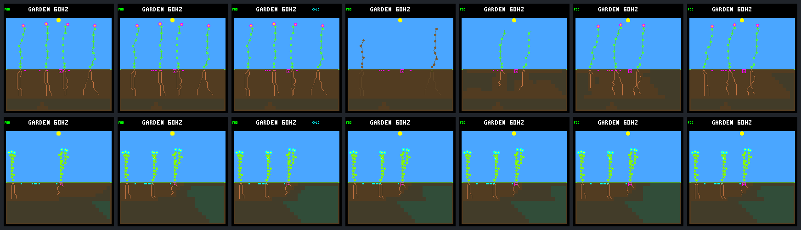
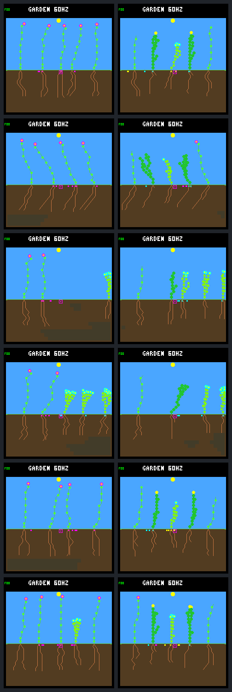
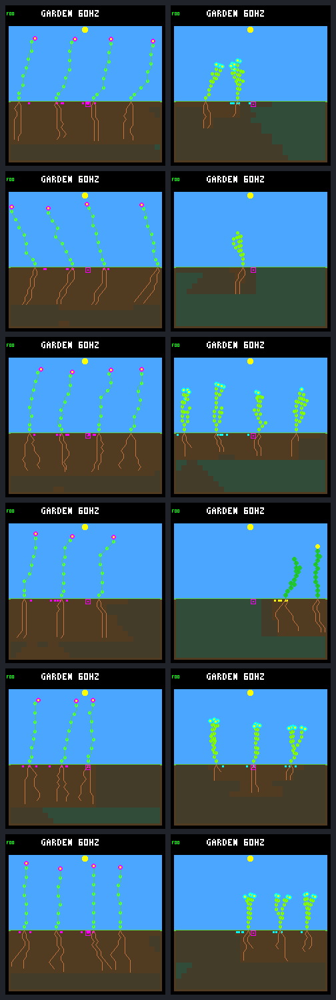

# Smaller bodies improve seasonal renewal but stall steady worlds

The fixed 32-node construction cap **fails the whole-panel retention screen**.
It improves seasonal scores and bridges the selected winter gap, but steady
worlds lose renewal. Keep the cap as an explicit host-only experiment, not a
firmware default, training policy or qualified controller.

This is the single intervention agreed after the
[adult resource diagnosis](landing-adult-resources.md), using the
[predeclared protocol](landing-growth-protocol.md). Six frozen controllers run
in twelve existing conditions through day 192. Weather, ordinary ecology,
model bytes, storage and scoring remain unchanged; there is no training.
Both arms use water-eligible arbitration. The original veto and ordinary
behavior remain additional archived baselines.

## Seasonal improvement does not offset steady regression

Late first-day cohorts are born in `(62,190]` days. Renewal confirmations use
confirmation time in that interval and the existing ancestry qualification;
these are different counts, not interchangeable measures of success.

| Climate and measure | Uncapped eligible control | 32-node cap |
|---|---:|---:|
| Seasonal late births | 98 | 184 |
| Seasonal late first-day survivors | 61 | 107 |
| Seasonal qualifying renewal confirmations | 59 | 107 |
| Seasonal weakest-period credit summed across worlds | 601,350 ticks | 1,399,545 ticks |
| Seasonal total renewal credit | 5,951,190 ticks | 8,204,760 ticks |
| Steady late first-day survivors | 1 | 1 |
| Steady qualifying renewal confirmations | 1 | 0 |
| Steady total renewal credit | 250,740 ticks | 0 ticks |
| Steady zero-credit periods | 18 of 24 | 24 of 24 |

The seasonal aggregate key improves from `[0,23,601350,5951190]` to
`[1,24,1399545,8204760]`. All six seasonal pairs beat the eligible control and
ordinary behavior under the unchanged lexicographic key; five beat the veto
and one loses. The key ranks terminal coverage before weakest-period and total
credit. It is not a claim that every constituent metric improves: seasonal
multi /34 loses late survivors, 9 → 8, and total credit, 1,146,195 → 785,580,
while improving its weakest period.

The steady key drops from `[1,24,0,250740]` to `[0,8,0,0]`: five paired losses
and one tie against the eligible control. Four capped steady worlds have no
births or deaths over all 192 days. Their five original founders remain alive,
with all three species and a full seed bank. That is persistent occupancy and
retained founders, not renewed diversity. The other two steady cases do have
births, so the cap does not mechanically disable reproduction everywhere.

The steady score-retention gate fails against **all three baselines**. Late
steady survivors also fall below ordinary behavior's four. No new biological
emptiness is introduced, but that weaker condition cannot override renewal
failure. The six seasonal endpoints remain single-living-species: five ground
cover and one shrub. Do not call this ecological qualification.

## The selected winter gap closes with a different population

In seasonal single /34, the uncapped eligible run has no established descendant
from day 126.8125 until 128.8515625. The capped run retains established ground
cover throughout that interval, with no stress during days `[124,127)`.
This is not a matched rescue of the four flowers in the original diagnosis.
The cap changes construction, competition and subsequent ancestry from day zero.

Actual day-125 budgets and post-step morphology show the tradeoff:

| Measure per living plant | Uncapped flowers 25–28 | Capped ground cover 23, 27, 29 |
|---|---:|---:|
| Nodes | 36 | 32 |
| Roots | 20 | 7–12 |
| Active leaves | 8 | 19–24 |
| Energy upkeep per full day | 320 | 256 |
| Water upkeep per full day | 128 | 192–256 |
| Gross energy income during day 125 | 291–333 | 302–407 |
| Energy remaining at end of day 125 | 70–122 | 155–192 |

For capped plant 23, the energy account is
`253 initial + 308 income − 150 overflow − 256 upkeep = 155 final`.
No growth or reproductive spending occurs that day. The lower energy upkeep
is real, but so are the changed species, larger leaf count, smaller root system
and higher water upkeep. This comparison does not isolate the contribution of
maintenance savings from morphology and population replacement.

There is a counterexample within the same window: the earlier drought gap
lengthens. The uncapped run lacks established descendants from days
104.015625–105.8515625; the capped run from 102.765625–105.8515625. All four
older capped plants die water-short around day 102.6. Better winter overlap is
not uninterrupted survival across the season. The seed bank prevents these
gaps from being biological extinction.

Rows below are uncapped eligible control, then cap. Columns are days 120, 124,
126.5, 127, 128, 129 and 130. The uncapped day-127 remnants are decomposing;
the capped population is a different species and lineage history.



## Implementation boundary

`growth-replay --node-limit off|32` is a separate host command with a `GLC1`
fingerprint containing the cap setting. At the cap, an allocating EXTEND bid
becomes WAIT before the existing water eligibility and priority ranking.
Priority, tip and neural next-memory remain intact. This does not select a
different lower-priority bid just because growth is blocked, nor invent a
FINISH action. Normal tip finishing, nonallocating tip cleanup and reproduction
retain their existing semantics and resource charges.

The cap applies during construction to founders and descendants. It removes
no tissue and changes no resource endowment. The ordinary CLI, shared engine,
models and device build inputs are unchanged. This result tests that explicit
projection, not every possible learned or maintenance-aware growth policy.

## Complete panel and evidence

Day-192 endpoint sheets show uncapped control on the left and cap on the right.
Rows are single /33, multi /33, single /34, multi /34, single /35 and multi /35.
These are all prescribed cases, not selected successful images. Visual review
found complete valid frames; endpoints alone cannot establish ongoing renewal.





The [portable archive](landing-growth-results.json.gz) retains all complete
results, first-day resource accounts, unchanged score calculations and three
baseline comparisons, plus raw adult/seed window records and frame identities.
The focused cap/control windows each contain 8,705 ecology samples. Their
25,071 / 32,234 plant samples and 65,924 / 66,816 seed samples reconcile.

All twelve uncapped controls reproduce the historical eligible results,
first-day traces, resource accounts and framebuffer bytes exactly. Every pair
matches across traced, untraced and repeated traced execution. The fourteen
intermediate captures also match trace-on/off pixels. The protocol and source
snapshot were fixed before outcome collection. All 483 full-bundle artifact
hashes verify; offline verification recomputes scores, gates and resource
accounts. Fingerprints:

- Portable result SHA-256:
  `9027651cd3da4d8a9a8703ef7a78d4ecc351faef35ece5fe4f2ee43f5605d2da`.
- Full bundle manifest SHA-256:
  `e16b2cb3d3860d1036556d9c7502007ff0d8e0ff44cd3ea949f1157cde927523`.
- Frozen host binary SHA-256:
  `e5d8cdf6d81d3c1e842ed7486cbe6120170c70ffbfbf4baf0bcbb9624e2042ee`.

```sh
make host-screen-landing-growth \
  GARDEN_LANDING_GROWTH_OUT=artifacts/new-growth-screen
docker compose run --rm -T firmware python3 -W error sim/garden_landing_growth.py \
  --verify benchmarks/garden-seasons/landing-growth-results.json.gz
# Additionally verify every retained file in the local full bundle:
docker compose run --rm -T firmware python3 -W error sim/garden_landing_growth.py \
  --verify artifacts/garden-landing-growth-v1
```

The ignored full bundle preserves binary, build settings, inputs, protocol,
sources, raw traces and frames. This is a reused exploratory panel, not unseen
validation. No device has been flashed or measured.

All **155 ordinary host CTests pass** under UBSan (160.24 seconds). The new
native tests cover the 31/32/33-node boundary, nonallocating cleanup, unchanged
priority/memory, cap-off equivalence, value-copy replay and complete rollback.
Five Python tests cover CLI identities and failures, no-clobber, trace/pixel
parity, resource budgets, portable evidence, gallery hashes and retained gates.
Changed-C formatting and `git diff --check` also pass.

## Next question

The [completed species-resolved audit](landing-species.md) separates survival,
fertility and allocation in these saved runs. Seasonal flower seed production
falls to zero, while ground cover supplies most improved renewal. Four capped
steady worlds produce seeds but never recruit; every mature seed check is
spacing-blocked. The subsequent [founder trace](landing-founders.md) distinguishes
halted flowering from resource/bank constraints: all twelve capped seasonal
flower founders form no flowers through death, with 763 visits blocked only
by missing flowers. Two fertile capped steady founders finish shoots before
exhausting construction space. Next test a reserved shoot budget within the
cap; no additional policy intervention follows automatically from this result.
