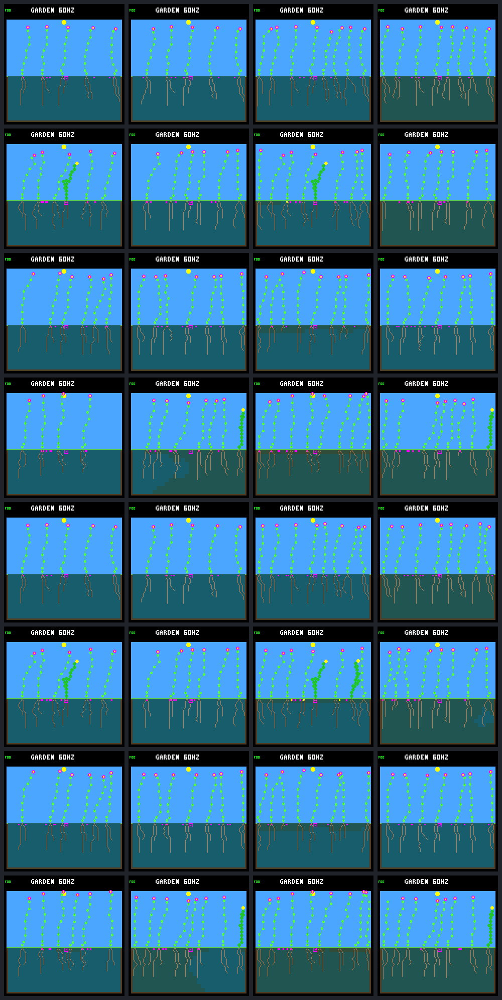

# Broader late dispersal improves establishment but exposes crowding and energy costs

Completed 2026-10-03. Broadening late seed distances from `5..7 + trait` to
`3..9 + trait` increases established offspring and restores some late births
in the examined capped-uptake worlds. **Only four of sixteen comparisons pass
every existing population check**, however. Ten have worse descendant energy
shortfall rates, and the fuller worlds frequently exhaust their eight plant
slots. Keep the change host-only and off by default.

The subsequent [offline energy audit](landing-dispersal-energy-audit.md) separates
extra exposure, failed recruits, established recruits and previously existing
plants. It finds genuine matched individual regressions as well as changed
cohort costs. More births are a real improvement, but neither a fuller screenshot
nor a few late births proves sustained renewal.

## Fixed comparison

The [frozen protocol](landing-late-dispersal-protocol.md) retains the eight
order/guard/allocation settings from the [uptake-cap comparison](landing-uptake-limit.md).
It compares narrow and broader late dispersal with capped uptake, both with
and without wicking. All share the same examined weather seed, controller and
256-garden-day horizon. These are correlated diagnostic histories, not sixteen
independent weather replications or a held-out training evaluation.

The new support starts strictly after logic tick 626580. It preserves edge
reflection, parent traits, seed mutation, spacing, bank size, viability and
costs. An existing seed never relocates. Fourteen signed choices replace six;
the same random draw selects an original choice, with the existing spacing-aware
fallback generalized to fourteen entries. Reflected aliases keep their weight.
This changes sampling probabilities as well as reach and does not isolate
those effects. No arbitrary global destination or light/moisture oracle is used.

All 48 full trials completed: sixteen rebuilt controls and two identical runs
of each candidate. The controls match their archived results, four existing
traces and pixels exactly. Candidate repeats match results, all five traces
and pixels. All physical trace prefixes match through onset. The first reach
receipt differences occur at ticks 648420–652500, when later purchases use
the broader support; already-banked seeds retain their previous placements.
No training, device flash or ordinary-default change occurred.

## More offspring establish and reproduce

Counts below concern offspring **born after intervention**, not all historical
descendants. Each column totals eight settings; censored survivors have not yet
had enough follow-up to satisfy the stated duration.

| Post-intervention outcome | Cap narrow | Cap broader | Cap and wicking narrow | Cap and wicking broader |
|---|---:|---:|---:|---:|
| Births | 36 | 66 | 18 | 37 |
| Confirmed one-day survivors | 32 | 51 | 12 | 25 |
| Died by the one-day checkpoint | 4 | 11 | 6 | 11 |
| One-day follow-up censored | 0 | 4 | 0 | 1 |
| Confirmed 32-day survivors | 32 | 48 | 12 | 22 |
| Died by the 32-day checkpoint or horizon | 4 | 13 | 6 | 13 |
| 32-day follow-up censored | 0 | 5 | 0 | 2 |
| Produced seeds | 21 | 37 | 7 | 15 |
| Produced a confirmed one-day surviving child | 10 | 20 | 1 | 6 |
| Still living at the horizon | 30 | 48 | 12 | 21 |

All eight cap-only settings gain births and confirmed 32-day survivors. With
wicking, four gain births, three tie and one loses a birth; four gain confirmed
32-day survivors and four tie. The complete setting table prevents pooled
gains from hiding the regression. Arrows compare narrow to broader support;
the late columns count births in the final 32 garden days, previously zero
in every narrow control.

| Order and guard | Allocation | Cap births | Cap late births | Cap and wicking births | Cap and wicking late births |
|---|---|---:|---:|---:|---:|
| Fixed daylight | Ordinary | 1 → 6 | 0 | 1 → 5 | 0 |
| Fixed daylight | Focal | 6 → 8 | 0 | 2 → 7 | 1 |
| Fixed dawn | Ordinary | 7 → 11 | 3 | 1 → 1 | 0 |
| Fixed dawn | Focal | 3 → 7 | 0 | 5 → 5 | 1 |
| Rotating daylight | Ordinary | 1 → 7 | 0 | 1 → 6 | 0 |
| Rotating daylight | Focal | 6 → 8 | 0 | 2 → 8 | 2 |
| Rotating dawn | Ordinary | 7 → 11 | 3 | 1 → 1 | 0 |
| Rotating dawn | Focal | 5 → 8 | 1 | 5 → 4 | 0 |

The eleven new final-period births are not yet a self-renewing late cohort.
Six survive one day, five lack that follow-up, and none produces a seed by
the horizon. Four have died by the horizon and the other seven lack 32-day
follow-up. Longer observation would be needed to establish their eventual fate.

## Reach improves while the worlds fill up

Unlike the preceding retrospective audit, these traces record each producing
parent's actual trait, legal choices and exact site masks. Every purchase and
seed exit reconciles with the ledger. Purchase-time and sequential germination
spacing maps reconcile with the complete stored-slot census, including dead
plants awaiting decomposition and children admitted earlier in the same step.

Post-intervention purchases into already-blocked sites fall from **177/202 to
155/232** with the cap alone and **188/196 to 154/214** with both water rules.
Blocked purchases made while some global spacing-clear column exists fall
177 → 47 and 149 → 24, respectively. The wider support therefore addresses the
specific reach problem rather than merely increasing purchases.

It also changes subsequent occupancy. All eight broader cap-only worlds end
with eight living plants, versus four to six in their narrow controls. Across
the final period they spend **65.1–100%** of samples with all eight slots occupied
by living plants, versus zero in every narrow cap-only world. Five broader
cap-only worlds are full throughout that period. With wicking, broader worlds
end with seven or eight living plants and six of eight encounter full living
occupancy in the final period. These measurements exclude decomposing bodies;
when eight living plants are present, the plant-capacity gate is necessarily
closed, but smaller living counts alone do not prove free stored slots.

Final-period mature-check counts retain each seed's original purchase support:

| Check outcome | Cap narrow | Cap broader | Cap and wicking narrow | Cap and wicking broader |
|---|---:|---:|---:|---:|
| Any globally usable site | 144,838 | 5,002 | 86,544 | 6,407 |
| Any usable site within original support | 1,014 | 646 | 0 | 3,302 |
| Chosen site fails spacing | 523,768 | 490,248 | 523,772 | 439,094 |
| Total mature checks | 523,768 | 523,709 | 523,772 | 523,742 |

These are repeated checks, not independent trials. The large fall in global
vacancies is consistent with the denser populations; it is not evidence that
wider dispersal intrinsically makes every individual site worse. In the narrow
cap controls, exact traits resolve 1,014 reachable checks, refining the earlier
bound of 931 certain and 375 unresolved checks without contradicting it.

## The energy regression prevents promotion

The existing harm screen passes for cap-only daylight/focal settings in both
orders, and for combined-water fixed/dawn/focal and rotating/dawn/ordinary
settings. It fails the other twelve comparisons:

- Six cap-only and four combined-water settings worsen unpaid descendant
  energy per maintenance payment.
- Combined-water fixed/dawn/ordinary and rotating/dawn/focal settings lose
  seed-producing descendant parents. The latter also loses a successful parent.
- Every comparison retains terminal population, species, late living time,
  confirmed one-day and 32-day survivor counts, and prior empty-world timing.
  Descendant water-shortfall rates improve in all sixteen comparisons.

The energy deficits are small in absolute units, but the predeclared check
has not been relaxed. Pooled cap-only energy shortfalls rise **394 → 487 units**
over **485,161 → 570,438 payments**, or **0.812 → 0.854 unpaid units per thousand
payments**. With wicking they rise **234 → 419 units** over **508,927 → 567,850
payments**, or **0.460 → 0.738 per thousand**. These are whole-descendant lifetime
accounts, including the shared pre-intervention history. Different populations
have different exposure: the rates do not establish that matched individuals
became less efficient. Absolute unpaid water also rises in the pooled totals
even though its per-payment rate improves.

Before changing costs, light transport or admission rules, use the saved
shortfall events and body histories to determine which cohorts incurred the
extra energy deficit and when. Separately identify where slot occupancy blocks
replacement. Shading, unsuccessful seedlings and prolonged incumbency are
plausible explanations to investigate, not causes established by these totals.

## Terminal screenshots

Columns are cap narrow, cap plus wicking narrow, cap broader, and cap plus
wicking broader. Rows follow the eight-setting table above. The images show
the denser endpoints; they cannot show renewal over time.

## Verification and retained evidence

The ordinary host suite passes all **202 CTests**. Focused C checks pass in all
four builds, covering every origin/trait, reflected aliases, high mask bits,
onset boundaries, original-choice preservation, all-blocked fallback, observer
support and unchanged RNG/mutation/resource state. The older from-start wide
dispersal native test also passes. The changed Garden source compiles with
the recorded Zephyr flags; this is not a full firmware rebuild or hardware test.

All **14 focused Python tests pass in each of the four builds**, and all four
ordinary-build reset tests pass. They cover isolation, rule metadata, observer parity, purchase
spacing, decomposing occupants, censored cohorts, trace framing, missing
observations, no-clobber output and tampered portable evidence. The bounded
uptake accounts reconcile **11,156,992 soil-cell transitions** across candidates,
with zero post-onset uptake overflow in that recorded window.

Portable verification and a complete second extraction from the raw bundle
both pass with process launching forbidden. This rechecks all file hashes,
control/repeat equality, prefix histories, purchase/site records and resource
accounts without running another native simulation. The captured source archive
and binaries retain the implementation used for the experiment.

The local raw bundle is about 55 GiB and retains all 686 artifacts, including
uncompressed and compressed traces. No prior bundle was removed. The
[8.4 MiB portable result](landing-late-dispersal-results.json.gz) retains exact
purchase contexts, site histograms, resource accounts and all paired summaries.
See the [tooling instructions](../../docs/garden-landing-tools.md#broader-late-dispersal-experiment)
for capture, offline analysis and verification commands.

| Artifact | SHA-256 |
|---|---|
| Frozen protocol | `87b6c5e1229a09e79c2c490fe34bb5c7e21d432f15a5d6c74e09a2a779a6a192` |
| Pinned uptake-cap input | `687f354bbeb04b71dc2c8d81b57bccefba0a1f6e2cfa6677f9dd14d517647768` |
| Raw manifest | `4a94df9dcc4f53c980e3631b58dc3fd853c3f03a68678d335127ab09f7a83001` |
| Portable result | `390669aba064732072c82e2170ad1d6f7872612710bc1c6501ad3351c8ad3b62` |
| Screenshot gallery | `db008673990f7dc3e19e5dba2960bd4f682f4f9b6e6ca78d3644686274ece469` |
