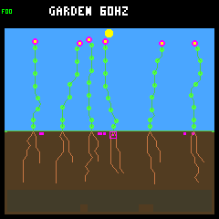
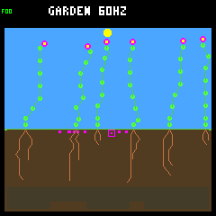

# Why the late seedlings fail to establish

All three failed late seedlings in S35's rotating-order run first run short
of water. Two later also exhaust energy; the third dies from water shortage
while energy remains. All three keep their two initial root nodes throughout
life, spending most of their available water on shoot growth. This closes the
death-cause gap in the [saved regression audit](landing-order-regressions.md).

The [four-replay protocol](landing-late-resources-protocol.md) changes only
observation. Fixed and rotating runs both reproduce their historical complete
ledgers and endpoint pixels, their repeats are exact, and the day-218 overlap
matches the original traces. There is no new policy, training, weather seed,
firmware change or promotion. The selected pair diagnoses known failures; it
does not qualify rotation more broadly.

## Water runs out before energy

Each seedling starts with 24 water. The following balances cover its entire
short life, including the terminal maintenance step:

| Rotating plant | Birth column | Water income | Water spent on growth | Water spent on upkeep | Terminal shortage |
| --- | ---: | ---: | ---: | ---: | --- |
| 48 | 27 | 38 | 45 | 17 | Energy and water |
| 49 | 12 | 56 | 60 | 20 | Energy and water |
| 50 | 27 | 25 | 30 | 19 | Water only |

Every row balances: starting water plus income equals growth plus upkeep.
There is no water overflow, reproductive spending or terminal water discard.
Growth uses roughly 73%, 75% and 61% of the respective water supplies. That
is observed spending, not proof that withholding it would produce survivors:
growth also changes photosynthesis, maintenance and access to resources.

Plants 48 and 49 each experience five water-only shortage maintenance steps,
then three with both shortages. Plant 50 experiences eight water-only steps.
Stress rises consecutively from one to eight in all three cases. They die at
ages 0.273, 0.289 and 0.422 garden days respectively.

Plant 50 is an important accounting check. It has 11 energy before terminal
maintenance, pays two, and discards the remaining nine when marked dead.
Its final zero energy is therefore **not** evidence of an energy-shortage
death. The recorded flags and due/paid/discarded fields establish the cause.

These failures occur in autumn or winter, outside an active drought interval.
The first shortage samples have sun intensity 24, but low light does not by
itself explain the water shortage or establish how much shading contributed.

## Roots remain small despite available growth sites

The three failed plants retain exactly two roots. They make nine, twelve and
six paid growth steps respectively, ending at 13, 16 and 10 total nodes.
Their root tips have available candidate sites whenever queried, and none of
their recorded root bids is denied by the shoot-completion node reservation.
The controller proposes root extension early and later proposes waiting.

The [combined eligibility check](../../sim/garden_landing_run.c#L119) also
applies the [seedling water guard](../../sim/garden_seedling_reserve.c#L119),
so priority alone does not identify a winner. Its required reserve is one
upkeep payment for a qualifying wetter root destination, four otherwise.
Stand receipts omit destination moisture, but that missing detail is not
needed for these early opportunities: all root-extension bids already have
enough stored water for the stricter four-payment threshold. The other bids'
water eligibility is also unambiguous at those steps.

Reconstructing eligibility before comparing priorities gives:

| Plant | Steps offering affordable root extension | Higher-priority winner |
| --- | ---: | --- |
| 48 | 4 | Shoot extension on all 4 |
| 49 | 7 | Shoot extension on all 7 |
| 50 | 7 | Shoot extension on 6; root WAIT on 1 |

All 17 shoot wins have matching growth debits; the WAIT win has none. In that
last case, tick 906900, stored water is 11. A root extension needs at most
nine and is eligible, while the shoot extension needs thirteen and is denied.
Another root's WAIT bid has priority 25 versus 21 for root extension, so WAIT
wins. This is not a bank-capacity or node-reservation failure.

The guard protects a short reserve, not a full first day's water supply or
predicted future uptake. The next question is whether one early affordable
root investment improves access to water enough to help. Available candidates
and affordable construction do not establish that the resulting root would
collect enough water, or that delaying a shoot would leave enough energy.

## Successes and pending seedlings remain in the comparison

All eleven births after day 218 are retained, not only the three failures.
Six establish, three die within their first day, and two are unresolved.
Here establishment means surviving the first garden day, not permanent survival.

| Cohort | Fixed order | Rotating order |
| --- | --- | --- |
| Births in (218,222] | 1 establishes | 3 establish |
| Births in (222,254] | 2 establish | 3 die |
| Births in (254,256] | None | 2 awaiting follow-up |

The fixed closing-period survivors at columns 25 and 3 finish their first
day with 16 roots, no recorded shortage, and 498 and 357 water respectively.
They receive 787 and 608 water during that day. They also differ in birth time,
location, ancestry and potentially genome, so they are comparison examples,
not matched counterfactuals for the failed rotating plants.

The two final rotating seedlings, at columns 12 and 27, are only 0.137 days
old at day 256. They have five roots, no shortage yet, and 25 and 12 water.
Their much higher early energy income does not establish that they will
survive the next dark interval. This trace extension does not extend the
simulation horizon; both remain censored.

## Saved evidence and verification

The capture retains 9,729 ecology samples per arm, 100,343 plant-resource
observations in total, and 1,869 exact first-day child receipts. Every sampled
stand, seed bank, production gate, growth reservation and resource transfer
is checked using the existing analyzers. Portable first-day verification also
checks consecutive resource balances, death discard, seed fees, ancestry,
historical outcomes and censoring.

- [Portable results and first-day receipts](landing-late-resources-results.json.gz),
  SHA-256 `6e30507abd1262163afc4e975a7f9e261ca3633c998d799a1aecbf9464ae4f89`.
- Original capture: `artifacts/garden-landing-late-v1`, manifest SHA-256
  `a82a6808b6922683c5b876faadb38ed681e4b49f317a10de75d978564f8ff4a7`.
- Protocol SHA-256
  `2bc9a547f29cd41c800341eee11809c1660145b4a3c84cac7b1fb9ef774e0c97`.

The original bundle keeps both repeated raw traces, all four invocation
receipts and native results, source snapshot, model, executable, build settings
and images. Full-bundle verification recomputes the complete stand/resource
analysis; portable verification recomputes the retained first-day budgets and
checks the frozen historical identities without rerunning the simulator.
All 172 host suites pass. Twelve offline tests cover this capture, including
the adverse cases, corrupt inputs and the conservative water-bound calculation;
the added bound check was rerun after the full suite completed.

```bash
# Verification does not simulate.
docker compose run --rm -T firmware python3 sim/garden_landing_late.py \
  --verify benchmarks/garden-seasons/landing-late-resources-results.json.gz
docker compose run --rm -T firmware python3 sim/garden_landing_late.py \
  --verify artifacts/garden-landing-late-v1

# A new capture makes exactly four calls and requires a fresh destination.
make host-trace-landing-late GARDEN_LANDING_LATE_OUT=artifacts/new-late-trace
```

Collection also needs the original rotation bundle for the overlap check;
use the script's `--reference` option if that bundle is elsewhere. The default
Make destination intentionally refuses to overwrite the completed capture.

These day-256 frames match the historical pixels. The failed seedlings have
already died; the pictures show endpoint context, not the death mechanism.

| Fixed order | Rotating order |
| --- | --- |
|  |  |

## Next bounded question

Keep rotation experimental. The saved bids are sufficient to choose a small
counterfactual: prefer one already-proposed, affordable root extension at a
seedling's first opportunity, with all costs and eligibility checks unchanged.
Apply it to separately scoped failed and successful examples, verify each
unchanged prefix and follow both water and energy through establishment.
Agree on its call budget before running it. Do not change germination
thresholds, add water, relax all spending guards or start broad retraining
on this evidence alone.

Reuse the existing host-only machinery where suitable. The earlier
[wet-root bootstrap experiment](../garden-longevity/root-bootstrap.md) already
found water benefits and an energy-survival regression under a different
controller/ecology configuration. This next test would check the current
landing-controller failures, not rediscover or automatically promote that
older policy. Preserve successful seedlings as explicit harm checks.
