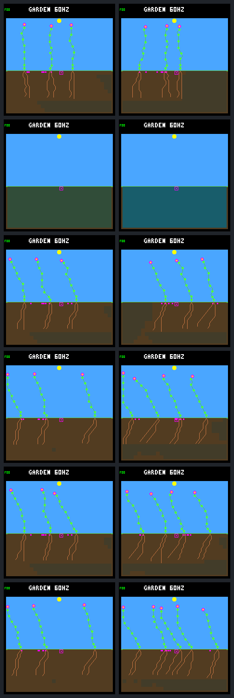
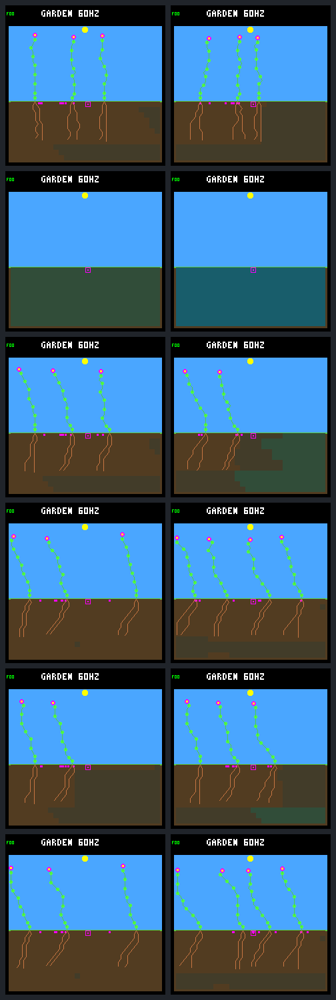
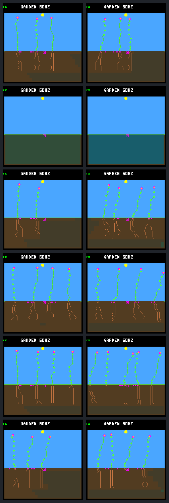
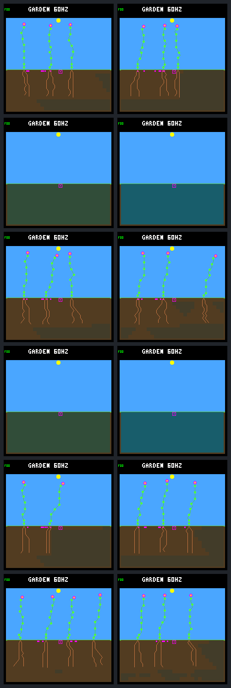
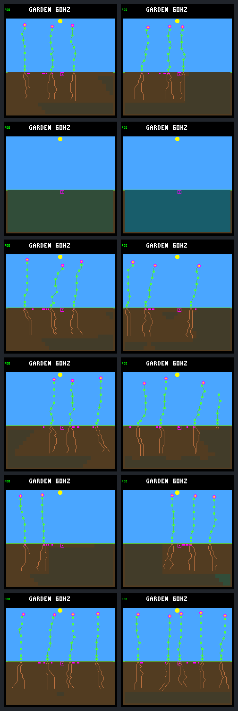
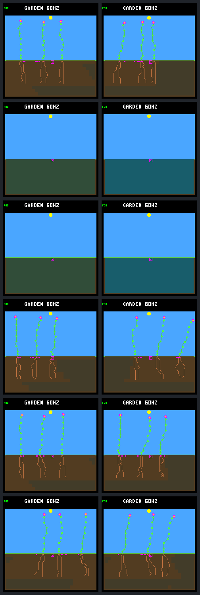

# Broader training: better survival in two searches, no consistent renewal gain

The [fixed five-seed experiment](landing-multiseed-protocol.md) is complete.
Broader live-input training wins two of three paired fresh-panel aggregates and
loses one. Fixed-input training loses two and ties one. Neither passes its
predeclared replicate/climate gate. All five changed finalists have **less
weakest-window reproduction credit** than their single-seed counterparts.
The two live-input aggregate wins come from better terminal persistence, which
the unchanged objective deliberately ranks before reproduction credit.

This is useful evidence about the survival/renewal tradeoff, not a qualified
controller, proof that sensing is useless, or a reason to change the score
after seeing these outcomes. No architecture, encoding, ecology, player or
firmware change is made in this experiment.

## What was held fixed

The same original initializer, current-only network, live/fixed profiles,
mutation schedule, two generations, three children and three search RNG seeds
give 42 candidate evaluations. Training expands from the original world seed
to its union with all four seeds from the preceding control panel: 20 worlds
per candidate instead of four. This costs **five times as many training
worlds**, not equal compute. Old/new training aggregate keys have different
world counts and must not be compared directly.

All six new finalists are chosen before fresh evaluation. The six frozen
single-seed finalists are replayed alongside them on the same four unused
seeds, both layouts and climates: 16 worlds each. The original initializer is
also evaluated under both profiles. There is no best-finalist selection from
these outcomes. These inspected seeds are now development evidence.

Fixed profiles replace the four active added fields with raw zero / encoded
-128, preserving legacy sensing, recurrence and source/body gating. The
override is part of the replay record, not the model file. Both profiles use
ordinary ecology with gardener/irrigation off.

## Primary comparison: single-seed versus five-seed

Numbers below use the **shared fresh evaluation panel**, not training scores.
Established endpoints count four late windows per world, including two days
of follow-up: 64 checks total. Credit is the sum of each world's minimum
bounded-age renewal credit across its four windows, in credited logic ticks.
The score is lexicographic, not a weighted sum. World counts are wins/ties/losses
for multi relative to single.

| Profile / search suffix | Aggregate result | Established endpoints, single → multi | Minimum-window credit, single → multi | Zero-credit windows, single → multi | World W/T/L |
|---|---|---|---|---|---|
| live / 33 | loss | 48 → 48 | 224,310 → 56,370 | 39 → 45 | 6 / 1 / 9 |
| live / 34 | win | 56 → 64 | 445,260 → 353,310 | 36 → 33 | 6 / 3 / 7 |
| live / 35 | win | 56 → 61 | 408,630 → 346,005 | 37 → 38 | 6 / 3 / 7 |
| fixed / 33 | loss | 52 → 48 | 194,415 → 41,670 | 38 → 44 | 4 / 2 / 10 |
| fixed / 34 | loss | 64 → 64 | 608,550 → 138,840 | 30 → 36 | 3 / 4 / 9 |
| fixed / 35 | tie | 48 → 48 | 381,990 → 381,990 | 38 → 38 | 0 / 16 / 0 |

Suffixes abbreviate search RNG seeds 6d697833, 6d697834, 6d697835. Each row's
aggregate win/loss/tie has the same sign separately in steady and seasonal
climates. The live breadth gate passes 6/9 required checks, the fixed gate 0/9;
both require 9/9 and therefore fail. All per-seed/layout/climate slices and
individual regressions remain in the retained records.

The live / 34 terminal counts change from 56 established and eight observed
extinct to 64 established. Live / 35 changes from 56 established and eight
observed extinct to 61 established and three living-unestablished. Those three
are not confirmed established descendants or mere seed-only survival. They
occur in rainfed-seasonal, at the first window for seed 7d3b7bde, second for
940cfdc4 and fourth for 5aa2b327. No observed-extinct endpoint remains in either
of these new live finalists, but that does not imply continuous reproduction.

The first two score components explain why live / 34 and / 35 win despite lower
weakest-window credit. Each also loses **seven individual worlds** while
winning six and tying three. An aggregate win is not a majority-world win.
Fixed / 35 is an exact model-and-replay tie, not just an equal score.

All twelve finalists rank above their same-profile initial model in aggregate,
but each has individual losses. Even multi / 33 ranks above the initializer
while losing renewal credit: its terminal sum is 32 versus the initializer's
31. The complete score decomposition is important; a headline ranking alone
would hide this tradeoff.

## Secondary comparison: live versus fixed after broader training

| Search suffix | Aggregate | Steady | Seasonal | World W/T/L |
|---|---|---|---|---|
| 33 | live wins | live loses | live wins | 5 / 9 / 2 |
| 34 | live wins | live wins | live wins | 9 / 3 / 4 |
| 35 | live wins | live wins | live wins | 8 / 3 / 5 |

All three overall comparisons favor live, unlike the previous one-seed
experiment. However, the predeclared live/fixed gate still fails (8/9 checks)
because / 33 loses its steady slice. This is an interesting sensitivity to
training coverage, not a replicated all-climate advantage or a causal account
of how the added signals help.

## What remains unsolved

Across all fourteen evaluated model/profile variants, **no steady world has
renewal credit in every late window**. Multi live / 34 has established
descendants at all 64 endpoints but still has 33 zero-credit windows; 26 of
those are in steady worlds. Every changed finalist loses minimum-window
credit. More training coverage has not solved durable renewal.

Recommended next discussion: use the saved ledgers for a bounded diagnosis of
these persistent-but-not-renewing worlds. Separate missing seed production,
seeds that fail to recruit, and established descendants aging out of the
bounded credit window. Compare the old/new live / 34 and / 35 survival gains
alongside their renewal losses; retain / 33 as the regression control. This
should inform whether the next change belongs in the training environment or
objective before spending a larger search budget. Do not retune against these
evaluation seeds or automatically promote one of the finalists.

## Search and visual records

| Search suffix | Live: old → new finalist | Fixed: old → new finalist |
|---|---|---|
| 33 | g1-c0 → g2-c2 | g1-c0 → g2-c2 |
| 34 | g1-c2 → g2-c2 | g2-c2 → g2-c0 |
| 35 | g1-c1 → g2-c0 | g2-c1 → g2-c1 |

Both searches start from identical weights; all first-generation candidate
bytes and RNG schedules match the corresponding single-seed controls. Later
parent selection can diverge. Generation-zero training biology matches across
all six searches, and generation-zero review matches the preceding pilot.

All six contact sheets were inspected. The morphology remains predominantly
tall sparse stalks; this experiment does not establish visual diversity. Rows
show generations 0, 1 and 2, each rainfed then crowded. Columns show days 16 and
192 on the fixed seasonal review seed ed52188c. Empty/failing worlds and
unchanged champions are retained. These are review worlds, not hand-picked
fresh evaluation successes.

### Search 33

### Search 34

### Search 35

## Reproducibility

Retained evidence:

- [Protocol](landing-multiseed-protocol.md) and [workflow](../../docs/garden-landing-multiseed.md).
- [Readable summary](landing-multiseed-summary.json): search receipts, score
  decompositions, paired slices, gallery identities and provenance.
- [Full results](landing-multiseed-results.json.gz): all 1,136 scored worlds and
  lineage/seed ledgers, training-only selections and complete comparisons.
- [Models](landing-multiseed-models.json.gz): 42 candidate files, six prior
  finalists and the original initializer, stored as a relative-path → hex map.
- [Independent replay receipt](landing-multiseed-verification.json.gz): matching
  per-file hashes, frozen inputs and completed-manifest identity.
- [Gallery receipts](landing-multiseed-gallery.json.gz): all 72 frame identities,
  native CRCs and captured-world records, tied to the six retained sheets.

The optimized UBSan host build keeps all research ecology flags off. The whole
experiment repeats with one worker and captures disabled, with exact model and
JSON equality. An independent execution of the frozen tools/binary reproduces
all records, model bytes and 72 frames. Its replay overlaps the one-worker
repeat; acceptance waits for the completed collection manifest and verifies
all frozen-input and artifact hashes. No source/build edits occur during
collection. Regression tests recompute every retained score and champion,
replay every native mutation, and recover all frame CRCs from gallery pixels.
The 138-test host suite passes. No firmware deployment or controller promotion.

Collection plus the one-worker repeat took 1,487.819 seconds; the overlapping
independent replay took 352.265 seconds and matched all 275 primary-panel files.
Frozen manifest SHA-256:
`9d6bb6646af166ada8d6e9442d2f20d0c4324e4b489f2f27e4a7038db95323e3`.
