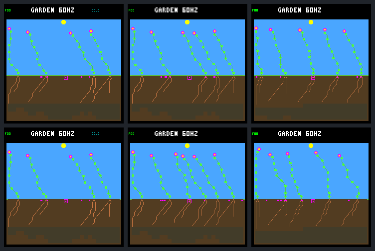

# Rotating reproduction order results

Changing reproduction visit order helps some established replacements produce
surviving children. The [frozen comparison](landing-order-protocol.md) passes its
three aggregate screening checks: successful early replacement parents rise
0 → 4, all new reproducing parents rise 54 → 66, and closing-window first-day
confirmations rise 6 → 9. This is an ecological gain, not merely more seed
purchases. It is **not ready for promotion**: individual worlds regress, early
seedling mortality rises, and even rotation can miss every useful turn for a
particular plant.

All six frozen controllers, both original control and vacancy contexts, and
both order rules are retained. There is no training, extra parameter search,
device deployment, new fitness function or default change.

## What changed

The common prefix ends at day 158, including the vacancy context's one
predetermined adult removal. Rotation begins on the next maintenance tick.
Its starting array index is
`((logic_tick - 606720) / 60) % current_plant_count`; visits wrap once through
the existing array. Retained dead slots remain present but cannot reproduce.
Storage, germination and growth are not reordered, no random draw is added,
and cooldowns are still decremented once per ecology step.

Everything else is fixed: eight seed slots, 32-day viability, 48-energy/24-water
seed fees, 32-node construction with shoot reservation, spacing-aware placement,
seasonal weather `940cfdc4`, layout and model bytes. The normal eight-slot
host build uses explicit per-run flags; the older compile-time rotation
experiment is off. The new flag is host-only and rejects conflicting rotation
configurations. Disabled runs retain their historical fingerprints.

There are 24 trajectories through day 256. Each has a traced run, exact repeat,
untraced run and two earlier checkpoints: 72 full replays plus 48 checkpoint
replays, exactly 120 experimental native calls. Resource and ordered-visit
traces cover days 158–218; complete lineage and seed ledgers cover the full run.

## Renewal and mortality

An early replacement is born in (158,190]. Establishment means surviving its
first full garden day; successful reproduction requires a child that also
survives its first day, observed through day 256. All new reproducing parents
are born after day 158. Closing confirmations occur in (222,254]. These are
counts of distinct parents or first-day confirmations, not raw seed counts.

| Outcome across all twelve world contexts | Fixed | Rotating |
| --- | ---: | ---: |
| Early births | 21 | 25 |
| Early first-day survivors | 5 | 5 |
| Early established parents producing seeds | 0 | 4 |
| Early established parents producing established children | 0 | 4 |
| Their seeds through day 256 | 0 | 6 |
| Their established children | 0 | 5 |
| All births after day 158 | 212 | 233 |
| First-day survivors among those births | 137 | 147 |
| First-day deaths among those births | 73 | 84 |
| Still awaiting first-day follow-up | 2 | 2 |
| New parents with an established child | 54 | 66 |
| Closing-window confirmations | 6 | 9 |
| Natural deaths after day 158 across all ages | 198 | 219 |
| Plants alive at day 256 | 70 | 70 |

The six seeds from successful early parents all germinate; one child dies within
a day and five establish. None of those six seed outcomes is censored. Across
all new births, however, the resolved first-day survival fraction falls from
137/210 (65.2%) to 147/231 (63.6%). More births and survivors do not establish a
survival-rate improvement or increased final population.

The aggregate pass hides an important split:

| Context | Early successful parents | New reproducing parents | Closing confirmations |
| --- | ---: | ---: | ---: |
| No removal | 0 → 0 | 27 → 30 | 4 → 2 |
| One adult removed at day 158 | 0 → 4 | 27 → 36 | 2 → 7 |

Six models share one weather seed; these are not twelve independent
environmental replicates. The predefined aggregate screen passes, but a
separate no-removal closing-retention check would fail. That distinction must
remain visible in any later qualification.

### Every controller and context

S and M identify the single- and multi-seed-trained frozen controllers; 33,
34 and 35 abbreviate model seed suffixes `6d697833`, `6d697834` and `6d697835`.
Every cell is fixed → rotating. Surviving children are counted through day 256,
including those born after the resource trace ends.

| Model | Context | Early survivors | Early successful parents | All new first-day survivors | New reproducing parents | Closing confirmations |
| --- | --- | ---: | ---: | ---: | ---: | ---: |
| S33 | Control | 0 → 0 | 0 → 0 | 10 → 12 | 4 → 6 | 0 → 0 |
| M33 | Control | 0 → 1 | 0 → 0 | 11 → 12 | 4 → 5 | 1 → 0 |
| S34 | Control | 0 → 0 | 0 → 0 | 12 → 10 | 5 → 4 | 0 → 0 |
| M34 | Control | 0 → 0 | 0 → 0 | 10 → 13 | 4 → 5 | 1 → 1 |
| S35 | Control | 0 → 0 | 0 → 0 | 12 → 11 | 7 → 6 | 2 → 0 |
| M35 | Control | 0 → 0 | 0 → 0 | 9 → 10 | 3 → 4 | 0 → 1 |
| S33 | Vacancy | 0 → 0 | 0 → 0 | 9 → 12 | 3 → 4 | 1 → 1 |
| M33 | Vacancy | 1 → 1 | 0 → 1 | 12 → 14 | 3 → 7 | 1 → 2 |
| S34 | Vacancy | 1 → 0 | 0 → 0 | 12 → 8 | 4 → 1 | 0 → 0 |
| M34 | Vacancy | 1 → 1 | 0 → 1 | 15 → 15 | 6 → 7 | 0 → 3 |
| S35 | Vacancy | 1 → 1 | 0 → 1 | 13 → 14 | 7 → 8 | 0 → 1 |
| M35 | Vacancy | 1 → 1 | 0 → 1 | 12 → 16 | 4 → 9 | 0 → 0 |

S34 vacancy loses its early survivor and three reproducing parents; S34 control
and S35 control also lose reproducing parents. M33 and S35 controls lose all
their closing confirmations. These are retained negative outcomes, not omitted
outliers. The portable evidence also retains every period's births, deaths,
living census and credit, rather than treating old carried-in credit as fresh
renewal.

## Actual access rather than nominal fairness

The previous [bank audit](landing-bank-access.md) found five early replacements
with 3,394 otherwise-eligible blocked visits. Only sixteen saw a genuine opening
before earlier incumbents filled it; the other 3,378 began with a full bank.
The fixed arms reproduce those histories exactly.

Rotation changes who receives some rare openings. In M33 vacancy, the same
pre-switch seed produces a replacement at tick 613710 in both arms, with the
same parent, column, species and generation. At tick 649260 the bank has one
space. Fixed order visits incumbent 19 first, so it buys the slot; rotating
order starts at array index four, visiting replacement 28 first. The latter
buys that seed and one more later. Both germinate; one child establishes and
itself produces three seeds before day 256.

Equal time at each rank still does not imply equal opportunity. The rotated
M33 **control** has an early replacement that receives 427–428 maintenance
visits at each of its six ranks. Yet at its four otherwise-eligible openings
it is at rank three twice and rank four twice, and loses all four. It produces
no seeds. This is observed timing bias, not proof that every deterministic
allocation rule must fail.

Across the five rotating early survivors, the opening-rank histogram and
purchase count are:

| World | Ranks at otherwise-eligible openings | Purchases | Established children |
| --- | --- | ---: | ---: |
| M33 control | 3×2, 4×2 | 0 | 0 |
| M33 vacancy | 0×2, 2×1, 4×1 | 2 | 1 |
| M34 vacancy | 0×1, 3×1 | 1 | 1 |
| S35 vacancy | 0×1, 3×1, 4×1 | 1 | 1 |
| M35 vacancy | 0×1, 1×2, 4×2 | 2 | 2 |

Ranks are zero-based actual visit ranks, including any retained dead slots.
Each entry `rank×count` describes opportunities, not successful purchases.
All actual visits are checked against the independent rotation formula and
physical array inventory. The schedule is not silently tuned after seeing
these results.

## Costs and survival remain real

Over the entire day-158–218 traced panel, purchases barely change: 299 → 300,
with exact reproduction debits 14,352 → 14,400 energy and 7,176 → 7,200 water.
The early rotating survivors spend 288 energy and 144 water on their six seeds.
No extra capacity, free seeds, refunds or weakened gates explain the gain.

All five rotating early survivors eventually die with verified water-shortage
receipts, as did all five fixed early survivors. The cohorts differ, so these
are not five individually matched treatment pairs. Three vacancy births
(M33, M34 and M35) can be matched to identical seeds already present before the
switch. M34 and M35 die on the same ticks in both arms despite their added seed
spending; M33 dies 420 logic ticks, about 0.109 garden days, earlier under
rotation. Its energy income and water uptake also diverge, so the earlier
death cannot be attributed to seed fees alone. S35's surviving replacement has
a different parent and birth event; equal lineage numbers are never used as a
cross-arm identity rule.

Additional reproduction therefore is sometimes affordable until the same
drought loss, but is not proven harmless across the panel. The increased
first-day deaths and the regressed contexts still need explanation.

## Saved screenshots

Each gallery has fixed order on top and rotating order below; columns are days
158, 192 and 256. All twelve first columns match exactly across their order
pair. The images are actual 240×240 host framebuffers, not illustrations or
device captures. The HUD's 60 Hz is the configured simulation rate, not a new
hardware performance measurement.

| Controller | No removal | Vacancy |
| --- | --- | --- |
| S33 | [Gallery](frames/landing-order-control--single-s6d697833-live.png) | [Gallery](frames/landing-order-vacancy--single-s6d697833-live.png) |
| M33 | [Gallery](frames/landing-order-control--multi-s6d697833-live.png) | [Gallery](frames/landing-order-vacancy--multi-s6d697833-live.png) |
| S34 | [Gallery](frames/landing-order-control--single-s6d697834-live.png) | [Gallery](frames/landing-order-vacancy--single-s6d697834-live.png) |
| M34 | [Gallery](frames/landing-order-control--multi-s6d697834-live.png) | [Gallery](frames/landing-order-vacancy--multi-s6d697834-live.png) |
| S35 | [Gallery](frames/landing-order-control--single-s6d697835-live.png) | [Gallery](frames/landing-order-vacancy--single-s6d697835-live.png) |
| M35 | [Gallery](frames/landing-order-control--multi-s6d697835-live.png) | [Gallery](frames/landing-order-vacancy--multi-s6d697835-live.png) |

For example, M33 vacancy shows the matched prefix and later divergence:



## Evidence and validation

- [Portable results](landing-order-results.json.gz), SHA-256
  `65d240d896f7f6aeb014212fed502479b69e135b921f26d4a288e84b41cc4f32`.
- Frozen protocol SHA-256
  `66dcf7d2ae13b20253fe48c5e76646e0cd38f10dfa48c83ef9f0609aa6658861`.
- Local raw bundle `artifacts/garden-landing-order-v1`, manifest SHA-256
  `9075e770e5005c14ff1e2824626eedf013c3952acd0d7b04eab953809e5296f4`.
- Captured binary SHA-256
  `aca40a59bd42831c14ec37879323f27f761b1448b09ffe45f5329074f85ea12e`.

The raw bundle includes the source snapshot and patch, compiler settings,
binary, frozen models and inputs, all native commands and results, repeated
ordered/resource traces, raw pixels and 72 checkpoint/end images. Repeated
and untraced endpoints match exactly. All twelve fixed trajectories reproduce
the historical states, overlapping visits, gate/resource summaries and pixels.
All twelve day-158 order pairs have identical physical state, cache-derived
base identity, ledgers and pixels, apart from declared configuration hashes.

Full bundle verification independently reanalyzes all 24 saved trace pairs,
including gate masks, bank conservation and resource transfers, without
running simulation. Portable verification recomputes lineage outcomes and
screening checks; it does not replace the raw-trace reanalysis. The repository
also retains exact artifact identities and tests for the negative cases above.

```bash
make host-screen-landing-order GARDEN_LANDING_ORDER_OUT=artifacts/garden-order-fresh
docker compose run --rm -T firmware python3 sim/garden_landing_order.py \
  --verify benchmarks/garden-seasons/landing-order-results.json.gz
docker compose run --rm -T firmware python3 sim/garden_landing_order.py \
  --verify artifacts/garden-landing-order-v1
```

Collection requires a fresh destination and unchanged sources during capture.
Both saved verification modes pass. The native tests cover empty/full arrays,
non-maintenance and switch boundaries, purchase gates/debits, unchanged
storage, invalid configuration and rollback. All 170 default host suites pass,
including twelve Python order cases and the new native order suite. Two
source-snapshot checks initially rejected concurrent report edits and passed
when rerun with the tree held still; experimental collection was already
complete and is unaffected. The older rotation regression and the Zephyr
firmware build also pass. The new order field and branch are absent from the
firmware path. No device flash was performed.

## Recommended next step

Keep this candidate host-only. Before another policy change, audit the saved
S34 vacancy and S35 control regressions: trace changed seed ownership and
landing outcomes to the lost established offspring, keeping mortality and
censoring separate. Use the missed M33-control openings to distinguish
allocation timing from unavailable space or unaffordable reproduction. This
can begin with the evidence already collected rather than another training
run or a sweep of rotation schedules.

The [saved-event audit](landing-order-regressions.md) now completes that
diagnosis to the limits of the existing traces. It separates S34's changed
seed sequence and longer incumbent survival, S35's late establishment losses,
and M33's verified allocation misses. Late S35 resource causes require a
separately scoped extension of detailed observation beyond day 218.

If the tradeoffs are acceptable after that diagnosis, agree on a fresh
multi-weather and longer-horizon qualification panel. Passing this one-seed
screen does not establish robust autonomous renewal or justify changing the
device/default policy.
