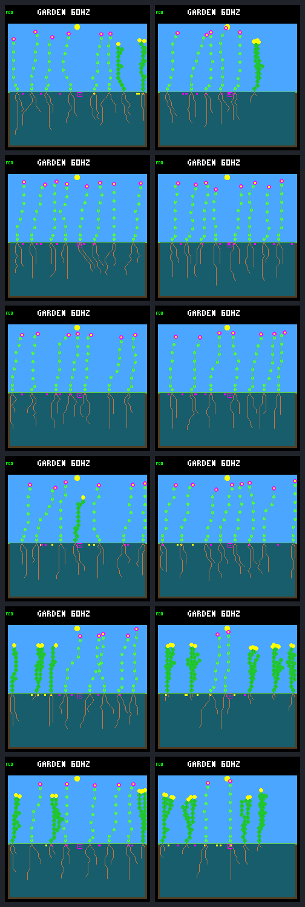

# Spatial dieback renewal holds across six fresh cases

The [predeclared confirmation](landing-patch-confirmation-protocol.md) passes:
all three new world seeds improve in both existing rain-fed starting layouts.
Each treatment produces **9–10 qualifying parent–child pairs**, versus zero in
its control. Neither arm becomes empty during the measured window. All 26
calls are complete, including the two historical anchors, six exact repeats and
six observer-free treatments.

This supports the pilot's narrow finding beyond its original weather seed.
It does not establish indefinite renewal, a generally qualified training
environment, or an optimal disturbance rule. Established ancestry depth varies
from two to four plants, some late descendants remain censored, and young-plant
deaths, resource costs and a species loss remain visible.

## What stayed fixed

The executable, model and W2 recipe are copied unchanged from the
[patch-sweep pilot](landing-patch-sweep.md). W2 is the first existing recipe
without the historical root-allocation selector for one named plant. The C
interface review identified that selector as unsuitable for silently treating
it as a general rule in fresh worlds; no C or simulation change was made.

Both arms retain eight plant slots, eight seeds, 256 nodes, fixed visits,
dawn/resource guards, the construction cap, and the same late uptake/dispersal
rules. Wicking, named-plant interventions and paid seed replacement remain off.
There is no gardener or recurring irrigation. Treatment still applies exactly
fifteen four-column dieback events, days 192–304, and stops at day 320. No seed,
layout, controller, schedule or acceptance threshold was retuned.

The new seeds are S1 `3a7e45e6`, S2 `366928c6`, and S3 `275c8982`, derived by
the protocol's fixed hash recipe before simulation. Each initializes world
randomness and weather. Ordinary `rainfed` starts with three founders and more
initial water per founder; `rainfed-crowded` starts with five. This is a test of
bundled starting conditions, not an isolated spacing or weather intervention.
The two layouts sharing each seed are not independent environmental replicates.

## Paired renewal outcomes

Entries are **control / treatment**. Births are strictly after day 192;
qualifying pairs require both parent and child to be in that cohort and have
sixteen-day survival confirmed. Established chain length counts plants, so
four plants means three parent–child edges, not four edges.

| Case | Cohort births | Sixteen-day survivors | Qualifying pairs | Established chain | Endpoint living |
| --- | --- | --- | --- | --- | --- |
| S1 ordinary | 0 / 16 | 0 / 14 | 0 / 9 | 0 / 4 | 8 / 6 |
| S1 crowded | 0 / 17 | 0 / 16 | 0 / 9 | 0 / 2 | 8 / 8 |
| S2 ordinary | 1 / 21 | 1 / 17 | 0 / 10 | 1 / 2 | 7 / 7 |
| S2 crowded | 1 / 17 | 1 / 15 | 0 / 10 | 1 / 3 | 7 / 8 |
| S3 ordinary | 2 / 21 | 2 / 15 | 0 / 9 | 1 / 2 | 8 / 7 |
| S3 crowded | 2 / 20 | 2 / 16 | 0 / 9 | 1 / 3 | 8 / 6 |

Treatment totals are 112 cohort births, 93 confirmed sixteen-day survivors and
56 qualifying pairs; controls have six births, six survivors and no pairs.
Treatments have respectively 6, 6, 5, 6, 4 and 7 unique qualifying parents.
Posthumous children contribute 2, 3, 4, 4, 3 and 2 of their qualifying pairs.
These are descriptive counts, not independent trials or a fitness change.

The gate required improvement in at least two of three seeds within each
layout, no pair-count regression, and living plants at all treatment endpoints.
All three seeds improve within each layout, with no regression or empty
endpoint. Three endpoints nevertheless have fewer plants than their controls.

## Ancestry and incomplete follow-up

The deepest born chains have lengths 4, 3, 3, 4, 4 and 3, versus established
lengths 4, 2, 2, 3, 2 and 3. Birth alone does not establish a generation.

The shallow established chains do not all indicate failed continuation. In S1
crowded and S2 ordinary, the third chain member is alive but born on day
304.891. It is only 15.109 days old at the endpoint, just short of the required
sixteen-day confirmation. S2 crowded similarly has a fourth member born on day
304.969. The sixteen-day interval after the last dieback does not provide a
full sixteen days of follow-up after the resulting germination.

S3 ordinary has both censoring and an actual loss. Its deepest born chain is
`28 → 33 → 44 → 48`: lineage 28 dies in the day-200 sweep at age 7.188 days,
while lineage 48, born on day 312.930, remains too young to confirm. The middle
two qualify. Neither the early death nor the missing follow-up is hidden by
counting its inherited generation label.

The original endpoint is not extended here to improve the result. Late living
plants remain censored, and a parent already killed young cannot be rescued by
longer observation.

## Survival and young victims

All 112 treatment births and all six control births survive one day. Treatment
entries below are **confirmed / imposed-death / natural-death / censored**.
Deaths after a survival threshold do not erase an earlier confirmation.

| Case | Sixteen days | Thirty-two days | All sweep victims under sixteen days |
| --- | --- | --- | --- |
| S1 ordinary | 14 / 1 / 0 / 1 | 12 / 2 / 0 / 2 | 2 |
| S1 crowded | 16 / 0 / 0 / 1 | 14 / 0 / 0 / 3 | 1 |
| S2 ordinary | 17 / 2 / 1 / 1 | 14 / 3 / 1 / 3 | 2 |
| S2 crowded | 15 / 0 / 0 / 2 | 13 / 1 / 0 / 3 | 0 |
| S3 ordinary | 15 / 3 / 1 / 2 | 13 / 4 / 1 / 3 | 3 |
| S3 crowded | 16 / 2 / 1 / 1 | 13 / 4 / 1 / 2 | 3 |

All six control births also pass the sixteen- and thirty-two-day thresholds.
The two S1 controls have empty birth cohorts, not a measured zero survival rate.

There are eleven young imposed victims in total. Eight belong to the post-onset
birth cohort; three were born earlier. The youngest is S1 ordinary lineage 31,
killed at the first event at age 6.922 days. Including earlier births matters:
reporting only the cohort's eight deaths would omit three young victims of the
same hazard. No age protection or retargeting was added.

## Mortality and resource costs

These counts cover the whole post-onset population, not only new offspring.
Shortfalls are shown with their maintenance-payment denominators. All natural
deaths have an energy-only terminal cause.

| Case | Imposed deaths, treatment | Natural deaths, control / treatment | Shortfalls / payments, control | Shortfalls / payments, treatment |
| --- | --- | --- | --- | --- |
| S1 ordinary | 17 | 0 / 1 | 2 / 65536 | 21 / 52875 |
| S1 crowded | 17 | 0 / 0 | 0 / 65536 | 3 / 64562 |
| S2 ordinary | 19 | 1 / 2 | 13 / 57329 | 17 / 61879 |
| S2 crowded | 16 | 1 / 0 | 12 / 57329 | 7 / 58865 |
| S3 ordinary | 19 | 1 / 2 | 38 / 61489 | 23 / 56353 |
| S3 crowded | 19 | 1 / 2 | 24 / 65321 | 44 / 58884 |

Natural deaths rise from four to seven overall; shortfalls rise from 89/372540
payments to 115/353418. Outcomes vary by case: S2 crowded has fewer natural
deaths and shortfalls, while S3 ordinary has fewer shortfalls but more natural
deaths. Imposed mortality competes with starvation and changes exposure, so
these are not matched-individual health estimates.

The 107 imposed deaths discard 26964 energy and 54526 water model units without
refunds. Per-case energy/water totals, in table order, are 4284/8662, 4284/8670,
4788/9690, 4032/8154, 4788/9673 and 4788/9677. Accounting includes these discards
and birth endowments; consistent accounts do not imply a complete physical
resource cycle.

## Capacity and seed fates

All ninety scheduled events are recorded. Only S1 ordinary's day-208 event is
empty, and no alternative target is chosen. All 107 victims are reclaimed by
the endpoint through ordinary decomposition after 0.234375–0.24609375 garden
days; death does not immediately free a stored plant slot.

Minimum living counts from the complete post-step chronology are 8, 8, 6, 6,
6 and 7 in controls and 4, 6, 5, 5, 5 and 5 in treatments. Neither side goes
empty during the observation window. Treatment endpoint node counts are 192,
256, 224, 254, 224 and 192; stored plant counts equal their endpoint living
counts. Every endpoint has eight pending seeds.

Seed fates below concern **purchases after day 192**, distinct from the birth
cohort. Fates are **germinated / expired / pending**.

| Case | Purchases, control / treatment | Control fates | Treatment fates |
| --- | --- | --- | --- |
| S1 ordinary | 32 / 42 | 0 / 24 / 8 | 15 / 19 / 8 |
| S1 crowded | 32 / 41 | 0 / 24 / 8 | 14 / 19 / 8 |
| S2 ordinary | 33 / 49 | 1 / 24 / 8 | 21 / 20 / 8 |
| S2 crowded | 33 / 44 | 1 / 24 / 8 | 16 / 20 / 8 |
| S3 ordinary | 34 / 48 | 2 / 24 / 8 | 19 / 21 / 8 |
| S3 crowded | 34 / 48 | 2 / 24 / 8 | 20 / 20 / 8 |

Treatments buy 272 seeds versus 198 and germinate 105 versus six from those
purchases. Seven treatment births come from pre-onset purchases, reconciling
the 112-birth cohort. Pending seeds remain censored, not expired failures.

## Species and all endpoint images

Shrubs persist at three treatment endpoints versus four controls. S2 crowded
loses its remaining shrub species, despite producing two qualifying shrub
pairs earlier. Cumulative reproduction therefore does not imply endpoint
species persistence. Ground cover is absent from every endpoint.

The outcome is not uniformly flower-only: S3 ordinary finishes with five
shrubs/two flowers versus three shrubs/five flowers in its control; S3 crowded
has four shrubs/two flowers versus three shrubs/five flowers. Of the 56
qualifying pairs, fifteen have shrub parents and 41 have flower parents.
Neither this mix nor the isolated shrub gain establishes sustained diversity.

All twelve frames were visually reviewed. Rows are S1 ordinary/crowded, S2
ordinary/crowded, S3 ordinary/crowded; columns are control/treatment. The
shrubs' thicker foliage and reduced occupancy in some treatments are visible,
without apparent rendering corruption. These static endpoints do not prove
ancestry; the ledgers do. The `60HZ` HUD is not a timing measurement.

## Evidence and next step

The [complete portable result](landing-patch-confirmation-results.json.gz) has
SHA-256 `13a46abbfe805bb58c5895b9417c622c05067d6f9c18c31cb7447da7c4657656`.
The local raw bundle is `artifacts/garden-landing-patch-confirmation-v1`, with
manifest SHA-256
`7e0e1babb1ead8ebcbbb17256cf7673fe18a968a87cc4fb849244957c1f72b6c`.
The [tool guide](../../docs/garden-landing-tools.md#confirm-spatial-dieback-across-starting-conditions)
documents collection and portable/raw verification.

Both historical anchors reproduce their prior results, frames, traces and
accounts. All six exact repeats match; all six observer-free results and
pixels match their treatments. The nine confirmation contract/captured-result
checks pass with no skips through CTest, and host configure/build succeeds.

Offline verification authenticates the complete source/input/run inventory,
reconciles every resource observation in all twenty traced calls, reproduces
the twelve-image gallery from its fixed raw frames, and reproduces the portable
gzip byte-for-byte. Native process launches were forbidden during that audit.
All 24 numeric table rows and victim/discard totals match the saved capture;
231 local references across twelve changed/new documents resolve. The PNG was
visually inspected; rendered Markdown layout was not previewed.

This closes the narrow fresh-condition confirmation, not environment
qualification. The remaining uncertainty includes follow-up length, continued
turnover, three-seed coverage, dependence on experimental safeguards, and
species persistence. No training, neural interface change, default promotion
or device deployment follows automatically.

The next proposal is a separately predeclared **day-352 follow-up of these same
six pairs**, retaining the original fifteen events with no new events after
day 304. Another 32 garden days can resolve the current cohort's outstanding
survival thresholds without changing the hazard or silently extending this
experiment's endpoint. Keep the day-320 results fixed, preserve early deaths,
and measure whether any later renewal continues as openings cease. Discuss
that scope before running it; it would still not prove indefinite persistence.

That separately approved [day 352 follow-up](landing-patch-followup.md) is now
complete. It resolves the survival gaps but finds almost no later recruitment.
This report's day 320 endpoint, cohort and result archive remain unchanged.
