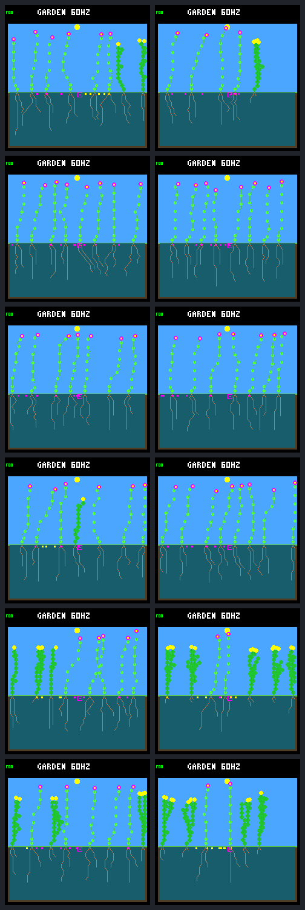

# Spatial dieback follow up through day 352

The [predeclared follow-up](landing-patch-followup-protocol.md) resolves the
original cohort's incomplete survival observations, but does **not** demonstrate
continuing renewal after the dieback schedule stops. All eight previously
censored sixteen-day observations become confirmed survivors. Established
parent–child pairs rise from 56 to 64 across the six treatments, entirely from
plants already born by day 320.

Only one new plant is born across the six treatments during days 320–352,
and it dies before sixteen days. Controls have no new births or deaths. All
36 calls complete, including twelve exact historical anchors, six traced
treatment repeats and six observer-free repeats. No environment, controller
or device default is promoted.

## What changed and what stayed fixed

The sole runtime source edit raises the host CLI's replay limit and help text
from 320 to 352 days. The model, W2 build options, ecology, experimental guards,
three seeds and two starting layouts remain unchanged. Evaluator and training
limits are not extended. Before any longer run, the rebuilt executable
reproduces every original control and treatment at day 320: result JSON,
compressed traces and framebuffer bytes all match.

The fifteen spatial-dieback events still occur on days 192–304, with identical
victims and event hashes. There are no additional events. Every trace row and
complete ledger prefix through day 320 matches the earlier capture. The
[original confirmation](landing-patch-confirmation.md) remains a separate,
unchanged result; this report does not retrospectively move its endpoint.

S1 is `3a7e45e6`, S2 is `366928c6`, and S3 is `275c8982`. Ordinary/crowded
denote the existing bundled founder and initial-water layouts. Six paired
cases sharing three environmental seeds are not six independent weather trials.

## The fixed cohort now has complete follow up

The denominator is births strictly after day 192 and no later than day 320.
The later birth is excluded here. Survivors must be alive at the stated age;
death exactly at that threshold fails. An eventual death does not erase a
previously confirmed shorter survival interval.

| Treatment | Cohort births | Sixteen-day survivors | Thirty-two-day survivors | Pairs at day 320 → 352 | Established chain at day 320 → 352 |
| --- | --- | --- | --- | --- | --- |
| S1 ordinary | 16 | 15 | 13 | 9 → 10 | 4 → 4 |
| S1 crowded | 17 | 17 | 17 | 9 → 10 | 2 → 3 |
| S2 ordinary | 21 | 18 | 17 | 10 → 11 | 2 → 3 |
| S2 crowded | 17 | 17 | 16 | 10 → 12 | 3 → 4 |
| S3 ordinary | 21 | 17 | 16 | 9 → 11 | 2 → 3 |
| S3 crowded | 20 | 17 | 15 | 9 → 10 | 3 → 3 |

Of 112 treatment births, sixteen-day outcomes are 101 confirmed survivors,
eight imposed deaths and three natural deaths. Thirty-two-day outcomes are
94 confirmed survivors, fourteen imposed deaths and four natural deaths.
No observation in this fixed cohort remains censored. All six control births
survive both intervals; the two S1 controls have empty birth cohorts, not a
measured zero survival rate. Controls still have no qualifying pairs.

All eight previously censored sixteen-day observations resolve positively.
Of sixteen censored thirty-two-day observations, fifteen resolve positively
and one fails: S1 ordinary lineage 46 dies on day 334.781 at age 31.879 days.
Longer observation therefore both confirms previously immature descendants
and exposes a real loss. Earlier imposed deaths remain failures.

Chain length counts plants, not edges. S3 ordinary's established depth reaches
three, not its four-plant born depth: an early ancestor was killed young in
the original sweep. Extra observation cannot repair that loss.

## Births after the last opening

These treatment birth counts use consecutive intervals open on the left and
closed on the right. The last dieback event is at day 304. Every corresponding
control count is zero.

| Treatment | Days 304–312 | 312–320 | 320–328 | 328–336 | 336–344 | 344–352 |
| --- | --- | --- | --- | --- | --- | --- |
| S1 ordinary | 1 | 0 | 0 | 0 | 1 | 0 |
| S1 crowded | 1 | 0 | 0 | 0 | 0 | 0 |
| S2 ordinary | 1 | 0 | 0 | 0 | 0 | 0 |
| S2 crowded | 2 | 0 | 0 | 0 | 0 | 0 |
| S3 ordinary | 1 | 1 | 0 | 0 | 0 | 0 |
| S3 crowded | 1 | 0 | 0 | 0 | 0 | 0 |

The single extension birth is S1 ordinary lineage 48, born in column 9 on day
336.891. Its parent, lineage 47, occupies column 1. The offspring dies naturally
on day 350.813, aged 13.922 days,
without buying any seeds. Its born ancestry is `32 → 39 → 41 → 47 → 48`, but
the final member never establishes. The expanded cohort consequently has
113 births and a five-plant born chain in this case, but still only 64
established pairs across treatments. Counting births or inherited generation
labels alone would overstate the result.

Only S1 ordinary has extension deaths: lineage 46 and then lineage 48.
Its living count changes from six at day 320 to five at day 352. Other
treatment counts remain 8, 7, 8, 7 and 6; control counts remain 8, 8, 7, 7,
8 and 8. No world becomes empty. Population census was checked at every
extension ecology step, not only at daily samples or endpoints.

Treatments buy 49 new seeds: one germinates and 48 remain pending. Controls
buy 48, all pending. In each arm all 48 seeds that were pending at day 320
expire without germinating. Every endpoint still has eight pending seeds.
Seed production continues, but it is not equivalent to successful recruitment.
Several worlds retain unused plant slots; this follow-up alone does not
identify which local establishment gates prevent filling them.

## Species and endpoint images

No additional species is lost during the extension. Shrubs remain at three
treatment endpoints and four controls, retaining the original comparison's
species loss. Ground cover remains absent everywhere. S1 ordinary ends with
four flowers and one shrub; the other treatment mixes are unchanged.

All twelve frames were visually reviewed. Rows are S1 ordinary/crowded,
S2 ordinary/crowded, and S3 ordinary/crowded; columns are control/treatment.
The sparser first treatment is visible, with no apparent rendering corruption.
The HUD's `60HZ` label is not a timing measurement or evidence of renewal.

## Evidence and verification

The [portable result](landing-patch-followup-results.json.gz) has SHA256
`467a2fefbb238689999fd97f0f6de78b2c7558bb3b1e4833e19d90ae76a57083`.
The local bundle is `artifacts/garden-landing-patch-followup-v1`; its manifest
SHA256 is `fad8f7bfd1f59e3a70830d8c03d640c40b91065d3ddfef1f001f82b5e9bbc38e`.
The [tool guide](../../docs/garden-landing-tools.md#follow-the-same-histories-through-day-352)
documents collection and offline verification.

All nine contract/captured-result tests pass without skips. Ordinary host
build and CLI/signal suites pass, including the new upper bound and rejection
above it. The experimental build and native turnover/dieback checks pass.
Full offline verification, with native launches forbidden, authenticates the
source archive, inputs, all 36 run receipts, every compressed trace and its
restoration bytes, all frames, tail census and the reproduced gallery.
An independent ledger calculation also checks survival and qualifying pairs.
All twelve numeric table rows and 235 local file links across the updated
guides/reports check out; the portable gzip reproduces byte-for-byte. The PNG
was visually inspected; rendered Markdown layout was not previewed.
This is not a new resource-budget comparison: the prior report retains the
complete day 192–320 accounting, while this follow-up audits census and survival.

The new bundle retains compressed traces only, about 0.7 GiB including its
source archive. Its recorded raw traces would consume another 18.3 GiB.
The preceding [storage cleanup](../../docs/artifact-storage.md) reclaimed
257.7 GiB from older duplicate traces without deleting their compressed
evidence. Historical collectors, protocols and result archives stay unchanged.

## Interpretation and next proposal

The narrower positive finding holds: the imposed openings enable established
multi-generation reproduction across the tested starting conditions. The
extension closes the original cohort's follow-up gaps, but does not establish
self-sustaining renewal once that opening schedule ends. Almost no new plants
appear during the added 32 days, and the only one fails to establish.

Next, audit the failed S1 ordinary replacement and the remaining unfilled
space using the already saved adult, stand and reach traces. Explain its
resource trajectory and establishment opportunities before choosing a new
hazard schedule or changing a survival rule. That can be an offline
investigation with no new simulations. Training, default promotion, firmware
deployment and indefinite-evolution claims remain outside this result.
