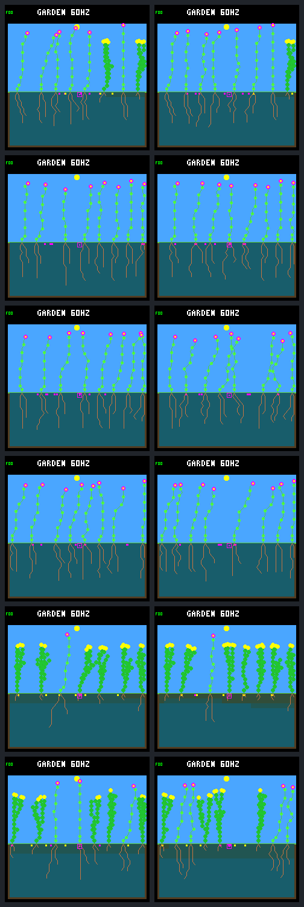

# Recurring winter openings restore some sustained renewal

Four recurring spatial diebacks increase primary-cohort 32-day survivors from
**4 to 25**. Every treatment garden produces children of post-day-384 recruits,
versus none under the stopped schedule. **Two of six treatments pass sustained
renewal**, versus zero controls. All twelve populations remain viable and retain
their baseline species and founder families.

The broad-signal gate still fails: it requires four renewing gardens spanning
all three weather seeds and both layouts; the two passes are ordinary layouts
on S1 and S2. The hazard kills 28 plants, including two younger than 32 days,
and natural deaths rise from 8 to 14. Recurring disturbance helps this panel,
but these costs and incomplete offspring follow-up prevent a general success
claim. No rule, controller or training objective is promoted.

## Fixed winter schedule and shared history

The [protocol](landing-patch-recurring-protocol.md) freezes the six cursor
gardens from the [waiting-time comparison](landing-seed-wait.md). Both arms
retain the fifteen original diebacks ending day 304 and the purchase cursor
starting after day 320. Waiting-time priority is disabled. Histories, ledgers,
old event receipts and pixels are identical through day 384.

Treatment adds events on days **396, 428, 460 and 492**, at the starts of every
other winter. Their four-column patches are respectively 4–7, 8–11, 12–15 and
16–19, continuing from the old sweep's final band. Selection depends only on
living plants' base columns, not age, lineage, species or resources. Corpses
retain their slots and tissue until ordinary decomposition; there is no instant
space refund, seed removal or gardener assistance.

The 32-day interval is four times slower than the earlier sweep, chosen before
implementation and runs. It is not a fitted optimum. Every resource/seed rule,
model byte, capacity, weather seed and build setting remains unchanged. The
implementation shares the existing transactional patch operation and preserves
the original preset; only the host CLI and schedule helper/header change at
runtime. Device code and the world/model ABI are untouched.

All 48 planned calls complete without retries: twelve day-384 anchors, twelve
day-512 endpoints, twelve exact repeats and twelve framebuffer-free runs.
Controls match the archived cursor results exactly. Treatment anchors differ
only in declared schedule metadata, kind and run-hash wrapping. Repeats match
results, complete ledgers and pixels; omitting capture changes only the absent
framebuffer CRC. This is three weather seeds in two layouts, not six independent
weather histories or fresh validation conditions.

## Established offspring and sustained renewal

Entries are **stopped / recurring**. S1, S2 and S3 are `3a7e45e6`, `366928c6`
and `275c8982`. Primary births are in `(384,480]`; all have complete potential
32-day follow-up. The three birth windows are `(384,416]`, `(416,448]`, and
`(448,480]`. A qualifying pair requires both parent and child in that primary
cohort and both surviving 32 days. Renewal additionally requires a survivor in
every birth window; inherited generation labels or refills alone do not count.

| Garden | Primary births | 32-day survivors | Qualifying pairs | Recurring survivors by window |
| --- | ---: | ---: | ---: | --- |
| S1 ordinary | 1 / 4 | 1 / 4 | 0 / 1 | 1, 1, 2 |
| S1 crowded | 0 / 5 | 0 / 4 | 0 / 0 | 1, 1, 2 |
| S2 ordinary | 2 / 7 | 1 / 5 | 0 / 1 | 2, 1, 2 |
| S2 crowded | 2 / 7 | 2 / 5 | 0 / 0 | 2, 0, 3 |
| S3 ordinary | 0 / 4 | 0 / 4 | 0 / 0 | 2, 1, 1 |
| S3 crowded | 0 / 4 | 0 / 3 | 0 / 0 | 1, 1, 1 |
| Total | 5 / 31 | 4 / 25 | 0 / 2 | 9, 5, 11 |

S1 ordinary's qualifying link is `51 → 53`, born on days 398.906 and 462.949.
S2 ordinary's is `41 → 43`, born on days 398.906 and 428.906. These are within-arm
identities, not matched individuals in diverged histories. Both established
ancestry chains contain two post-onset plants, rather than an inherited label
being mistaken for another observed generation.

Primary-cohort buyers increase from 3 to 21, and their seed purchases from 5
to 44. Control seeds yield four expiries and one pending seed. Treatment seeds
yield **12 germinations, 17 expiries and 15 still pending**. Thus improved access
now reaches actual children, unlike the waiting-time-only comparison. Pending
seeds are unresolved, not failed germinations.

The twelve treatment parent–child links have distinct outcomes:

- Two have both parent and child confirmed at 32 days.
- Six have an established parent and a living child too young to assess.
- One has an established parent but a primary-cohort child that dies young.
- One has an established child but a parent killed before age 32.
- Two have established parents but late-born children already observed dead.

Treatment has thirteen births after day 480: eleven living and too young for
32-day assessment, two observed dead. Controls have four late births, all
living and too young. These late cohorts do not enter the primary denominator.

## Mortality and population retention

Deaths below occur during `(384,512]`. Young deaths are at or before age 32.

| Garden | Natural deaths stopped / recurring | Recurring imposed deaths | Young natural stopped / recurring | Young imposed |
| --- | ---: | ---: | ---: | ---: |
| S1 ordinary | 2 / 0 | 5 | 0 / 0 | 0 |
| S1 crowded | 1 / 0 | 6 | 0 / 0 | 1 |
| S2 ordinary | 1 / 3 | 4 | 1 / 2 | 0 |
| S2 crowded | 2 / 3 | 5 | 0 / 1 | 1 |
| S3 ordinary | 1 / 2 | 4 | 0 / 0 | 0 |
| S3 crowded | 1 / 6 | 4 | 0 / 3 | 0 |
| Total | 8 / 14 | 28 | 1 / 6 | 2 |

Both young imposed deaths occur in the day-460 band: S1 crowded plant 49 is
31.160 days old, and S2 crowded plant 38 is 29.102 days old. They germinated
after the preceding event. **Thirty-two days between disturbances does not
guarantee a recruit thirty-two days of life**, particularly when it settles in
the next band. S2 plant 38 has an established posthumous child, but its own early
death prevents that pair qualifying and leaves the middle birth window empty.
Longer observation cannot undo this failure.

Every treatment ends with eight living plants. The only endpoint increase is
S3 ordinary, from seven to eight. Treatment transient minima are six except S3
crowded, which briefly reaches four; controls stay between six and eight. Every
16-day mean exceeds seven in treatment, above the required four, and no world
goes empty. Exact birth/death population conservation holds in all twelve runs.
The 42 treatment deaths versus eight control deaths are retained, not hidden by
the full endpoints. Lower natural deaths in S1 are not by themselves a survival
benefit: imposed deaths can preempt later natural deaths.

No baseline species or founder family loses living representation, even between
checkpoints. All three initially multi-species gardens and all five initially
multi-family gardens retain that variety. Three gardens are already monocultures
at the shared anchor, and every controller is W2; this is not general ecological
or neural-controller diversity qualification. Per-plant resource causes of the
extra natural deaths need observations beyond these lifetime/event ledgers.

## All paired endpoint images

Rows follow the tables. Left is the stopped schedule, right recurring winter
events, all at day 512. All twelve images are retained. Similar occupation at
the endpoint does not imply similar reproductive history.

## Evidence and validation

The [portable result](landing-patch-recurring-results.json.gz) retains all calls,
complete birth/seed ledgers, event receipts, derived outcomes, recruit purchases
and children, source/build/model identities and all comparison results. The
[tool guide](../../docs/garden-landing-tools.md#recurring-winter-comparison)
provides fresh collection and offline verification commands.

All nine selected CTest suites pass: native patch-sweep, cursor, waiting-time
and order contracts; the new recurring suite; and existing sweep, cursor,
waiting-time and competitive-renewal suites. The new Python suite has ten
tests, including the published-data checks. Native tests cover both schedules,
boundaries, multiple/empty hits, young victims, unchanged survivor/seed/soil/RNG
state, retained corpses, failed-step rollback, bad counts and write failures.
CLI tests cover invalid combinations, explicit identity, pre-onset world/pixel
parity, capture independence and output preservation.

Every recurring event is independently checked for its complete spatial victim
set, death classification, age and bounded stores. Unreceipted deaths, omitted
victims, altered schedules, invalid hashes, partial panels and changed derived
outcomes are rejected. The portable and full local bundle verify with subprocess
execution forbidden, regenerating every PNG and the complete gallery. All
twelve endpoint images were inspected. Builder clang-format 18, shell syntax,
Make target expansion, local links and `git diff --check` pass.

The bundle `artifacts/garden-landing-patch-recurring-v1/` contains 26,444,536 file
bytes (25.2 MiB), including a 2,673,178-byte source archive. Portable results add
268,151 bytes and the gallery 31,690 bytes. No large per-step traces, older full
bundle copies, firmware rebuilds, device flashes or training runs were needed.
Earlier evidence and protocols remain unchanged.

| Identity | SHA-256 |
| --- | --- |
| Frozen protocol | `be1b1fe9f6d422d806b64455afeed0eed0785459c0cec21c4ae7b0548b62292d` |
| Portable result | `d4a5b37d99e2ab8dda32befb083b7f7c8b75806580a996e5319cad1d86f7dde6` |
| Local bundle manifest | `3c8fe8e7c8021eb6f7e138d5d1c0f96d93f94558a56ef8b646e9c08c854ed845` |
| Review gallery | `6a919fdab66f1dfe30471f1a9dae12e481c37b3b43e653ce70ee30d348b4fefd` |

## Next proposal for unresolved offspring

Keep the cadence unchanged for the next investigation. Six new parent–child
links have living children awaiting a full 32-day assessment; changing the rule
now would mix that question with tuning. A bounded follow-up through day 544
should carry the spatial schedule forward, including the next winter event on
day 524 at columns 20–23, rather than protecting those children by pausing the
hazard. Fix the follow-up cohort and checks before running it.

This comparison remains a closed **2-of-6** renewal result with a failed broad
gate. A follow-up can resolve censoring and measure continued turnover, not
retroactively erase deaths or relabel late births as primary successes here.
Any later qualification still needs fresh conditions and explicit consideration
of mortality costs. No further event or horizon is implemented in this step.

The separately frozen [day-544 follow-up](landing-recurring-followup.md) now
resolves those children without changing this comparison: five establish,
one dies in the next scheduled patch, and one garden loses a founder family.
The original 2-of-6 result above remains unchanged.
