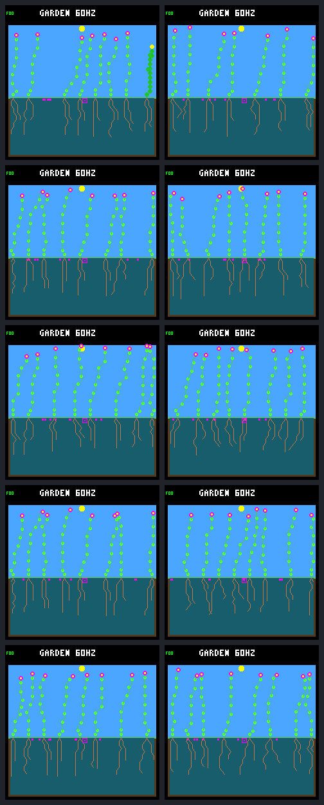

# Repeated spatial dieback enables descendant renewal

The fixed patch sweep passes its predefined pilot criterion in **all five
worlds**. Treatments produce 8–11 parent–child pairs in which both plants were
born after day 192 and survived sixteen days; every control produces zero.
Every treatment has a four-plant established ancestry chain, and none goes
empty during the observation window. This is renewal beyond immediate refill.

It comes at a cost: later sweeps kill ten young plants before sixteen-day
confirmation, two worlds have more natural deaths and maintenance shortfalls,
and one loses its remaining second species. This is a positive host diagnostic
under one weather seed and model, **not a qualified training environment or a
change to ordinary host/device ecology**.

## Fixed comparison and completed collection

The [original protocol](landing-patch-sweep-protocol.md) is unchanged. Both arms
retain eight plant slots, eight seed slots, 256 nodes, the captured controller
and each recipe's experimental construction/resource settings. Old named-lineage
deaths and paid seed replacement are absent from both arms. There is no gardener.

The treatment kills living plants based only on their base column: fifteen
four-column patches move left to right on days 192, 200, …, 304. All ages are
eligible; an empty patch stays empty. Corpses decompose normally. Seeds, soil,
survivor memory and RNG state are preserved; victims' stores are discarded
without refunds. Both arms end at day 320.

All **25 planned research calls** are complete: five archived baselines, five
controls, five treatments, five exact treatment repeats and five observer-free
treatments. The [interruption checkpoint](landing-patch-sweep-interruption.md)
preserves the original twelve-call stop and auditor correction. The separately
recorded [continuation plan](landing-patch-sweep-continuation.md) authorized only
the remaining thirteen calls, using the captured binaries and model. All twelve
earlier calls and the original source archive remain unchanged; none was retried.
The correction accounts for offspring age incrementing on the birth step and
does not change the simulation or elapsed-time survival calculations.

World labels below follow sorted recipe keys in the result artifact. All share
weather seed `f7ee4528`, capped uptake and wide late dispersal. Their inherited
research settings are:

| World | Visit order | Dawn reserve | Focal root allocation | Wicking |
| --- | --- | --- | --- | --- |
| W1 | Fixed | On | On | On |
| W2 | Fixed | On | Off | Off |
| W3 | Rotating | On | On | Off |
| W4 | Rotating | On | Off | Off |
| W5 | Rotating | Off | On | On |

## Renewal beyond immediate refill

Each cell is **control / treatment**. The cohort includes every birth strictly
after day 192. A qualifying pair requires both its parent and child to belong
to that cohort and have sixteen-day survival confirmed.

| World | Cohort births | Sixteen-day survivors | Qualifying pairs | Unique qualifying parents, treatment | Endpoint living |
| --- | --- | --- | --- | --- | --- |
| W1 | 1 / 22 | 1 / 16 | 0 / 9 | 6 | 8 / 7 |
| W2 | 3 / 21 | 2 / 16 | 0 / 10 | 7 | 8 / 8 |
| W3 | 2 / 22 | 2 / 16 | 0 / 11 | 7 | 8 / 8 |
| W4 | 3 / 21 | 2 / 18 | 0 / 10 | 8 | 8 / 8 |
| W5 | 2 / 16 | 1 / 12 | 0 / 8 | 5 | 8 / 8 |

Treatments have 102 cohort births, 78 confirmed sixteen-day survivors and 48
qualifying pairs; controls have 11 births, eight survivors and no pairs. These
are descriptive totals across related recipes, not independent statistical
replicates. The predefined gate needed improvement in three of five worlds
and no new empty endpoint; all five improve and remain occupied.

The deepest established post-onset chain is **four plants, or three parent–child
edges**, in every treatment, versus one plant in each control. For example, W1
lineages `31 → 32 → 38 → 43` are born on days 192.922, 201.895, 250.938 and
264.820. The first three die on days 248, 256 and 304; the last remains alive at
320. This follows actual parent IDs and birth times, not inherited generation
labels. W2 also has a fifth chain member born, but it has not yet passed
sixteen-day confirmation.

Posthumous children remain valid: respectively 2, 3, 2, 4 and 1 qualifying pairs
have a child born after its parent's death. Both individuals still meet the
survival criterion. Cross-arm numeric lineage IDs are not matched individuals
after histories diverge.

## Survival and censoring

Treatment survival entries are **confirmed / imposed-death / natural-death /
horizon-censored**. A death after a confirmation threshold does not erase that
confirmation; a recent living birth is censored, not counted as a failure.

| World | One day | Sixteen days | Thirty-two days |
| --- | --- | --- | --- |
| W1 | 22 / 0 / 0 / 0 | 16 / 4 / 0 / 2 | 11 / 6 / 1 / 4 |
| W2 | 21 / 0 / 0 / 0 | 16 / 2 / 0 / 3 | 13 / 3 / 0 / 5 |
| W3 | 21 / 1 / 0 / 0 | 16 / 3 / 1 / 2 | 14 / 3 / 2 / 3 |
| W4 | 21 / 0 / 0 / 0 | 18 / 1 / 0 / 2 | 14 / 2 / 0 / 5 |
| W5 | 16 / 0 / 0 / 0 | 12 / 0 / 0 / 4 | 11 / 0 / 0 / 5 |

All eleven control births survive one day. At both later thresholds the
controls have 1, 2, 2, 2 and 1 confirmed survivors, with respectively 0, 1, 0, 1
and 1 natural deaths and no imposed deaths or censoring.

Ten treatment victims die before sixteen-day confirmation: 4, 2, 3, 1 and 0 by
world. The youngest is W3 lineage 44, killed on day 256 at age 0.9765625 days.
Spatial targeting does not protect seedlings, and the fixed cadence can remove
new recruits as well as older occupants. No protective rule was added after
observing these losses.

## Mortality and resource costs

This table covers the whole population during the post-onset observation window,
not just the newborn cohort. Maintenance shortfalls retain their payment-count
denominators; the arms have different lifetimes and exposure.

| World | Imposed deaths, treatment | Natural deaths, control / treatment | Shortfalls / payments, control | Shortfalls / payments, treatment |
| --- | --- | --- | --- | --- |
| W1 | 20 | 1 / 3 | 22 / 65521 | 48 / 56270 |
| W2 | 20 | 3 / 1 | 26 / 65491 | 12 / 59541 |
| W3 | 18 | 1 / 3 | 11 / 63098 | 26 / 61602 |
| W4 | 20 | 3 / 1 | 26 / 65491 | 16 / 64419 |
| W5 | 16 | 2 / 0 | 28 / 64797 | 2 / 54330 |

Every natural death has an energy-only terminal cause. W1 and W3 have more
natural deaths and shortfalls despite fewer maintenance payments. The other
worlds' lower natural-death counts do not prove healthier individuals: imposed
death competes with starvation and shortens exposure.

The 94 imposed deaths discard energy/water totals of 5040/10199, 5040/10195,
4528/9161, 5040/10194 and 4032/8160 model units. The raw audit reconciles every
resource account, including these discards and birth endowments. That is
internal bookkeeping consistency, not a claim of a complete physical resource
cycle.

## Capacity and seed fates

Every world records all fifteen events. Only W3's day-224 patch is empty; no
replacement target is selected. All 94 imposed victims are reclaimed by day
320, after 0.234–0.254 garden days of ordinary decomposition, not immediate slot
release.

The minimum living populations in the complete post-step birth/death chronology
are 7, 6, 7, 6 and 7 for controls and 4, 3, 5, 6 and 4 for treatments. No world
goes empty during the measured window, not merely at its endpoint. Treatments
finish with 7, 8, 8, 8 and 8 stored plant slots and 224, 256, 256, 248 and 254
nodes; all ten endpoints have eight pending seeds. Capacity remains tight.

The following fates cover **seeds purchased after day 192**, distinct from the
birth cohort above. Fates are **germinated / expired / pending**.

| World | Purchases, control / treatment | Control fates | Treatment fates |
| --- | --- | --- | --- |
| W1 | 33 / 46 | 1 / 24 / 8 | 20 / 18 / 8 |
| W2 | 35 / 47 | 3 / 24 / 8 | 19 / 20 / 8 |
| W3 | 34 / 46 | 2 / 24 / 8 | 19 / 19 / 8 |
| W4 | 35 / 43 | 3 / 24 / 8 | 19 / 16 / 8 |
| W5 | 34 / 41 | 2 / 24 / 8 | 16 / 17 / 8 |

Treatment purchases total 223 versus 171 in controls, with 93 versus eleven
germinations. Nine additional treatment births come from seeds purchased before
onset, accounting for the 102-birth cohort. Pending seeds are right-censored;
expiry is not substituted for their unknown later fate.

## Diversity and endpoint review

All treatments finish flower-only. W1's control retains a shrub alongside
flowers, but its treatment kills the last shrub (lineage 25) on day 240. The
other controls are already flower-only. Renewal therefore does not establish
species diversity, and this panel includes a diversity regression.

All ten prescribed day-320 frames were reviewed. Rows are W1–W5, with control
on the left and treatment on the right. The frames show predominantly similar
tall shoots and extensive roots; W1's missing shrub is visible. There is no
apparent rendering corruption. Static endpoints do not demonstrate ancestry or
turnover; those claims use the ledgers. The HUD's `60HZ` label is not a timing
measurement or a device-performance result.

## Evidence and recommendation

The [complete portable result](landing-patch-sweep-results.json.gz) retains all
25 calls, ledgers, accounting summaries, source/build/model identities,
continuation provenance and gallery hashes. Its SHA-256 is
`dd5b43c954c9e82b51f1200819bdef6c9287c7e412bdf467964bb95bdd012f64`.
The full local raw bundle is `artifacts/garden-landing-patch-sweep-v1`; its final
manifest SHA-256 is
`c48725b1cd3419f3cb9f74c8b3ed6c24dffb13a26a54ecba06d3f582e535caaf`.

All five exact repeats match results, frames and traces. All five observer-free
treatments match results and pixels. Offline verification authenticates the
original twelve calls, reruns all fifteen control/treatment/repeat raw-accounting
audits without process launches, recreates the complete gallery from fixed raw
frames, and reproduces the compressed portable result byte-for-byte. See the
[tool guide](../../docs/garden-landing-tools.md#test-repeated-spatial-dieback) for
verification commands and the earlier interruption record for implementation
validation at that checkpoint.

The completed capture passes all twelve sweep-contract checks and six
continuation checks with no skips, plus the native patch-sweep suite. The host
configure/build succeeds. All
numeric table rows were checked against the saved result, and 213 local
file/anchor references across the eight related documents resolve. The PNG
gallery was visually inspected; rendered Markdown layout was not previewed.

The result supports the narrower explanation that **recurring spatial openings
enable repeated descendant renewal in this panel**. It does not identify an
optimal disturbance rate, show generalization, remove the experimental resource
guards, or qualify the ordinary ecology for training. Shared weather/model and
related recipes limit the evidence; seedling deaths, resource harms and species
loss remain real costs.

The next proposal is a small, predeclared confirmation panel with fresh weather
seeds and starting layouts, keeping this controller and all rules fixed. Retain
the same renewal, survival, resource-cost and diversity measurements, including
failures. Discuss that scope before running it. No broader training, new neural
inputs, fitness revision, default promotion or device flashing follows from this
pilot automatically.

That separately scoped [fresh-condition confirmation](landing-patch-confirmation.md)
is now complete. It retains this pilot unchanged and reports the new six-pair
comparison, limitations and subsequent proposal separately.
