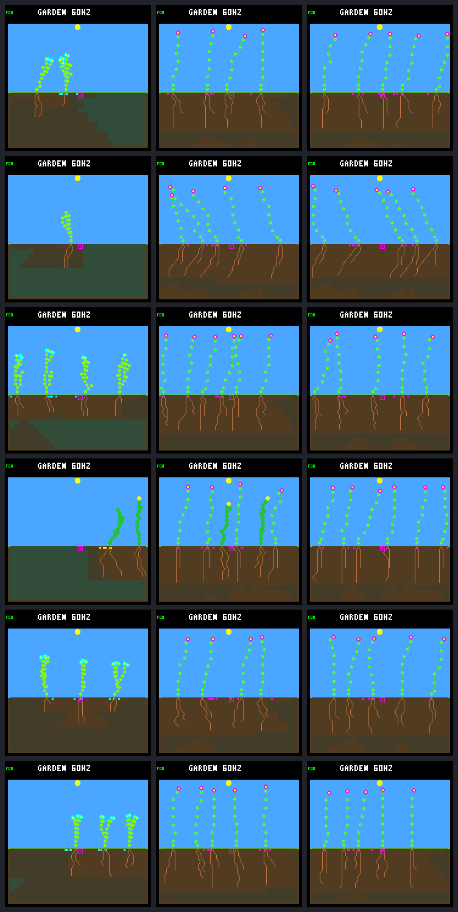

# Spacing aware placement shifts renewal gaps without fixing them

Choosing an unoccupied landing within the parent's existing dispersal range
does not pass the renewal screen. Compared with shoot reservation alone,
seasonal late first-day survivors fall **41 → 39**, and the four zero-credit
periods remain. Two previous gaps close, but two new ones open. The candidate
also loses to the original eligible-32 control in all six seasonal score
comparisons. Keep it host-only and off in ordinary runs.

There are useful local successes: 42 redirected seeds germinate, and 17 of
their children survive their first day. Those are observed outcomes in the
candidate, not 17 matched rescues. Earlier landings change later competition,
seed supply and neural observations, even though model weights stay fixed.

## Fixed rule and comparison

The [predeclared protocol](landing-placement-protocol.md) freezes the same
twelve model/world pairs for 192 Garden days, gardener off. Three arms retain
the same 32-node budget and water eligibility:

| Arm | Shoot reservation | Placement |
|---|---|---|
| Eligible 32 | Off | Ordinary |
| Reserve 32 | On | Ordinary |
| Spacing | On | Spacing-aware |

At an otherwise paid seed purchase, retain the ordinary landing if it is
spacing-clear. Otherwise, choose among the parent's same six nominal choices
that pass the native spacing rule, including retained dead plant slots.
Reflection duplicates retain their multiplicity. If all choices are blocked,
keep the ordinary landing and purchase.

The selection uses the existing draw `r`: ordinary index `r % 6`; alternative
index `(r / 6) % clear_count` in the ascending list of clear choice indices.
It adds no draw or mutation, changes no costs or cooldown, and does not consult
light, moisture, cold, capacity or future weather. Normal germination still
checks every gate. No range, model, score, ecology default or device change is
promoted.

## More births do not ensure sustained renewal

Late births use the unchanged (day 62, day 190] cohort, with complete first-day
follow-up. Each climate has six worlds and 24 scored world-periods.

| Metric | Eligible 32 | Reserve 32 | Spacing |
|---|---:|---:|---:|
| Steady births through day 192 | 36 | 18 | 30 |
| Steady late births | 16 | 1 | 3 |
| Steady late first-day survivors | 1 | 0 | 1 |
| Steady late renewal confirmations | 0 | 0 | 1 |
| Steady zero-credit periods | 24 | 24 | 23 |
| Seasonal births through day 192 | 236 | 119 | 126 |
| Seasonal late births | 184 | 65 | 57 |
| Seasonal late first-day survivors | 107 | 41 | 39 |
| Seasonal late first-day deaths | 77 | 24 | 18 |
| Seasonal late renewal confirmations | 107 | 41 | 39 |
| Seasonal late seed expiries | 122 | 162 | 168 |
| Seasonal zero-credit periods | 0 | 4 | 4 |
| Seasonal total credited ticks | 8,204,760 | 5,153,025 | 5,956,440 |
| Sum of each seasonal world's weakest-period credit | 1,399,545 | 141,495 | 72,900 |

The unchanged score prioritizes individual-world continuity before total
credit. Thus the seasonal aggregate key worsens despite greater total credit.
The candidate fails seasonal score and survivor retention against **both**
controls. Steady retention and improvement checks pass, and no new or earlier
biologically empty world appears; these do not override the seasonal failures.

The sole steady credit is 1,410 ticks in multi /34's first late period. All
26 steady founders remain alive at day 192 in every arm. Four crowded steady
worlds have no births in any arm; spacing is blocked across every reachable
choice at all 192 candidate purchases in those four worlds.

### Seasonal gains and regressions

The final-period credit columns below cover (day 158, day 190]. The score
comparison uses all four late periods, not just that final interval.

| World | Late survivors reserve → spacing | Final credit reserve → spacing | Full score versus reserve |
|---|---:|---:|---|
| Single /33 | 6 → 5 | 0 → 50,595 | Win |
| Multi /33 | 6 → 7 | 0 → 22,305 | Win |
| Single /34 | 8 → 6 | 144,630 → 0 | Loss |
| Multi /34 | 10 → 9 | 14,715 → 0 | Loss |
| Single /35 | 6 → 6 | 0 → 0 | Win |
| Multi /35 | 5 → 6 | 0 → 0 | Win |

Both /35 wins come from increased total credit; their weakest periods remain
zero. Both /34 regressions remain visible rather than being hidden by pooled
gains. Seasonal late first-day deaths change from 14 energy, nine water and one
combined shortage under reservation to seven energy, nine water and two combined
shortages with placement. These are different birth cohorts, not matched causal
survival estimates.

## The placement rule has limited room to act

These counts cover all candidate purchases through day 192, not just late
purchases. The spacing and full-gate columns use purchase-time observations.

| Candidate purchases and outcomes | Steady | Seasonal |
|---|---:|---:|
| Paid purchases | 318 | 394 |
| Every reachable choice spacing-blocked | 285 | 330 |
| Redirected purchases | 13 | 36 |
| Selected landing spacing-clear | 33 | 64 |
| Selected landing passes all hypothetical mature gates | 4 | 28 |
| Redirected seeds germinating | 12 | 30 |
| Redirected seeds expiring | 1 | 6 |
| Redirected children surviving their first day | 2 | 15 |
| Redirected children dying within their first day | 10 | 15 |

All redirected seeds have resolved fates; all their children have complete
first-day follow-up. Child outcomes are joined by `child_id` within each world.
Of those 25 first-day deaths, ten are energy-only, twelve water-only and three
combined shortages. Avoiding an occupied landing is not equivalent to finding
a site where a seedling can establish.

Most purchases still have no spacing-clear alternative: 615 of 712 in the
candidate. This establishes a limit on the rule's operation in these runs,
not a proof that widening dispersal or forcing turnover would improve renewal.
The counts differ from the controls because earlier placement changes alter
later populations and purchases.

Species diversity does not recover. Seasonal late survivors remain 36 flowers,
while shrubs fall from five to three and ground cover stays at zero. All 31
candidate plants alive at the seasonal endpoints are flowers; the reserved
control retains 28 flowers and two shrubs. No seasonal founder survives to
the endpoint in any arm.

## Endpoint review

Columns are eligible 32, reserve 32 and spacing. Rows are single /33, multi /33,
single /34, multi /34, single /35 and multi /35. These are fixed day-192 captures,
not selected best runs. Both sheets were visually inspected.



The [steady endpoint sheet](frames/landing-placement-steady.png) uses the same
ordering. Healthy-looking adult stands do not demonstrate fresh renewal.

## Verification and reproduction

There are **108 full experimental replays and 36 initial snapshots**, with
zero training. Every arm has combined placement/recruitment/reach tracing,
an untraced endpoint capture, and repeated traces plus endpoint capture.
All repeated results, trace bytes and framebuffer bytes match. Both controls
match archived complete biological results, raw recruitment traces and pixels
in all twelve worlds.

Native tests exhaust the supported origin/trait/spacing masks, including
reflection aliases and maximum RNG input. Same-state paid purchases preserve
world bytes after normalizing only seed columns: RNG, mutations, costs,
cooldowns and seed counts are unchanged. Native reach masks independently check
placement receipts, and full seed lifetimes reconcile with recruitment audits.
CLI tests cover explicit options, invalid receipts, missing samples, no-clobber
outputs, identities and observer parity.

The [portable result](landing-placement-results.json.gz) retains all 36 histories,
first-day resource accounts, placement receipts, species partitions, unchanged
gates and provenance. The local bundle verifies full raw traces and all 412
artifact hashes. All 162 host CTests pass, as do the standalone Garden world
and neural checks. Ordinary firmware builds successfully; no device was flashed.

```sh
make host-screen-landing-placement \
  GARDEN_LANDING_PLACEMENT_OUT=artifacts/new-placement-screen
docker compose run --rm -T firmware python3 -W error sim/garden_landing_placement.py \
  --verify benchmarks/garden-seasons/landing-placement-results.json.gz
docker compose run --rm -T firmware python3 -W error sim/garden_landing_placement.py \
  --verify artifacts/garden-landing-placement-v1
```

Portable SHA-256: `c94d1d8e466dd0e81b399cf7416f353cb5533cb1e8288d33f17719097ef7fa82`.
Local manifest SHA-256: `f04e1d84db9b14e415ee13d17393aab4c91c682a85ec01c74779e44ff924a7e7`.
Frozen native binary SHA-256: `bb656ba70955d261864d0b2034b56ada60a2b7b85850a321c18c1b68d98f110b`.

## Next question

The subsequent [saved-run turnover diagnosis](landing-placement-turnover.md)
answers this question: the /33 gains are older carry-in credit, and all four
focal candidate stands remain spacing-blocked without established-plant deaths.
The original proposal below is retained as the record of what was tested.

Keep this negative screen intact. A bounded next diagnosis can use the saved
records to compare the two new /34 gaps with the /33 gains: did credit disappear
because occupants aged out, died before replacement, seeds stayed blocked, or
new children failed? Track the redirected seeds and later cohorts separately.
The hypothesis that earlier establishment fills sites with persistent adults
is worth testing, not yet established by this comparison.

Do not retune the choice rule, expand training, widen dispersal, force mortality
or relax renewal scoring from these reused worlds. Any next intervention needs
a separate proposal; there is no production or device promotion here.
