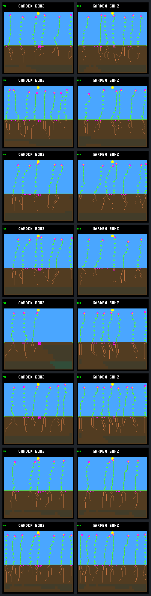

# Population dawn-reserve qualification

The dawn guard does **not** pass population qualification. Two of eight pairs
pass the predeclared harm checks; six regress on population, reproduction or
resource-shortage rates. The guard remains host-only and off by default.
The useful result is a reproducible population test, not a policy promotion.

The [prospective protocol](landing-population-protocol.md) fixed the candidate,
one diagnostic and three fresh weather seeds, fixed/rotating reproduction order,
and day-256 endpoints. All 32 calls completed: sixteen distinct worlds and exact
repeats. Both arms use the same paid birth-root preference and continuous
daylight protection for all living non-founders from age two, including later
descendants. Only the candidate adds the unchanged dawn reserve.

This is broader than the previous single-lineage intervention. Its population
control is not the previous diagnostic's unprotected surrounding population.
Model weights, ecology, prices, capacity, placement and weather rules stay fixed.
No training, extra experimental calls, firmware flash or default change occurred.

## Every paired outcome

Values are daylight control → dawn candidate. Shortages count actual unpaid
maintenance bills, not persistent flags. Successful parents are non-founders
with at least one child confirmed alive beyond one day; that is not proof of
long-term renewal.

| Weather / order | Offspring energy-shortage bills | Water-shortage bills | Alive at day 256 | Successful parents |
| --- | ---: | ---: | ---: | ---: |
| Diagnostic 940cfdc4 / fixed | 29 → 3 | 252 → 201 | 6 → 7 | 16 → 14 |
| Diagnostic 940cfdc4 / rotating | 16 → 3 | 238 → 177 | 8 → 6 | 16 → 13 |
| Fresh f7ee4528 / fixed | 6 → 36 | 132 → 237 | 5 → 7 | 10 → 18 |
| Fresh f7ee4528 / rotating | 37 → 47 | 141 → 230 | 7 → 5 | 12 → 18 |
| Fresh 04fa8f03 / fixed | 35 → 16 | 126 → 69 | 3 → 7 | 8 → 6 |
| Fresh 04fa8f03 / rotating | 38 → 16 | 142 → 77 | 6 → 8 | 11 → 7 |
| Fresh 5181d0db / fixed | 4 → 0 | 138 → 136 | 5 → 5 | 7 → 7 |
| Fresh 5181d0db / rotating | 10 → 0 | 156 → 154 | 8 → 8 | 10 → 10 |

Both 5181d0db pairs pass; the other six fail. Four of six fresh pairs improve
unpaid-unit rates, but only two also retain all population/reproduction checks.
The two order variants share a weather seed: they are not independent weather
replicates. Every endpoint contains only species 0, so species retention here
does not establish a diverse ecosystem.

## Fewer shortfalls and more survivors are different objectives

The diagnostic seed lowers both shortage rates, yet loses successful parents
and one-day confirmations in both orders. Rotating order also loses three
32-day survivors (16 → 13) and closing live credit (860160 → 737280 ticks).

Seed 04fa8f03 shows the clearest survival/reproduction tradeoff. Fixed order
raises endpoint population from three to seven and closing credit from 368640
to 860160, while successful parents fall from eight to six. The offspring's
unpaid energy per thousand maintenance opportunities falls from 1.983 to 0.620;
water falls from 5.731 to 1.605. This is a real resource improvement, but not a
clean improvement in renewal. Rotating order has the same direction of tradeoff.
Bank-only blocked reproduction visits rise from 21017 to 34112 in fixed order
and 24548 to 34173 in rotating order. These are actual recorded opportunities,
not proof that changing bank capacity would help.

Seed f7ee4528 reverses the resource benefit. Fixed order increases maintenance
opportunities from 52558 to 67349, but the problem is not merely more exposure:
unpaid energy per thousand opportunities rises **0.285 → 1.128** and water
**5.860 → 8.746**. More offspring reproduce successfully, but more also face
shortfalls. Rotating order worsens both rates too and loses endpoint population,
three 32-day survivors (13 → 10), and closing credit (974010 → 818325).

For 5181d0db, endpoint population, seed purchases, successful-parent counts and
closing credit match. Energy shortages disappear and water shortfalls decline
slightly. The worlds are not identical: resource histories, geometry and some
death timing differ. Matching totals must not be called identical ledgers.
In each order, matched plants 14, 17 and 24 die respectively 360, 120 and 60
ticks earlier; the rotating candidate also extends plant 27's life by 120
ticks. Passing these predefined population checks is not a guarantee for every
individual, nor a demonstrated improvement at every age or time window.

Founder lifetime credit is unchanged in every pair. Most founder resource totals
also match, but 04fa8f03's candidate increases founder unpaid water by one unit
(85 → 86) in each order. Excluding founders from the guard does not isolate them
from competition. No active bid encountered an unavailable dawn estimate.

## What changed first, and what remains unexplained

The first changed choices are at ticks 219675, 403545, 35025 and 123825 for the
four listed weather seeds respectively, the same in each order variant because
rotation starts later, at 606720. Complete pre-choice trace prefixes match after
removing only the dawn receipt. Forecasts, ordinary prices and combined choices
reconcile independently for all plants.

In f7ee4528, the first difference is plant 9's eight-to-nine-node stem extension
at 403545. It has 93 energy and three roots. Its old maintenance-increase margin
is zero; reserving six energy for dawn changes that margin to −6, so the candidate
defers. The projected-income margin alone remains positive at 84. No energy is
granted and no price changes. This establishes the first intervention, not a
causal explanation of every later shortage.

Later birth cohorts diverge. Only thirteen ancestry/birth-time/site identities
match between f7ee4528 arms, including founders. Numeric IDs after divergence
are not paired individuals. In the fixed candidate, several late shortfalls
belong to later descendants, including plant 28: born at 648405, dead at 916620,
with 31 unpaid energy units, no unpaid water and a final 30-node body without
active tips. Its control namesake is not assumed to be the same plant.

The next bounded investigation should use these saved traces, without new
simulation or tuning: follow f7ee4528's common plant 9 through the first changed
growth/seed events, then separate matched-cohort effects from the later
descendants' shortages. Check maintenance, reproduction spending, illumination
and water competition at the failure windows. An afternoon construction guard
cannot be assumed to prevent every later resource deficit in a mature body.
Do not adjust the reserve, bank, controller or qualification criteria together.

That [saved-trace audit is now complete](landing-population-audit.md): matched
offspring improve, while different later cohorts include mature resource
failures without recent growth or seed spending. Plant 9 flowers earlier, not
later. No further reserve tuning or policy promotion follows from this result.

## Gallery and evidence



Rows follow the outcome table. All sixteen prescribed endpoint images are
included and were visually inspected. The display's “60HZ” label is the nominal
simulation rate, not a performance measurement from these headless runs.

`make host-probe-landing-population` reproduces the panel in a fresh
`GARDEN_LANDING_POPULATION_OUT`. Complete raw receipts live in
`artifacts/garden-landing-population-v1` (about 29 GiB, including uncompressed
traces); the portable bundle retains summaries, complete ledgers, all shortage
events, growth histories and first-effect witnesses, not every bid.

```sh
docker compose run --rm -T firmware python3 sim/garden_landing_population.py \
  --verify benchmarks/garden-seasons/landing-population-results.json.gz
docker compose run --rm -T firmware python3 sim/garden_landing_population.py \
  --verify artifacts/garden-landing-population-v1
```

| Artifact | SHA-256 |
| --- | --- |
| [Portable results](landing-population-results.json.gz) | `c823c7b9d1c19d476403a5741a6ff25996ad60847f4340e2207ba2260091fa2a` |
| Raw manifest | `9e6322e3ae8709c94f7c4d6d762783214a735b9104848b3ccc5e3a4f7a15a58a` |
| Protocol | `ddd2910bbf115a747439ebdf4108ee5e52c3b759ad045ddc8fdcee8f7a105c2d` |
| Native executable | `11e02e4d432db79e92b6587400e09ef0212f4077c86a047a72c29e54396a2bbb` |
| Build configuration | `f93e432ba3d6c2704864bf10ffb3dddcc93e442878d605864862a5180184b0e6` |
| Gallery | `23d6d6b625f9c0c3ccbb6e90acbbb957b45e3a7bf827b3f61899fe93556eb63a` |

The capture freezes 2285 source files. The fresh-seed audit covers 192 prior
benchmark JSON/JSON.gz artifacts; the seeds were selected before outcomes.
All 183 host CTests passed (350.02 seconds, four workers), including the native
scope and seven initial population tests. Ten population tests pass after
capture, including frozen outcomes, corruption rejection and a spending boundary
correction: an eligible EXTEND with no destination still pays when it closes
the tip. That correction changes only the independent checker, not the captured
executable, policy, calls or saved outcomes. It and the outcome-specific tests
postdate the source snapshot. Firmware remains untouched.
The three postcapture CTest entries for native scope, population and the prior
dawn experiment also pass (50.37 seconds). The portable verifier passes, local
documentation links resolve, and formatting/diff checks pass.
Complete raw-bundle reanalysis also passes for all eight pairs with the corrected
checker: full receipts, identical repeats, first-effect prefixes, all artifact
hashes and all 2285 archived source hashes. The saved outcomes are unchanged.
