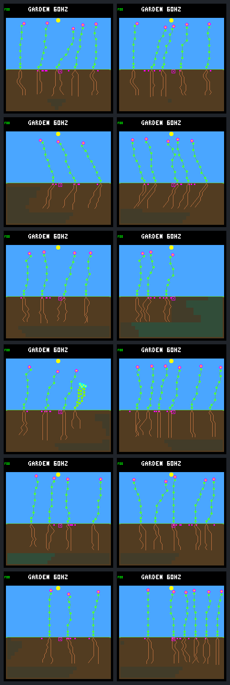
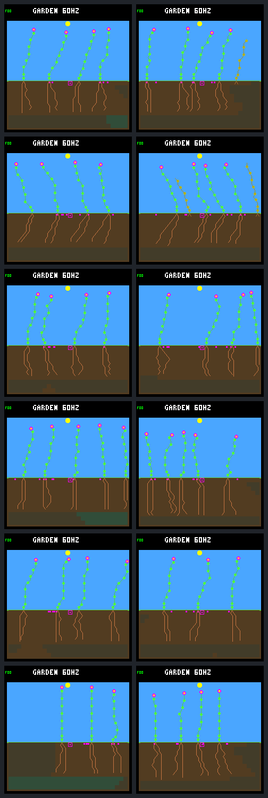

# Wider dispersal: more seedlings, insufficient establishment

**The fixed narrow/wide screen fails its prespecified gates.** Keep ordinary
dispersal as the default. Across the same twelve selected cases, wider dispersal
raises late births from **127 to 268**, but first-day survivors only rise from
**55 to 60** and first-day deaths rise from **72 to 208**. Steady-world renewal
and survival worsen. Seasonal survivors improve, but the primary score worsens
because one window loses all established descendants.

No model was retrained, no objective changed, and no firmware was modified or
flashed. These are retrospective diagnostic cases, not independent replicates
or a fresh generalization panel. No second range or resource rule was tuned.

## Treatment and interpretation boundary

The [protocol](landing-range-protocol.md) was frozen before the panel. Both
arms use the six archived single/multi live finalists from searches /33–/35
on the same twelve worlds as the [reach diagnosis](landing-reach.md), for
192 Garden days. Every research switch is OFF except the existing wider-range
option in the treatment: `5–7 + inherited trait` becomes `3–9 + inherited trait`.
The one random draw, direction, reflection, mutation, costs, dormancy, lifespan,
spacing, capacities, rainfall and climate rules are unchanged.

An important detail surfaced during review: the existing range-aware landing
observations also project over the active dispersal support. The same network
weights can see different occupancy/water/light summaries and choose different
growth even before a seed lands. This is the **existing wider-range environment
with consistent observations**, not a physical-landing-only intervention holding
neural inputs identical. No additional feature algorithm was changed. Separating
physical reach from controller response would require a separate experiment.

Rule bits remain explicit (narrow 0, wide 1). Initial biology matches exactly;
only rule metadata and rule-aware fingerprints differ. The ordinary trainer
still rejects experimental ecology. Both arms use the unchanged pure scorer,
without relabeling wide results as ordinary. Descendants diverge between arms,
so no individual seed/child is treated as a matched counterfactual.

## Births versus first-day establishment

Late children are born in (62,190], followed through their first day or death.
Every member has a full day of potential follow-up. These are cohort counts
and survival fractions, not exposure-adjusted mortality rates.

| Climate | Late births, narrow → wide | First-day survivors | First-day deaths | Qualifying late confirmations |
|---|---:|---:|---:|---:|
| Steady, six worlds | 13 → 44 | 4 → 3 | 9 → 41 | 4 → 1 |
| Seasonal, six worlds | 114 → 224 | 51 → 57 | 63 → 167 | 51 → 57 |
| All twelve | 127 → 268 | 55 → 60 | 72 → 208 | 55 → 58 |

The overall first-day survival fraction falls from 43.3% to 22.4%. A day-surviving
child is not automatically renewal-eligible: the unchanged rule also requires
a confirmed descendant parent. The last column counts qualifying confirmations
occurring in (62,190], not births in that interval; the cohorts are intentionally
distinct even where counts coincide.

First-day death shortages increase from **22 → 82 energy-only**, **43 → 108
water-only**, and **7 → 18 combined**. Every resource budget balances. These
receipts identify the stores that fail at death, not proof that one universal
reserve or growth cap would fix them. Root acquisition, growth spending, light
timing and competition can all differ after the trajectories diverge.

## Renewal and contrary cases

The four-component key is lexicographic: worst terminal tier, sum of tiers,
sum of each world's weakest-window credit, then total credit. It retains the
same four late windows and age-bounded credit. Do not average away a terminal
regression or treat total credit as the whole score.

| Climate | Narrow key | Wide key | Paired wins / losses |
|---|---|---|---:|
| Steady | `[1,24,0,456540]` | `[1,24,0,215055]` | 2 / 4 |
| Seasonal | `[1,24,837480,5699160]` | `[0,23,833385,5896380]` | 3 / 3 |
| All | `[1,48,837480,6155700]` | `[0,47,833385,6111435]` | 5 / 7 |

In multi /35's seasonal world, the day-128 follow-up snapshot for the (94,126]
window changes from one established descendant to four young, unestablished
descendants and one banked seed, with no living founders. It is not empty, but its terminal tier
falls from 1 to 0. More survivors and total credit cannot override this
higher-priority regression.

| Finalist | Steady survivors, narrow → wide | Steady score | Seasonal survivors | Seasonal score |
|---|---:|---|---:|---|
| single /33 | 1 → 0 | loss | 7 → 5 | loss |
| multi /33 | 0 → 0 | win | 6 → 3 | win |
| single /34 | 1 → 0 | loss | 12 → 16 | win |
| multi /34 | 1 → 1 | loss | 8 → 15 | win |
| single /35 | 1 → 0 | loss | 11 → 8 | loss |
| multi /35 | 0 → 2 | win | 7 → 10 | loss |

Both /34 seasonal cases genuinely improve survivors and score. Multi /33 gains
nonzero credit in its formerly zero-credit window despite fewer survivors and
less total credit; the individual-minimum objective deliberately recognizes that
continuity. Contrary cases remain visible rather than selecting only failures.

Late seed expiries remain **192 → 192** in steady worlds and fall **151 → 134**
seasonally. No world becomes biologically empty in either arm. At day 192,
total living plants rise **47 → 57** and each arm still has 96 banked seeds.
Historical durable parents rise **45 → 51**. Fuller endpoints and cumulative
reproduction do not imply reliable ongoing renewal.

Passed gates: no earlier/new empty world; retain seasonal late survivors;
improve at least one climate's qualifying confirmation count. Failed gates:
retain steady key, retain steady late survivors, retain seasonal key. Therefore
`passes_screen` is false. This does not prove wider dispersal is inherently
harmful under every controller.

## Fixed visual review

All 24 production-rendered day-192 frames are retained, not selected winners.
In both sheets: narrow left, wide right; rows are single /33, multi /33,
single /34, multi /34, single /35, multi /35. Raw captures repeat exactly.

### Steady

### Seasonal

Several wider endpoints look fuller, consistent with the living counts, but
these pictures cannot show the day-128 terminal regression or establish renewal.

## Decision and next discussion

Keep narrow dispersal, model bytes and objective unchanged. Close this bounded
screen without tuning another range. Next focus on **first-day establishment**:
use the retained resource trajectories to choose one small resource-allocation
or training experiment under ordinary ecology. Do not combine it with range
widening or assume additional birth resources are the answer. If physical
versus observation effects need attribution, plan a separate factorial rather
than inferring it from this panel. Nothing is promoted here.

## Evidence and verification

- [Protocol](landing-range-protocol.md), [workflow](../../docs/garden-landing-range.md),
  [readable summary](landing-range-summary.json), [full portable results](landing-range-results.json.gz).
- All twelve narrow results, scores, budgets and raw traces exactly reproduce
  the earlier recruitment panel. Both arms pass untraced capture and traced
  repeats for full state, trace bytes and pixels.
- The 24 worlds contain 1,179,648 ecology samples, 9,117,047 actual seed checks
  (9,117,916 visits including expiry), and 103,449 first-day resource samples.
  Pending seeds/recent children remain censored in the full results.
- Frozen bundle: `artifacts/garden-landing-range-v1`, with both binaries/caches,
  source, models, inputs, initial/final results, original/repeated traces and
  original/repeated raw frames. Independent verification reproduces the complete
  panel and checks all 405 artifact hashes.

### Test coverage and limits

The complete ordinary-build suite passes **145/145** tests. Both builds pass
the range, resource-audit and native dispersal checks; the range regression also
recomputes the portable scores, budgets, gates and image hashes.

The full experimental-wide suite is **not green**: 122/135 pass. Seven existing
tests require ordinary environment metadata (`garden-climate-replay`,
`garden-rainfall-smoke`, `garden-experiment-bundle`, `garden-gallery-smoke`,
`garden-node-audit-smoke`, `garden-establishment-smoke`,
`garden-policy-probe-smoke`). `garden-experiment-smoke` depends on an ordinary
ready-seed fixture. The four Garden sequence checks (generations, lifecycle,
smoke, mature) and `garden-profile-smoke` require ordinary golden states.
Wider ecology intentionally changes those states; their guards are left intact.

An explicitly filtered wide-compatible rerun passes **122/122**, including the
new range regression. This is subset coverage, not a replacement for the full
ordinary suite or evidence that all existing workflows support wide ecology.
The full failed run and filtered rerun are retained in
`artifacts/garden-landing-range-wide-tests.log` and
`artifacts/garden-landing-range-wide-applicable-tests.log`; ordinary results are
in `artifacts/garden-landing-range-narrow-tests.log`. The independently replayed
24-world experiment supplies the treatment-specific evidence above. No device
performance claim follows from these host tests.

Manifest SHA-256:
`f15e65d6655575d5f40253458f75010a41e24bab0fcd218e6cc9c4ec8befd109`.
