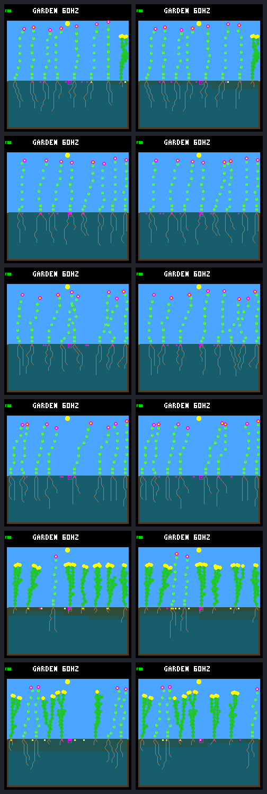

# Recurring winter offspring survival through day 544

**Five of the six previously unresolved parent–child links now have both
members confirmed at age 32 days.** The sixth child dies in the scheduled
day-524 patch at age 29.133 days. Across all eleven late-born plants alive at
day 512, ten establish and remain alive at day 544; the same imposed death is
the only failure. These observations resolve the frozen cohorts completely.

All six populations remain viable and end with eight living plants. However,
the extra interval contains eight imposed deaths and three natural deaths,
including one young death of each kind. One crowded garden loses a founder
family: its last living plant dies in the patch and its final seed expires
later. All baseline species remain represented. This is useful renewal, with
real turnover costs—not a general qualification result or a rule promotion.

## Fixed continuation and cohort boundaries

The [protocol](landing-recurring-followup-protocol.md) follows the same six
treatment gardens from the [recurring winter comparison](landing-patch-recurring.md).
It preserves the W2 model, purchase cursor, resources, weather, capacities,
fifteen original diebacks and four subsequent winter events. It adds exactly
one event on **day 524 at columns 20–23**, continuing the 32-day cadence and
spatial sequence. All living plants in that band are eligible, regardless of
age or ancestry. Corpses decompose normally; seeds and surviving plants receive
no protection or refunds. The horizon is day 544.

All 24 prescribed research calls complete without failure or retry: six
day-512 anchors, six day-544 endpoints, six exact repeats and six capture-free
endpoints. Anchors match the saved state, complete ledgers, old event receipts
and pixels after removing only the declared follow-up identity. Endpoints
preserve the full day-512 history. Repeats match exactly; omitting capture
changes only the absent framebuffer CRC.

This is a selected follow-up, with no new stopped-schedule controls. It cannot
estimate the extra natural deaths relative to an unobserved control interval.
The earlier **2-of-6 sustained-renewal result and failed broad gate remain
closed**. These late births do not move into that experiment's primary cohort.

## All unresolved offspring outcomes

S1, S2 and S3 are seeds `3a7e45e6`, `366928c6` and `275c8982`; ordinary and
crowded are the two existing layouts. IDs refer to plants within each garden.
Every focal parent was already confirmed at age 32 on day 512.

| Garden | Focal parent to child | Child outcome at age 32 | All late survivors established |
| --- | --- | --- | ---: |
| S1 ordinary | 54 to 55 | Confirmed, still alive | 1 of 1 |
| S1 crowded | 50 to 53 | Confirmed, still alive | 1 of 1 |
| S2 ordinary | None | Not in the focal cohort | 1 of 1 |
| S2 crowded | 37 to 42 | Confirmed, still alive | 1 of 1 |
| S3 ordinary | 52 to 53 | Imposed death at age 29.133 | 2 of 3 |
| S3 crowded | 45 to 48 and 42 to 51 | Both confirmed, still alive | 4 of 4 |
| Total | Six links | Five confirmed, one failed | 10 of 11 |

S3 ordinary child 53 germinates on day 494.867 in column 20. Its age-32
deadline is day 526.867, after the next patch strikes on day 524. Its death is
therefore a failed establishment, not missing follow-up. The hazard acts on
location rather than plant age; equal disturbance and establishment intervals
do not guarantee enough time for a seed that germinates after a disturbance.

The two previously established post-day-384 parent–child links remain, giving
seven such established links across five gardens by day 544. This descriptive
count is not a replacement sustained-renewal score: it includes children born
outside the earlier primary window. S3 ordinary still has no such confirmed
pair. Dead siblings and parents that failed their own age threshold are not
substituted away.

Eleven additional plants are born in `(512,544]`. Ten remain alive but are
still younger than 32 days; S3 ordinary plant 56 dies naturally at age 1.832
days. These new births are reported separately, not added to the eleven
previously censored survivors. The interval contains 55 seed purchases, of
which seven germinate and 48 are pending at the endpoint. Four of the eleven
births instead come from seeds purchased on or before day 512.

## Mortality and population retention

Counts cover `(512,544]`. A young death is at or before age 32.

| Garden | Births | Imposed deaths | Natural deaths | Young imposed / natural | Minimum living | Mean living during days 512–528 | Endpoint living |
| --- | ---: | ---: | ---: | --- | ---: | ---: | ---: |
| S1 ordinary | 1 | 1 | 0 | 0 / 0 | 7 | 7.815 | 8 |
| S1 crowded | 1 | 1 | 0 | 0 / 0 | 7 | 7.814 | 8 |
| S2 ordinary | 3 | 1 | 2 | 0 / 0 | 5 | 7.735 | 8 |
| S2 crowded | 1 | 1 | 0 | 0 / 0 | 7 | 7.817 | 8 |
| S3 ordinary | 3 | 2 | 1 | 1 / 1 | 6 | 7.858 | 8 |
| S3 crowded | 2 | 2 | 0 | 0 / 0 | 6 | 7.884 | 8 |
| Total | 11 | 8 | 3 | 1 / 1 | — | — | 48 |

Every population stays nonempty. Both 16-day means exceed the required four;
every garden has exactly eight living plants throughout `(528,544]`. Exact
population conservation holds separately in each garden: starting population
plus births minus deaths equals the endpoint population. The three natural
deaths are S2 ordinary plants 45 and 46, both older than 47 days, and the new
S3 ordinary seedling 56. Their resource-level causes are not measured here.

## Founder family loss despite a full population

S3 crowded's founder family 4 has only plant 38 alive at day 512. Its other
recent descendants, plants 43, 46 and 47, have already died. The day-524 event
kills plant 38 in column 20, leaving no living member of that family for the
rest of the observation period.

One family seed remains: plant 38 purchased it on day 505.875 in column 15.
It does not germinate and expires on day **537.875**. From then through day
544 the family has neither a living plant nor a pending seed. This is a family
loss, not just a temporary gap between generations. The ledger establishes the
seed's fate, not which landing or resource constraint prevented germination.

All other day-512 founder families retain continuous living representation,
and every baseline species does so in all six gardens. S3 crowded retains two
species and two other families. A founder family denotes ancestry here, not
a distinct neural controller: every plant uses W2. Family turnover can be a
legitimate outcome of competition, but a full plant count must not conceal it
when assessing variety and renewal.

## Paired images before and after follow up

Rows follow the tables. Left is day 512 and right is day 544. All twelve
frames are retained and inspected; similar full endpoints conceal changes in
identity, survival and ancestry.

## Evidence and implementation

The [portable result](landing-recurring-followup-results.json.gz) contains all
24 calls, complete lifetime/seed ledgers, all event receipts, frozen cohorts,
derived outcomes and the unchanged earlier decision. The
[tool guide](../../docs/garden-landing-tools.md#recurring-winter-offspring-follow-up)
provides collection and offline verification commands.

Only the host CLI and schedule helper/header change at runtime. The helper
uses one transaction and fixed descriptors for its three schedules, avoiding
different death semantics between presets. The new opt-in flag adds a separate
receipt and hash wrapper; the old four-event mode and ordinary 512-day limit
remain unchanged. Only the follow-up flag allows 544 days. Model/world ABI,
device defaults, general evaluator limits and training remain unchanged.

The complete portable and local bundle verify with subprocess execution
disabled. Verification regenerates all eighteen captured PNGs and the gallery,
checks all artifact/source/model hashes, independently reconciles spatial
victims and exact age thresholds, and reproduces the derived results. Native
tests cover old-mode compatibility, exact event timing, multiple and empty
hits, young victims, retained state, failed-step rollback and output errors.
Python tests cover frozen cohorts, CLI bounds, capture neutrality, death at
the exact age deadline, later deaths and rejected evidence tampering.
All ten selected CTest suites pass, including all eleven tests in the new
follow-up suite and the existing recurring, sweep, cursor, waiting-time and
competitive-renewal checks. Builder clang-format 18, Make target expansion,
local documentation links and `git diff --check` also pass.

The local bundle contains **16,971,628 file bytes, about 16.2 MiB**, including
a 2,948,101-byte source archive. Portable results add 165,800 bytes and the
gallery 28,982 bytes. No large traces or copies of older complete bundles are
created. Earlier evidence and frozen protocols remain intact.

| Identity | SHA-256 |
| --- | --- |
| Frozen protocol | `6956c27c1fb302f9bcf3f6bf957bc8dcef8f8ff8bc323b6c228c6ae9c4b581b6` |
| Portable result | `634d35468b6c2cc09603dd9c4b0af29e82cd95779446db333a7a2579e7c00884` |
| Local bundle manifest | `d2441d4e879150a119415dc4d2893134bb66211e5344edf8b300d2e3b353874e` |
| Review gallery | `1fc7a5396b062b49a31242a6999bc47394cd84bcf38e557d14b2cd54f2dc0541` |

## Next proposal for fresh conditions

The unresolved offspring question is now answered. The next useful test is a
prospective comparison of recurring versus stopped disturbance on fresh weather
seeds, with a window fixed in advance that allows recruits and their children
to establish. Keep the disturbance cadence, spatial rule and W2 controller
unchanged rather than tuning around the one young casualty or lost family.

Define population viability, multi-generation renewal and species/family losses
separately before running that panel. Individual deaths and some family turnover
are compatible with the A-life goal; neither births nor full endpoints alone
demonstrate a useful training environment. This is a proposal for another test,
not a claim that the failed earlier qualification gate now passes. No further
event, horizon, experiment, training or deployment is included in this step.

### Separately completed fresh-weather comparison

The subsequently approved [fresh panel](landing-recurring-fresh.md) completes
66 calls on three new seeds and both layouts, with wider 64-day birth windows
declared in advance. All six recurring gardens pass its renewal criterion
versus none of the stopped controls. The earlier 2-of-6 score above remains
unchanged. The new report retains mortality, one family extinction and the
limitation that all six fresh gardens were already flower-only at onset.
