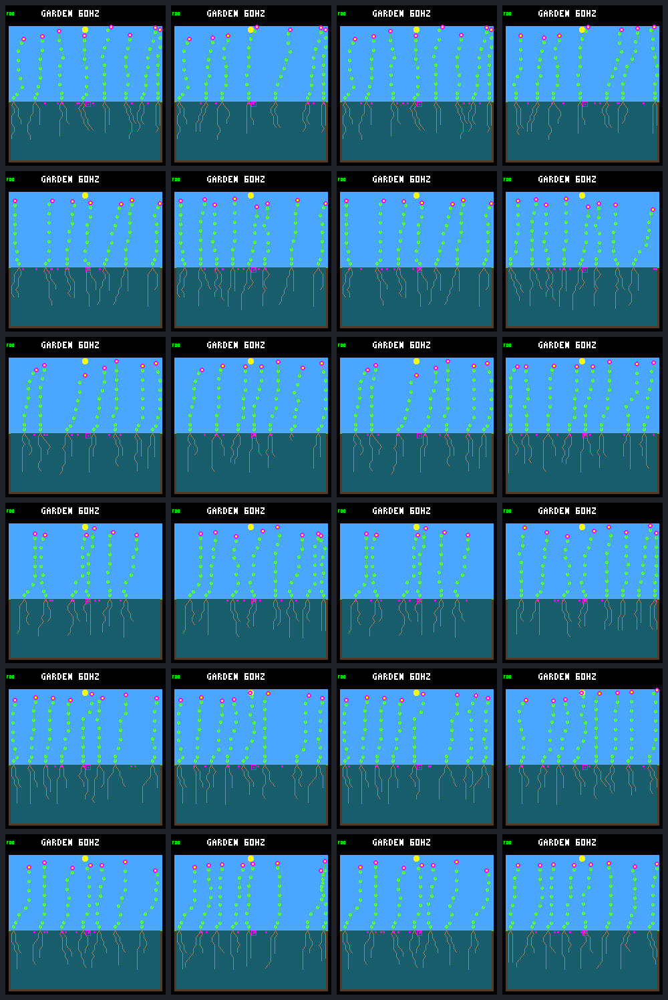

# Recurring renewal on fresh weather seeds

**All six recurring gardens meet the prospective renewal criterion; none of
the six stopped controls does.** Across the primary birth cohort, 44 of 52
treatment recruits survive 32 days, compared with two of two control recruits.
The treatment has 21 established parent–child links and ancestry chains of two
to four established plants. Every population passes the viability floors.

This is a positive renewal result with costs: recurring disturbance kills 50
plants, including five young recruits; natural deaths are seven versus one in
controls. One crowded treatment loses a founder family. All six gardens were
already flower-only before the arms diverged, so this panel cannot demonstrate
mixed-species persistence. The earlier 2-of-6 result remains closed, and no
rule, model or training objective becomes a default.

All 66 prescribed calls complete without failure or retry. Frozen-executable
anchors, exact repeats, capture-free runs and offline bundle verification pass.

## What was fixed before the comparison

The [protocol](landing-recurring-fresh-protocol.md) derives three seeds from a
fixed SHA-256 rule without inspecting their worlds. None appeared in the 115
existing compact season captures. S1, S2 and S3 below are `840f7cda`, `d6033864`
and `a9802f60`, each in ordinary and crowded rain-fed layouts. These are three
paired weather histories, not six independent weather samples.

Both arms use the same W2 controller, purchase cursor, resource and construction
rules, eight plant slots, eight seed slots and 256 tissue nodes. They share the
fifteen earlier spatial diebacks ending on day 304 and the cursor starting
strictly after day 320. Recurring adds seven four-column events on days 396,
428, 460, 492, 524, 556 and 588. The last event wraps to columns 0–3, completing
one spatial cycle. Stopped adds no events. Cadence, all-age eligibility and
normal decomposition remain unchanged; empty hits are retained.

The observation interval is `(384,608]`. Primary births occur in `(384,576]`,
giving each a full 32-day opportunity to establish. Renewal requires at least
one established recruit in each of three **64-day** birth windows, plus an
established direct parent–child pair born within that primary cohort. Death at
or before the age-32 deadline fails establishment; later adult death does not
erase it. Posthumous children are allowed, without inflating a dead parent's
observed lifespan.

These wider windows were declared prospectively. They are not the earlier
experiment's three 32-day windows, and the fresh worlds and longer observation
period also differ. The new 6-of-6 result must not replace or be presented as a
rescore of the old 2-of-6 result. The population floors remain unchanged: no
empty interval, a mean of at least four plants in every 16-day block, and at
least four plants at the endpoint.

## Renewal in every retained pair

Fractions below are established recruits / primary births. A control with
`0 / 0` has no eligible births, not a measured zero-percent survival rate.
Window counts cover `(384,448]`, `(448,512]` and `(512,576]`, respectively.

| Garden | Stopped established / born | Recurring established / born | Recurring established per window | Recurring established links | Deepest recurring chain |
| --- | ---: | ---: | --- | ---: | ---: |
| S1 ordinary | 1 / 1 | 8 / 9 | 3, 2, 3 | 2 | 2 |
| S1 crowded | 0 / 0 | 7 / 7 | 3, 2, 2 | 5 | 4 |
| S2 ordinary | 0 / 0 | 6 / 10 | 1, 3, 2 | 3 | 2 |
| S2 crowded | 0 / 0 | 9 / 12 | 3, 3, 3 | 6 | 4 |
| S3 ordinary | 1 / 1 | 7 / 7 | 2, 3, 2 | 4 | 3 |
| S3 crowded | 0 / 0 | 7 / 7 | 3, 3, 1 | 1 | 2 |
| Total | 2 / 2 | 44 / 52 | 15, 16, 13 | 21 | — |

All six recurring gardens meet both renewal requirements, covering all three
seeds and both layouts; all six remain viable. Stopped has no qualifying links
and no garden with an established recruit in all three windows. The declared
broad within-panel renewal-advantage gate therefore passes.

The deepest chains are observed ancestry, not generation labels: S1 crowded
has plants `49 → 50 → 52 → 54`, and S2 crowded has `41 → 46 → 48 → 50`, with
every member born after day 384 and confirmed at age 32. All plants still use
W2; these are not separately trained controllers.

There are ten further treatment births after day 576. All remain alive but
younger than 32 at day 608, so they stay censored and outside the primary
denominator. Controls have no late births. Across the entire observation
interval, births are 62 versus two. Eight treatment primary recruits die young:
five imposed deaths and three natural deaths. None is hidden by censoring.

## Mortality and population floors

Counts cover `(384,608]`, including deaths of plants already alive at onset.
Young means death at or before age 32. The block mean is the lowest exact
16-day mean in that garden, not a mean over selected snapshots.

| Garden | Recurring imposed deaths (young) | Natural deaths stopped → recurring | Recurring young natural deaths | Minimum living stopped → recurring | Lowest block mean stopped → recurring | Endpoint living stopped → recurring |
| --- | ---: | --- | ---: | --- | --- | --- |
| S1 ordinary | 8 (1) | 0 → 2 | 0 | 7 → 6 | 7.445 → 7.263 | 8 → 7 |
| S1 crowded | 7 (0) | 0 → 0 | 0 | 7 → 6 | 7.000 → 6.889 | 7 → 8 |
| S2 ordinary | 9 (3) | 0 → 2 | 1 | 7 → 5 | 7.000 → 6.634 | 7 → 8 |
| S2 crowded | 9 (1) | 0 → 2 | 2 | 6 → 5 | 6.000 → 5.884 | 6 → 8 |
| S3 ordinary | 9 (0) | 1 → 0 | 0 | 7 → 6 | 7.983 → 7.633 | 8 → 8 |
| S3 crowded | 8 (0) | 0 → 1 | 0 | 7 → 5 | 7.000 → 5.887 | 7 → 8 |
| Total deaths / endpoint living | 50 (5) | 1 → 7 | 3 | — | — | 43 → 47 |

All twelve populations stay nonempty. Exact conservation holds in each garden;
in aggregate, recurring starts with 42 plants, adds 62 births, loses 57 plants
and ends with 47. Stopped starts with the same 42, adds two births, loses one
and ends with 43. The higher endpoint population does not erase temporary
declines, young deaths or family loss. Resource-level causes of natural deaths
are not measured by this ledger-only comparison.

Purchases and their endpoint fates are also retained. Counts concern seeds
purchased after day 384; they need not equal births, which can come from older
seeds.

| Garden | Purchases stopped → recurring | Germinated stopped → recurring | Expired stopped → recurring | Pending stopped → recurring |
| --- | --- | --- | --- | --- |
| S1 ordinary | 57 → 63 | 1 → 10 | 48 → 45 | 8 → 8 |
| S1 crowded | 56 → 63 | 0 → 8 | 48 → 47 | 8 → 8 |
| S2 ordinary | 56 → 67 | 0 → 12 | 48 → 47 | 8 → 8 |
| S2 crowded | 56 → 68 | 0 → 13 | 48 → 47 | 8 → 8 |
| S3 ordinary | 57 → 59 | 1 → 8 | 48 → 43 | 8 → 8 |
| S3 crowded | 56 → 65 | 0 → 10 | 48 → 47 | 8 → 8 |
| Total | 338 → 385 | 2 → 61 | 288 → 276 | 48 → 48 |

One treatment birth uses a seed purchased on or before day 384. More purchases
alone are not the result: the primary evidence is established descendants.

## A family loss and an earlier diversity limit

S1 crowded loses founder family 1 under recurring disturbance, while its
stopped control retains it continuously. Plant 41 is the family's last living
member at onset. The day-428 event kills it in column 10. Its final seed,
purchased on day 398.9375 in column 15, expires on day **430.9375**. From that
point through day 608, the family has neither living plants nor pending seeds.
The garden's eventual eight plants all descend from founder 5. This is an
extinction within the observed world, not merely a living-generation gap.

Every other onset family retains continuous living representation. Ordinary
gardens start this interval with only family 1; crowded gardens start with
families 1 and 5. Family denotes ancestry, not an independent neural model.
This loss sets the separate diversity-tradeoff flag; individual and family
turnover are not automatic vetoes of the declared renewal gate.

Species retention after day 384 is a weak check here: every onset population
and seed bank already contains only flowers. Shrubs and ground-cover have
lost both their last plant and last pending seed before the arms diverge:

| Garden | Shrub absent with no pending seed from day | Ground-cover absent with no pending seed from day |
| --- | ---: | ---: |
| S1 ordinary | 304.969 | 70.578 |
| S1 crowded | 216.000 | 97.031 |
| S2 ordinary | 65.891 | 65.188 |
| S2 crowded | 104.016 | 32.953 |
| S3 ordinary | 103.781 | 102.469 |
| S3 crowded | 320.922 | 102.453 |

These dates come from the shared reference histories, not an effect of the
new recurring schedule. All six remain flower-only through day 608. The data
therefore support continuing generations under the tested controller and
conditions, not sustained coexistence or controller variety.

## All paired images

Rows follow the six gardens above. Columns are **day 512 stopped, day 512
recurring, day 608 stopped, day 608 recurring**. All 24 frames are retained and
visually inspected; similar-looking full gardens can have very different
ancestry and turnover.

## Evidence and implementation

The [portable capture](landing-recurring-fresh-results.json.gz) retains the
complete lifetime and seed ledgers, all event receipts and call identities,
derived results and the unchanged earlier decision. The
[tool guide](../../docs/garden-landing-tools.md#fresh-seed-recurring-comparison)
documents the explicit day-608 mode and collection/offline verification commands.

The new mode changes only the host CLI and patch helper/header at runtime.
It uses the same transactional death operation as the older presets. An
explicit enabled field distinguishes stopped from recurring, and `GPN1`
separately tags the mode without changing the old receipts. Ordinary replay
retains its 512-day bound and the old follow-up retains its 544-day bound.
There is no new world/model ABI, firmware state, training run or deployment.

The 66 calls comprise six day-384 references on the frozen earlier executable,
twelve day-384 anchors on the new executable, twelve day-512 intermediate
captures, twelve day-608 endpoints, twelve exact repeats and twelve capture-free
endpoints. Every anchor matches reference state, complete ledgers, old event
receipts and pixels after removal of only the new mode identity. All anchors
pass before longer runs begin. Endpoints preserve both earlier histories;
repeats match exactly, and omitting capture changes only the absent framebuffer
CRC. There are no retries, replacement worlds or post-outcome rule changes.

Portable and full local verification pass with subprocess execution disabled.
The verifier checks all 66 call receipts, source/model/binary identities,
complete spatial victim sets, ages, mortality classifications, storage bounds
and derived outcomes. It regenerates all 54 captured PNGs and the 24-frame
gallery. A separate direct ledger calculation confirms the cohort counts,
parent–child links, population minima and exact block means. All eleven selected
CTest suites pass, including all twelve tests in the fresh-panel Python suite
with its published-data checks enabled. The selected set also covers native
patch/cursor/waiting/order contracts and the older sweep, cursor, waiting,
recurring, follow-up and competitive-renewal suites. Builder clang-format 18,
Make target expansion, local documentation links and `git diff --check` pass.
The full project suite, remote CI and device performance are not retested here.

The local bundle contains **38,861,141 file bytes, about 37.1 MiB**, including
a 3,118,512-byte source archive of 755 files. The portable capture adds 358,930
bytes and the review gallery 48,946 bytes. No per-step traces or copies of older
complete bundles are created. Earlier evidence and frozen protocols remain
intact.

| Identity | SHA-256 |
| --- | --- |
| Frozen protocol | `2b380d9fdd192ba8a9415e97775af3efd3f421e2a425cbf4e7507355348f99a9` |
| Portable result | `816188ca9e909ff90a21f6729e5cd3fd0472fd84541d1186133efeb269fda341` |
| Local bundle manifest | `5478b1de291c3d3c2db0e7b23ffb00f67801a1e94e9281be4d0fa07b7bd21407` |
| Review gallery | `2c815721ebd9e5987df0ae1667e26b3ea65b5f8a61b866b222f156f10474c162` |

## Recommendation

The bounded fresh-weather renewal question now has a positive verified answer:
with the fixed W2 controller and prospective 64-day birth windows, continuing
the disturbance supports established descendants across all six gardens where
stopping it does not. Review this as an integration checkpoint; another
intervention is not needed to publish it.

The next separate question is variety. An offline audit of the saved pre-day-384
histories can distinguish the last shrub/ground-cover deaths, failed replacement
seeds and their timing relative to the earlier sweeps. That would bound a
subsequent test without assuming that competitive adult deaths must be prevented
or that one lost founder family invalidates useful renewal. Broader training,
ecological promotion and device deployment remain separate decisions.
