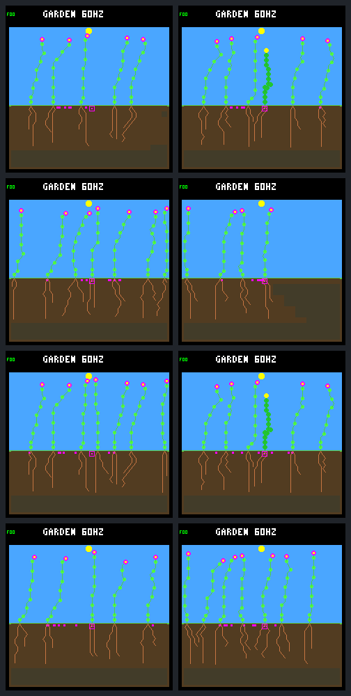

# Focal root allocation improves survival but fails population checks

One root-priority intervention extends the matched shrub's life from **13.97
to about 45.15 garden days** and raises its seed production from one to two.
All four focal comparisons pass their checks. **None of the four population
comparisons passes:** offspring water-shortage rates increase in every pair.
The rule remains an opt-in host diagnostic; no broader trial or default change
is justified by the frozen stopping rule.

The [protocol](landing-root-allocation-protocol.md) fixes lineage 9, born at
403365 to parent 4, generation 1, shrub, column 24. Sixteen full-horizon native
calls cover daylight/dawn guards and fixed/rotating reproduction order, each
with allocation off/on and an exact repeat. The model, weather, prices,
construction budget, candidate directions and spending guards are unchanged.
There is no training, gardener, irrigation, parameter sweep or device flash.

## The intervention

Exactly **one bid is boosted and one winning choice changes per candidate
world**. At tick 406695 with daylight guards, or 406755 with dawn protection,
root tip 22 replaces the selected shoot bid. The unchanged destination is
`(201,161)`, moisture 18, at the ordinary price of seven energy and five water.
Complete physical prefixes match through the pre-action state: 27112 or 27116
earlier ecology samples respectively.

Both bodies finish at 32 nodes. The control buys one root and 27 shoots after
birth; the candidate buys two roots and 26 shoots. Final root count is **3 → 4**.
Shoot closures remain two under daylight guards and three under dawn guards;
there are no paid root closures. Total construction cost and the final
maintenance brackets do not change. Mandatory terminal closures retain their
higher priority.

On the next ecology sample, focal water income is **2 → 5** units; at the next
growth opportunity it is **1 → 4**. The new trajectory no longer satisfies the
water-deficit predicate there. The two/three substitutions found by reranking
the old trajectory in the preflight are therefore not repeated interventions
in the changed world. Normal winner memory and later decisions may diverge.

## Focal outcomes

The two reproduction orders share each complete focal history: rotation starts
after 606720, later than either candidate's death. These are **two distinct
early A/B histories**, not four independent survival demonstrations.

| Measure | Daylight control → candidate | Dawn control → candidate |
| --- | --- | --- |
| Death tick | 457020 → 576780 | 457020 → 576720 |
| Lifetime in garden days | 13.973 → 45.160 | 13.973 → 45.145 |
| First flower | 406515 → 406515 | 404100 → 404100 |
| First seed | 406860 → 406920 | 406860 → 406860 |
| Seeds | 1 → 2 | 1 → 2 |
| Children confirmed alive at one day | 0 → 1 | 1 → 1 |
| Maintenance opportunities | 895 → 2891 | 895 → 2890 |
| Unpaid water units over whole life | 31 → 59 | 29 → 56 |
| Unpaid water per opportunity | 0.03464 → 0.02041 | 0.03240 → 0.01938 |
| Unpaid energy units | 0 → 0 | 0 → 0 |

The dawn candidate also has one child that dies before the one-day confirmation.
The saved result retains each child's status; failed or censored recruitment
is not counted as successful. Both candidate focal plants eventually die,
discarding 252 energy units and no water. This is a substantial extension of
survival, not permanent survival or autonomous renewal.

### Equal exposure

Through tick 457020, each arm faces **895 maintenance opportunities**. Candidate
water shortfalls are **zero**, versus 31/29 unpaid units in the daylight/dawn
controls. Each candidate still holds 22 water and 252 energy at that boundary.

Most additional water uptake still overflows. In the daylight pair, income
rises 4562 → 5867 and overflow 935 → 2187, leaving only **53 extra retained
units**: 31 pay upkeep that the control misses and 22 remain stored. In the dawn
pair, income 4614 → 5926 and overflow 981 → 2242 leave **51 extra retained
units**: 29 additional upkeep and 22 stored. Growth and reproduction water
spending are identical at this shared cutoff. The benefit is usable water at
the right time, not merely a larger gross-uptake total.

### Full lifetime water accounts

All start with 24 water units and finish with zero. Each row balances initial
water plus income against overflow, construction, reproduction and paid upkeep.
Complete energy accounts, every shortage, allocation/closure event and body
change are retained in the [portable results](landing-root-allocation-results.json.gz).

| Guard and arm | Income | Overflow | Construction | Reproduction | Paid upkeep |
| --- | ---: | ---: | ---: | ---: | ---: |
| Daylight control | 4562 | 935 | 150 | 24 | 3477 |
| Daylight candidate | 19865 | 8258 | 150 | 48 | 11433 |
| Dawn control | 4614 | 981 | 155 | 24 | 3478 |
| Dawn candidate | 20442 | 8832 | 155 | 48 | 11431 |

## Population outcomes

Endpoint increases do not hide failed pairs. The metrics below use all
offspring, including the focal plant; rates are unpaid units per **1000
maintenance opportunities**, not percentages of plants or bills.

| Baseline | Final living | Seed parents | Successful parents | Confirmed 1 day survivors | Confirmed 32 day survivors |
| --- | --- | --- | --- | --- | --- |
| Fixed daylight | 5 → 6 | 18 → 18 | 10 → 13 | 19 → 22 | 10 → 12 |
| Fixed dawn | 7 → 4 | 22 → 20 | 18 → 16 | 33 → 31 | 12 → 9 |
| Rotating daylight | 7 → 6 | 20 → 20 | 12 → 13 | 23 → 22 | 13 → 12 |
| Rotating dawn | 5 → 7 | 23 → 27 | 18 → 20 | 32 → 37 | 10 → 10 |

| Baseline | Energy shortage rate | Water shortage rate | Closing window plant ticks |
| --- | --- | --- | --- |
| Fixed daylight | 0.285 → 0.989 | 5.860 → 6.545 | 614400 → 737280 |
| Fixed dawn | 1.128 → 0.210 | 8.745 → 12.288 | 924300 → 492765 |
| Rotating daylight | 1.961 → 0.989 | 5.312 → 6.545 | 974010 → 737280 |
| Rotating dawn | 1.997 → 0.141 | 8.654 → 12.383 | 818325 → 792660 |

All pairs retain species and founder credit and have the same first empty
population tick, 400440, before the intervention. The complete failed checks are:

- Fixed daylight: energy and water shortage rates.
- Fixed dawn: water rate, final living, seed parents, successful parents,
  one- and 32-day survivors, and closing-window credit.
- Rotating daylight: water rate, final living, one- and 32-day survivors, and
  closing-window credit.
- Rotating dawn: water rate and closing-window credit.

Birth matching uses ancestry, birth tick, site and species rather than reusing
numeric lineage IDs. Later cohorts differ, so the aggregate regression does
not by itself establish water competition with the focal plant as its cause.

## Final screenshots

All frames are at day 256; the focal plant has already died. Left is control,
right is candidate. Rows are fixed daylight, fixed dawn, rotating daylight,
rotating dawn. These show the resulting populations, not a surviving focal
plant. Manual inspection confirms complete rendered frames and the visibly
sparser fixed-dawn candidate; all eight frames are retained, including losses.



## Verification and artifacts

All **191 capture-source host CTests pass** with undefined-behavior sanitization. Native tests
cover boundary predicates, each spending guard, reservation/cap refusal, scope,
terminal priority, unchanged proposals and observer failure rollback/recovery.
Short CLI tests cover rejection before output creation, repeats, the first
predicted active substitution and trace-on/off neutrality. They are separate
from the sixteen full-horizon experimental calls.

After retaining the results, all **ten focused Python tests pass**, including
offline portable verification, corrupt coverage/priority/repeat/prefix/conclusion
rejection and regression assertions that preserve the population failure despite
the focal improvement. The native allocation test also passes again. Post-capture
changes are limited to reports, retained artifacts and result assertions; the
implementation and executable remain identical to the frozen capture.

The capture preserves 2326 source files, the frozen protocol, executable and
build cache. Controls exactly match historical results, all three trace hashes
and pixels. Repeats exactly match within each arm. Full receipt analysis and
first-effect comparisons pass, including independent reanalysis of the raw
bundle and verification of the portable result. Commands are:

```sh
make host-probe-landing-root-allocation  # Requires a fresh output directory
docker compose run --rm -T firmware python3 sim/garden_landing_root_allocation.py \
  --verify artifacts/garden-landing-root-allocation-v1
docker compose run --rm -T firmware python3 sim/garden_landing_root_allocation.py \
  --verify benchmarks/garden-seasons/landing-root-allocation-results.json.gz
```

The local raw bundle is about 19 GiB; the portable result is about 8.9 MiB.
Neither verification command executes the simulator. The capture-source test
log is `artifacts/garden-landing-root-allocation-ctest.log`.

| Artifact | SHA-256 |
| --- | --- |
| Portable results | `8877c4e6f7f951ec06c546c5fc6f3e0ea0175a250b70e21596e734cd8fa63d76` |
| Raw manifest | `b2aab73b6ed9fadf1e28d1dd32e28911202661ca0ff593cc3c1a3641f4195972` |
| Protocol | `a4f5c23a79c344377b15e63cfa118bd76f1263a2dcd8a4fc1883a7d329d662f6` |
| Executable | `d8aff498a26245936959222e4beadad935bc3484a20cd7fd0e897e26e6e34639` |
| Build cache | `f93e432ba3d6c2704864bf10ffb3dddcc93e442878d605864862a5180184b0e6` |
| Paired gallery | `b2c12c25031b3d478eea9102a2d531debaa742c29a1a772bc39f821ea7bc225e` |

## Decision and proposed follow up

Stop this capture without tuning or widening the selector. The evidence supports
the motivating individual's allocation diagnosis, but fails the agreed gate
for a population-wide trial. Firmware and normal policies remain unchanged.

The [completed offline decomposition](landing-root-allocation-audit.md) finds
both changed cohorts and worse matched resource budgets. Equal-exposure
nonfocal water deficits rise by 36 units under daylight guards and 15 under dawn
guards. Earlier deaths mask much of that in full-lifetime totals. Later matched
losses also include extra seed spending, not only lower uptake. No additional
simulation or allocation heuristic was needed; the audit records the proposed
next investigation of saved reproduction gates and resource timing.
