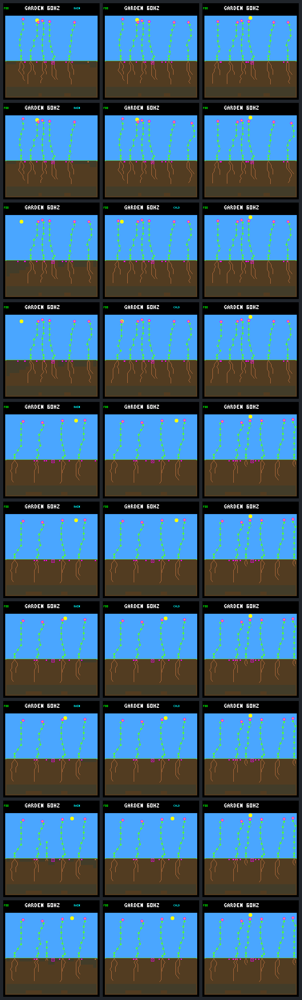

# One early root fixes the water shortage, not survival

Giving each of the three failed S35 seedlings one early root allocation
increases water uptake but makes it die **earlier from energy shortage**.
Both successful harm checks still establish and remain alive through day 256.
The targeted override is diagnostic only; neither it nor a new default rule
is promoted.

## What was changed

The [prospective protocol](landing-root-choice-protocol.md) fixes five
independent pairs. At each named seedling's birth tick, prefer an existing,
affordable root EXTEND over the shoot bid that originally won. Both arms
germinate the same seed into the same pre-growth state. The candidate pays
the same ordinary price and allocates one root instead of one shoot. All
later choices use the unchanged model. Priority is the only proposal field
changed: destination ordering, memory proposals, costs, water eligibility,
shoot reservation, node capacity and random draws remain unchanged.
Normal winner-only memory advancement still follows the selected decision.
This tests a different choice by the controller, not a morphology-only edit
with its later private state artificially held fixed.

Multiple eligible root bids receive the same maximum priority, so normal
traversal resolves their tie. This does **not** select the wettest destination
or necessarily the largest original priority. The shared executor, not the
probe, performs the purchase. The trace verifies exactly one root allocation
and no priority overrides outside the named plant and tick.

## All five results

“Day” is the existing 3,840-logic-tick simulation cycle. Numbers below are
internal resource units, not physical quantities. Fixed-order cases are
successful harm checks; rotating-order cases are the known failures.

| Case | First-day outcome, control → candidate | Age at death, days | First shortage, control → candidate |
| --- | --- | ---: | --- |
| fixed 45 | establishes → establishes | alive at day 256 in both | none → none |
| fixed 46 | establishes → establishes | alive at day 256 in both | none → none |
| rotating 48 | dies → dies | 0.273438 → 0.226562 | water → energy |
| rotating 49 | dies → dies | 0.289062 → 0.242188 | water → energy |
| rotating 50 | dies → dies | 0.421875 → 0.234375 | water → energy |

Deaths move earlier by 180, 180 and 720 logic ticks. All three candidates
have three roots rather than two, with **no water-shortage maintenance
receipts** before death. Their terminal water discards are 14, 26 and 6;
they die with usable water remaining, not merely a changed cause label after
stores have been cleared.

To avoid comparing unequal lifetimes, the following income/spending totals
use the same window in each pair: birth through the candidate's earlier
death, inclusive. These are direct sums of the saved first-day receipts.

| Case | Water income, control → candidate | Energy income | Energy spent on growth | Candidate's final paid growth leaves |
| --- | ---: | ---: | ---: | ---: |
| rotating 48 | 38 → 66 | 46 → 38 | 81 → 90 | 4 energy |
| rotating 49 | 56 → 95 | 74 → 71 | 108 → 117 | 6 energy |
| rotating 50 | 25 → 64 | 51 → 47 | 54 → 99 | 4 energy |

The initial substitution does not cost extra. It delays a shoot/leaf step,
and the ensuing trajectory makes one additional paid growth action in 48
and 49, five additional actions in 50. The last purchases occur at sun phases
120, 110 and 116, respectively, before sunset at phase 128. Merely being
able to pay the immediate fee leaves little energy for maintenance. More
water permits continued growth but does not make that spending sustainable.
The receipts establish the resource change; a separate counterfactual would
be needed to show which growth restriction actually saves the seedlings.

Successful cases finish their first day with 32 nodes, 16 roots and one flower
in both arms. Case 45 retains 252 energy/498 water; case 46 changes from
100/357 to 104/344. Neither has a first-day shortage. These checks show no
observed survival harm in these two examples, not general safety. None of the
five focal plants buys a seed through day 256 in either arm.

All non-focal lineage ledgers and all seed ledgers remain identical within
each pair. Closing confirmations and established-parent counts do not improve.
The two original pending late seedlings remain censored. The failed cases'
day-256 framebuffers are even byte-identical despite the earlier deaths;
endpoint screenshots alone would miss this regression. Successful cases have
small morphology/soil differences visible in pixels, so they are not physical
no-ops.

## Visual record

Columns: last ecology step before intervention, first-day checkpoint, day 256.
Rows are control/candidate pairs for fixed 45, fixed 46, rotating 48, rotating
49 and rotating 50, in that order. These are native-renderer captures, not
illustrations. The first-day failed plants have already died by those images.



## Evidence and reproduction

- Exactly 40 experimental native calls: 20 full-horizon calls including
  repeats, plus 20 prefix/first-day checkpoints. No training or device flash.
- All five normalized full-JSON prefixes and raw pixel pairs match. Every
  control's endpoint matches the historical ledger/pixels, and every detailed
  overlapping stand/resource sample matches the saved late-resource trace.
- Repeated complete JSON, stand/resource traces and raw pixels match exactly.
  All reported growth, maintenance, income and terminal-discard balances
  reconcile. The new trace includes raw/applied priorities and independently
  checked water forecasts; legacy trace formats and unconfigured fingerprints
  remain unchanged.
- All **174/174 host CTest suites** pass, including native guard/rollback
  coverage and eight focused Python integration/evidence tests. Offline full
  bundle verification also rechecks every raw trace and artifact without
  running any new simulation. Changed C files pass the repository formatter.
- [Portable results](landing-root-choice-results.json.gz) retain both arms,
  full ledgers, checkpoint receipts, first-day histories, all-plant summaries,
  command lists and capture provenance. The local immutable raw bundle is
  `artifacts/garden-landing-root-choice-v1`.

```sh
make host-probe-landing-root-choice \
  GARDEN_LANDING_ROOT_CHOICE_OUT=artifacts/new-root-choice

# Offline: portable evidence, or additionally every raw trace in a full bundle.
python3 sim/garden_landing_root_choice.py --verify \
  benchmarks/garden-seasons/landing-root-choice-results.json.gz
python3 sim/garden_landing_root_choice.py --verify \
  artifacts/garden-landing-root-choice-v1
```

Collection requires the pinned original late-resource bundle; use the script's
`--reference PATH` option to relocate it. Outputs must be fresh. The captured
source archive is immutable even when later documentation and verification
tests are added to the working tree.

SHA-256 identities:

- Results: `d29470fc81efc4c111ead315a159bb8e7caac7fb0e2b75f7b7ec0a40c1861b9f`
- Manifest: `e2925f56da731485dd5df50ee9fe297256ece271e5bc58026b6199a5b4f5ae7b`
- Protocol: `3ea35d8f9807df7dc08c42f5ae908b26d7ef169de02b94af0087933b08b0c969`
- Native executable: `ca48f9b61774095ef81f3ebf9ea3008630664717dd1ffd9d416d28fad15c8799`

## Next bounded question

Investigate energy spending alongside root acquisition, not additional forced
roots. A proposed next comparison would keep these same five cases and use
the root-only run as its control, then test a first-day energy reserve before
ranking paid growth. Keep ordinary prices, water guards and destinations, and
retain both successful checks. Agree on the reserve rule and call budget
before running it; the current result does not qualify a general allocation
policy or demonstrate autonomous renewal.
