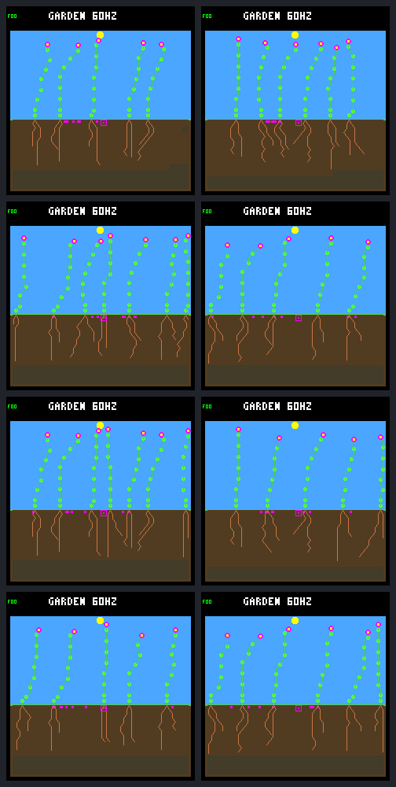

# Wetter root directions do not pass the population checks

The root-only direction comparison is complete. All eight configurations have
exact repeats across sixteen frozen calls, and all four controls match their
historical worlds.
**None of the four pairs passes the existing population harm checks.**
Descendants take up slightly more total water in every pair, but retain less
in three, and fewer descendant plants produce seeds in all four. Keep the
candidate opt-in and leave ordinary host/device behavior unchanged.

## The change and its scope

The [protocol](landing-root-direction-protocol.md) follows the
[construction direction audit](landing-directions.md). It retains the same
four `f7ee4528` worlds, frozen model, seasonal rain, 256-day horizon, eight
plant slots, 256 world nodes, 32-node construction budget and eight seed slots.
Each world runs with the new preference off/on, twice. This is a selected
single-weather diagnostic, not fresh qualification or training.

The host-only `--root-wet-direction` hook reconsiders already-eligible root
EXTEND bids from both founders and offspring. It prefers strictly greater
`min(endpoint moisture, species uptake limit)`, preserves the model's ordering
on ties, and moves only the winning endpoint to the front. It preserves
action, tip priority, recurrent memory, RNG state and every purchase/guard
rule. It cannot unlock a rejected bid. Shoots are not rewritten.

The candidate has a separate `GLW1` run identity. Its direction stream adds
the original model ranking, allowing independent Python checks of every
rewrite. The old trace schemas and hashes remain unchanged when disabled.
Population accounting is shared through a small extraction of the existing
receipt analyzer; the original population entry point still enforces its
original experiment identity.

Across the eight distinct histories, analysis checks **524,288 world steps,
5,294,567 bids and 21,337,365 endpoints**. There are **1,251 rewritten bids**,
but only **251 changed root purchases**; the others lose ordinary arbitration.
Every changed bid is retained with its complete plant decision/resource receipt.
All repeated results, three trace streams and final pixels match exactly.

## Population outcomes

Every arrow is old direction ordering → wetter ordering. “Dawn” identifies
the existing dawn-reserve setting; all other baseline guards stay the same.
Seed parents are distinct descendants that produced at least one seed, not
the total number of seeds or parents whose children survived.

| Reproduction order | Dawn | Changed root purchases | Final living | Descendant seed parents | Total seeds | Harm checks |
| --- | --- | ---: | ---: | ---: | ---: | --- |
| Fixed | Off | 63 | 5 → 6 | 18 → 13 | 81 → 87 | Fail |
| Fixed | On | 65 | 7 → 5 | 22 → 16 | 95 → 86 | Fail |
| Rotating | Off | 56 | 7 → 5 | 20 → 16 | 86 → 85 | Fail |
| Rotating | On | 67 | 5 → 6 | 23 → 17 | 93 → 87 | Fail |

The fixed/no-dawn pair gains closing population credit and 32-day survivors,
but worsens both resource-shortage rates and loses seed parents. Both dawn
pairs improve resource-shortage rates, yet lose seed parents, successful
parents and closing population credit. Rotating/no-dawn improves the energy
rate while worsening water and several survival/reproduction measures. All
endpoints remain single-species, flowers only.

Founder live-time credit falls from 1,625,880 to 1,625,160 logic ticks in every
pair. The first interval with no living plants starts at 400140 instead of
400440; seeds remain available for subsequent recruitment. A later nonempty
endpoint does not erase that earlier living-population gap.

## More water removed does not mean more water retained

These are cumulative **descendant** accounts over each complete world, not
matched equal-exposure plants. Retained income is uptake minus storage overflow;
it is not closing water inventory, and excludes birth endowments. Resource
rates are unpaid units per 1,000 maintenance opportunities, not percentages
of plants or fractions of upkeep units due.

| Order and dawn | Water uptake | Retained water income | Unpaid water rate | Unpaid energy rate |
| --- | ---: | ---: | ---: | ---: |
| Fixed, off | 453,729 → 463,172 | 116,757 → 123,215 | 5.860 → 6.323 | 0.285 → 1.211 |
| Fixed, on | 468,075 → 468,559 | 160,945 → 131,374 | 8.745 → 6.186 | 1.128 → 0.884 |
| Rotating, off | 459,968 → 466,351 | 136,470 → 120,372 | 5.312 → 6.448 | 1.961 → 0.418 |
| Rotating, on | 466,803 → 472,222 | 152,374 → 140,683 | 8.654 → 5.933 | 1.997 → 0.823 |

For example, fixed/dawn uptake increases by only 484 while overflow increases
by 30,055. That world also has 25 rather than 37 descendant births and 58,842
rather than 67,349 maintenance opportunities. Its lower shortage rate is real,
but is not evidence that the same plants now reproduce more effectively.
Likewise, aggregate overflow does not establish why a particular plant died.

Full per-plant energy/water income, overflow, upkeep, construction, reproduction,
discarded stores and final balances are retained. No water, growth price,
capacity or maintenance cost was changed to produce these outcomes.

## What the matched histories establish

The first changed purchase is identical across all four pairs: **founder 5 at
tick 315**, after twenty matching ecology samples. Its root tip is `(199,149)`.
The model chooses `(199,155)`, with zero moisture; the candidate chooses
`(203,154)`, with six moisture. Immediate capped uptake potential rises from
zero to three. The same tip wins and pays the same **eight energy and five
water**, reducing stores from `(212,100)` to `(204,95)`. This is a direction
change, not a newly permitted purchase or free growth.

Only seven birth identities match in each pair: the five founders and
offspring 6 and 9. Matching uses ancestry, birth tick, site and species, not
numeric IDs alone. Later cohorts must not be presented as matched individuals.
The four pairs share early histories and are not four independent trials.

All five matched founders still reach 32 nodes with the same root counts
`16,18,14,18,16`. Their total water uptake slightly falls, 240,737 → 240,584,
and retained water falls 55,745 → 55,721. Founder 3 produces four seeds rather
than three, offset by founder 1 producing thirteen rather than fourteen.
Equal final body sizes and equal total founder seed counts hide changes in
geometry and timing. The first seed ledger entry moves from founder 3 at
tick 900, column 8, to tick 780, column 19; both seeds eventually expire.
That fact alone does not attribute the later population losses to this seed.

The previously water-failing offspring 9 remains a 32-node plant with only
three roots in both arms. It produces more seeds but dies slightly earlier:
457020 → 456060 without dawn protection, 457020 → 456840 with it. The root-only
change does not resolve that plant's root/shoot allocation limitation.

## Visual review

Final day-256 frames use the native production renderer. Left is the old
ordering; right is the wetter preference. Rows are fixed/off, fixed/on,
rotating/off and rotating/on for reproduction order/dawn protection.
These are whole worlds with different later cohorts, not matched plant portraits.



The pictures show plausible gardens on both sides; they do not demonstrate
healthy renewal. The resource and reproduction accounts determine the result.

## First day follow up

The [saved first-day audit](landing-root-direction-audit.md) completes that
follow-up without new simulations. All four pairs share the same early histories.
The five founders take up 87 extra water units but overflow 108 extra units;
none retains more water over the window. Founder 3's earlier seed is enabled
by earlier flower availability, not by clearing a resource gate. Both arms
produce seven first-day seeds with one eventual matched recruit. Keep the
candidate experimental and consider whole-plant root/shoot allocation before
another local-moisture rule. Canopy planning remains a separate energy problem.

## Reproduction and verification

`make host-probe-landing-root-direction` builds and performs the sixteen-call
comparison. Set `GARDEN_LANDING_ROOT_DIRECTION_OUT` to a fresh directory.
The reusable CLI flag requires the existing `--root-all-offspring` daylight
guard chain; `--root-dawn-reserve` stays optional. If a stand trace is requested,
use `--stand-dawn`. `--direction-trace NEW.jsonl` then writes
`landing-root-directions-v1`, including `raw_order` and the applied `order`.

```sh
docker compose run --rm -T firmware python3 sim/garden_landing_root_direction.py \
  --verify benchmarks/garden-seasons/landing-root-direction-results.json.gz
docker compose run --rm -T firmware python3 sim/garden_landing_root_direction.py \
  --verify artifacts/garden-landing-root-direction-v1
```

Portable verification checks identities, exact controls/repeats, all changed
receipts, lifetime accounting, comparisons and first-effect witnesses. Raw
verification additionally checks every artifact and the 2,312-file frozen
source archive, then recomputes complete population/direction accounting and
the matching first-effect prefixes. Both verification modes pass; neither runs
a simulator.

| Artifact | SHA-256 |
| --- | --- |
| [Portable result](landing-root-direction-results.json.gz) | `18f81abb8f76fc0a2fb4bf1e86b6b659984cadc9b2f507382187075a56b9122b` |
| Raw manifest | `814b0af751397b91db4d618ef6606dac466eb30916013ce82827e61ee4924a0e` |
| Protocol | `e7f8d4f1605212243b5a708dec83c8e79ebdf76cc53d0f5e2e87712f3cc1d62d` |
| Native executable | `3513df59297e4409fa6d1a7e1994b03ea5dbecbe755fe44d399a214186edcc3d` |
| Build cache | `f93e432ba3d6c2704864bf10ffb3dddcc93e442878d605864862a5180184b0e6` |
| Paired gallery | `8ebce84710269ecfdfd4193677ea2395abd82c1c448113cdc1cec6af811c93a7` |

All 188 host CTest entries pass on the unchanged capture source, in 437.48
seconds. The saved-result case was skipped before promotion. Native checks
cover eighteen ranking/guard cases, unchanged world/observation/model memory,
observer failure rollback and recovery. Short CLI tests cover exact repeats,
trace-on/off neutrality, invalid scope, first-effect checks and corrupt receipts.
All ten focused Python cases pass after promotion, including frozen findings
and corrupt evidence checks; the four focused CTest entries also pass.
Postcapture changes add frozen-result tests, this report and links, not changes
to the experiment policy or analyzer. No device flash or hardware validation
was needed for this host-only experiment.
