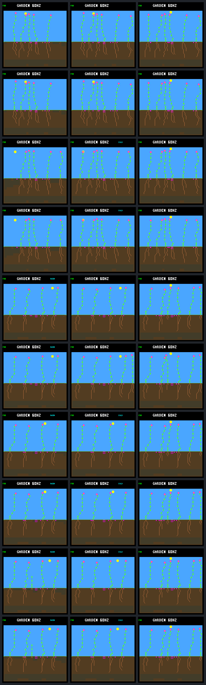

# Energy after one root: a partial rescue

The existing first-day energy reserve rescues **one of three** previously failing
seedlings through day 256. The other two live longer but still die during their
first night. Both successful harm checks remain unchanged. This supports the
energy-spending diagnosis, but does not qualify the current forecast or a
population-wide policy.

## The fixed comparison

The [prospective protocol](landing-root-energy-protocol.md) retains the five cases
from [one root choice](landing-root-choice.md). Its root-only candidates are now
the controls. Both arms make the identical paid root purchase at birth. Only the
candidate then adds energy eligibility for the named offspring's ecology ages
2–256; the guard is off at age 257. Costs, model, water eligibility, 32-node budget,
spacing, weather, ordinary arbitration and destination order are unchanged.

Forty native calls capture the common post-root state, the first-day checkpoint,
and the full day-256 run plus an exact repeat for each arm. Complete stand/resource
traces start one ecology step before birth. No extra experimental runs, training,
parameter sweeps or device changes were made.

## Individual outcomes

Lifetimes below are simulated days since the focal birth. Surviving lifetimes are
right-censored at the day-256 endpoint, not measured times to eventual death.

| Case | Root-only control | Root + energy reserve | Focal seeds through day 256 |
| --- | --- | --- | ---: |
| fixed-45 | alive, 32.078 days observed | unchanged, alive | 0 |
| fixed-46 | alive, 20.168 days observed | unchanged, alive | 0 |
| rotating-48 | dies at 0.227 days | alive, 21.852 days observed | 0 |
| rotating-49 | dies at 0.242 days | dies at 0.617 days | 0 |
| rotating-50 | dies at 0.234 days | dies at 0.594 days | 0 |

All three failures have energy-only terminal shortages in both arms. The two
remaining candidate deaths occur at ticks 908940 and 909000, respectively;
they still discard 54 and 25 water. Extra water is not the missing reserve.

The successful checks have identical normalized checkpoint JSON, endpoint pixels
and first-day histories. Although the energy rule rejects 142/149 bids, none is
an additional exclusion beyond existing water/node eligibility in these cases.
This is a useful no-harm check, not proof of safety across other successful plants.

## Why one survives and two do not

Lineage 48 pauses at **eight nodes** before the first night. It enters sunset
with 55 energy and reaches dawn with 23, with no first-day shortage. It waits
until phase 39 of the next morning to buy its ninth node, then grows to 32 nodes
and 16 roots. First-day stores finish at 256 energy / 24 water; after the second
day, with protection already off, they are 256 / 495. It remains alive at day 256.

The remaining failures buy their ninth node before the first sunset. This raises
maintenance from one to two energy per charge, hence the nominal full-night
requirement from 32 to 64. The forecast knows that price increase; its mistake
is optimistic future income, not an omitted maintenance charge.

| Candidate | Ninth-node tick / sun phase | Forecast remaining income | Actual income through sunset | Forecast sunset energy | Actual sunset energy |
| --- | --- | ---: | ---: | ---: | ---: |
| rotating-49 | 906690 / 94 | 49 | 26 | 66 | 43 |
| rotating-50 | 906930 / 110 | 25 | 6 | 64 | 45 |

The existing heuristic credits half the current income over remaining daylight.
Both decisions see income 3, but later income falls sufficiently that even this
discount is too optimistic. These receipts establish a forecast error; they do
not separately attribute the falling income to sun angle, shading or climate.
No forecast parameter was adjusted after seeing these results.

First-day budgets reconcile exactly, including maintenance, overflow and terminal
discard. For lineage 48, `64 + 805 = 270 growth + 99 upkeep + 244 overflow + 256
remaining`. For 49, `64 + 44 = 45 growth + 63 upkeep`; for 50,
`64 + 39 = 45 growth + 58 upkeep`. These cover different survival intervals and
must not be interpreted as equal-duration income-rate comparisons.

## Population effects and limits

In the independent lineage-48 candidate world, closing-window confirmations rise
0→1 and replacement parents with a confirmed child rise 6→7: parent 47 now has a
surviving child. The rescued plant itself still produces **no seeds**. Closing
live credit rises 508335→580740 ticks, while endpoint living count stays six.

This rescue changes later recruitment and seed-bank history. Existing parents
40, 45 and 47 produce 6/5/1 seeds instead of 4/6/4, respectively, without changed
death outcomes for pre-existing nonfocal plants. Later births are not matched by
numeric lineage ID: the candidate has one late pending child instead of two and
no second birth at column 27. The lower death count partly reflects fewer births,
not additional rescues. The two other failure pairs retain their seed ledgers,
nonfocal lifetime outcomes and identical day-256 pixels despite different focal
death times.

The next useful investigation is an offline audit of these maintenance-step-up
forecasts across the saved first-day histories, including successful growth.
That can inform a bounded, conservative reserve comparison. Do not hard-cap every
plant at eight nodes or promote this hindsight-selected five-case intervention.
Robust autonomous renewal remains unqualified.

## Screenshots

Columns: identical post-root state, one day after birth, day 256. Rows are
control/candidate pairs, ordered fixed-45, fixed-46, rotating-48, rotating-49,
rotating-50. The extra right-side adult in row six is the rescued lineage 48.
All other endpoint pairs are pixel-identical; screenshots alone would hide the
two delayed deaths.

## Evidence and validation

- [Portable results and exact focal receipts](landing-root-energy-results.json.gz).
- Raw verified bundle: `artifacts/garden-landing-root-energy-v1-verified`.
- `make host-probe-landing-root-energy` creates a fresh 40-call capture.
- `python3 sim/garden_landing_root_energy.py --verify BUNDLE_OR_RESULTS` verifies
  saved evidence without simulation. Full bundles also reanalyse every raw trace.

The initial collector completed all 40 calls and repeat/historical checks, then
its portable checker rejected a plant record because the tick remained in the
enclosing sample. The checker now passes that tick explicitly. Offline reanalysis
created a separate verified bundle, preserving the original failed capture and
its frozen executable/source. `validation-recovery.json` records the error,
original file hashes and repaired validator snapshot. **Zero additional native
calls** were used to recover the report; the biological rule was unchanged.

| Artifact | SHA-256 |
| --- | --- |
| Portable results | `dca98970b1efbd6552df4796c280fcb0883bc959f226d569531353a760abe778` |
| Verified manifest | `793e82ab64e589b6fbfcde0c451e28560385a75dc583a0260cfbe8d20f1a26c0` |
| Prospective protocol | `de6beb2221c4703605740f929de7fa1b1160710792c0aa7680d5508673ababf2` |
| Native executable | `18e8a70bf1fc3896db6fff3af5b367522d852cf82497a2b475a6101fcb1f3351` |
| Gallery | `44f585b76d15138e31a313513e59378a434cc52b00836f8cfccf394878d75aac` |

Native tests cover target/age boundaries, unchanged initial root selection,
WAIT/night handling, errors, fingerprints and transactional failure. Python tests
cover independent forecast arithmetic, combined eligibility/allocation, legacy
state/pixel/trace compatibility, CLI validation, historical controls, exact
repeats, the observed partial rescue and malformed evidence.

Validation completed: all **175/175 host CTests** pass, including the ten focused
root-energy Python cases and expanded native root/energy tests. Full offline
bundle verification passes, including original-capture hashes, all ten raw-trace
reanalyses, historical controls, repeated frames/traces and recovery provenance.
Formatting and `git diff --check` are clean.
