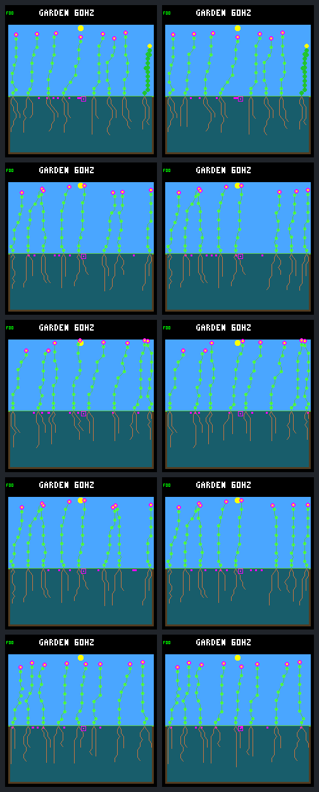

# A second opening brings replacements, but not the first recruits' children

The [frozen day-288 second-opening test](landing-second-opening-protocol.md)
is complete through day 320. Each of five treated worlds gains one established
replacement; unchanged controls gain none. **None of the first five recruits
produces a child**, and none of the seven original focal survivors does either.
All first recruits now have confirmed 32-day survival, not censored follow-up.

The useful distinction is that **two replacements come from newly purchased
seeds**, not the pre-event bank. Reproduction can respond to an opening, but
the first recruits did not exploit these particular opportunities. Their two
existing seeds expire; both remain spacing-blocked by surviving neighbours.

These are the same five selected histories, sharing one model and weather seed,
not independent weather replicates. No training, firmware/default changes,
capacity increase or promoted mortality rule follows. The older 12/16 harm-screen
failures remain unresolved.

## What filled the second opening?

All runs retain the first death at day 256. Treatment additionally kills the
oldest living non-focal plant at day 288, after that tick's observations. Bodies
decompose normally; death does not immediately release their slots or erase
seeds. Four bodies are reclaimed after 945 logic ticks (0.246094 day); W3 takes
975 ticks (0.253906 day). Every victim has 32 nodes and 252 stored energy;
discarded water is 510 except W3's 509. These discards are not maintenance debt.

World labels match the [protocol's fixed panel](landing-second-opening-protocol.md#frozen-inputs-and-targets)
and gallery order. Seed timing refers to the second event, not the first.

| World | Second victim (column) | Parent → replacement (column) | Seed purchased, day | Germinated, day | Seed timing |
| --- | --- | --- | ---: | ---: | --- |
| W1 | 20 (3) | 28 → 32 (3) | 265.859375 | 288.859375 | Before opening |
| W2 | 19 (18) | 19 → 36 (24) | 256.875000 | 288.859375 | Before opening |
| W3 | 26 (12) | 30 → 35 (12) | 288.859375 | 288.894531 | After opening |
| W4 | 19 (18) | 29 → 36 (24) | 267.890625 | 288.875000 | Before opening |
| W5 | 19 (13) | 21 → 32 (13) | 289.875000 | 289.906250 | After opening |

W2 is a posthumous child of the second victim. W2 and W4 consume the released
global plant slot at column 24, leaving the victim's column 18 empty. W1, W3
and W5 refill the exact column. All five replacements survive at least 16 days
with no shortfalls. Their ages at day 320 are 30.094–31.141 days, so their own
32-day survival remains **censored**, not failed or confirmed.

The old-seed winners in W1/W2/W4 wait only on light after reclamation: 157,
157 and 161 checks, respectively. W3/W5 need a new seed purchase, then maturation
and sufficient light. Consequently, an open slot does not imply that a viable
seed is immediately available at a useful location.

## Why didn't the first recruits get children?

All five first recruits remain alive at about 63.1 days of age in both arms.
Only W3's ID 34 and W5's ID 31 held seeds at day 288. Those seeds were purchased
at day 281.984375 and expire at day 313.984375 in **both** arms.

| First recruit's seed | Surviving spacing blocker | Columns newly cleared by the second death | Mature checks still spacing-blocked, per arm |
| --- | --- | --- | ---: |
| W3: ID 34, seed at column 10 | ID 27 at column 8 | 11, 12 | 6,651 / 6,651 |
| W5: ID 31, seed at column 14 | ID 21 at column 16 | 12, 13 | 6,651 / 6,651 |

The seed sites are two columns from an unchanged neighbour; three are required.
The second death removes one blocker but not the other. There is no need to
infer this from the final screenshot: every retained mature gate check fails
spacing. Capacity, light, seasonal cold and sometimes moisture overlap those
failures. Increasing a global pool alone would not make these seeds viable.

The missed *new* seed purchases during the opening are not purely an ordering
problem either:

- In W3 at day 288.859375, incumbent 30 buys the winning seed. First recruit 34
  has 160 energy against a protected purchase requirement of 208, as well as a
  now-full bank. Reordering alone cannot make that particular purchase legal.
- In W5 at day 289.875000, first recruit 31 is visited **before** the winner,
  while the bank has seven seeds. It has 197 energy against a requirement of
  208; energy protection alone blocks it. Incumbent 21 then buys the winner.

These are reproductive reserve thresholds, not observed starvation: all plants'
maintenance payments are fully paid. Removing protection is not thereby safe.

Later, when the old first-recruit seeds expire at day 313.984375, controls let
those same parents purchase replacement seeds. In both treatments the second
newcomer buys first; the first newcomer is visited last with sufficient
resources and **only** the bank-full blocker. Thus those later lost purchases
really are ordered-access losses. The two mechanisms should not be conflated.

## Complete paired outcomes

| Measure during days (288, 320] | Continue with first death only | Add second death |
| --- | ---: | ---: |
| Births across five worlds | 0 | 5 |
| Children of the five first recruits | 0 | 0 |
| New seeds from the first recruits | 2 | 0 |
| Children of the seven original focal plants | 0 | 0 |
| New seeds from the original focal plants | 1 | 3 |
| New seeds from the five second recruits | — | 2 |
| New natural deaths | 0 | 0 |
| Maintenance payments with unpaid energy/water | 0 | 0 |

The focal gain is not uniform: W4 goes from one to two seeds and W5 from zero
to one; W1–W3 remain at zero. The second recruits' two seeds (W3/W5) remain
pending at day 320 and have no children. No followed cohort gains established
grandchildren during this interval.

Each control's original eight pending seeds all expire and eight new purchases
remain pending. Treated W1/W2/W4 instead have seven old expiries and one old
germination, with eight new pending seeds. Treated W3/W5 have eight old expiries,
nine new purchases, one new-seed germination and eight new pending seeds.
Every post-step bank is full except three seven-seed observations in treated W3.

Both arms end with eight living/stored plants and eight seeds in all worlds.
Final nodes are 256, 251, 252, 251 and 256, unchanged within pairs. Each world's
seven matched pre-event survivors have 14,336 maintenance-payment observations
per arm, with zero unpaid energy/water. This includes the first recruits and
excludes the second victim and new numeric IDs. Individual budgets, bank access,
morphology, seed checks, resource denominators and censoring remain in the audit.

## Gallery and evidence

Day 320, W1–W5 top to bottom: **first death only left; two deaths right**.
These are host-rendered states, not device timing measurements. Appearance alone
does not establish lineage renewal.

All 25 full native calls passed: five day-288 baselines reproduce the original
results, frames and four traces byte for byte; five controls, five treatments,
five exact repeats and five untraced treatments complete day 320. All observation
prefixes through day 288 match. Both event identities and environmental death
labels are explicit; single-event output identity is preserved.

The [capture](landing-second-opening-capture.json.gz) contains commands,
results, configurations, source/binary hashes and trace receipts. The
[portable audit](landing-second-opening-results.json.gz) retains all ten paired
post-event resource/body/seed/reproduction windows and their complete analysis.
The raw bundle `artifacts/garden-landing-second-opening-v1` retains the source
archive, protocol, binaries, model, original/compressed traces and frames
(about 4.5 GiB). Raw re-extraction with process launches forbidden is
byte-identical to the portable result. The [tool guide](../../docs/garden-landing-tools.md#test-a-second-opening-through-day-320)
documents build/capture separately from offline verification.

The complete ordinary host build passes. All 27 focused ordinary CTests pass,
including the unchanged first-disturbance audit, all 20 landing native tests,
the CLI horizon/argument tests, and the new seven capture/CLI and nine audit
tests. The new interval-based accountant also agrees with the archived first
window's accounting without modifying that frozen implementation. Initial test
failures were a stale maximum-tick fixture and a test attribute shadowing
`unittest.TestCase.run`; both are fixed and their suites pass. No firmware build
or hardware test was needed for these host-only changes. The single-/second-event
CLI suites and transaction test also pass in both research builds.

| Artifact | SHA-256 |
| --- | --- |
| Frozen protocol | `9c144d03df558ab17bba0dbc2a19ff65284d742531315a5b9f643049a575a9e5` |
| Raw manifest | `30d684a178f6686ebb52126c22d7d95cd96ad923f0d961f5a99f0ec2de0b6238` |
| Portable capture | `4364639b5bf3b3445b22883ab3ec347f845f309d79af29dd8d7b78ff8827fc63` |
| Portable audit | `bf54ecec747fcd8e87501d068dce76c98696529651e3950d5cf8fdb7856b5d26` |
| Paired gallery | `645a6c9006f4450762b9585309d555b5ca1ffeb61dab81e3e2473686292517e7` |

## Next decision

Another arbitrary death would mostly repeat the question. First use these saved
traces to measure the actual seven-plant opportunity windows for **every** focal
plant and first recruit: when do reachable clear sites, light, protected seed
affordability and bank access overlap? Separate ineligible purchases from eligible
plants beaten by an earlier buyer. That bounded offline audit can tell us whether
to investigate placement, reserve timing or bank allocation next, without guessing
from a count of births or relaxing spacing/capacities to force a success.

Follow-through: the [completed opportunity audit](landing-opening-opportunities.md)
finds 49 eligible plant-visits with reachable space, 35 also passing current
mature-seed gates. Every one faces a bank full at entry, not a same-tick order
loss. Earlier energy failures and unreachable parents remain in the result.
It proposes a bounded paid-own-seed replacement comparison; no rule is changed.
