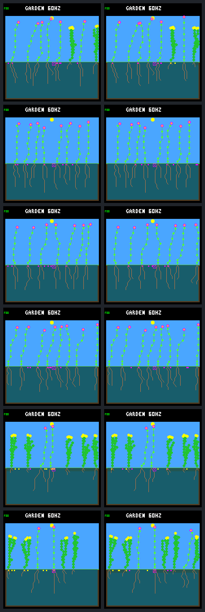

# Purchase-driven seed priority: useful recruitment, one adult regression

The cursor establishes six offspring in the fixed birth cohort, versus zero
under fixed reproduction order. Three of the six gardens improve. However,
one pre-existing adult dies only in the cursor arm, so the predeclared diagnostic
gate **fails**. This is promising host-only evidence, not a promoted ecology,
controller or training result.

All 36 planned calls completed: six day-320 cursor anchors, six day-352 fixed
anchors, twelve day-384 comparison runs, six exact traced repeats and six
observer-free repeats. Historical worlds, ledgers, boundary observations and
pixels match; only the deliberate cursor identity wrapper differs before onset.

## Matched outcomes

The [protocol](landing-seed-cursor-protocol.md) was frozen before collection.
Both arms retain unchanged W2, weather, eight plants, eight seeds, 256 nodes,
placement rules and the fifteen dieback events ending on day 304. The cursor
activates strictly after day 320. “Fixed” means the prior dieback treatment
continued with fixed reproduction order, not the earlier no-dieback control.

Primary births are in `(320,352]`, with complete potential sixteen- and
thirty-two-day follow-up at day 384. Each cell below is **fixed → cursor**.

| Garden | Primary births | 16-day survivors | 32-day survivors | Extra pre-existing adult death |
| --- | ---: | ---: | ---: | --- |
| S1 ordinary | 1 → 3 | 0 → 3 | 0 → 3 | None |
| S1 crowded | 0 → 0 | 0 → 0 | 0 → 0 | None |
| S2 ordinary | 0 → 1 | 0 → 1 | 0 → 1 | Plant 37 |
| S2 crowded | 0 → 0 | 0 → 0 | 0 → 0 | None |
| S3 ordinary | 0 → 0 | 0 → 0 | 0 → 0 | None |
| S3 crowded | 0 → 2 | 0 → 2 | 0 → 2 | None |

S1/S2/S3 are seeds `3a7e45e6`, `366928c6`, `275c8982`. All six established
offspring have different parent identities within their respective gardens.
Their parent–child links are S1 ordinary `42→48`, `44→49`, `47→50`; S2
ordinary `35→39`; and S3 crowded `35→40`, `37→41`. Each parent also survives
its own first 32 days. There is no new endpoint species loss or empty garden.

Across the full `(320,384]` observation window:

- New purchases are 101 → 102, while distinct buying plant–garden identities
  increase from 20 → 42. Paid seed costs are 4,848 → 4,896 energy and
  2,424 → 2,448 water; nothing becomes free.
- Total births are 5 → 6. Fixed order has four births after day 352; three
  reach sixteen days, but all four lack potential 32-day follow-up here.
  They are retained as secondary observations, not silently pooled into the
  primary comparison. The cursor has no births after day 352.
- Natural deaths are 3 → 2 overall, and deaths before sixteen days are 2 → 0.
  That aggregate improvement does not erase the additional death of S2's
  previously living adult. Endpoint living counts are 44 → 46.
- Shortfall payments are 38 → 58, with 138 → 214 unpaid energy units and
  no unpaid water. These are raw exposures, not rates: the cursor also supports
  more plant-time (174,164 → 187,497 maintenance payments).

## What changed, and what remains unresolved

Priority starts after the last successful buyer's stable lineage ID. It advances
only on an actual purchase, not when the bank is full or a parent is ineligible.
It does not rotate storage, resource uptake or germination. This avoids the
clock-driven priority losing turns without buying anything.

The S3 crowded case gives a particularly direct example: previously excluded
parents 35 and 37 now produce established children in columns 23 and 26.
The three unchanged-birth cases also gain a broader set of buyers, demonstrating
why buyer fairness alone is not the success criterion.

S2 ordinary plant 37, at column 24, dies at day **382.8125**, after eight
consecutive energy-short maintenance payments. Its terminal receipt discards
510 water units. Its fixed-order counterpart has no resource-short payments
and remains alive at day 384. The cursor plant purchased one seed at day
360.921875, paying 48 energy and 24 water. These facts do **not** isolate the
cause of the later energy deficit: spending, changed shading and other effects
of the new population must be distinguished before prescribing a fix.

The next bounded investigation should compare that adult's paired income,
overflow, spending and nearby plant geometry from the saved traces. Determine
whether the additional death is avoidable starvation or a competition tradeoff
we want. Do not silently relax the completed experiment's gate, add a protection
rule, increase capacities or start training on this result.

## All twelve endpoints

Left: fixed order. Right: cursor. Rows follow the six-row table above, all at
day 384. These are production-renderer frames, not selected best cases.
The S3 crowded pair visibly fills the right-hand gap; screenshots alone do not
establish ancestry or lifetime survival.

## Verification and retained evidence

The [portable capture](landing-seed-cursor-results.json.gz) contains full ledgers,
per-plant resource accounts, ordered purchase events, cohort outcomes and
authenticated trace/frame receipts. Full offline verification re-extracts the
compressed traces and checks cursor traversal, bank gates, sequential admission,
resource conservation, repeats and gallery pixels without native execution.
See the [tool guide](../../docs/garden-landing-tools.md#compare-purchase-driven-seed-priority)
for collection and verification commands.

Validation status: all collection, repeat and independent offline checks pass.
The verifier re-extracted all 90 new traces and the 18 historical comparison
traces with native process launches forbidden. Both focused native tests and
all eleven CLI/oracle/portable-capture tests pass. The selected default
regression run passed 42/43 CTests; the last
snapshot test passed on rerun after the new build directory was ignored.
The firmware rebuild and pinned formatting check also pass; no board was flashed.
The earlier renewal auditor's thirteen tests pass with its original receipt
unchanged.

The local bundle is `artifacts/garden-landing-seed-cursor-v1/` (about 501 MiB).
Its 8,400,231,467 bytes of raw traces were verified against 279,579,367 bytes
of gzip traces, then the redundant raw files were removed. Every trace remains
restorable. The initial source snapshot also retains 79 generated build files
from before the ignore correction; it matches its recorded hashes and has not
been rewritten. Future snapshots exclude that build directory.

| Identity | SHA-256 |
| --- | --- |
| Portable capture | `cf6ba820eee40259fcaededb7188708517a8b282541ac78ff4b292f68d43af8a` |
| Canonical receipt | `ab0ac00db27be91d35fd388bdba07a282f26f4d8931c283e963e3fc4853cb87e` |
| Local manifest | `245c2f70f8876d4aa9f30e6734215c423fd0a362655444ebda193930bd9de5dd` |
| Frozen executable | `82cb8901a7ba39b539fe32d422d7290864acc775fad0e07c23691bf7127ece9a` |
| W2 model | `f2dc989380339614dc512f64f11f2bf03f7079c465c4c9bd18895044ec3e1567` |

The cursor adds host-run state only. Firmware and ordinary host behavior,
model bytes, weather, resource prices and memory capacities remain unchanged.
