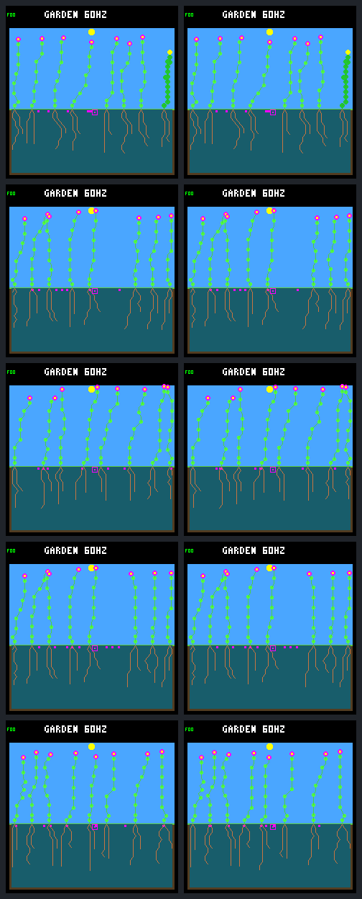

# Paid seed replacement does not add established offspring in this panel

The host-only replacement experiment completes all twenty prescribed runs.
It lets two first-generation recruits buy new seeds, but **neither gains a
child** by day 320. Each of the five worlds still establishes exactly one
post-opening offspring, from the same parent as its control. The frozen useful
result criterion therefore fails. Keep the rule experimental and off by default.

This tests the [predeclared paid replacement rule](landing-seed-replacement-protocol.md)
following the [opening opportunity audit](landing-opening-opportunities.md).
It preserves the five selected histories, model, weather, two imposed deaths,
eight-slot bank, protected resource costs, dormancy and 32-day seed viability.
These histories share one weather seed and model; they are not independent
environmental replication. No training or device deployment was performed.

## Paired outcomes through day 320

Replacement activates strictly after day 288. It requires all non-bank
production gates, available plant/node capacity and reachable clear space.
The parent pays 48 energy and 24 water to replace its oldest owned seed whose
current column fails spacing. Other parents' seeds and clear owned seeds are
protected. The old seed is recorded as `replaced`, not expired; the successor
is a new purchase with ordinary mutation and dormancy.

| World | Paid replacements | Post-onset purchases control / treatment | Offspring surviving 16 days control / treatment | First recruit children control / treatment |
| --- | ---: | ---: | ---: | ---: |
| W1 | 0 | 8 / 8 | 1 / 1 | 0 / 0 |
| W2 | 0 | 8 / 8 | 1 / 1 | 0 / 0 |
| W3 | 2 | 9 / 9 | 1 / 1 | 0 / 0 |
| W4 | 0 | 8 / 8 | 1 / 1 | 0 / 0 |
| W5 | 2 | 9 / 9 | 1 / 1 | 0 / 0 |

World labels retain the sorted panel order from the preceding reports. All
five new children survive at least one and sixteen days in both arms. Their
32-day outcomes are right-censored by the day-320 cutoff, not failures.
Every endpoint again has eight living plants and eight banked seeds. Node
counts are unchanged at 256, 251, 252, 251 and 256 respectively. Species lifetime
summaries are unchanged, and neither followed cohort gains living descendants.

All seven original focal plants and five first recruits remain in the portable
results, including non-producers. Original-focal purchases are unchanged:
zero in W1/W2/W3, one each for W4 parents 33 and 34, and one for W5 parent 30.
First recruits 34 in W3 and 31 in W5 each go from zero to one purchase; the
other three still buy none. The later children in W3 and W5 each go from one
purchase to zero. None of these followed cohorts has a post-onset child in
either arm. Changes in access remain visible even without an establishment loss.

## Why the new recruit seeds lose

The four transactions are fully paid, but the seed bank is not the only
queue. A spacing-clear site can have several dormant seeds waiting nearby;
buying a seed does not reserve space for it.

| World / parent | Purchase tick | Replaced column → new column | Fate of new seed at cutoff |
| --- | ---: | --- | --- |
| W3 / 28 | 1,109,280 | 26 → 12 | Pending |
| W3 / 34, first recruit | 1,109,340 | 10 → 11 | Pending |
| W5 / 21 | 1,109,280 | 7 → 12 | Germinated at 1,109,430; child survives |
| W5 / 31, first recruit | 1,109,340 | 14 → 13 | Pending |

In W3, parent 30 already bought the eventual winning seed at tick 1,109,220.
It germinates at 1,109,355 in both arms, at ecology age nine. At that same
admission step, parent 28's replacement is age five and recruit 34's is age
one: both are still dormant, and the latter also lacks ground light. The next
step observes full plant capacity and spacing blocks at both new landings.

In W5, parent 21's replacement germinates at age ten. Recruit 31's seed is
checked earlier in that same step with a clear site but age six: dormancy
alone blocks it. After parent 21 establishes at column 12, the next check
adds full-capacity and spacing blocks for recruit 31's column-13 seed.
Changing same-step bank order would not make an age-six seed mature.

W5 fills at day 288.9140625 instead of 289.90625: 3,810 logic ticks, or about
0.99 simulated days, sooner. The winning parent remains 21, but the child
lands at column 12 instead of 13. Earlier refill is not an additional child
or evidence of multi-generation renewal. The other four refill times and
winning parents are unchanged.

The three pending replacement seeds have not yet reached their new expiry
dates at the cutoff. Do not classify them as expired or permanently useless.
All four displaced seeds have exact pre-onset counterparts in controls, and
all four of those counterparts expire without germinating. This selected
observation does not establish that discarding blocked seeds is generally safe;
earlier experiments contain valuable old and posthumous seeds.

## Costs and regressions

The four replacements debit 192 energy and 96 water in total. Those are gross
transaction costs, **not extra whole-window costs**: both arms make 42 purchases
after onset, spending 2,016 energy and 1,008 water. Earlier replacement changes
which later expirations free bank slots, so costs and opportunities move between
parents. For example, the two first recruits each spend an additional 48 energy
and 24 water, while the two later children lose a purchase opportunity.

Every post-onset seed check, ordered production visit, replacement, bank count
and living/dying plant resource transfer reconciles against raw observations.
There are no new natural deaths or maintenance shortfalls after onset, no
extra matched-parent shortfalls, and no reduction in 16-day-established
offspring for another pre-onset parent. Those checks pass, but the required
first-recruit establishment gain does not. Earlier broader harm-screen failures
are not resolved by these five cases.

## Images and reproducibility

Rows are W1 through W5; columns are control and paid replacement at day 320.
W1/W2/W4 have identical world state, observation rows and pixels across arms.
W3/W5 differ visually, but a different image is not extra recruitment.

The [portable capture](landing-seed-replacement-results.json.gz), about 171 KiB,
retains complete plant and seed ledgers, cohort follow-up, resource totals,
replacement receipts, displaced-seed control fates, first-effect receipts,
all call arguments and source/build/model identities. The ignored raw bundle
is `artifacts/garden-landing-seed-replacement-v1` (about 3.8 GiB), with source
snapshot, binaries, framebuffers and all five trace streams.

All five controls exactly reproduce the archived second-opening treatments'
results, frames and four original traces. All five treatment repeats match
results, frames and all five traces; all five observer-free treatments match
results and frames. Both affected worlds first differ at the first replacement,
tick 1,109,280; direction observations first differ one ecology step later.
Every earlier data row matches, including the entire history through day 288.
Run-identity footers deliberately differ when the option is enabled.

The [tool guide](../../docs/garden-landing-tools.md#test-paid-replacement-of-an-owned-seed)
documents capture and offline verification. Portable verification checks
provenance, ledgers, comparisons and receipts; raw verification independently
rebuilds the resource/seed accounts and common prefixes. Neither needs native
execution. Fresh outputs are required and capture never automatically retries.
Full raw verification also passes with all subprocess launches prohibited.

Validation includes 32 focused ordinary host CTests, turnover and replacement
tests in both isolated research builds, strict warnings and UBSan. Transaction
tests cover ownership, oldest-seed selection and ties, all capacity/resource
gates, invalid and blocked placement, unchanged denied-purchase RNG/resources,
and observer neutrality. Python tests cover CLI boundaries, hashes, censoring,
complete cohorts, hidden establishment losses and tampering; all sixteen cases
pass after retaining the capture. Changed C ranges pass formatter checks,
and `git diff --check` passes. A whole-file host formatter check still flags
older cast/pointer spacing in `garden_world.c`, confirmed unchanged against the
prior source archive and left outside this experiment. The ordinary
Zephyr firmware also builds successfully; it was not flashed. Existing
devicetree unit-address and enabled-assertion build warnings remain.

| Artifact | SHA-256 |
| --- | --- |
| Frozen protocol | `394cbfce5b7945b2acaa77c1589d09bf7f9b4a13d37e32877271ddadc025f279` |
| Portable result | `e856d8877a34747bce4c5ade78e3492acb0f211379ddcb843e4a44a2ec868b4a` |
| Raw manifest | `6f5f737dcb8147a488ad0339a553d7f81823db65d5df8a097332112ff15de465` |
| Paired image | `a35d0d9de8ca2b332993af1ae3c268bbd9d9a625ccee7453095dbbdac9e5670c` |

## Next question

The proposed bank-access mechanism works, but it does not solve these recruits'
landing race. Before another rule change, inspect which competing seeds are
already queued at each opening, their maturity and light gates, and the viable
space after the first admission. That can distinguish a poorly timed purchase
from an opening that can support only one competitor. Pending-seed-aware
placement or a different environmental opening pattern would be separate
hypotheses requiring discussion and a new fixed comparison, not additions to
this completed experiment. No training or default-policy promotion follows.
