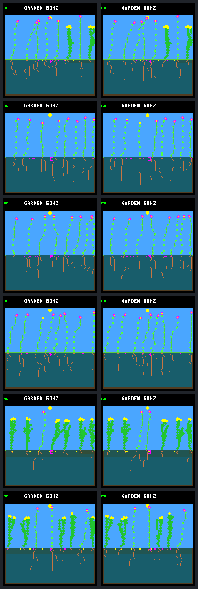

# Waiting-time priority changes access, not sustained renewal

Prioritizing the longest-waiting seed buyer increases primary-cohort 32-day
survivors from **four to five**, but **neither policy produces a child of any
post-day-384 recruit** by day 512. All six gardens remain viable in both arms;
none passes sustained renewal. Waiting-time priority also adds two natural
deaths and leaves one garden with seven plants instead of eight.

This completes the [predeclared comparison](landing-seed-wait-protocol.md)
following the [non-buyer diagnosis](landing-nonbuyer.md). More successful buyers
are not sufficient evidence of a better ecology. The policy remains host-only
and opt-in; ordinary host/device behavior, model weights and training objectives
are unchanged. The original cursor experiment's failed harm gate is unchanged.

## Same gardens, one ordering change

Both arms reproduce the six saved cursor histories through day 384, including
the fifteen imposed diebacks ending day 304 and cursor activation after day 320.
The treatment switches strictly after day 384 to ascending last-paid-purchase
tick, using birth tick for never-buyers and stable lineage ID for ties. Existing
eligibility checks skip ineligible plants without reserving a slot for them.

Seed fees, energy/water requirements, flower/cooldown gates, eight seed slots,
eight plant slots, 256 nodes, 32-day seed viability and germination order do not
change. Waiting history is tracked from tick zero in a bounded host value-state
record: 72 bytes in this eight-plant build, outside the device world/model ABI.
History follows stable IDs across slot reclamation, updates only on successful
steps and is included in run identity. Zero configuration preserves old hashes.

All **48 planned research calls** complete without retries: twelve day-384
anchors, twelve day-512 endpoints, twelve exact repeats and twelve runs without
framebuffer capture. Control results, ledgers and pixels match the frozen cursor
capture. Treatment anchors match after accounting only for declared waiting
metadata/hash wrappers. Waiting timestamps independently reconcile with births
and paid seed purchases. Repeats and capture-free runs match exactly as specified.

This remains a development panel of three weather seeds, each used in two
layouts. It is not six independent weather histories or a held-out validation.

## Outcomes, including regressions

Counts are **cursor / waiting-time**. S1, S2 and S3 are seeds `3a7e45e6`,
`366928c6` and `275c8982`. Primary births are in `(384,480]`; every member has
32 days of potential follow-up. A confirmed survivor may die later.

| Garden | Primary births | Primary 32-day survivors | Day-512 living plants |
| --- | ---: | ---: | ---: |
| S1 ordinary | 1 / 1 | 1 / 1 | 8 / 8 |
| S1 crowded | 0 / 0 | 0 / 0 | 8 / 8 |
| S2 ordinary | 2 / 3 | 1 / 2 | 8 / 8 |
| S2 crowded | 2 / 2 | 2 / 2 | 8 / 8 |
| S3 ordinary | 0 / 0 | 0 / 0 | 7 / 7 |
| S3 crowded | 0 / 0 | 0 / 0 | 8 / 7 |
| Total | 5 / 6 | 4 / 5 | 47 / 46 |

Neither policy establishes a 32-day survivor in the middle birth window
`(416,448]` in any garden. Neither has a qualifying new parent–child pair.
The unchanged sustained-renewal and broad-signal gates therefore fail, despite
all populations remaining between six and eight living plants. Every 16-day
block meets the mean-population floor and every endpoint exceeds four plants.

All baseline species and founder families retain living representation, even
between checkpoints. The three initially multi-species gardens and five
initially multi-family gardens retain that variety in both arms. This does not
recover species already missing at day 384 or establish controller diversity:
all plants still use W2.

Across the six gardens, primary-cohort buyers increase from three to four and
their seed purchases from five to six. Cursor's five seeds yield four expiries
and one pending seed; waiting-time's six yield five expiries and one pending
seed. None germinates by the endpoint. Pending seeds remain unresolved. Across
all parents, purchases increase from 198 to 200 and per-garden distinct-buyer
counts sum to 47 versus 50. Natural deaths increase from eight to ten, with
deaths by age 32 increasing from one to two. These are population comparisons,
not matched-individual survival claims after the histories diverge.

Two cases make the distinction concrete:

- **S2 ordinary gains turnover, not descendants.** Waiting-arm recruit 41 is
  born on day 414.996, buys one seed on day 447, and dies on day 478.641 at age
  63.645. Its seed expires on day 479. A different parent's recruit 42 then
  arrives on day 479.031 and survives 32 days. This adds a primary survivor,
  but not a child of recruit 41. Control recruit 41 is a different individual,
  with a different parent and birth time; the old non-buyer was not simply
  rescued in place.
- **S3 crowded improves one adult's access but loses a young plant.** Baseline
  adult 41 buys three seeds under waiting-time priority versus none under the
  cursor. All three expire. Both arms later produce offspring of parent 37 at
  column 27, but at different times: the waiting recruit is born on day 497 and
  dies on day 510.75 at age 13.75; the cursor recruit is born on day 505.094 and
  remains alive, aged 6.906 days, at day 512. The latter is still too young to
  confirm, not a demonstrated durable replacement. The young death is observed;
  its resource cause is not established by these ledgers.

Both arms have four births after day 480. All four cursor births remain alive
but too young for a 32-day assessment. Waiting-time has three such living births
and the observed S3 crowded young death. Late births do not enter the primary
cohort or silently improve its survival denominator.

## All paired endpoint images

Rows follow the table; left is cursor, right is waiting-time, all at day 512.
Every endpoint is retained, not just the improved S2 ordinary case. Images show
occupation and morphology; the lifetime ledgers establish whether generations
continue.

## Validation and retained evidence

The [portable result](landing-seed-wait-results.json.gz) retains all 48 calls,
complete ledgers, source/build/model identities, derived outcomes and recruit
seed/child joins. The [tool guide](../../docs/garden-landing-tools.md#waiting-time-purchase-comparison)
documents fresh collection and offline verification.

- Fourteen focused CTest suites pass, including the new seven-test Python
  suite with its published-data checks active, plus native waiting/cursor/order,
  growth/placement/patch/root tests and prior renewal/diagnostic suites.
- Native contracts cover stable IDs, exact onset, failed-step rollback,
  eligibility and fees, full banks, ties, births/reclamation, empty worlds,
  state hashes and rejection of invalid ordering callbacks. The short CLI
  oracle reconstructs visit order from the independent lifetime/seed ledgers.
- The portable and complete local bundle verify with subprocess execution
  forbidden, including source/artifact hashes, call receipts, framebuffer
  CRCs and gallery regeneration. All twelve endpoint images were inspected.
- C formatting with the builder's clang-format 18, shell syntax, Make target
  expansion, local Markdown links and `git diff --check` pass. Host clang-format
  21 requests unrelated existing-code changes; no such reformat was applied.

An older renewal test initially failed because it compared today's evolving
CLI with a historical only-the-horizon-changes rule. That test now exercises
the permitted historical transformation and rejection of extra changes using
a controlled source fixture. The frozen collector, protocol, inputs and results
were not edited. No research run was retried. An ad-hoc offline verifier call
also needed an absolute bundle path, as already supplied by the CLI; correcting
that invocation required no data or code change.

The local bundle `artifacts/garden-landing-seed-wait-v1/` contains 27,051,214
file bytes (25.8 MiB), including a 2,698,502-byte source archive. The portable
result is 271,107 bytes and gallery 25,970 bytes. No large per-step traces or
previous full bundles were copied; no older evidence was deleted. No firmware
rebuild, device flash or training was performed.

| Identity | SHA-256 |
| --- | --- |
| Frozen protocol | `23c3d196054bcb1ecdc7a81d7a53f7968c3417dfcb9497e641b3b595cd8b08e1` |
| Portable result | `05989040f933de126a5d4a1fba6c484608059c26da6642872cc9607d864b6dbb` |
| Local bundle manifest | `c31d824c205850a9e8c6cf22535ffeb56bf24b9ca5dffeb1d71621f87c140d95` |
| Review gallery | `a5bfc639e15b41eef676a6f6065a4b45049e96cf084b6493870a71acc76c7d28` |

## Next proposal: recurring environmental openings

Stop tuning purchase order for now. Earlier fixed diebacks supported multiple
generations while opening space; renewal stalled after those events ended.
The seed audits established capacity and spacing barriers, and this comparison
adds evidence that better purchasing alone does not remove them.

Next discuss a bounded comparison of **continuing, non-targeted seasonal
dieback** against the existing stopped schedule, holding the cursor and all
resource/seed rules fixed. Choose the cadence and footprint before collecting
results, allow time for recruits to establish, and retain population, renewal,
diversity and young-death checks. That would test dependence on recurring
environmental turnover, not prove autonomous renewal without disturbances.
No new schedule is implemented or selected by this report.

The [subsequent recurring winter comparison](landing-patch-recurring.md) now
tests that proposal: all six treatments produce children of new recruits, but
only two pass sustained renewal, with mortality costs and late offspring
retained. It does not change this waiting-time result or promote either policy.
