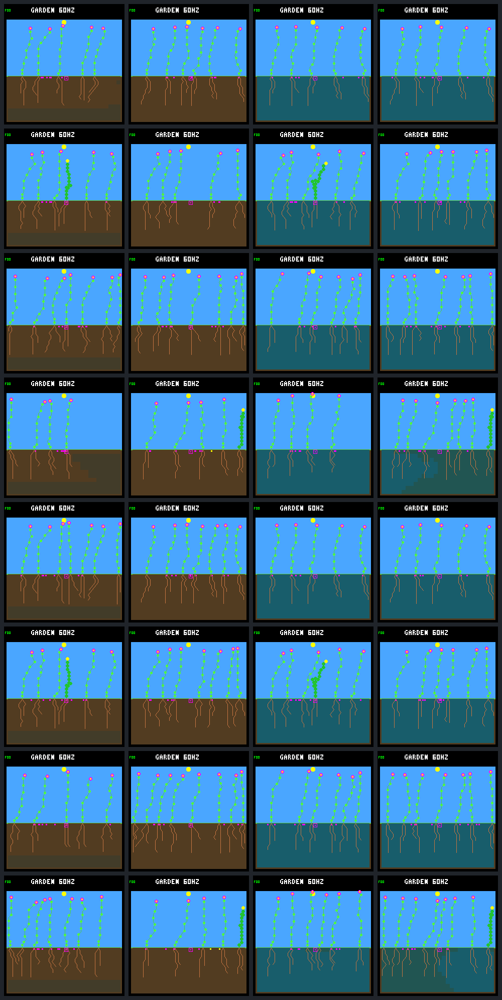

# Late uptake limiting preserves water but does not restore renewal

Completed 2026-10-03. The [frozen comparison](landing-uptake-limit-protocol.md)
tested storage-limited root uptake alone and with the previous upward soil
transfer rule. **Water-shortfall rates improve in all 16 cap-versus-no-cap
comparisons, but every comparison loses seed-producing descendant parents.**
Some selected adults survive dramatically longer. Neither capped variant has
any births in the final 32 garden days. Keep both changes host-only and off by
default; better adult survival has not yet produced a renewing population.

## What was tested

Eight existing settings combine fixed/rotating seed purchase order,
daylight/dawn energy guards, and ordinary/focal-root allocation. Each has four
environments: ordinary, wicking, capped uptake, and capped uptake with wicking.
All use the same controller, weather seed and 256-day horizon. These are
correlated diagnostic histories from one examined weather seed, not a fresh
generalization panel.

The cap leaves surplus water in the soil before extraction. It uses current
storage after each root, permits no extra allowance for later spending, and
starts after tick 626580. Wicking keeps its prior rule and cadence. Model
weights, weather, growth costs and guard implementations are unchanged;
observations and decisions can change. No training or device deployment occurred.

The 48 full trials comprise 16 rebuilt uncapped controls and two runs of every
capped condition. All controls match the archived results, all four traces and
pixels exactly; all capped repeats match. Physical observations agree through
626580. The first changed uptake is at 626595, 626610 or 626640 depending on the
setting; the following soil update first differs one ecology step later.

## Water is retained and sometimes extends survival substantially

All 16 capped worlds have **zero uptake overflow after onset**. The saved
626520–660480 observation window contains 21–74 overflow units per capped
world, entirely before onset. Every cell transition and root debit reconciles,
including germination withdrawals: 11,156,992 reconstructed cell transitions
across the new capped worlds.

Every world receives 13,916 rain units during the reconstructed transitions.
At the window endpoint, soil water rises from 2,063–3,185 to 5,157–6,466 without
wicking, and from 502–655 to 2,772–3,903 with wicking. Evaporation also rises.
Gross extraction falls, but retained uptake rises in 14 of the 16 comparisons;
the two dawn/ordinary-allocation wicking comparisons retain 158 fewer units.
Thus neither gross extraction nor total soil water alone measures plant benefit.

The first drought in the window is days 164–168. Uncapped ordinary worlds take
zero water during it; capped ordinary worlds take 36–218 units. Wicking worlds
take 72–168 units without the cap and 1,013–1,092 with it. This is recycled soil
water, not added rain. Across all later drought intervals, capped worlds still
have 23–99 unpaid water units and 1–5 deaths per world. Deaths *during* drought
are not necessarily caused by it.

Selected flowers were already present before intervention, born at tick
590640. Garden days are 3,840 logic ticks:

- With dawn guards and ordinary allocation, the selected plant's lifespan
  changes from 14.25 days to **at least 102.19 days** with the cap alone, still
  alive at the horizon. Its seed count changes 1 → 6 with fixed order and 1 → 4
  with rotating order. Cap plus wicking gives 10 and 6 seeds, respectively,
  versus one in each uncapped wicking world.
- With dawn guards and focal allocation, the cap alone leaves the selected
  death unchanged. Cap plus wicking extends lifespan from 14.375 to 85 days
  with fixed order and at least 102.19 days with rotating order; seeds rise
  2 → 11 and 2 → 3, respectively.
- Daylight-guarded selected plants gain at most four seconds from the cap
  alone, or 44–67 seconds when adding the cap to wicking. None gains seeds.

These are real individual benefits, but the long-lived cases have longer
exposure and some are censored at the horizon. Matched common-window accounts
are retained separately. Over equal windows, cap plus wicking retains an extra
113–200 water units in each selected plant versus uncapped wicking. The cap
alone retains 0–37 extra units versus ordinary uptake. No matched selected
window gains seed spending. The extended reproduction happens later.

## Fewer births and fewer reproducing descendants

Births **after intervention**, not lifetime totals:

| Order and guard | Allocation | Ordinary | Wicking | Cap | Cap and wicking |
|---|---|---:|---:|---:|---:|
| Fixed daylight | Ordinary | 6 | 4 | 1 | 1 |
| Fixed daylight | Focal | 9 | 6 | 6 | 2 |
| Fixed dawn | Ordinary | 19 | 9 | 7 | 1 |
| Fixed dawn | Focal | 15 | 7 | 3 | 5 |
| Rotating daylight | Ordinary | 11 | 5 | 1 | 1 |
| Rotating daylight | Focal | 9 | 10 | 6 | 2 |
| Rotating dawn | Ordinary | 17 | 12 | 7 | 1 |
| Rotating dawn | Focal | 22 | 8 | 5 | 5 |

Every capped condition has fewer post-intervention births than its matching
uncapped control. Across the eight settings, ordinary/cap totals are 108 → 36,
and wicking/cap-with-wicking totals are 61 → 18. In the final 32 days, the
corresponding totals are 6 → 0 and 4 → 0. These sums describe this panel;
they are not independent replications or significance estimates.

The established population checks compare each cap arm with its own uncapped
control. No comparison passes all checks:

| Regressions among eight settings | Cap versus ordinary | Cap and wicking versus wicking |
|---|---:|---:|
| Fewer seed-producing descendant parents | 8 | 8 |
| Fewer parents with a one-day-surviving child | 6 | 8 |
| Fewer cumulative one-day offspring survivors | 6 | 8 |
| Fewer cumulative 32-day offspring survivors | 2 | 3 |
| Worse descendant energy-shortfall rate | 2 | 2 |
| Less late living time | 5 | 4 |
| Fewer living plants at the endpoint | 3 | 4 |

Descendant water-shortfall rates improve in all eight comparisons for each
variant. Founder living time, terminal species retention and empty-world timing
do not regress against their respective controls. Survival counts are
follow-up-aware, not just the plants remaining at the endpoint. The separate
cap-plus-wicking versus cap-only comparison passes all checks in two of eight
settings, both daylight/ordinary-allocation; it does not establish a general win.

## Capacity is not the complete explanation

Post-step living-body occupancy is saved alongside the outcome accounts. It
excludes decomposing occupants and therefore lower-bounds actual pool use.
In the rotating/dawn/focal cap-plus-wicking world, eight living plants occupy
all 256 nodes throughout the last 32 days: that case genuinely has no room for
another seedling. The fixed-order counterpart has all eight living slots filled
for 46.28% of the same period.

However, **none of the eight cap-only worlds reaches eight living plants or
more than 252 living nodes in that late window**, and all still have zero
births. This does not exclude decomposing occupancy or local crowding, but it
does rule out claiming universally full living-body capacity as the explanation.
Longer incumbency is a plausible contributor, not a complete causal diagnosis.

The next bounded task should audit the already-saved seed and reproduction
receipts: distinguish missing seed supply from maturity, local spacing, shade,
water and actual seed-check capacity limits. Those receipts include seed gate
bitmasks, resource values, pool use and open-site counts, so no new simulation
or mechanics change is needed to start. Do not intensify drought or add another
hazard merely because cumulative births fell.

## Saved screens

Columns are ordinary, wicking, cap, cap plus wicking. Rows follow the birth
table above. These are terminal native captures, not additional replays. The
wetter capped soil is visible; a fuller canopy does not establish renewal.



## Reproduce and verify

Use fresh output names for reruns; all earlier bundles remain intact.

```sh
make host-probe-landing-uptake-limit
make host-audit-landing-uptake-limit
python3 sim/garden_landing_uptake_limit.py \
  --verify benchmarks/garden-seasons/landing-uptake-limit-results.json.gz
python3 sim/garden_landing_uptake_limit.py \
  --verify benchmarks/garden-seasons/landing-uptake-limit-results.json.gz \
  --bundle artifacts/garden-landing-uptake-limit-v1
```

The raw bundle is local and ignored, about 57 GiB with 590 manifested artifacts.
The portable [results](landing-uptake-limit-results.json.gz) and screenshot are
versioned. Analysis and verification never execute native simulations.

All 199 ordinary host CTests passed before exporting the new saved-result
fixtures. Afterwards all four focused CTests pass, including all ten uptake-cap
Python tests and twelve wicking tests. Portable verification and complete raw
re-extraction pass, with native process calls disabled; all 590 raw artifacts
are rehashed and the independently derived report is identical. Focused tests
cover the uptake boundary, per-root updates, shared
cells, full storage without skipping photosynthesis, upkeep, invalid-world
rollback, isolated build flags and offline accounting. Both capped builds and
the unchanged older headroom variant pass their native checks. Firmware rejects
the host-only header. No device performance or timing qualification is claimed.

SHA-256 provenance:

| Artifact | SHA-256 |
|---|---|
| Portable results | `687f354bbeb04b71dc2c8d81b57bccefba0a1f6e2cfa6677f9dd14d517647768` |
| Raw manifest | `7b69ecde2d36817c141811f267c8538a467a0d9120703358c8631b790cbd0857` |
| Frozen protocol | `776cf87e9a8c9e4a089c75f2b569b48bf38849b5df8ee04061fad1ae221b8607` |
| Captured sources | `fd18640e474a3d1c4c5a0ccdfc99d31bd48a62a2d431890d723f90fc6925be97` |
| Model bytes | `f2dc989380339614dc512f64f11f2bf03f7079c465c4c9bd18895044ec3e1567` |

The capture records all four binary hashes and build settings. After capture,
the offline verifier was tightened to bind each root's initial storage to its
adult receipt; the simulation rule and frozen protocol were not changed.
