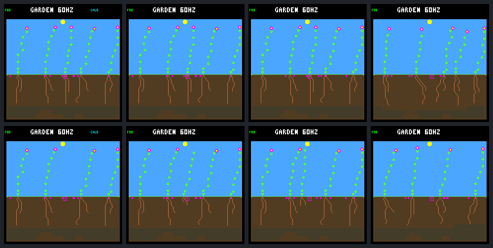

# Seasonal vacancy recovery: early refills, later natural turnover

One opening admits seedlings, but it does not establish a reproducing early
replacement. More importantly, extending the unchanged controls reveals
natural turnover that the previous day-192 endpoint missed. The earlier
spacing-blocked interval was real; calling it a permanent stall would be wrong.

This completes the [fixed vacancy protocol](landing-vacancy-protocol.md).
Six frozen controllers share one crowded layout and one weather seed,
`940cfdc4`; these are not six independent weather replications. Each has an
unchanged control and one predetermined adult export after the day-158 step,
followed through day 256. Models, climate, resource costs, seed lifetime,
placement, 32-node reservation and renewal-credit rules are unchanged.
No gardener, recurring irrigation, training or device change is involved.

## The opening helps establishment, not early reproduction

The first planned window is (158, 190]. Its birth cohorts receive their full
first-day follow-up; none is censored. “Seeds later” follows those same children
through day 256, not merely through the window boundary.

| Controller | Control births / day survivors | Vacancy births / day survivors | Early vacancy children's seeds later |
|---|---:|---:|---:|
| Single /33 | 0 / 0 | 4 / 0 | 0 |
| Multi /33 | 0 / 0 | 1 / 1 | 0 |
| Single /34 | 0 / 0 | 3 / 1 | 0 |
| Multi /34 | 0 / 0 | 1 / 1 | 0 |
| Single /35 | 0 / 0 | 9 / 1 | 0 |
| Multi /35 | 1 / 0 | 2 / 1 | 0 |
| Total | 1 / 0 | 20 / 5 | 0 |

Nineteen of the twenty treatment births are within two columns of the removed
plant. The exception is a failed Multi /35 seedling elsewhere. None is a child
of the removed parent. Fifteen die within their first day: nine energy failures
and six water failures. A gap is not sufficient to fund establishment.

The five survivors live for approximately 22–40 days, but **none buys a seed
or has a child at any point**. They die around day 200. Their stable lineage
IDs, columns and lifetimes are:

| Controller / child | Column | Birth day | Death day |
|---|---:|---:|---:|
| Multi /33 #28 | 18 | 159.820 | 199.984 |
| Single /34 #26 | 12 | 172.844 | 199.953 |
| Multi /34 #25 | 15 | 159.832 | 199.984 |
| Single /35 #40 | 10 | 177.844 | 200.016 |
| Multi /35 #29 | 14 | 159.867 | 199.969 |

These are refills, not self-renewing replacement lineages. We have first-day
resource receipts and complete seed purchases, but not these adults' exact
later flower/resource/bank eligibility at every production decision. Zero
purchases alone does not identify which production gate stopped them.

## The untouched controls resume renewal too

All six extended controls produce new first-day survivors and reproducing
post-day-158 parents. Thirty of their 31 day-158 occupants die between days
199.875 and 200.094; the remaining Multi /35 occupant dies at 215.844.
The first cluster coincides with the end of the existing four-day drought
on [196, 200), derived from `garden_climate.c` for this weather seed/year.
No harvesting or new mortality rule is required for that observed turnover.

This timing is consistent with drought-related resource loss, not proof of
each older plant's shortage. The current recruitment trace follows resource
budgets only through a child's first day; an adult-resource trace is needed
to attribute those later deaths precisely.

Across all births in (158, 256], control → vacancy gives:

- Births: **92 → 120**.
- First-day survivors: **64 → 73**; first-day deaths: **27 → 46**.
- Right-censored recent children: **1 → 1**, not counted as failures.
- Post-intervention-born parents with a first-day-surviving child: **27 → 27**.

Those last parents include the later natural-turnover cohorts in both arms.
They must not be credited to the five early vacancy refills. Lineage IDs are
within-run identities; after divergence they are not matched rescues across
arms. Additional births do not by themselves establish improved renewal.

## Later activity is uneven

The final planned window (222, 254] has seven births in each arm, but four
confirmations in control versus two under vacancy. The complete panel keeps
the adverse and quiet worlds:

| Controller | Final-window confirmations, control → vacancy | Post-day-158 reproducing parents, control → vacancy |
|---|---:|---:|
| Single /33 | 0 → 1 | 4 → 3 |
| Multi /33 | 1 → 1 | 4 → 3 |
| Single /34 | 0 → 0 | 5 → 4 |
| Multi /34 | 1 → 0 | 4 → 6 |
| Single /35 | 2 → 0 | 7 → 7 |
| Multi /35 | 0 → 0 | 3 → 4 |

Multi /34 and Multi /35 treatments have no births in that window. All 16
seed episodes in each have their entire reachable support spacing-blocked
throughout mature checks; eight expire and eight remain pending. Neither
has a natural death in the window. Thus recovery can again settle into a
quiet occupied stand, even though their final windows accumulate substantial
credit from earlier cohorts. Credit carried in is not fresh reproduction.

The intervention does not demonstrate sustained improvement across worlds.
Do not promote it as a harvesting policy, change the objective, or conclude
that the existing environment never creates turnover.

## Visual review

Every sheet has control on top, vacancy below; columns are days **158, 160,
192 and 256**. Day 158 is after the export. The 48 images use the ordinary
renderer and match repeated raw framebuffers exactly. All six sheets were
visually inspected; pictures illustrate occupancy, while ledgers establish
parentage, death and reproduction.



All pairs: [Single /33](frames/landing-vacancy-single-s6d697833-live.png),
[Multi /33](frames/landing-vacancy-multi-s6d697833-live.png),
[Single /34](frames/landing-vacancy-single-s6d697834-live.png),
[Multi /34](frames/landing-vacancy-multi-s6d697834-live.png),
[Single /35](frames/landing-vacancy-single-s6d697835-live.png),
[Multi /35](frames/landing-vacancy-multi-s6d697835-live.png).

## Evidence and verification

All **108 experimental native calls** completed: 36 full replays and 72
checkpoint replays. Every control's complete day-192 result and pixels match
the archived placement run. Both trace prefixes match through day 158
(40,448 ecology samples per trace/pair), and before/after hashes reconcile
the export. Repeated JSON, trace bytes, raw images and untraced runs agree.

Export is host-only and transactional: compact indices, preserve survivors,
their memory, soil, banked seeds, RNG, clocks and cache history; remove the
body and its stores without refund. Native tests cover invalid targets,
young/dead targets, rollback and compaction. `removal_tick` ends occupancy and
credit without inventing a natural death. The ordinary replay format remains
unchanged. The paired ancestry label `removed_parent` denotes the designated
export target in both arms; only the vacancy arm actually removes it.

The [portable result](landing-vacancy-results.json.gz) retains full ledgers,
first-day receipts, three seed/reach-window audits, checkpoint results,
frame hashes and source/build/model identity. Local bundle
`artifacts/garden-landing-vacancy-v1` also retains both raw traces and repeats,
all raw/PNG frames, frozen executable, source archive and manifest. Independent
verification reanalyzes all raw histories/windows and checks repeated pixels;
it performs no new simulations.

| Artifact | SHA-256 |
|---|---|
| Portable result | `f49fa29abdefbc931bbe57937c90c33c2e51c35c573ce3709c9428cee46c6801` |
| Local manifest | `ab03cbde8e1172eb84b976569f5d6c873891ac18aea5e558e39300a276a7c260` |
| Native binary | `e4a8d60d6d116d16ebb9fa7cc5c77630af099be1fc43349cef2a20a29d02bb5f` |
| Frozen protocol | `28bb1ed334ce06eed0518165654efa993bc00f7142f6d76576218c18ea185a97` |

All 166 default host suites passed. The nine vacancy Python tests additionally
check the frozen early/late outcomes, galleries, corrupt records, independent
credit arithmetic and no-clobber behavior. Default and maintenance-research
export/lifetime tests pass, as does the firmware build. Nothing was flashed.

```sh
make host-screen-landing-vacancy \
  GARDEN_LANDING_VACANCY_OUT=artifacts/new-vacancy-screen
docker compose run --rm -T firmware python3 -W error sim/garden_landing_vacancy.py \
  --verify benchmarks/garden-seasons/landing-vacancy-results.json.gz
# Stronger raw-data verification, without running native worlds:
docker compose run --rm -T firmware python3 -W error sim/garden_landing_vacancy.py \
  --verify artifacts/garden-landing-vacancy-v1
```

## Next proposal

Keep this as a completed diagnostic, not a policy promotion. Next trace the
five seedless established replacements' production gates and the old controls'
day-200 resource losses, retaining exact historical results. That separates
failure to reproduce while a gap is filled from the environmental event that
later reopens the stand. Use those facts to choose a longer, multi-weather
qualification horizon before adding mortality or changing the renewal score.
