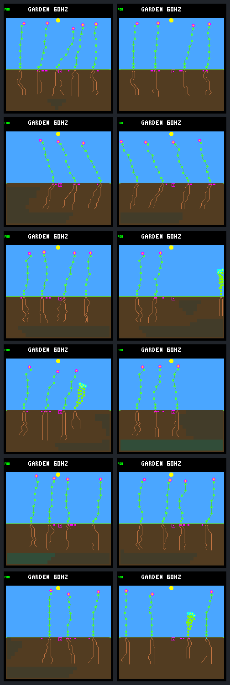
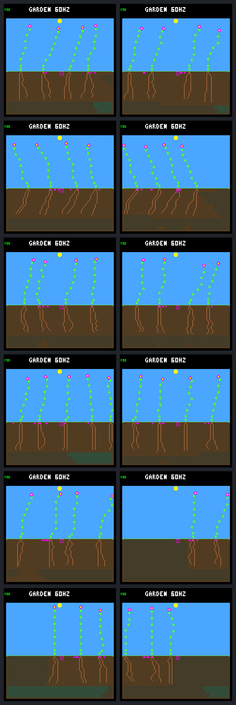

# First day water reserve results

The frozen-model water-reserve comparison **fails its prespecified screen**.
Late first-day survivors increase from 55 to 60 across twelve worlds, but steady
survivors fall from four to one, and one seasonal checkpoint loses established
descendants. Keep the ordinary controller path unchanged. Conserving water
helps some trajectories, but this adapter is not a general establishment fix.

The [protocol](landing-water-protocol.md) fixes the same six archived controllers,
twelve cases and 192-day horizon as the previous recruitment diagnosis. There
is no retraining, threshold search, score change, firmware change or flash.
These retrospectively selected cases are diagnostic, not fresh generalization
evidence. This report closes one comparison, not the broader Garden roadmap.

## What changed

The host-only `water-replay` command wraps the existing neural policy with the
existing water component of the seedling reserve adapter. Both arms use the
same binary with every research ecology option OFF. Models, rainfall, dispersal,
capacities and ordinary costs remain unchanged.

Only living descendants at ages 1 through 256 ecology ticks are guarded.
A paid growth proposal must leave four maintenance payments for its resulting
shoot count. A root's first available ranked destination qualifies for a
one-payment reserve if it is at or below the soil boundary, wetter than its
tip and contains at least the growth cost. Equality permits spending. Energy
reserves and reproduction are not guarded; founders and age 257 onward are
unaffected. No future uptake is credited.

A rejected proposal becomes WAIT **without changing priority or proposed
memory**. Normal first-wins ties and winner-only memory advancement remain.
Consequently, a rejected shoot can still win arbitration over a useful root.
This is intentional preservation of the existing adapter, not a forced-root
policy or an implementation error.

Probe output has a distinct replay kind and a configuration-aware fingerprint,
alongside the ordinary base fingerprint. The ordinary trainer rejects it.
The collector explicitly validates that identity before applying the unchanged
pure history scorer; it never stores guarded results as ordinary replays.

## Establishment and renewal

Late births occur in (62,190] and receive full first-day follow-up. Qualifying
confirmations instead occur in (62,190] and require a confirmed descendant
parent. The two cohorts are intentionally distinct. Pending seeds and younger
children remain censored, not counted as failures.

| Climate | Late births, control → guard | First-day survivors | First-day deaths | Qualifying confirmations |
|---|---:|---:|---:|---:|
| Steady, six worlds | 13 → 6 | 4 → 1 | 9 → 5 | 4 → 1 |
| Seasonal, six worlds | 114 → 129 | 51 → 59 | 63 → 70 | 51 → 57 |
| All twelve | 127 → 135 | 55 → 60 | 72 → 75 | 55 → 58 |

Overall first-day survival changes from 43.3% to 44.4%, concealing the steady
regression from 30.8% to 16.7%. These are cohort fractions, not exposure-adjusted
mortality rates. Descendant identities are not matched across divergent arms.

| Climate | Control score key | Guard score key | Paired wins / ties / losses |
|---|---|---|---:|
| Steady | `[1,24,0,456540]` | `[1,24,0,182880]` | 1 / 2 / 3 |
| Seasonal | `[1,24,837480,5699160]` | `[0,23,867480,6183360]` | 2 / 0 / 4 |
| All | `[1,48,837480,6155700]` | `[0,47,867480,6366240]` | 3 / 2 / 7 |

The key orders worst terminal tier, summed tiers, summed individual weakest-window
credit, then total credit. Increased seasonal credit cannot override a terminal
regression. In single /35's seasonal world, the day-128 follow-up for (94,126]
changes from two established descendants to none: only two youngsters and one
banked seed remain, with no living founders. It is not biologically empty, but
the terminal tier falls from one to zero. Neither arm ever becomes empty.

All six guarded seasonal worlds have positive credit in every late window,
versus five controls. That improvement is real but insufficient under the
unchanged terminal-retention rule. Steady zero-credit windows increase 17 → 20.

| Finalist | Steady survivors, control → guard | Steady score | Seasonal survivors | Seasonal score |
|---|---:|---|---:|---|
| single /33 | 1 → 0 | loss | 7 → 8 | loss |
| multi /33 | 0 → 0 | win | 6 → 8 | win |
| single /34 | 1 → 0 | loss | 12 → 10 | loss |
| multi /34 | 1 → 1 | tie | 8 → 9 | win |
| single /35 | 1 → 0 | loss | 11 → 17 | loss |
| multi /35 | 0 → 0 | tie | 7 → 7 | loss |

Steady late seed expiries remain 192; seasonal expiries fall 151 → 145.
Across the full horizon, seed purchases are 806 → 803, germinations 271 → 270,
and expiries 439 → 437, with 96 seeds still banked in each arm. Historical
durable parents increase 45 → 49 while closing living plants fall 47 → 43.
Cumulative reproduction is not proof of sustained renewal.

Passed gates: retain seasonal late survivors, improve qualifying confirmations
in at least one climate, and cause no earlier/new empty world. Failed gates:
retain steady survivors, retain the steady score, and retain the seasonal score.

## Resource allocation and blocked root proposals

First-day water-only deaths fall **43 → 28**, but energy-only deaths rise
**22 → 35** and combined shortages **7 → 12**. Because births and competition
diverge, these counts do not show that particular water deaths were converted
into energy deaths. A water-only reserve does not address all-night energy needs.

| Late first-day measurement | Control | Guard |
|---|---:|---:|
| Children with expanded roots at age one eighth day | 55 / 127 | 69 / 135 |
| Children never expanding roots during follow-up | 62 | 50 |
| Root additions | 1,081 | 1,418 |
| Shoot additions | 1,536 | 1,640 |
| Paid actions without a new node | 195 | 235 |
| Water spent on growth | 14,012 | 16,465 |
| Water spent on upkeep | 9,047 | 10,580 |
| Water discarded on first-day death | 3,063 | 6,398 |

Every child is alive at the one-eighth-day checkpoint. All no-root-expansion
children eventually die within follow-up, but root expansion does not guarantee
survival: ten control and 25 guarded deaths had expanded roots. Aggregate
spending rises despite individual vetoes; these are different cohorts and
trajectories, not equal-exposure efficiency estimates. All energy/water stage
budgets reconcile, including growth, upkeep, reproduction, overflow and discard.

Among the 135 guarded late children, **85 receive 1,282 selected WAIT vetoes**.
At **680** of those decisions, affecting **77** children, a lower-ranked or
later tied root proposal has a locally available wetter destination and passes
the water forecast. Of these selected refusals, 658 are shoot extensions and
22 are root extensions. The higher-priority rejected proposal remains the
winner, so the affordable alternative is not executed.

This establishes a missed local growth opportunity, not a proven rescue:
destination moisture is not guaranteed future uptake, and the audit does not
simulate the alternative's energy, competition or lifetime outcome. Off-mode
receipts identify 240 would-be selected vetoes in the original late cohort;
1,282 treatment vetoes are not repeated measurements of those same states.

## Fixed visual review

All 24 production-rendered day-192 captures are retained. Control is left and
guard is right; rows are single /33, multi /33, single /34, multi /34,
single /35, multi /35. Both full sheets were visually inspected. Final frames
cannot establish renewal or reveal the earlier day-128 terminal regression.

### Steady

### Seasonal

## Next discussion

Do not promote this guard or combine it with another intervention. The most
direct next question is arbitration: could an affordable wetter-root proposal
remain eligible when a higher-priority growth proposal is refused? First use
the saved receipts to characterize the affected children and refusal streaks;
then agree on one bounded comparison if warranted. Changing arbitration would
be a separate policy intervention, not a correction silently folded into this
result. Keep the energy-timing problem separate and preserve the current score.

The subsequent [offline streak diagnosis](landing-stalls.md) now supplies that
characterization, retaining both later root growth and contrary outcomes without
changing any trajectory or the failed screen decision above.

## Evidence and verification

The [summary](landing-water-summary.json) and
[complete portable results](landing-water-results.json.gz) retain every case,
budget, selected-winner receipt and fixed image identity. The
[workflow](../../docs/garden-landing-water.md) documents reproduction.

All twelve off-mode outcomes, scores and recruitment trace bytes exactly match
the earlier ordinary panel. Both arms pass untraced capture and repeated traced
capture checks for full state, raw pixels and both trace streams. The collection
uses 96 native invocations; independent one-worker verification uses 72 more,
reproducing the entire panel and checking all **456** artifact hashes.

The 24 primary trajectories contain 1,179,648 ecology samples, 9,213,877 actual
seed checks (9,214,753 visits including expiry), and 85,562 first-day resource
samples. The local frozen bundle is `artifacts/garden-landing-water-v1`; it
contains source, binary/cache, inputs, models, original/repeated traces and raw
frames. Hash inventories detect accidental edits, not malicious replacement.

The complete ordinary UBSan host suite passes **148/148** CTests. Native tests
cover boundaries, age/founder selection, unchanged off-mode and trace-disabled
state, winner memory/priority, invalid configuration, full rollback and recovery.
Python tests check malformed CLI/trace inputs, exact historical controls, every
portable resource/winner receipt, unchanged scores/gates and image hashes.
No device timing, firmware build or hardware compatibility claim follows from
this host-only experiment. No commit or push is made by this comparison.

Manifest SHA-256:
`83e59e734570ddc56a1aa547424bb90b9441a90514e2659a9152031340063d7e`.
