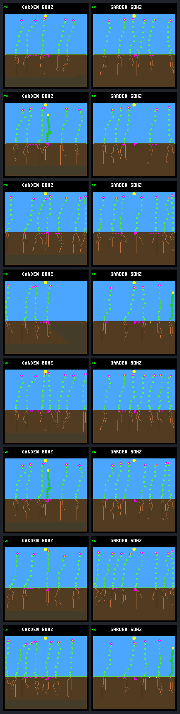

# Upward flow supplies roots, but most of the extra uptake is discarded

Bounded upward transfer gives the selected plants more water and slightly longer
lives. It does not increase their seed production. Much of the extra uptake
arrives while the plants' water stores are full: roots remove it from the soil,
but the excess is discarded rather than saved for the coming dry interval.
Water-shortfall rates improve in all eight comparisons, but **none passes the
existing whole-population non-regression screen**. Keep this rule experimental.

This is a [late-intervention diagnostic](landing-wicking-protocol.md), following
the [root reachability audit](landing-root-reachability.md), not a new qualified
training environment. The ordinary host build and PicoSystem firmware remain
unchanged. No training or flashing was performed.

## What changed

Both builds behave identically through logic tick 626580. Beginning at 626640,
the experimental build moves at most one water unit across each eligible upward
edge every 60 logic ticks, after downward/lateral transport and before surface
evaporation. A lower cell must exceed the upper cell by at least two units.
Top-to-bottom traversal prevents newly lifted water from rising twice in one
pass. This is a bounded simulation rule, not a calibrated physical soil model.

The pass conserves water and adds no RNG draws or persistent world storage.
Rain, root geometry rules, body budgets, spending guards and controller bytes
are unchanged; subsequent plant decisions may respond to the changed moisture.
The compiled experiment has a distinct world hash and explicit JSON marker.

The fixed panel contains eight comparisons: fixed/rotating seed order,
daylight/dawn spending guards, and ordinary/focal-root-priority allocation.
All use weather seed `f7ee4528` and run through 983040 logic ticks (256 garden
days). Eight rebuilt ordinary runs exactly reproduce historical results,
ordinary traces and terminal pixels. Eight wicking runs each have an exact
repeat: **24 full trials**, with no parameter search or extra screenshot runs.

## Selected plants: better supply, little extra lifetime

Daylight lineage 16 and dawn lineage 17 were already alive when the intervention
began. The table compares post-intervention water through the predeclared common
endpoints, 639480 for daylight and 644700 for dawn. These windows have equal
exposure within each comparison. Retained income means uptake minus overflow,
not final stored water or total water remaining in the soil.
The fixed/rotating accounts agree over these common windows; they are not
independent evidence for the local effect.

| Guard / allocation | Additional uptake | Additional overflow | Additional retained water | Death delayed by logic ticks | Extra seeds |
| --- | ---: | ---: | ---: | ---: | ---: |
| Daylight / ordinary | 273 | 253 | 20 | 420 | 0 |
| Daylight / focal priority | 227 | 164 | 63 | 1260 | 0 |
| Dawn / ordinary | 309 | 294 | 15 | 480 | 0 |
| Dawn / focal priority | 171 | 133 | 38 | 1140 | 0 |

The lifespan gains are 0.11–0.33 garden days, or 7–21 seconds at the nominal
60 Hz logic rate. The two allocation-candidate plants' fixed-window water
shortfalls fall from 23/16 units to zero; ordinary-allocation plants already
had no shortfalls by those endpoints. All four ultimately die with unpaid
water maintenance and energy still available. Full-lifetime totals are retained
separately from these equal-exposure accounts.

Between 72% and 95% of the additional uptake becomes additional overflow in
these windows. The current uptake rule removes water before clipping storage
at 512, even when a plant cannot retain it. More water reaching a root therefore
does not necessarily mean much more water available to pay later maintenance.
This observation motivates revisiting storage-aware uptake; it does not
establish the result of that counterfactual.

## The reservoir moves early, and drought still matters

All sixteen primary histories have identical paired observations through
626580. The first changed soil update is 626640 in every pair. Independent
reconstruction matches **36,224 between-snapshot transitions, or 11,156,992
cell transitions**, across the 626520–660480 observation window. Root removal,
overflow and the 12-unit soil withdrawal on germination reconcile separately.
Every upward pass conserves water; all pairs receive the same 13,916 rain units
over the reconstructed interval.

Much of the formerly inaccessible bottom reservoir moves before drought begins
at 629760 (garden day 164). The selected plants begin near full storage.

| Guard / allocation | Bottom-two-row stock at intervention | Ordinary stock at drought onset | Wicking stock at drought onset |
| --- | ---: | ---: | ---: |
| Daylight / ordinary | 1193 | 1193 | 332 |
| Daylight / focal priority | 1146 | 1146 | 297 |
| Dawn / ordinary | 1134 | 1134 | 240 |
| Dawn / focal priority | 1200 | 1200 | 293 |

These stocks also agree across fixed/rotating histories at this checkpoint.
The experimental pass accumulates 4,135–5,268 upward edge-unit transfers over
the full observation window. Those counts include movement between multiple
rows and possible recirculation; they are **not new water supply**. Closing
soil stocks are 502–655 with wicking versus 2063–3185 ordinarily. Actual
population uptake rises by 1382–3117 units, with retained uptake rising by
338–1882 units. Changed evaporation and germination are included in the balances.

The day-164–168 drought still has no rain. Ordinary plants collect zero soil
water during that interval; wicking plants collect 72–168 units across the
population. That is temporary buffering, not removal of scarcity. Across all
post-intervention drought intervals through the terminal horizon, wicking
histories still have 23–119 unpaid water units and 1–5 deaths per world. Deaths
are counted by time of occurrence, not assigned wholly to drought as a cause.

Water shortfall per 1000 drought maintenance payments falls in every comparison:
for example 5.28 → 3.60 in fixed/daylight/ordinary and 50.09 → 12.64 in
fixed/dawn/focal-priority. Denominators change with survival and cohorts, so these
population rates complement, rather than replace, the matched-plant accounts.

## Whole-population endpoints

Entries show ordinary → wicking at the same 256-day horizon. Births and seed
counts are cumulative, not population size; longer incumbent survival can
reduce turnover. Terminal living counts alone are not the success criterion.

| Seed order | Guard | Allocation | Living | Offspring births | Seeds |
| --- | --- | --- | ---: | ---: | ---: |
| Fixed | Daylight | Ordinary | 5 → 6 | 21 → 19 | 81 → 80 |
| Fixed | Daylight | Focal priority | 6 → 5 | 26 → 23 | 86 → 83 |
| Fixed | Dawn | Ordinary | 7 → 7 | 37 → 27 | 95 → 85 |
| Fixed | Dawn | Focal priority | 4 → 5 | 35 → 27 | 94 → 88 |
| Rotating | Daylight | Ordinary | 7 → 7 | 26 → 20 | 86 → 81 |
| Rotating | Daylight | Focal priority | 6 → 7 | 26 → 27 | 86 → 87 |
| Rotating | Dawn | Ordinary | 5 → 8 | 35 → 30 | 93 → 87 |
| Rotating | Dawn | Focal priority | 7 → 5 | 42 → 28 | 99 → 89 |

Seven comparisons produce fewer seeds and fewer offspring; one produces more.
These counts alone do not distinguish reduced opportunity from improved
longevity. The saved accounts retain matched/unmatched births, survival,
late living-plant time, and maintenance shortfall rates for that distinction.

All eight reduce whole-run descendant water-shortfall rates, but the existing
screen retains other outcomes too. Seven lose seed-producing descendant
parents, seven lose cumulative one-day survivors, six lose successful
descendant parents, four worsen energy-shortfall rates, four lose late
living-plant time, two lose terminal living plants and two lose a terminal
species. Only two lose cumulative 32-day survivors; several improve it.
Founder living time and the first empty-world time are unchanged because both
precede the intervention. The complete per-check booleans and matched/unmatched
birth lists are in the [portable results](landing-wicking-results.json.gz).



These are the actual terminal framebuffers from the prescribed trials. A fuller
endpoint does not override earlier lost parents, survival cohorts or species.

## Next question, not a promoted fix

Revisit the existing [storage-limited uptake rule](../garden-longevity/water-headroom.md)
in a separately frozen late 2×2 comparison: ordinary uptake versus storage-aware
uptake, each with upward transfer off/on. This would distinguish uptake waste
from access to the deep reservoir without increasing rainfall, storage capacity,
root depth or controller complexity.

The older headroom experiment already improved survival while reducing late
renewal under different models and constraints. That warning matters here:
preserving water might prolong incumbents and leave fewer opportunities for
descendants. Keep drought pressure, durable parent/child outcomes, occupancy
and all non-regression checks visible. Do not infer a useful combined rule by
adding the apparent benefits of its parts. No such follow-up is implemented here.

## Reproduce without changing ordinary builds

```sh
make host-probe-landing-wicking
make host-audit-landing-wicking
python3 sim/garden_landing_wicking.py --verify RESULTS.json.gz
python3 sim/garden_landing_wicking.py --verify RESULTS.json.gz --bundle RAW_CAPTURE
```

Use fresh `GARDEN_LANDING_WICKING_OUT` and `GARDEN_LANDING_WICKING_RESULTS`
paths for new capture/analysis outputs. Capture archives both executables,
CMake caches, source tree, model, all traces and all terminal framebuffers.
Analysis and both verification modes never execute the archived binaries.
The ordinary build resets the wicking option to `OFF`; the experimental build
is separate and rejects other compiled ecology experiments.

Even a favorable result here would need a separately frozen from-start and
fresh-seed comparison before promotion. The current panel reuses diagnostic
histories from one weather seed; its local fixed/rotating histories are not
independent replications.

The portable results are about 5.8 MiB; the original raw bundle remains under
`artifacts/garden-landing-wicking-v1` (about 29 GiB, including uncompressed and
compressed traces). All preceding captures are preserved. Native boundary,
cadence, conservation and integration tests pass in both builds. The ordinary
198-test host set passes across the full and focused runs; the new offline suite
has 12 passing Python cases. CMake rejects mixed ecology flags, and compilation
with `__ZEPHYR__` rejects the experimental header. Portable verification and an
independent parallel raw re-extraction agree for all eight comparisons, after
rehashing all 298 artifacts. No native simulations run during verification.
One source-snapshot smoke test was rerun successfully
after source edits stopped; no physics change was needed for that test.

| Artifact | SHA-256 |
| --- | --- |
| Portable results | `db7f43ee7ca46cbdfff73338b0de1896a91beda5a54132e72bafa4986e04be36` |
| Raw manifest | `69de3cbb4185e29805551e4b6c126cc1bcfde19c5bdc374d25e74fa89c05fe76` |
| Frozen protocol | `1b4f8d7fd2b68b52c138a2ffdf29f26faa863dedc88a160cd6a19da9b8f674c8` |
| Ordinary executable | `c93b83429d4fe6bc8e16a161169602fb7d51a70407dee7d05fd8f5aa7bbe8496` |
| Wicking executable | `44559c3cbb37ba56c2414fd495c5fd1730415c066df2049aa68f2236ccc3f94f` |
