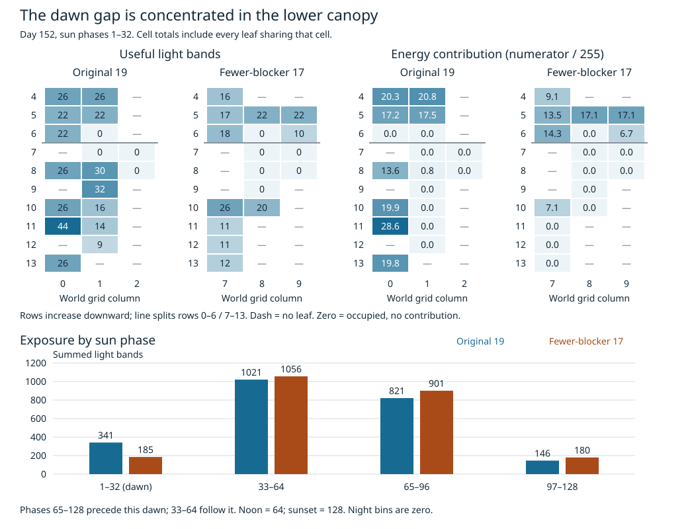

# The lower canopy accounts for the dawn energy gap

The two shrubs' upper leaves contribute almost the same energy during the
focal dawn. The difference comes from the lower canopy: about 83 energy in
original-placement shrub 19 versus 7 in fewer-blocker shrub 17. Of shrub 17's
15 lower leaves, eight never reach a productive light band, five receive
productive light but contribute zero energy, and only two contribute energy.

This is an offline spatial breakdown of the [matched foliage traces](leaf-population-foliage.md),
not a new simulation or intervention. It uses every recorded leaf and phase
from calendar day 152 and the same dawn interval `(152.75,152.875]`.



Each occupied cell sums all leaves in that cell; a dash means no leaf, while
zero means leaves are present but contribute zero to that measure. Color scales
are shared between plants for each measure. The maps retain actual world grid
columns, not hypothetical translated bodies. Rows increase downward.

## Similar whole plant averages hide different spatial patterns

The split below uses the fixed upper and lower halves of the light grid:
rows 0–6 and 7–13. The bodies occupy rows 4–13.

| Dawn measurement | Original upper | Experimental upper | Original lower | Experimental lower |
|---|---:|---:|---:|---:|
| Leaves | 7 | 11 | 17 | 15 |
| Summed usable light bands | 118 | 105 | 223 | 80 |
| Light-weighted condition | 64.13% | 73.94% | 37.11% | 8.90% |
| Fractional energy contribution | 75.67 | 77.64 | 82.75 | 7.12 |

Energy contribution means `sum((light // 64) * condition) / 255` before the
plant-wide remainder and integer conversion. Contributions are not rounded
per leaf or cell. Including each plant's carried remainder recovers the
previously measured 159 and 84 integer income exactly.

The lower canopy's contribution difference is about 75.63 energy; the upper
canopy offsets that by about 1.96. The resulting fractional difference is
73.66, while the plants' different starting and ending remainders make the
integer-income difference 75.

This refines the earlier whole-plant comparison. The two light-weighted
condition averages were almost equal, but their weights came from different
parts of the bodies. The weaker lower canopy combines reduced exposure with
poor condition in the leaves receiving that exposure. At the recorded light
field, even healthy leaves in band zero contribute nothing; at zero condition,
even lit leaves contribute nothing. These are accounting facts, not outcomes
of an intervention that would also change shading and later behavior.

Both shrubs have exactly 11 leaves contributing some energy during dawn.
Counting productive leaves alone therefore misses their very different
contributions. Original column 0's eight leaves account for 75.4% of that
plant's fractional dawn energy. The experimental plant has no leaves there;
its body occupies columns 7–9.

## The exposure disadvantage is specific to dawn

The original receives 341 usable light bands versus 185 during phases 1–32.
In the immediately following morning interval, phases 33–64, the experimental
plant receives more: 1,056 versus 1,021. Its income recovery comes after the
focal bank opening. Across the complete calendar day, the totals remain
nearly equal at 2,329 versus 2,322.

Ten experimental leaves never reach a productive light band during dawn but
do reach one elsewhere in the recorded day; six original leaves do likewise.
These are not simply permanently unlit leaves. Some still produce no energy
because their condition is zero.

The figure is sorted by sun phase, not simulation time. The trace starts at
noon: phases 65–128 are the afternoon **before** the focal dawn; phases 33–64
are the morning **after** it. Night contributes zero light bands. The derived
records retain actual ticks for every phase interval, so this ordering cannot
silently become a claim about a following afternoon that was not recorded.

## Follow up on lower canopy shadows

The concentration of the original's contribution in column 0 makes boundary
geometry worth checking, alongside self-shading and neighboring plants. The
current traces identify the light arriving at each leaf, not the objects that
attenuated it. Different ages, bodies, repair histories, and neighbors remain
part of the comparison.

The subsequent [dawn source trace](leaf-population-canopy.md) preserves those
policies and exact logging-on/off parity. The original encounters only self-shade
before leaving the left edge or reaching the ambient floor; the relocated shrub
also encounters founder flower 1. Its worn lower leaves still contribute only
22.33 fractional energy with all shading omitted at their recorded conditions.
Next inspect repair opportunities before choosing a growth, placement, or repair
change. No ecological rule or firmware default has changed.

## Reproduce the offline map

The [analysis](../../sim/experiments/leaf_population/population_exposure.py)
authenticates and fully revalidates the foliage archive before joining leaves
by preserved body order, not reusable global node indices. Every spatial and
phase aggregation reconciles with the exact original income numerators and
remainders. Co-located leaves retain their multiplicity. Phase zero closes the
preceding night rather than becoming an extra dawn sample.

The derived JSON (`leaf-population-exposure.json`, kept locally) retains all 50
leaves, occupied cells, eight phase intervals, and input trace digests. It is
246,176 bytes with SHA-256
`af844d8bf70b22456d944805fac7ace708aa9c327b2618802dae588160204467`. The [figure
generator](../../sim/experiments/leaf_population/exposure_figure.py) uses the
same verified derivation and requires no additional Python packages.

```sh
docker compose run --rm -T host-player python3 -B \
  sim/experiments/leaf_population/population_exposure.py --check \
  benchmarks/garden-seasons/leaf-population-exposure.json

docker compose run --rm -T host-player python3 -B \
  sim/experiments/leaf_population/exposure_figure.py \
  benchmarks/garden-seasons/leaf-population-exposure.json --check \
  benchmarks/garden-seasons/frames/leaf-population-exposure.svg
```

Nine focused tests cover phase wrapping and chronology, compaction, missing
records, body movement, co-located leaves, fractional contributions, spatial
conservation, and exact published data/figure reproduction. Published tests
forbid subprocess execution. All 155 offline analysis tests pass; the rendered
figure was visually checked. No new simulation calls or runtime changes were
made, and the existing evidence archive remains unchanged.
