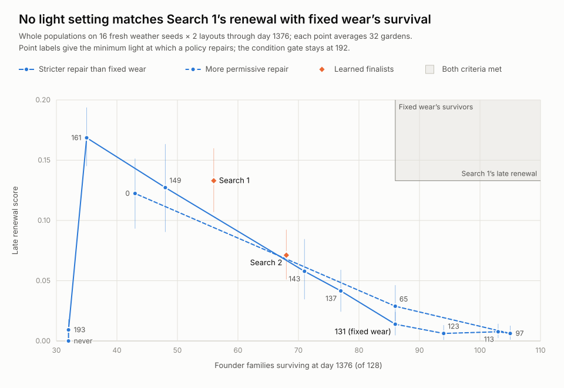

# Repair light threshold: no setting gives renewal and variety together

No setting of the shared repair light gate gives Search 1's late renewal
together with fixed wear's founder-family survival. On sixteen fresh weather
seeds in both layouts, the earlier tradeoff reproduces: Search 1 renews almost
ten times as much as fixed wear, 0.133 against 0.014, and loses 72 of 128
founder families against 42. Across twelve light settings, renewal and survival
trade off. The settings that keep fixed wear's variety renew at most 0.029,
under a quarter of Search 1's rate, and the only setting that out-renews
Search 1 loses 93 families.

All 448 [planned calls](leaf-population-threshold-sweep-protocol.md) and three
anchors completed in 36.6 minutes, inside the 90-minute budget, without
failures, retries or substitutions. Each call is one whole garden through day
1376 in which every family shares the assigned repair controller. The
custom-model path reproduces the archived fixed-wear, Search 1 and Search 2
population runs exactly, apart from rendering. An offline check revalidates
every output and recomputes every number below without running the simulator.



## Conditions

Each light setting comes from fixed wear by changing one bias. It repairs a
mature leaf when light is at least the stated value and condition is at most
192, and an exhaustive check of every light and condition pair proves that rule
against the exact fixed-point network. Fixed wear repairs at light 131 or more.
Search 1 and Search 2 run unchanged; for a 21-leaf shrub, Search 1 repairs at
light 143 or more and condition 188–190 or less, and its gates also move with
its other inputs.

The frozen research runtime, W2 growth, seasonal climate, rain-fed startup and
every ecological rule stay unchanged: eight plant slots, an eight-seed bank,
and no gardener. Both layouts run, with three and five founders. No tracked
file contained any of the sixteen weather seeds before the sweep. Each of the
32 worlds counts equally within a policy.

Late renewal uses the unchanged arithmetic. It credits children of non-founder
parents born in `(960,1344]`, both surviving their first 32 days, at most two
per family in each 64-day window, with every founder family in the denominator.
Intervals are 95% bootstrap intervals over weather seeds, resampling a seed's
two layouts together.

## Results

The protocol fixed four criteria for a light setting to deliver both:
(1) no garden ever without living plants, (2) late renewal at least Search 1's,
(3) extinct founder families at most fixed wear's and (4) single-species
gardens at most fixed wear's. They apply to the light settings only.

| Repairs when light is at least | Late renewal (95% interval) | Extinct founder families, of 128 | Single-species gardens, of 32 | Gardens with no living plants at some point | Criteria met |
|---|---:|---:|---:|---:|---|
| 0 | 0.122 (0.093–0.151) | 85 | 32 | 3 | none |
| 65 | 0.029 (0.014–0.046) | 42 | 0 | 0 | 1, 3, 4 |
| 97 | 0.006 (0.001–0.013) | 23 | 1 | 0 | 1, 3, 4 |
| 113 | 0.008 (0.002–0.014) | 25 | 0 | 0 | 1, 3, 4 |
| 123 | 0.006 (0.001–0.013) | 34 | 0 | 0 | 1, 3, 4 |
| 131 (fixed wear) | 0.014 (0.005–0.024) | 42 | 2 | 0 | 1, 3, 4 |
| 137 | 0.041 (0.024–0.059) | 51 | 2 | 0 | 1, 4 |
| 143 | 0.058 (0.035–0.085) | 57 | 3 | 0 | 1 |
| 149 | 0.127 (0.090–0.163) | 80 | 18 | 2 | none |
| 161 | 0.169 (0.145–0.194) | 93 | 29 | 9 | 2 |
| 193 | 0.009 (0.002–0.018) | 96 | 32 | 32 | none |
| never | 0.000 (0.000–0.000) | 96 | 32 | 32 | none |
| Search 1 | 0.133 (0.107–0.160) | 72 | 15 | 0 | — |
| Search 2 | 0.071 (0.051–0.092) | 60 | 4 | 0 | — |

The paired intervals below compare each policy with Search 1's late renewal and
fixed wear's family losses on the same seeds. Early and middle renewal use the
same arithmetic for births in `(192,576]` and `(576,960]`. Births include every
descendant through day 1376.

| Repairs when light is at least | Late renewal minus Search 1 (95% interval) | Extinct families minus fixed wear (95% interval) | Early renewal | Middle renewal | Closing-window families | Births | Reached age 32 | Died by age 32 |
|---|---:|---:|---:|---:|---:|---:|---:|---:|
| 0 | -0.011 (-0.037 to +0.015) | +43 (+35 to +51) | 0.178 | 0.156 | 21 | 2,592 | 1,201 | 1,334 |
| 65 | -0.104 (-0.135 to -0.073) | +0 (-6 to +6) | 0.080 | 0.031 | 4 | 649 | 481 | 165 |
| 97 | -0.127 (-0.152 to -0.102) | -19 (-25 to -13) | 0.029 | 0.011 | 1 | 318 | 248 | 67 |
| 113 | -0.125 (-0.150 to -0.101) | -17 (-26 to -9) | 0.027 | 0.012 | 2 | 298 | 253 | 44 |
| 123 | -0.127 (-0.154 to -0.101) | -8 (-14 to -2) | 0.027 | 0.009 | 2 | 299 | 256 | 40 |
| 131 (fixed wear) | -0.119 (-0.147 to -0.093) | +0 (+0 to +0) | 0.037 | 0.019 | 4 | 373 | 317 | 54 |
| 137 | -0.091 (-0.117 to -0.069) | +9 (+4 to +14) | 0.066 | 0.052 | 13 | 633 | 487 | 136 |
| 143 | -0.075 (-0.107 to -0.041) | +15 (+6 to +24) | 0.127 | 0.081 | 9 | 1,078 | 739 | 324 |
| 149 | -0.006 (-0.039 to +0.028) | +38 (+30 to +46) | 0.181 | 0.125 | 23 | 1,872 | 1,143 | 700 |
| 161 | +0.036 (+0.004 to +0.066) | +51 (+45 to +57) | 0.242 | 0.186 | 21 | 3,714 | 1,653 | 2,018 |
| 193 | -0.124 (-0.154 to -0.094) | +54 (+48 to +60) | 0.010 | 0.009 | 3 | 20,141 | 276 | 19,630 |
| never | -0.133 (-0.160 to -0.106) | +54 (+48 to +60) | 0.000 | 0.000 | 0 | 52,353 | 0 | 52,117 |
| Search 1 | +0.000 (+0.000 to +0.000) | +30 (+22 to +39) | 0.182 | 0.170 | 22 | 1,860 | 1,198 | 629 |
| Search 2 | -0.062 (-0.091 to -0.035) | +18 (+9 to +27) | 0.120 | 0.082 | 11 | 1,008 | 737 | 246 |

Survival peaks where renewal bottoms out. Gates at light 97 to 123 lose the
fewest families, 23 to 34. They also have the fewest births, about 300 across
32 gardens, and, apart from settings that empty every garden, the lowest late
renewal, 0.006 to 0.008. Moving the gate either way from there raises births,
renewal and losses together.

On the strict side, late renewal climbs from 0.014 under fixed wear to 0.169 at
light 161 while losses rise from 42 to 93. Beyond that the gardens fail. At
light 193 and with no repair, every garden is without living plants at some
point, and 19,630 of 20,141 and 52,117 of 52,353 offspring die by age 32, so
renewal collapses as well.

On the permissive side, repairing at light 65 or more matches fixed wear's
losses, with a paired difference of −6 to +6 families, and doubles its late
renewal, though their intervals overlap. It also leaves no single-species
garden and keeps shrubs in 14 gardens against 9. That is the closest the gate
comes to improving on fixed wear, and it remains far below Search 1. Repairing
regardless of light renews almost as much as Search 1 but leaves one species in
every garden and empties three.

The learned finalists sit near the strict branch rather than beyond it.
Search 2 falls between the 143 and 149 settings. Search 1 matches the 149
setting's renewal, 0.133 against 0.127, with eight fewer losses, but their
paired loss intervals against fixed wear overlap, +22 to +39 against +30 to +46.

## Which species remain

Columns count gardens, of 32, retaining each species at day 1376 as living
plants or pending seeds.

| Repairs when light is at least | Mean species retained | Flowers | Shrubs | Ground cover | Single-species gardens: flowers / shrubs / ground cover |
|---|---:|---:|---:|---:|---|
| 0 | 1.00 | 31 | 0 | 1 | 31 / 0 / 1 |
| 65 | 2.31 | 30 | 14 | 30 | 0 / 0 / 0 |
| 97 | 2.72 | 32 | 24 | 31 | 1 / 0 / 0 |
| 113 | 2.62 | 32 | 22 | 30 | 0 / 0 / 0 |
| 123 | 2.47 | 32 | 18 | 29 | 0 / 0 / 0 |
| 131 (fixed wear) | 2.19 | 32 | 9 | 29 | 2 / 0 / 0 |
| 137 | 2.06 | 32 | 8 | 26 | 2 / 0 / 0 |
| 143 | 1.97 | 31 | 6 | 26 | 2 / 1 / 0 |
| 149 | 1.44 | 20 | 2 | 24 | 6 / 1 / 11 |
| 161 | 1.09 | 4 | 2 | 29 | 1 / 2 / 26 |
| 193 | 1.00 | 1 | 2 | 29 | 1 / 2 / 29 |
| never | 1.00 | 0 | 4 | 28 | 0 / 4 / 28 |
| Search 1 | 1.53 | 30 | 2 | 17 | 14 / 0 / 1 |
| Search 2 | 1.91 | 30 | 2 | 29 | 2 / 0 / 2 |

The species that remains when a garden collapses is not random. Repairing
regardless of light leaves flowers alone in 31 of 32 gardens, while strict
light gates leave ground cover alone in 26 to 29. Search 1's light gate for a
21-leaf shrub equals the 143 setting's, yet its single-species gardens hold
flowers in 14 of 15. That fits its gates moving with leaf count, and so with
species, but this sweep does not test it. Shrubs are the most sensitive species
throughout: they persist in 24 gardens at light 97, 9 under fixed wear and 2
under either learned finalist.

## Decision

None of the twelve light settings meets all four predeclared criteria, so no
setting of this gate gives renewal and variety together on this panel. Five
settings, from light 65 through fixed wear's 131, keep fixed wear's variety,
and one, light 161, reaches Search 1's renewal. The panel reproduces the earlier
tradeoff: Search 1's late renewal exceeds fixed wear's, and it loses more
founder families.

## What this supports next

As the protocol requires, discuss coexistence mechanisms before any training.
The species pattern suggests where to look: as turnover rises, gardens collapse
toward whichever species the rule favors, not toward a random one.

- **Per-species strategies.** Permissive repair favors flowers and strict
  repair favors ground cover, so one shared rule may not suit all three
  species. The research runtime already gives one founder family its own
  controller, as in the [four-seed gate panel](leaf-population-gates-panel.md).
- **Niche differences.** All three species compete for the same slots under the
  same light, so nothing protects a species once it becomes rare.
- **Capacity.** With eight slots, a favored species can take over quickly.
  More slots might slow that, but would not obviously change which species
  wins.

A first step needs no native calls. The retained histories record every
plant's species, parent, birth and death, so this sweep's evidence can show how
each species' adult lifespan, births and establishment respond to the gate.
That would show whether species-specific gates could plausibly reach both
targets before anyone writes a protocol for them. Do not pick a deployment
default, tune the gate further or train from this sweep.

## Limits

- This is one weather panel of sixteen seeds. Seeds also drive plant
  randomness, and families in a garden are not independent replicates.
- Only the light gate moved; the condition gate stayed at 192. Search 1 differs
  from these settings in more than its light threshold.
- The twelve settings are samples. Lines in the figure connect neighboring
  settings and do not show measured behavior between them.
- The decision uses point estimates. The 149 setting's renewal interval
  overlaps Search 1's, and the 65 setting's overlaps fixed wear's.
- The panel covers day 1376, rain-fed startup, no gardener and eight slots.
  Other garden setups may behave differently.

## Evidence and verification

The 6.85 MiB archive (`leaf-population-threshold-sweep-results.json.gz`, kept
locally) contains all 1,818 retained files: the fourteen exact model files; a
receipt, stdout and stderr for each of the 448 calls and three anchors; per-call
summaries; the collection plan with source, binary and model digests; the
result; and the file manifest. The uncompressed collection is 54.6 MiB. Calls
took 20.7 to 145.6 seconds, median 52.5, with twelve workers and a 300-second
limit, while unrelated test suites shared the machine.

The sweep module, protocol, model codec and all 31 research player sources
matched their recorded digests at the end of collection, and the binary digest
did not change. Every light model was proved over all 65,536 light and
condition pairs before collection. Archive handling lives in a separate module
added after collection, so the collection module stays byte-identical to its
recorded digest.

Verification checks the file set, receipts, recorded arguments, fixed protocol
values and the anchors against the archived population runs. It then
revalidates all 448 outputs and recomputes the analysis, in about ten seconds.
Ten sweep tests cover the seed rule, model construction, gate proofs,
aggregation, the decision rule, the figure, an archive round trip with native
execution forbidden, and tamper detection. The research player tests cover the
custom-model path.

```sh
python3 -B sim/experiments/leaf_population/sweep_evidence.py unpack \
  benchmarks/garden-seasons/leaf-population-threshold-sweep-results.json.gz \
  artifacts/garden-threshold-sweep-review-v1
python3 -B sim/experiments/leaf_population/sweep_evidence.py verify \
  artifacts/garden-threshold-sweep-review-v1
python3 -B sim/experiments/leaf_population/sweep_figure.py \
  artifacts/garden-threshold-sweep-review-v1 artifacts/threshold-sweep-figure.svg
```

Use fresh output paths. Verification does not execute archived code.
Archive SHA256:
`d42463565e814398d9d80cddaab5a6916937505362da21d53762b5923e36159e`.
Firmware, policy defaults and ecological rules remain unchanged.
