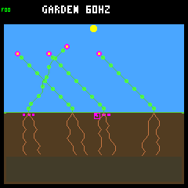
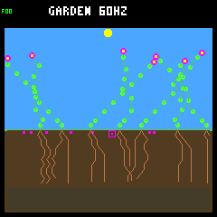

# Seasonal recruitment: openings exist, wider scattering is promising

The [read-only protocol](recruitment-protocol.md) and one
[predeclared wider-scattering screen](dispersal-protocol.md) are complete.
Normal host/device ecology remains unchanged: narrow scattering, 256 nodes,
eight plants, eight seeds, climate v1 and two-year seed viability. No controller
was trained or promoted and no firmware was flashed.

Follow-up: the frozen candidate now passes the
[fresh eight-seed confirmation](dispersal-confirmation.md). Aggregate gains
repeat, but late-survival gains are uneven and diversity remains unresolved.
The experiment below remains separate evidence; narrow is still the default.

## Exact checks resolve the spatial question

Reused the four weather seeds from the previous eight-year panel, both layouts,
both reference policies, steady and combined climates: 32 trajectories. Observe
the first and eighth years at the actual sequential germination checks. These
are four weather replicates, not 32 independent samples or untouched test cases.

| Combined climate, across 16 worlds | First year | Eighth year |
|---|---:|---:|
| Ecology steps observed | 65,536 | 65,536 |
| No structurally admissible column | 2,363 | 1,344 |
| Some physical space, but no wet/lit/warm-enough column | 57,388 | 59,154 |
| At least one usable column | 5,785 | 5,038 |
| Usable space, no mature seed | 417 | 0 |
| Usable space and mature seeds, but no successful landing | 5,261 | 5,014 |
| Steps with a successful germination | 107 | 24 |
| Actual births | 138 | 37 |

All 16 seasonal worlds have usable sites **and** missed landings in the final
year, including the eight with no births. Thus spacing-blocked seeds do not mean
the whole world lacks suitable space. Moisture, light, cold and structural limits
still overlap and make opportunity windows intermittent.

Of the 5,014 missed final-year landing steps, **1,537** have no usable column
within any living parent's current scattering support; **3,477** do. The latter
is geometric reach, not proof of seed-purchase capacity, fertility, a favorable
RNG draw or later seedling survival. Existing banked seeds remain at their
original locations. Repeated checks are neither unique seeds nor unique gaps.

Every fully eligible checked seed germinates. Two of the 37 late births consume
openings which are absent from the post-step site map. The exact tracer therefore
avoids misclassifying successful establishment as a missing opportunity.

Steady controls have 3,260 final-year usable-site steps, 3,259 missed landings and
one birth which does not survive a full day. Their lack of renewal is not simply
explained by an absence of any open soil either.

## One isolated treatment

Enabled the existing host-only wider-scattering option in a separate build:
`5–7 + inherited offset` becomes `3–9 + offset`, with unchanged direction,
reflection, one RNG draw and nominal midpoint. This adds possible destinations
but also reduces probability at the old ones. All other research options are
off; capacities, costs, dormancy, lifetime, climate, policies and starting states
are unchanged. No targeting of vacant sites or movement of banked seeds occurs.

Same 32 trajectories through 128 days; the combined-climate screen is:

| Metric | Narrow control | Wider candidate |
|---|---:|---:|
| Worlds with final-year births | 8/16 | 10/16 |
| Final-year births | 37 | 54 |
| Final-year offspring eligible for a full-day survival check | 36 | 53 |
| Final-year day-surviving offspring | 30 | 36 |
| Final-year durable descendant parents | 6 | 8 |
| Whole-run durable descendant parents | 157 | 176 |
| Multiple viable species at endpoint, including seeds | 1/16 | 1/16 |
| Observed empty worlds | 0/16 | 0/16 |

**All predeclared screen gates pass.** A durable parent and at least one child
each survived a full day; counts do not promise indefinite future survival.
One closing birth in each arm lacks a full day of follow-up. No new empty world
appears in steady controls either.

This is not a universal improvement:

- Crowded layouts lose late-birth worlds **5 → 4** and late day survivors
  **17 → 15**, while historical durable parents fall **82 → 80**. The less-crowded
  layout supplies the larger gains.
- Overall seasonal births rise **583 → 755**, but day-surviving offspring rise
  **392/582 eligible → 466/754**. Absolute survivors improve while the survival
  fraction falls (67.4% → 61.8%); natural deaths rise **583 → 742**. These are
  counts/cohort fractions, not exposure-normalized mortality rates.
- Baseline and adaptive both gain late day survivors (**17 → 20**, **13 → 16**),
  but adaptive's late-birth worlds and late durable parents are unchanged.
- Steady-climate historical durable parents worsen **8 → 5**. Its sole late
  birth still fails to survive a day.
- Diversity is not repaired: 15/16 seasonal endpoints still have only one viable
  species. The lone multi-species endpoint changes identity; this is not species
  preservation in the same world.

Initial decision: retain wider scattering as a candidate for fresh-seed confirmation,
not a new default or qualified training environment. Do not tune a second
parameter from this panel. Confirm the renewal/diversity/mortality tradeoffs on
new predeclared weather seeds before discussing promotion.

## Fixed visual review

First seed `ed52188b`, rainfed/adaptive, day 128; selected before results. This
particular world still has no final-year births under either rule despite more
historical renewal in the wider arm. A fuller picture is not proof of continuing
reproduction. All eight first-seed day-16/day-128 frames across rules/climates
are retained in `frames/` with hashes and framebuffer CRCs in the summary.

| Narrow | Wider candidate |
|---|---|
|  |  |

## Implementation, validation and reproduction

The existing bounded seed-audit API now works in normal host builds, not only
the older leaf-maintenance experiment. It records sequential eligibility and
pre-check living-parent support using production rules. Caller-owned storage
does not enter the authoritative world, RNG, device layout or controller ABI.
The embedded-C conventions guided the host-only guard, bounded ownership,
unchanged-on-error contract and byte-for-byte neutrality tests. Zephyr still
rejects the diagnostic header and compiles the hooks out.

- All **4,128 historical daily states** match (129 × 32 trajectories), and all
  observed births/expirations, ancestry, per-step inventory and seed continuity
  reconcile across **2,018,857 seed visits**. The first-seed seasonal quartet
  repeats exactly in both experiments. A separate replay of all 32 original
  trajectories using only the portable references reproduces every trace byte
  and analysis; it does not read the old full parent panel.
- Ordinary versus audited stepping is byte-identical over 18 days in all four
  climates. Fixtures cover cold, expiry, dormancy, sequential competition,
  invalid input, output errors and malformed/truncated traces.
- **103 default host tests** and **106 research tests** pass. The full standalone
  checks and pristine firmware build pass. A guard test was updated to reflect
  the deliberately expanded normal-host API; firmware rejection remains tested.
- Default firmware remains **257,596 B flash / 223,004 B main RAM**, plus the
  separate 8 KiB Core 1 reservation: unchanged from the merged seasonal build.

[Portable evidence](recruitment-summary.json) includes all case results,
source/binary/configuration digests, both screen breakdowns, image checksums,
daily hashes and compact original lifetime/daily references. The original full
panel is identified by SHA-256. Raw compressed receipts and full candidate
reports remain in ignored `artifacts/garden-season-recruitment` and
`artifacts/garden-seasonal-wide`; generated evidence is collapsed in GitHub diffs.

Recreate all 32 original exact traces **without** the old ignored parent panel:

```sh
make host-build
docker compose run --rm -T firmware python3 sim/garden_season_recruitment_evidence.py verify \
  --summary benchmarks/garden-seasons/recruitment-summary.json --build build-host
```

Or reanalyze all receipts and the four repeats without new simulation calls:

```sh
docker compose run --rm -T firmware python3 sim/garden_season_recruitment_evidence.py verify \
  --summary benchmarks/garden-seasons/recruitment-summary.json \
  --raw artifacts/garden-season-recruitment
```

For a fresh collection against the retained full panel, use
`make host-recruitment-garden GARDEN_RECRUITMENT_OUT=artifacts/new-recruitment`.
The wider build uses `scripts/container/host-garden-defaults.sh`'s CMake flags
followed by `-DTOY_FACTORY_GARDEN_WIDE_DISPERSAL=ON` in a separate directory;
run `sim/garden_season_dispersal.py --panel PATH --build WIDE_BUILD --out NEW`.
The collector rejects other enabled research flags and existing output paths.
This fixed screen is not a general parameter-search tool.
