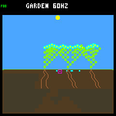
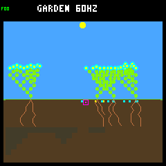
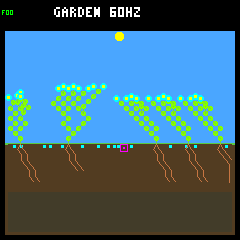
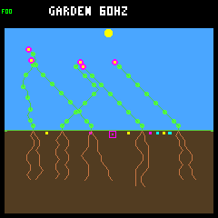
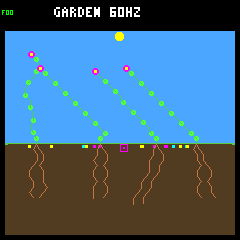
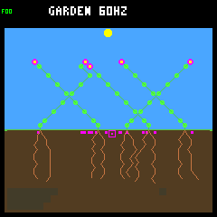

# Sixteen seed slots: more historical reproduction, weaker late renewal

Doubling the bank helps, but **fails the predeclared screen**. Historical durable
descendant parents increase from 285 to 401, while late durable parents fall from
six to four and late full-day survival declines from 55/62 to 63/73. Keep this as
an explicit host experiment; normal host/player/device builds remain at eight
slots. No policy, model, training objective or firmware is promoted.

## Fixed comparison

The [protocol](seed-bank-capacity-protocol.md) was written before collecting
treatment outcomes. It reuses the 32 seasonal worlds from the
[reserve confirmation](seedling-confirmation.md): eight shared weather seeds,
two layouts and baseline/adaptive controllers, through day 128. This is a
known-panel exploratory screen, not fresh confirmation or 32 independent weather
replicates. Both arms use wide scattering and the same combined first-day
energy/water guard for every offspring. **Eight versus sixteen seed slots is the
only changed rule.** Nodes remain 256, plant slots eight, seed viability 32 days,
climate v1, and there is no gardener or recurring irrigation.

Closing cohorts are born strictly after day 112. A full-day survivor must be
alive beyond its first day; death exactly on that boundary fails. Young cohorts
without full follow-up are censored. A durable parent is a day-surviving
descendant with a child that also survives a day. This is a historical achievement,
not a count of currently living parents. Dead plants and posthumous seed births
remain in the evidence.

## Results

| Across 32 worlds | Eight slots | Sixteen slots |
|---|---:|---:|
| Historical offspring births | 1,009 | 1,368 |
| Historical full-day survivors / eligible | 839 / 996 | 1,129 / 1,358 |
| Historical durable parents | 285 | 401 |
| Worlds with closing births | 23 | 21 |
| Closing births / eligible / censored | 75 / 62 / 13 | 83 / 73 / 10 |
| Closing full-day survivors | 55 | 63 |
| Closing full-day survival fraction | 88.71% | 86.30% |
| Closing two-day survivors / eligible | 53 / 62 | 55 / 73 |
| Closing durable parents | 6 | 4 |
| Living plants at day 128 | 180 | 188 |
| Multi-living-species endpoints | 0 | 1 |
| Empty worlds / zero-living endpoints | 0 / 0 | 0 / 0 |

Six of eight gates pass: late survivor count, historical durable parents, no new
empty world, no new zero-living endpoint, per-world viable-species count retention
and multi-living-species endpoint retention. The two failed gates are **strictly
improved late durable reproduction** and **retained late survival fraction**.
Neither the criteria nor the capacity was retuned after seeing these outcomes.

The historical gain is spread across 25 improved worlds, five ties and two
regressions. Late full-day survival is less consistent: twelve worlds improve,
seven tie and thirteen regress. Late durable parents improve in two worlds,
tie in 27 and decline in three. Three weather blocks lose late survivors;
`82deacfd` also loses historical durable parents, 36 to 31.

| Partition | Late survivors, 8 → 16 | Late durable parents, 8 → 16 | Historical durable parents, 8 → 16 |
|---|---:|---:|---:|
| Rainfed | 36 → 39 | 5 → 4 | 181 → 256 |
| Crowded rainfed | 19 → 24 | 1 → 0 | 104 → 145 |
| Baseline controller | 31 → 43 | 5 → 2 | 172 → 241 |
| Adaptive controller | 24 → 20 | 1 → 2 | 113 → 160 |
| Flower descendants | 34 → 35 | 2 → 2 | 143 → 184 |
| Shrub descendants | 6 → 0 | 2 → 0 | 42 → 34 |
| Ground-cover descendants | 15 → 28 | 2 → 2 | 100 → 183 |

Species-count retention does not mean every species is retained. The one shrub
endpoint (rainfed/baseline/`647001a8`) becomes ground-cover-only; sixteen slots
leave no viable shrub endpoint. The one new mixed endpoint
(rainfed/baseline/`a9c30c1e`) contains living flowers and ground cover, not merely
banked seeds. Every other treatment endpoint still has a single viable species.

## The larger bank fills too

| Seed ledger / post-step occupancy | Eight slots | Sixteen slots |
|---|---:|---:|
| Created | 1,866 | 3,100 |
| Germinated | 1,009 | 1,368 |
| Expired | 601 | 1,222 |
| Still pending at day 128 | 256 | 510 |
| Full-bank samples, whole run | 1,011,347 / 1,048,576 (96.45%) | 988,143 / 1,048,576 (94.24%) |
| Full-bank samples, closing year | 129,288 / 131,072 (98.64%) | 128,313 / 131,072 (97.90%) |
| Mean seeds, closing year | 7.980 / 8 | 15.954 / 16 |

Creation reconciles exactly to germination, expiry and pending seeds in both
arms. Occupancy is measured after each ecology step, excluding tick zero. It is
**not** the number or fraction of failed sequential production checks. The older
[production-gate diagnosis](production-gates.md) measures those directly, but
its eight-slot percentages must not be reused as sixteen-slot measurements.

Natural deaths increase from 957 to 1,308 alongside increased births; that raw
count alone is not a mortality-rate comparison. Among the 132 identical living
incumbents at the first capacity-caused divergence (113 founders and nineteen
descendants), 57 die earlier, 21 later and 54 at the same time or remain alive in
both arms. Twenty-nine worlds contain an earlier incumbent death. Numeric IDs
assigned after divergence are never treated as matched individuals. The result
does not isolate additional seed spending from the subsequent changes in
competition, resource uptake and population history.

## Storage and isolation

| Native structure | Eight slots | Sixteen slots | Increase |
|---|---:|---:|---:|
| Garden world | 4,352 B | 4,512 B | 160 B |
| Garden snapshot payload | 1,624 B | 1,640 B | 16 B |
| Complete scene snapshot | 1,664 B | 1,680 B | 16 B |

Each seed is 20 bytes; each snapshot seed is two bytes. These are measured native
structure sizes, not a total device-RAM promotion estimate. The explicit
`TOY_FACTORY_GARDEN_SEASONAL_SEED_BANK` option is OFF by default, is reset OFF by
normal build wrappers, rejects Zephyr and incompatible combined-ecology flags,
and leaves the separate older `LARGE_SEED_BANK` research option intact.

## Fixed screenshots

Weather seed `ed52188c`, baseline controller. These eight checkpoints were chosen
before collection. Native state hashes and framebuffer CRCs match each retained
trajectory, and all eight-slot PNGs match the earlier guarded confirmation.
The images were also inspected visually; appearance is not a renewal metric.

| Layout / day | Eight slots | Sixteen slots |
|---|---|---|
| Rainfed / 16 |  |  |
| Rainfed / 128 |  |  |
| Crowded / 16 |  |  |
| Crowded / 128 |  |  |

## Evidence and checks

- All 64 trajectories repeat byte-for-byte. All rebuilt eight-slot traces match
  the prior guarded confirmation, also byte-for-byte.
- All pairs share an exact prefix. Their first divergence, at ticks 3,840–15,000,
  is an additional seed purchase beyond eight slots, preserving the old eight
  seeds and shared incumbents. External weather stays matched throughout.
- All 2,097,216 original ecology snapshots reconcile their growth decisions,
  live/terminal resource budgets, seed histories and ancestry. A second complete
  analysis of the unchanged raw files reproduces the saved results.
- Boundary tests exercise the final slot's hash/render effect, expiry, rejected
  overflow without mutation, explicit metadata and build isolation. Corruption
  checks cover capacity, missing seeds, sample counts, prefixes and matched IDs.
- All 115 default and 117 representative older-research CTests pass. Both
  capacity builds pass native capacity/seed/reproduction and production-observer
  tests. The desktop player rebuild and smoke test pass.
- Normal firmware rebuilds at the unchanged 257,596 bytes flash, 223,004 bytes
  main RAM and 8 KiB Core 1 RAM. No device flash.

The [portable histories and seed ledgers](seed-bank-capacity-histories.json.gz)
retain every world, ancestry, cohort, occupancy histogram, source/build hashes,
first-divergence snapshots, incumbent comparisons and frame receipts.
Decompressed SHA-256:
`3ed1126d0db80996134bac59b6f3e0ffe3f78e61532612ddb8c668f2ba41a94e`.
The [summary](seed-bank-capacity-summary.json) includes all partitions and
per-world metrics; SHA-256:
`f14b312d06368bcaafa0f5d96c433ac8f5bba0025584c8850a09b3e07faa80d0`.

```sh
# Run inside the firmware build container, from the checkout root.
source scripts/container/host-garden-defaults.sh
for capacity in 8 16; do
  enabled=OFF
  if [[ $capacity == 16 ]]; then enabled=ON; fi
  cmake -S sim -B artifacts/build-host-seasonal-bank-$capacity -G Ninja \
    "${garden_default_cmake_options[@]}" -DCMAKE_BUILD_TYPE=RelWithDebInfo \
    -DTOY_FACTORY_SIMULATOR_SANITIZERS=ON \
    -DTOY_FACTORY_GARDEN_WIDE_DISPERSAL=ON \
    -DTOY_FACTORY_GARDEN_SEASONAL_SEED_BANK=$enabled
  cmake --build artifacts/build-host-seasonal-bank-$capacity --parallel 2 \
    --target toy-factory-garden-inspect toy-factory-garden-replay \
    toy-factory-garden-capacity-test
done
python3 -W error sim/garden_season_seed_bank_capacity.py collect \
  --out artifacts/garden-seasonal-seed-bank-capacity-new --jobs 4
python3 -W error sim/garden_season_seed_bank_capacity.py verify \
  --out artifacts/garden-seasonal-seed-bank-capacity-new --jobs 4
```

Collection requires a new directory and rejects changed non-capacity dependencies
or flags. Verification rereads the repeated traces without rerunning trajectories
(the small native storage fixture runs again). Portable evidence tests need no
ignored raw bundle. Raw traces and logs remain under
`artifacts/garden-seasonal-seed-bank-capacity*` /
`artifacts/garden-seed-bank-capacity*`.

## Next discussion

Do not increase capacity again or change lifespan based on these totals. First
use the saved histories to examine **which families/species occupy the bank,
how long their seeds wait, and which eventually establish reproducing children**.
Pair that with targeted resource-budget review of the earlier incumbent deaths;
more reproductive spending is a hypothesis, not yet the isolated cause. This can
distinguish useful buffering from repeated blocked-site occupancy before choosing
an admission/replacement policy or another experiment. The sixteen-slot result
stays mixed and unpromoted; no environmental qualification milestone is closed.

Follow-up: the [read-only bank ownership/resource diagnosis](seed-bank-diagnosis.md)
now completes that accounting on the unchanged trajectories. Most occupation is
spent on seeds that eventually expire, but long waits and posthumous seeds also
yield many reproducing descendants; extra parent spending is not a complete
mortality explanation. No capacity or eviction policy is promoted.
