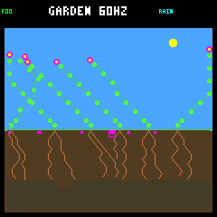
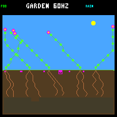
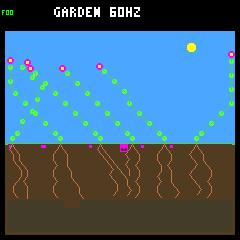
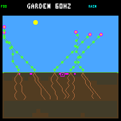

# Energy and water reserves protect different selected seedlings

The [fixed component comparison](seedling-components-protocol.md) separates the
two rescues: energy-only is sufficient for the energy failure, and water-only is
sufficient for the water failure. Neither component alone rescues both. The
unchanged combined rule retains both rescues, while the original survivor stays
alive in every arm.

These are the same three selected examples, **not a population-wide confirmation**.
Protection applies only during the named offspring's first day. No thresholds,
ecology, weather, capacity, controller weights or device defaults changed.

## Four-arm result

All surviving entries below are alive at the one-day and two-day checkpoints
and through the fixed day-128 horizon. Observed ages at the horizon are 14.832,
15.160 and 6.113 Garden days respectively; protection ends at age one day.

| Selected example | No guard | Energy-only | Water-only | Combined |
|---|---|---|---|---|
| Energy failure #35 | Dies at age 0.223 day | Survives | Same death as control | Survives |
| Water failure #41 | Dies at age 0.238 day | Dies at age 0.270 day | Survives | Survives |
| Survivor #39 | Survives | Survives | Survives | Survives |

All twelve runs were repeated exactly. The six disabled/combined traces also
match the earlier frozen full traces byte-for-byte. Both components still use
the same base decisions, candidate ranking, priority, arbitration and proposed
memory; only the enforced reserve condition differs. Water-only ignores the
energy rule's night veto as well as its energy forecast.

### Energy failure: the energy check is sufficient here

Energy-only first rejects growth at tick 434,745, just like the combined rule.
The proposed ninth body node would double energy upkeep, with forecast sunset
energy twenty against a 64-energy night requirement. Both treatments instead
reach first sunset with eight nodes and 32 energy, then reach dawn alive with
zero energy. Water-only vetoes nothing and reproduces the entire control state
trajectory, including the original energy-starvation death at tick 435,420.

Energy-only makes eighteen direct vetoes versus the combined rule's twenty-three
(eighteen energy, five water). It reaches 32 nodes a little sooner: at one day,
energy-only has 32 nodes / sixteen roots / 256 energy / eighteen water, versus
31 / fifteen / 255 / twenty-three for combined. At two days both have 32 nodes,
sixteen roots, eight active leaves, 256 energy and 301 water. Both pay 357 of 359
energy upkeep due over two days and all 205 water upkeep. Peak stress is two.

Equal endpoint stores/body counts do not mean identical complete states: growth
timing and decision counters differ. All five pre-birth neighbors remain alive
through day 128 in every arm.

### Water failure: an energy delay does not solve water exhaustion

Energy-only repeats the combined rule's energy veto at birth, but then dies
water-starved at tick 434,340, just 120 logic ticks later than the control. Its
terminal receipt shows 256 energy before income/upkeep, zero water, and two
unpaid water upkeep. It reaches seventeen nodes/eight roots, but still spends
seventy water on growth and pays only thirteen of twenty-nine water upkeep due.
That is a delay, not establishment.

Water-only does not make that birth energy veto. Its first changed action is
tick 433,665, age twenty-five ecology samples. A shoot extension would leave
three water against the required eight-water reserve, so it waits. Sixteen
direct water vetoes are made over its first day. It survives through day 128,
demonstrating that the energy component is not necessary for this selected rescue.

At one day it has 28 nodes, twelve roots, eight active leaves, 115 energy and 188
water. At two days it has the same body with 145 energy and 442 water. Combined
has the same two-day body/energy with 446 water. Over two days, water-only pays
234 of 237 water upkeep due, versus combined's 233 of 237. Peak stress is three
versus four. Both survive, but these differences are not a general quality ranking.

The existing wetter-root exception is exercised once in water-only, at tick
433,635. The base root proposal has seven water, a five-water growth cost and
one water upkeep per charge; its first ranked available destination has moisture
five versus zero at the current tip. The one-charge exception permits it, while
the ordinary four-charge floor would require nine water. It commits and adds a
root. This happens before the first changed action, and the original control
also makes this purchase. The panel shows the exception is used, **not** that
it is necessary for rescue; there was no no-exception counterfactual.

### Survivor: no survival regression, but the energy check alters growth

Water-only vetoes no bids and reproduces the full control state trajectory.
Energy-only makes nine vetoed bids across three committed WAIT decisions, as in
combined. All arms reach 36 nodes, twenty roots and eight leaves without an
upkeep shortage. At two days, control/water-only have 125 energy and energy-only/
combined have 117; all have 512 water. Two-day energy income is 1,837 versus
1,545 respectively, reflecting different growth/geometry trajectories rather
than proving equal productivity. All four pre-birth neighbors survive.

## Neighbor and world outcomes

The water example's parent, founder #5, dies at **the same tick 486,600** under
water-only and combined, remaining alive under control and energy-only. Both
rescued offspring remain alive. The parent's terminal resource receipt is the
same in both rescuing arms: zero energy and five unpaid energy upkeep, with 454
water before a paid two-water upkeep charge. It is winter, light 61%, without
active drought. This isolates neither shading nor the detailed competition
mechanism, and does not support describing the death as water starvation.

All thirteen other matched pre-birth neighbors stay alive in every arm.
Removing the energy component does not avoid the parent's later death. Founder
replacement can be useful A-life turnover; it is not automatically bad, nor is
it a free increase in population. Later offspring IDs are not matched between
diverged worlds.

| Endpoint world totals | Control | Energy-only | Water-only | Combined |
|---|---|---|---|---|
| Energy example: living / nodes / births / deaths | 6 / 217 / 36 / 33 | 6 / 212 / 32 / 29 | 6 / 217 / 36 / 33 | 6 / 212 / 32 / 29 |
| Water example: living / nodes / births / deaths | 5 / 180 / 37 / 37 | 5 / 180 / 37 / 37 | 5 / 172 / 37 / 37 | 5 / 172 / 37 / 37 |
| Survivor: living / nodes / births / deaths | 5 / 180 / 34 / 34 | 5 / 180 / 34 / 34 | 5 / 180 / 34 / 34 | 5 / 180 / 34 / 34 |

All endpoints retain only flowers, even including viable seeds. No focal plant
has a germinated child recorded in any arm by day 128. The two-day focal ledgers
also contain no seed spending; that narrower window is not a claim about all
later seed production. Individual rescue still does not establish durable
descendant reproduction, increased carrying capacity or diversity.

## Fixed rendered checkpoints

All twelve new images use the unchanged production renderer at the predeclared
one-/two-day boundaries, with matching audited world hashes and framebuffer
CRCs. The [older control/combined gallery](seedling-reserve.md#fixed-rendered-checkpoints)
is unchanged. All twelve new PNGs were inspected; lineage identity and resource
causes come from the traces, not the pixels alone.

| Example / checkpoint | Energy-only | Water-only |
|---|---|---|
| Energy / one day |  |  |
| Energy / two days |  |  |
| Water / one day |  |  |
| Water / two days |  |  |
| Survivor / one day |  |  |
| Survivor / two days |  |  |

## Reproduction and checks

The [summary](seedling-components-summary.json) retains all four arms' lifetimes,
daily histories, ledgers, neighbor contrasts, terminal receipts and checkpoints.
The [compressed histories](seedling-components-histories.json.gz) additionally
contain all 4,352 focal ecology samples. Decompressed SHA-256:
`80ce6c03a600b3162dc266470eb3948102244a183be97cbb4e453ac886520f4d`.
Summary SHA-256:
`6cdc7bec04a53aa01d0fe54c1d20975290801678ec874f06826c64e2f93d46d1`.

Across the twelve primary runs, checks cover 393,228 ecology snapshots,
1,678,600 live resource budgets, 408 terminal receipts and 72,594 bids. There
are 660 guarded forecasts, 85 vetoed bids and 73 changed committed decisions.
The nine paired treatment/control comparisons match 272,595 prefix snapshots
exactly, including the two entirely unchanged water-only worlds. Full climate,
sun-strength and rainfall-rate schedules match across arms. One wet-root
exception bid/commit is observed; all other arms record zero.

Sources/binaries/configuration were frozen at collection start/end. All twelve
runs repeat byte-for-byte; all six legacy controls match the frozen evidence.
Offline verification independently re-reads the full traces, rechecks the
arithmetic, budgets, event identities, paired analyses, repeat hashes, raw
framebuffer CRCs and saved PNG checksums. It passed without another simulation.

The native tests now cover all four energy/water affordability combinations
under each component, preserved base decisions/memory/priority, night behavior,
invalid enum/name handling and unchanged outputs on error, in addition to the
existing age/cohort/forecast boundaries. Five new Python tests cover the fixed
panel, effective forecast truth table, metadata tampering, wet-root selection,
portable evidence and CLI rejection/default identity. The earlier seven reserve
tests also pass with unchanged frozen fixtures.

`make check` passed standalone checks, all **109 default host tests** and the
pristine firmware build. `make host-research-check` passed all **112 research
tests**, including CLI rejection in incompatible research builds, and
`make host-player-check` passed its SDL dummy-display smoke test. Formatting
and `git diff --check` pass. Firmware sizes are unchanged: 257,596 bytes flash,
223,004 bytes main RAM, plus the separate 8 KiB Core 1 reservation. No device
flash was performed. Logs use the ignored
`artifacts/garden-seasonal-seedling-components-*` prefix.

```sh
docker compose run --rm -T firmware bash -c '
  set -e
  source scripts/container/host-garden-defaults.sh
  cmake -S sim -B artifacts/build-host-seasonal-seedling-components -G Ninja \
    "${garden_default_cmake_options[@]}" \
    -DTOY_FACTORY_GARDEN_WIDE_DISPERSAL=ON \
    -DTOY_FACTORY_SIMULATOR_SANITIZERS=ON -DTOY_FACTORY_SIMULATOR_PROFILING=ON
  cmake --build artifacts/build-host-seasonal-seedling-components \
    --target toy-factory-garden-inspect toy-factory-garden-replay \
      toy-factory-garden-seedling-reserve-test
'
python3 sim/garden_season_seedling_components.py collect \
  --out artifacts/garden-seasonal-seedling-components-new
python3 sim/garden_season_seedling_components.py verify \
  --out artifacts/garden-seasonal-seedling-components-new
```

Collection requires a new output directory. Raw traces, repeats and RGB565 files
from this run remain in ignored `artifacts/garden-seasonal-seedling-components`.
There is no firmware deployment or default promotion in this experiment.

## Next decision

Keep both components as the candidate: neither alone covers both selected
failures. The next useful test is broader application to all new offspring,
not another threshold search on these three plants. Predeclare a matched panel
and report early survival, later reproduction, turnover and adverse worlds;
do not count hand-selected rescues as qualification. Discuss that scope before
implementing it. Device ecology remains unchanged.
