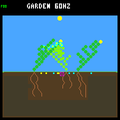
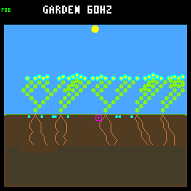
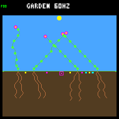
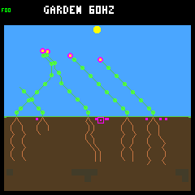
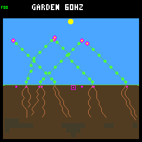

# Fresh seeds confirm establishment gains, with weaker reproduction gains

The [predeclared fresh confirmation](seedling-confirmation-protocol.md) passes
all nine unchanged aggregate gates. The combined first-day reserve rule improves
seedling establishment on eight new weather seeds, without retuning. Its effect
on continuing reproduction is smaller and uneven: historical durable parents
rise only 276 → 285, with ten individual worlds and three weather blocks losing
them. No endpoint retains multiple species, even counting viable seeds.

This confirms a useful **host-only reference-controller candidate**, not a
qualified training environment, general improvement in every world, or permission
to promote either wider scattering or the reserve rule to device defaults.

## Fixed experiment

Thirty-two matched seasonal pairs: eight fresh weather seeds × two layouts
(rainfed/crowded) × two controllers (baseline/adaptive), through 128 Garden days.
There are eight weather blocks, not 32 independent weather replicates. The seeds
are `ed52188c`, `4f0b9247`, `a9c30c1e`, `0bb887d1`, `647001a8`, `c629bb63`,
`20e1353a`, `82deacfd`; none overlaps the earlier seasonal panels checked by the
collector. Fresh results are evaluated separately, never pooled with the
[known-seed screen](seedling-population.md) to pass a gate.

Both arms use the previous screen's exact native inspector/replayer binaries and
all C sources. Only Python panel/render parameters and CMake test registration
change. The prior metrics, gates and summary still recompute identically.
Control uses the unchanged base controller; treatment explicitly selects
`--seedling-reserve all`, with the same combined forecast at offspring ages
1..256, wet-root exception, night veto, priority, ranking, arbitration and memory.
Founders and age 257 onward are not guarded. There is no gardener or irrigation.

Both arms retain experimental wider scattering, seasonal climate and the
256-node/eight-plant/eight-seed ecology. No physics, ecology, capacities,
resource/seed costs, model, fitness, host defaults or device firmware change.

## Establishment versus reproduction

Closing-year births occur strictly after day 112. Full-day eligibility requires
a full day of possible follow-up; death on the boundary fails, younger births are
censored. A durable descendant parent and at least one of its germinated children
must each survive a full day. These are cumulative achievements, not a guarantee
that parent and child are both still alive at the endpoint.

| Metric across 32 fresh worlds | Control | Guard |
|---|---:|---:|
| Closing-year worlds with births | 23 | 23 |
| Closing-year births | 81 | 75 |
| Closing-year eligible full-day survivors | 38 / 71 (53.5%) | 55 / 62 (88.7%) |
| Closing-year censored births | 10 | 13 |
| Closing-year eligible two-day survivors | 32 / 69 | 53 / 62 |
| Closing-year durable descendant parents | 5 | 6 |
| Historical durable descendant parents | 276 | 285 |
| All-history births | 1,175 | 1,009 |
| All-history eligible full-day survivors | 748 / 1,165 (64.2%) | 839 / 996 (84.2%) |
| All-history eligible two-day survivors | 649 / 1,163 | 770 / 996 |
| First-day deaths among eligible births | 417 | 157 |
| Total natural deaths | 1,144 | 957 |
| Living plants at endpoint | 159 | 180 |
| Living original founders at endpoint | 2 | 5 |
| Multi-viable-species endpoints | 0 | 0 |

One of the thirteen censored treatment births is already dead; censoring is not
survival. The first-day mortality decrease separates into energy deaths
307 → 116, water deaths 108 → 41 and combined shortages 2 → 0. As before, these
are different resulting cohorts, not 260 individually matched rescues. Changed
decisions alter later geometry, births, ancestry and resource competition.

The whole-history fraction of established offspring becoming durable parents
actually falls: 276/748 (36.9%) → 285/839 (34.0%). Late survivors without any
recorded germinated child rise from 29/38 to **48/55**. Of those 48 guarded
nonparents, 39 remain alive and nine have died by the horizon. One additional
guarded late survivor has a child but none with full-day survival yet. Do not
equate better establishment with solved reproduction.

Across the full history, all three species improve full-day establishment:
flowers 364/585 → 435/516, shrubs 122/176 → 130/154, ground cover
262/404 → 274/326. Durable parent counts do not improve for every species:
flowers 128 → 143 and shrubs 36 → 42, but ground cover **112 → 100**.

## Adverse worlds and partitions

Closing-year survivors increase in fifteen pairs, tie in thirteen and decrease
in four. Historical durable parents increase in fifteen, tie in seven and
decrease in ten. Endpoint living population rises in fifteen worlds, ties in ten
and falls in seven. All adverse cases remain in the report and portable archive.

| World losing closing-year full-day survivors | Control | Guard |
|---|---:|---:|
| Rainfed / baseline / `82deacfd` | 2 | 0 |
| Crowded / baseline / `ed52188c` | 1 | 0 |
| Crowded / baseline / `647001a8` | 5 | 4 |
| Crowded / adaptive / `ed52188c` | 1 | 0 |

The crowded/baseline `647001a8` case also loses a late durable parent (2 → 1).
Its closing births fall 10 → 4, versus 5 → 1 and 2 → 0 in the two crowded
`ed52188c` cases. The rainfed/baseline `82deacfd` world retains three closing
births but eligible follow-up changes 2 → 1 and no treatment birth survives a
full day. These are not all the same failure mode.

| World losing historical durable parents | Control | Guard |
|---|---:|---:|
| Rainfed / baseline / `ed52188c` | 22 | 14 |
| Rainfed / baseline / `4f0b9247` | 30 | 19 |
| Rainfed / baseline / `0bb887d1` | 30 | 25 |
| Rainfed / baseline / `c629bb63` | 5 | 3 |
| Rainfed / adaptive / `c629bb63` | 8 | 2 |
| Crowded / baseline / `0bb887d1` | 6 | 5 |
| Crowded / baseline / `647001a8` | 8 | 7 |
| Crowded / adaptive / `a9c30c1e` | 16 | 14 |
| Crowded / adaptive / `647001a8` | 11 | 9 |
| Crowded / adaptive / `c629bb63` | 1 | 0 |

| Weather block, four worlds each | Closing survivors, control → guard | Historical durable parents, control → guard |
|---|---|---|
| `ed52188c` | 6 → 5 | 33 → 30 |
| `4f0b9247` | 3 → 8 | 41 → 32 |
| `a9c30c1e` | 2 → 4 | 46 → 58 |
| `0bb887d1` | 5 → 9 | 45 → 45 |
| `647001a8` | 18 → 19 | 49 → 55 |
| `c629bb63` | 0 → 0 | 15 → 6 |
| `20e1353a` | 1 → 6 | 17 → 23 |
| `82deacfd` | 3 → 4 | 30 → 36 |

Six weather blocks gain late survivors, one ties and one loses. Historical
durable parents gain in four blocks, tie in one and lose in three. No
independent-world significance claim is made.

Both controllers gain closing survivors: baseline 25/43 → 31/36, adaptive
13/28 → 24/26. Baseline historical durable parents merely tie at 172; adaptive
104 → 113 supplies the aggregate gain. Both layouts gain closing survivors,
but rainfed historical durable parents fall 190 → 181, while crowded rises
86 → 104. Crowded closing durable parents fall 2 → 1; rainfed rises 3 → 5.
The unchanged gates are aggregate, not a claim that every partition passes.

## Turnover and diversity

No world becomes empty of living plants plus viable seeds at any sampled ecology
step, and every endpoint has living plants. Of 128 matched founders, sixteen die
earlier in treatment even though the final living-founder count rises two → five.
Survival gains are not cost-free for every neighbor. Descendant IDs are never
matched across divergent arms.

All 64 arm endpoints contain one viable species only. Both arms' aggregate
living endpoint distribution is 28 flower, three ground-cover and one shrub
world, although species can differ within a pair. The previous screen's two
bank-only diversity gains do not recur here. Seeds created fall 2,026 → 1,866;
expired seeds change 596 → 601. Raw activity is not itself the evaluation goal.

## Fixed screenshots

First fresh seed `ed52188c`, baseline, both layouts and arms at days sixteen and
128. All eight preselected images were inspected and their native state hashes,
RGB565 CRCs and PNG hashes verified. Reproduction claims come from the traces,
not appearance.

| Layout / day | Control | Guard |
|---|---|---|
| Rainfed / 16 |  |  |
| Rainfed / 128 |  |  |
| Crowded / 16 |  |  |
| Crowded / 128 |  |  |

## Evidence and verification

The [summary](seedling-confirmation-summary.json) retains gates, partitions,
paired outcomes, provenance, per-case summaries and checksums. The
[compressed archive](seedling-confirmation-histories.json.gz) includes every
lifetime, daily history, terminal receipt and per-lineage intervention count.
Decompressed SHA-256:
`49baf29c3e2976bfdfb0bbbef19240ceadbfc3747d9354dfe6afe3a89fc4f1e5`.
Summary SHA-256:
`28c8f6e08a7832229a9d7792801cff389f38b7c69d8b76baa3f157fcee527f33`.

All 64 fresh primary runs repeat byte-for-byte (128 fresh native runs), plus four
old population traces reproduced before the fresh panel. Source/binary/flag
snapshots match at collection start and finish. Independent offline verification
re-reads every primary trace, checks repeated hashes and legacy controls,
rebuilds all paired analyses and checks every capture. Controls were audited and
their complete histories established before running each fresh treatment.

Across the primary arms, the audits reconcile 2,097,216 ecology snapshots,
9,361,344 live resource budgets, 2,101 terminal receipts and 688,881 bids. The
guard checks 238,650 eligible forecasts and vetoes 31,898 bids, changing 21,646
committed decisions. Nine wet-root exception bids commit. Every paired prefix
matches until its first override, totalling 38,793 exact paired snapshots; first
changed bids range from tick 3,150 to 95,490. Weather/light and offered rainfall
remain matched, with daily weather also checked across layouts/controllers.

Six confirmation tests cover seed reuse, panel completeness/order, unchanged
old metrics and gates, frozen native dependencies, retention of negative outcomes
and portable evidence/metadata tampering. Existing seven population tests,
including native cohort/forecast checks, also pass. Full regression validation
passes: 111 default host CTests, 114 research CTests, standalone checks and the
SDL dummy-display player smoke test. The pristine firmware build passes with
unchanged size: 257,596 bytes of flash, 223,004 bytes of main RAM and the separate
8 KiB Core 1 region. No device flash is part of this work.

```sh
# Reuse the exact frozen wide-scattering binaries from the population screen.
python3 sim/garden_season_seedling_confirmation.py collect \
  --build artifacts/build-host-seasonal-seedling-population \
  --out artifacts/garden-seasonal-seedling-confirmation-new --jobs 4
python3 sim/garden_season_seedling_confirmation.py verify \
  --out artifacts/garden-seasonal-seedling-confirmation-new --jobs 4
```

The output directory must be new. The build command for these binaries is in
the [population report](seedling-population.md#evidence-and-verification).
Full raw/repeated traces and framebuffers remain under ignored
`artifacts/garden-seasonal-seedling-confirmation`; logs use the same hyphenated
prefix. Independent worker processes own separate worlds, with stable result
order. All earlier archives and results remain unchanged.

## Next decision

Keep the confirmed establishment rule unchanged and host-only. Next, discuss a
read-only reproductive bottleneck audit using the retained trajectories: separate
established plants that never produce seeds from parents whose seeds fail to
germinate or whose children die. Preserve follow-up time and adverse-world/
species partitions; do not select only successful families. This confirmation
does not isolate those mechanisms or justify another controller tweak yet.
Training, sustained diversity and environment qualification remain unfinished.

Follow-up: the [saved-trace reproductive funnel](reproduction-funnel.md) is now
complete. The dominant missing stage is seed production, while pending seed
banks and short follow-up remain distinct from demonstrated failures.
