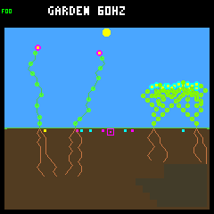
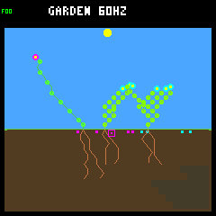
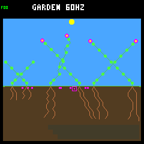
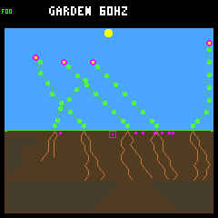
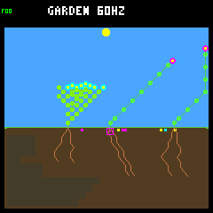
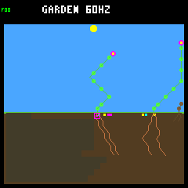
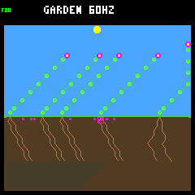
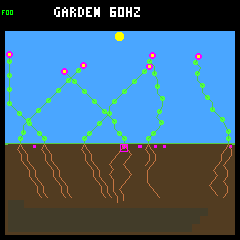

# All-offspring reserves improve the known-seed screen, not every world

The [predeclared all-offspring screen](seedling-population-protocol.md) passes
all nine aggregate gates. Applying the unchanged combined guard during every
offspring's first day improves establishment and recorded descendant reproduction
across these 32 seasonal worlds. It is not simply an increase in raw births:
total births fall while full-day survivors and durable descendant parents rise.

However, five worlds lose closing-year survivors, six lose historical durable
parents, and most late survivors still have no child. No endpoint has multiple
**living** species. Keep this host-only candidate frozen for fresh confirmation;
do not promote it or call the environment qualified.

## Fixed scope and controls

Use all eight weather seeds from the earlier wider-scattering confirmation,
crossed with rainfed/rainfed-crowded and baseline/adaptive: 32 matched pairs, each
run through 128 Garden days. These are known seeds used during diagnosis, not
fresh validation, and there are eight weather blocks rather than 32 independent
weather replicates. Both arms retain experimental wider scattering and the
256-node/eight-plant/eight-seed seasonal ecology. Normal host/device scattering
remains narrow.

`--seedling-reserve all` wraps the existing base policy for every living offspring
at ages 1..256 ecology samples. Founders and ages 257 onward remain unmodified.
The original energy forecast, water reserve and wetter-root exception are
unchanged, as are priority, arbitration, candidate order and proposed memory.
Rejected paid proposals become WAIT. Numeric-ID experiments and disabled defaults
keep their prior behavior. All-offspring single-component combinations are
rejected; this bounded candidate always uses both checks.

No weather, resources, seed spending, capacity, gardener, irrigation, model,
fitness function or firmware behavior was changed. This is a reference-controller
experiment, not neural training or a new ecological law.

## Establishment and renewal

Closing-year cohorts are born strictly after day 112. Eligibility requires a
full day of possible follow-up; death exactly on that boundary fails. Younger
births are reported as censored. A durable descendant parent survived a full day
and had at least one germinated child which also survived a full day. This is
the existing diagnostic definition, not proof of indefinitely sustainable renewal.

| Metric across 32 worlds | Control | All-offspring guard |
|---|---:|---:|
| Closing-year worlds with births | 21 | 22 |
| Closing-year births | 50 | 56 |
| Closing-year eligible full-day survivors | 20 / 37 (54.1%) | 33 / 44 (75.0%) |
| Closing-year censored births | 13 | 12 |
| Closing-year eligible two-day survivors | 18 / 35 | 26 / 39 |
| Closing-year durable descendant parents | 1 | 2 |
| Historical durable descendant parents | 211 | 271 |
| All-history births | 1,077 | 950 |
| All-history eligible full-day survivors | 594 / 1,064 (55.8%) | 775 / 938 (82.6%) |
| All-history eligible two-day survivors | 544 / 1,062 | 701 / 933 |
| First-day deaths among eligible births | 470 | 163 |
| Total natural deaths | 1,045 | 916 |
| Total living plants at endpoint | 160 | 162 |
| Living original founders at endpoint | 10 | 4 |

The first-day death reduction includes energy deaths 372 → 101, water deaths
93 → 61 and combined shortages 5 → 1. These are **different resulting cohorts**,
not 307 individually matched rescues: protection starts early enough to change
future births, geometry, ancestry and resource competition. Numeric descendant
IDs are not matched between diverged worlds.

First-day survival improves for all three species across the full history:
flowers 340/646 → 442/553, shrubs 98/154 → 128/142, ground cover 156/264 → 205/243.
Historical durable parent counts also rise in each species: 126 → 163, 30 → 36,
and 55 → 72 respectively. Yet the fraction of day survivors becoming durable
parents does not increase overall: 211/594 versus 271/775. More established
plants create more recorded reproducing parents, not a demonstrated improvement
in every established plant's reproductive prospects.

Late reproduction remains sparse: **31 of 33 guarded closing-year day survivors
have no recorded germinated child**, compared with eighteen of twenty controls.
Of those 31 guarded nonparents, twenty remain alive and eleven have died by the
horizon. The two guarded late durable parents occur in different worlds:

- Rainfed/adaptive `0bb887d0`: ground-cover #56, generation five, has child #61
  which survives a full day. Both remain alive at the endpoint.
- Crowded/baseline `a9c30c1f`: flower #38, generation four, has child #42 which
  survives a full day. Both remain alive at the endpoint.

The old control's one late durable parent was in rainfed/baseline `0bb887d0`;
that world's treatment has zero. The gain from one to two is not retention of
the same successful parent plus an extra one.

## Adverse worlds and weather blocks

Closing-year full-day survivors increase in fourteen pairs, tie in thirteen and
decrease in five. Historical durable parents increase in twenty-two, tie in four
and decrease in six. Endpoint living population increases in eleven worlds,
ties in twelve and decreases in nine. None reaches an empty living-plus-seed
state at any ecology sample, and every endpoint retains living plants.

| World losing closing-year full-day survivors | Control | Guard |
|---|---:|---:|
| Rainfed / baseline / `0bb887d0` | 5 | 0 |
| Rainfed / baseline / `647001a9` | 2 | 0 |
| Rainfed / baseline / `c629bb62` | 2 | 0 |
| Crowded / baseline / `647001a9` | 1 | 0 |
| Crowded / adaptive / `4f0b9246` | 1 | 0 |

The first row is a substantial adverse case: closing births 8 → 3, eligible births
7 → 1, day survivors 5 → 0, late durable parents 1 → 0, and historical durable
parents 26 → 13. The retained evidence also includes all six historical-parent
regressions; no bad world is removed from the aggregates.

| Weather seed, aggregated over four worlds | Closing survivors, control → guard | Historical durable parents, control → guard |
|---|---|---|
| `ed52188d` | 0 → 1 | 20 → 15 |
| `4f0b9246` | 1 → 3 | 28 → 38 |
| `a9c30c1f` | 5 → 9 | 31 → 46 |
| `0bb887d0` | 8 → 14 | 67 → 80 |
| `647001a9` | 3 → 0 | 29 → 36 |
| `c629bb62` | 2 → 1 | 16 → 23 |
| `20e1353b` | 1 → 2 | 11 → 19 |
| `82deacfc` | 0 → 3 | 9 → 14 |

Six weather blocks gain late survivors and two lose them. Seven gain historical
durable parents and one loses them. These blocks share weather within their four
worlds; no independent-trial confidence claim is made.

Crowded layouts gain closing survivors 6/11 → 17/21, but their closing birth-world
count falls 11 → 9. Rainfed layouts gain survivors 14/26 → 16/23 and birth worlds
10 → 13. Baseline retains fourteen late survivors with fewer eligible births
(29 → 19); adaptive rises from 6/8 to 19/25. Historical durable parents improve
under both controllers and both layouts. All these partitions are retained,
not just the aggregate passing gate.

## Turnover and diversity limitations

Of 128 matched initial founders, 28 die earlier under treatment. Endpoint
founders fall ten → four; all remaining founders are flowers. Individual founder
replacement is not automatically a regression for the A-life goal, but these
interventions alter competition and must not be described as cost-free survival.
The panel does not isolate the precise light/water/spatial mechanism behind every
changed founder death.

Viable multi-species endpoints rise zero → two, but **both gains are seed-bank
only**. In seed `0bb887d0`, both adaptive layouts end with living ground cover
and banked shrub seeds; neither has a living shrub. All 32 treatment endpoints
remain single-living-species. Living shrub endpoints actually fall one → zero;
flower endpoints change thirty → twenty-nine and ground cover one → three.
Do not interpret the viable-species gate as demonstrated living coexistence.

Total seeds created fall 1,950 → 1,804 and expired seeds 617 → 598. Lower raw
birth/death counts coexist with higher establishment and durable-parent counts;
raw activity alone is not the evaluation objective.

## Fixed screenshots

First seed `ed52188d`, baseline controller, both layouts, days sixteen and 128.
These eight images were preselected by the protocol, not chosen after examining
outcomes. Native state hashes, RGB565 CRCs and PNG hashes match; all eight were
inspected. Lineage, death and reproduction claims come from the traces.

| Layout / day | Control | Guard |
|---|---|---|
| Rainfed / 16 |  |  |
| Rainfed / 128 |  |  |
| Crowded / 16 |  |  |
| Crowded / 128 |  |  |

## Evidence and verification

The [summary](seedling-population-summary.json) retains metrics, all gates,
paired/partitioned outcomes, provenance, per-case summaries and checksums.
The [compressed histories](seedling-population-histories.json.gz) retain complete
lifetimes, daily histories, terminal receipts and per-lineage intervention counts.
Decompressed SHA-256:
`8f70391a857c864ad245fe47cba92eeeed53a38abfc23345de3ff1fc99d14008`.
Summary SHA-256:
`0c833395bfead5716ef42dfb4cfcac7661d5ba933617edc438502a80dc299345`.

All 64 primary runs repeat byte-for-byte (128 native panel runs), plus six exact
legacy full-trace checks before the panel. All 32 controls reproduce the earlier
wide worlds' complete saved daily/lifetime/death histories. The new audits check
2,097,216 ecology snapshots, 9,290,126 live budgets, 1,961 terminal receipts and
754,084 bids, including 273,804 first-day guarded forecasts. There are 33,567
vetoed bids across 20,329 changed committed decisions; seven wet-root exception
bids commit. Forecast arithmetic, cohort expiry, winner/priority consistency and
all resource receipts reconcile. Initial state/decision prefixes match for 37,650
paired snapshots before the first override in each world.

Source, binary and flag snapshots match at collection start/end. Separate offline
verification re-read all 64 full traces, checked repeats, rebuilt all paired
analyses/cohorts/gates, and verified raw framebuffer CRCs and PNG hashes. No
treatment source or threshold changed during collection.

The native test now checks every age 0..257 under founder, first-generation and
later-generation selection, plus dead/inactive targets, invalid initializer inputs,
unchanged outputs on failure and resetting an all-offspring context back to a
disabled named context. Seven Python cases cover fixed panel/censoring, exact
fraction gates, adverse-pair retention, changed prefixes, explicit/incompatible
CLI options, an active native trace with tampering, and portable evidence.
Existing named/component evidence tests remain unchanged and pass.

Full regression validation passes: 110 default host CTests, 113 research host
CTests, the standalone checks and the SDL dummy-display player smoke test. The
pristine firmware build also passes, retaining 257,596 bytes of flash and 223,004
bytes of main RAM plus the separate 8 KiB Core 1 region. No device flash or default
promotion is part of this work.

```sh
docker compose run --rm -T firmware bash -c '
  set -e
  source scripts/container/host-garden-defaults.sh
  cmake -S sim -B artifacts/build-host-seasonal-seedling-population -G Ninja \
    "${garden_default_cmake_options[@]}" \
    -DTOY_FACTORY_GARDEN_WIDE_DISPERSAL=ON \
    -DTOY_FACTORY_SIMULATOR_SANITIZERS=ON -DTOY_FACTORY_SIMULATOR_PROFILING=ON
  cmake --build artifacts/build-host-seasonal-seedling-population \
    --target toy-factory-garden-inspect toy-factory-garden-replay \
      toy-factory-garden-seedling-reserve-test
'
python3 sim/garden_season_seedling_population.py collect \
  --out artifacts/garden-seasonal-seedling-population-new --jobs 4
python3 sim/garden_season_seedling_population.py verify \
  --out artifacts/garden-seasonal-seedling-population-new --jobs 4
```

Collection requires a new output directory. Full raw/repeated traces, RGB565
captures and per-pair results remain in ignored
`artifacts/garden-seasonal-seedling-population`; logs use the matching hyphenated
prefix. Workers own separate worlds/processes; result order follows the fixed
panel rather than completion order.

## Next decision

Keep this candidate unchanged and discuss a fresh eight-weather-seed confirmation
before any promotion. Reuse the same horizons, denominators, reproduction gates
and adverse-block reporting. Do not tune the rule against these newly observed
losses or interpret the two bank-only diversity gains as living coexistence.
Training and environment qualification remain separate, unfinished milestones.

Follow-up: the [fresh eight-seed confirmation](seedling-confirmation.md) is now
complete. It passes the same aggregate gates with the unchanged candidate, while
showing smaller and uneven reproduction gains and no multi-species endpoints.
