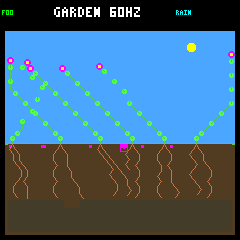
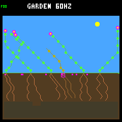
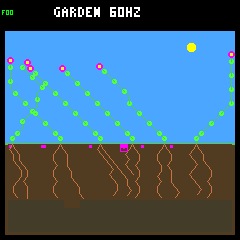
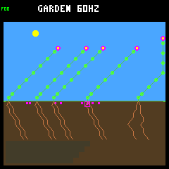
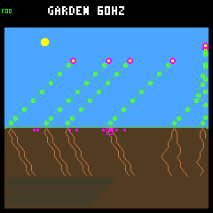
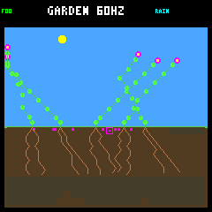

# First-day reserves rescue individuals, with a later neighbor cost

The [predeclared reserve counterfactual](seedling-reserve-protocol.md) rescues
both previously failing seedlings. They survive the first day, the second day
after the adapter switches off, and the remaining run through day 128. The
previously surviving example also remains alive. This is an actual changed-
decision replay, not an arithmetic claim that unspent resources guarantee rescue.

However, the rescued water-limited flower's parent later dies in the treatment
while remaining alive in the control. Final living populations do not increase,
all endpoints remain single-species, and none of the focal plants has a
germinated child recorded. **Do not promote this as an ecosystem-wide benefit.**

## Fixed comparison and implementation

Use the three wide-scattering examples from the
[read-only seedling replay](seedling-resources.md), each paired with its own
unchanged run. There are no replacement seedlings, new parameter settings,
capacity increases, weather changes or added resources.

The explicit host-only `--seedling-reserve ID` option wraps the existing baseline
or adaptive controller for just the named offspring's first day, ages 1–256.
It keeps candidate order, priority, arbitration and proposed memory unchanged.
Rejected paid actions become WAIT. From age 257 onward, the base controller runs
without the guard. This is not applied globally or installed on the device.

Energy uses the existing sunset/night forecast, including its fixed heuristic
credit for current daylight income. Water keeps four post-action upkeep charges;
a root aimed at a visibly wetter available soil destination can use a one-charge
floor. The energy test still applies to that root. Forecasts use current local
observations, not future weather, future uptake or knowledge of which seedling
failed in the original run.

## Survival and retained resources

| Fixed focal example | Unchanged outcome | Guarded outcome through day 128 | Guarded stores after two days | Guarded body after two days |
|---|---|---|---|---|
| Energy failure #35, rainfed/baseline `a9c30c1f` | Dies at age 0.223 day | Alive, observed to age 14.832 days | 256 energy / 301 water | 32 nodes, 16 roots |
| Water failure #41, crowded/baseline `ed52188d` | Dies at age 0.238 day | Alive, observed to age 15.160 days | 145 energy / 446 water | 28 nodes, 12 roots |
| Survivor #39, crowded/adaptive `4f0b9246` | Alive through day 128 | Alive, observed to age 6.113 days | 117 energy / 512 water | 36 nodes, 20 roots |

All three guarded plants are alive with zero stress at both full-day checkpoints.
The two rescued plants still experience temporary shortages: peak stress in the
two-day window is two for #35 and four for #41. The reserve heuristic is not a
promise of perfect forecasts or shortage-free survival.

### Energy: protect the first night, then grow

The first changed decision is tick 434,745, age thirteen ecology samples and sun
phase 119. It rejects the proposed ninth node: energy upkeep would rise from one
to two per maintenance interval. The forecast projects only twenty energy at
sunset against a 64-energy night requirement for that larger body.

At the same first-sunset tick, the unchanged plant has eleven nodes and two
energy; the guarded plant has **eight nodes and 32 energy**. The latter reaches
dawn alive with eight nodes and zero energy, then resumes productive growth.
By the first-day boundary it has 31 nodes, eight active leaves and 255 energy.
This is delayed investment followed by growth, not permanently keeping the
seedling tiny. Two energy upkeep units go unpaid later in the first-day window,
but stress recovers instead of reaching death.

The guard changes 23 committed decisions here: eighteen energy vetoes and five
water vetoes. The plant records 119 total WAIT decisions in its first day, but
most are the unchanged base policy's decisions in the new state, **not** direct
guard overrides. Avoid equating all subsequent behavior with the veto count.

### Water: more time for root access, but not a water-only experiment

The water example has nine changed committed decisions: **one energy veto at
birth and eight later water vetoes**. Thus this combined rule does not isolate
the water floor's individual contribution.

At the original death tick, 434,220, the guarded plant is still water-empty but
alive with stress two, seventeen nodes and nine roots extending through soil row
four. The original dies with sixteen nodes and seven roots reaching only row
three. By the guarded plant's two-day endpoint, roots reach row six and water
stores have recovered to 446. This documents a changed growth/resource path;
it does not establish that any single skipped purchase or root caused the rescue.

The smaller water floor for promising roots **never admits a bid that the normal
four-charge floor would reject** in any of these three trials. It is covered by
boundary tests, but this panel supplies no evidence of its practical benefit.
Do not attribute the rescue to that exception.

### Survivor: survival retained, trajectory changed

The adaptive survivor has nine vetoed bids across three committed WAIT decisions.
It still reaches 36 nodes, twenty roots and eight active leaves by its first-day
boundary, with no upkeep shortage. Its geometry and income change: first-day
energy income is 920 → 806; second-day-end energy is 125 → 117. Survival is
retained, but the guard is not behaviorally neutral or uniformly more productive.

## Neighbor and world outcomes

Track the fourteen plants already alive just before focal birth; their IDs and
histories are matched across each pair's identical prefix. One dies earlier:
the water example's parent, founder flower #5, dies at tick 486,600 (day 126.719)
under the guard, while remaining alive through day 128 in the control. All
thirteen other pre-existing neighbors remain alive in both arms.

The parent dies **energy-starved in winter**, with seasonal light at 61%, not
water-starved: its exact terminal receipt has zero stored/incoming energy with
five upkeep due, and 454 water before the final two-unit water upkeep. The
replay establishes this downstream cost of the intervention; it does not isolate
the shading, geometry or other intermediate mechanism. Do not automatically
explain it as the rescued plant consuming the parent's water.

| World totals at day 128, unchanged → guarded | Energy example | Water example | Survivor example |
|---|---:|---:|---:|
| Living plants | 6 → 6 | 5 → 5 | 5 → 5 |
| Historical offspring births | 36 → 32 | 37 → 37 | 34 → 34 |
| Historical natural deaths | 33 → 29 | 37 → 37 | 34 → 34 |
| Nodes | 217 → 212 | 180 → 172 | 180 → 180 |
| Viable species, including seeds | 1 → 1 | 1 → 1 | 1 → 1 |

No focal plant has a germinated child in either arm by the horizon. Rescuing a
seedling can alter occupancy, subsequent births and existing adults' fates;
individual survival, continuing renewal and diversity are different outcomes.
Later offspring IDs are not matched across diverged worlds.

Replacing a long-lived founder with a descendant may be useful generational
turnover for the A-life goal, not automatically a regression. This panel shows
establishment and replacement, but not yet self-sustaining descendant reproduction
or increased carrying capacity.

## Fixed rendered checkpoints

The shared production renderer captures both arms at each focal plant's exact
one-day and two-day boundaries. These twelve images are fixed by the protocol,
not chosen after seeing attractive results. The energy and water pairs show
persistent additional plants; the survivor pair shows a changed canopy shape.
Lineage identity and survival come from the traces, not visual inference alone.

| Energy example | Control | Guard |
|---|---|---|
| One day, 438,405 |  |  |
| Two days, 442,245 |  |  |

| Water example | Control | Guard |
|---|---|---|
| One day, 437,145 |  |  |
| Two days, 440,985 |  |  |

| Survivor example | Control | Guard |
|---|---|---|
| One day, 471,885 |  |  |
| Two days, 475,725 |  |  |

## Evidence and checks

The [summary](seedling-reserve-summary.json) retains both arms' lifetime/daily
histories, neighbors, resource ledgers, checkpoints, provenance and checksums.
The [compressed histories](seedling-reserve-histories.json.gz) additionally
retain all 2,172 focal samples, including forecasts, actual bids and terminal
receipts. Its decompressed SHA-256 is
`703aaaccc6570635b5247b001b4f275124fdf5d7dd9d6e9da61c07aabfd3165d`;
the summary SHA-256 is
`2c4350e3bd5cc40ec4e00162acce9d5e4f2a2b7ff2d7a2041f44ab6bdc520c99`.
Full raw traces, including other plants' per-step receipts, remain in ignored
`artifacts/garden-seasonal-seedling-reserve`.

All three disabled traces match the earlier frozen controls byte-for-byte.
All six new runs repeat byte-for-byte. Across the primary runs, the analysis
checks 196,614 ecology snapshots, 839,296 live budgets, 204 terminal receipts and
36,295 bids, including 276 guarded bid forecasts. There are 41 vetoed bids and
35 changed committed decisions. All unchanged historical control states and
89,073 paired pre-intervention snapshots match exactly. Climate, global sunlight
and rainfall-rate schedules match through day 128. Every override is confined
to the named offspring's first day. The twelve frame hashes and framebuffer CRCs
match the audited states; all twelve PNGs were inspected.

The native test covers water/energy boundaries, the upkeep size transition,
ranked wet/dry/blocked destinations, the night veto, invalid proposals, offspring
age limits, default/other-lineage exclusion, immutable state/memory and error
paths. Seven Python cases cover the fixed panel, independent forecast arithmetic,
scope and transformation checks, resource conservation, invalid traces/prefixes,
portable evidence and CLI rejection/inactive-target identity. An independent
offline verification rechecks the full paired traces, repeated hashes and PNGs.

All **108 default host tests**, **111 research tests**, standalone checks and the
SDL player smoke test pass, as does a pristine firmware build. Firmware remains
at 257,596 bytes of flash and 223,004 bytes of main RAM, plus its separate 8 KiB
Core 1 reservation. No device flash or production-policy change was made.

## Reproduction

From the recorded source/toolchain checkpoint, build the ordinary host ecology
with only wider scattering enabled in a separate directory:

```sh
docker compose run --rm -T firmware bash -c '
  set -e
  source scripts/container/host-garden-defaults.sh
  cmake -S sim -B artifacts/build-host-seasonal-seedling-reserve -G Ninja \
    "${garden_default_cmake_options[@]}" \
    -DTOY_FACTORY_GARDEN_WIDE_DISPERSAL=ON \
    -DTOY_FACTORY_SIMULATOR_SANITIZERS=ON -DTOY_FACTORY_SIMULATOR_PROFILING=ON
  cmake --build artifacts/build-host-seasonal-seedling-reserve \
    --target toy-factory-garden-inspect toy-factory-garden-replay
'
docker compose run --rm -T firmware python3 -W error sim/garden_season_seedling_reserve.py \
  collect --out artifacts/new-seedling-reserve
docker compose run --rm -T firmware python3 -W error sim/garden_season_seedling_reserve.py \
  verify --out artifacts/new-seedling-reserve
```

The collection destination must not exist. Verification reads a complete bundle
and launches no native process. The collector rejects changed baseline
dependencies, flags, control output or collection-time source/binary changes.
The portable archive can be inspected with `gzip -dc ... | jq .`; the regression
test checks its budgets, forecasts and image checksums without native replays.

## Next proposal

Keep both wider scattering and this guard experimental. Before expanding to a
fresh population-wide panel, discuss a fixed component comparison on these same
cases: energy reserve alone, water reserve alone, and the already measured
combination. In particular, the water rescue starts with an energy veto, and the
root exception never changes an outcome here. Separate those contributions and
retain the parent's later fate instead of adding more heuristic complexity.
No new candidate, tuning, promotion or device flash follows this panel.
