# Seedling failures: two different resource budgets

Read-only follow-up to the [offspring outcome audit](offspring-outcomes.md),
using the [fixed replay protocol](seedling-resources-protocol.md) and
[selection](seedling-resources-selection.json). Six matched-world traces cover
five focal plants: one wide-scattering energy failure, one water failure, one
day survivor, and the two available narrow-scattering counterparts. These are
selected diagnostic examples, not a new performance panel or a rescue test.

Both failed seedlings spend most of their limiting resource on early growth.
The energy failure reaches sunset nearly empty; the water failure runs dry in
daylight while retaining abundant energy. The surviving examples can fund much
more growth from actual income. No focal seedling spends resources on seeds.
This suggests testing resource-aware restraint, not assuming that all growth is
bad, relaxing germination rules, or subsidizing survival.

## Fixed examples

All worlds use combined seasonal climate. A day is 3,840 logic ticks, or 256
ecology intervals; observations include the birth step and the endpoint.
All selected plants are flowers. IDs match only within a world, not across rules.

| Role | Layout / policy / seed | Wide plant and observation | Nearest eligible narrow counterpart |
|---|---|---|---|
| Energy failure | rainfed / baseline / `a9c30c1f` | #35, ticks 434,565–435,420; dies at age 0.223 day | #34, born 433,260; survives its full day |
| Water failure | rainfed-crowded / baseline / `ed52188d` | #41, ticks 433,305–434,220; dies at age 0.238 day | None; no eligible late flower in this world |
| Day survivor | rainfed-crowded / adaptive / `4f0b9246` | #39, ticks 468,045–471,885; alive at age one day | #26, born 467,760; survives its full day |

Selection orders the earlier confirmation's declared seeds, layouts, policies,
then birth ticks and IDs, before examining these detailed traces. The two
failures have neither active drought nor seasonally reduced light at death.
This does not guarantee wet soil, unshaded leaves, or freedom from earlier
weather effects. Matching worlds does not match birth phase, location, inherited
traits or neighboring plants. In particular, these are not identical seedlings
subjected to two scattering rules.

## Exact resource accounting

Every row closes as `initial + income = overflow + upkeep paid + growth +
seed spending + terminal discard + remaining`. Income includes the terminal
step when a plant dies; terminal receipts distinguish upkeep from stores cleared
by death. Initial stores are 64 energy and 24 water. All seed spending is zero.

| Plant / resource | Initial + income | Overflow | Upkeep paid / due | Growth spending | Terminal discard | Remaining |
|---|---:|---:|---:|---:|---:|---:|
| Wide energy failure #35: energy | 64 + 10 | 0 | 11 / 27 | 63 | 0 | 0 |
| Wide energy failure #35: water | 24 + 59 | 0 | 15 / 15 | 35 | 33 | 0 |
| Narrow #34: energy | 64 + 1,120 | 518 | 288 / 288 | 280 | 0 | 98 |
| Narrow #34: water | 24 + 761 | 0 | 122 / 122 | 175 | 0 | 488 |
| Wide water failure #41: energy | 64 + 411 | 87 | 30 / 30 | 104 | 254 | 0 |
| Wide water failure #41: water | 24 + 52 | 0 | 11 / 26 | 65 | 0 | 0 |
| Wide survivor #39: energy | 64 + 920 | 226 | 301 / 301 | 315 | 0 | 142 |
| Wide survivor #39: water | 24 + 1,502 | 715 | 124 / 124 | 175 | 0 | 512 |
| Narrow #26: energy | 64 + 580 | 81 | 219 / 219 | 279 | 0 | 65 |
| Narrow #26: water | 24 + 407 | 0 | 108 / 108 | 155 | 0 | 168 |

Growth spending includes paid EXTEND and FINISH actions; an extension attempt
need not successfully append a node. Different inherited vigor also changes
energy cost, so equal action counts need not have equal energy spending.

### Energy failure: growth before sunset, little productive income

Wide #35 germinates at sun phase 107 and makes seven paid extension attempts
(three roots, four shoots), at phases 107, 110, 113, 116, 119, 122 and 125.
**All seven precede sunset at phase 128.** Its body grows from four to eleven
nodes, with five roots and three active leaves before death.

It gathers only ten energy over its observed life. Growth spends 63 of the
available 74, leaving eleven for upkeep. At sunset it has **two energy and
42 water**. The first energy-shortage observation is phase 136; it dies at
phase 164, before dawn. A rule that only prohibits growth during the night
would not prevent these purchases.

Five post-birth samples have active leaves and global sun at least 64 but zero
energy income. This documents non-productivity, not its precise geometric cause:
global light and proposed growth-site light are not a per-leaf exposure trace.
Reduced growth would change both future income and upkeep, so subtracting costs
from this recorded history is not proof of rescue.

The narrow counterpart is born much earlier in the day, at phase 20. It reaches
sunset with 237 energy and dawn with 77, eventually completing 32 extensions and
three FINISH actions without upkeep shortage. Its more productive history does
not isolate scattering, landing location, birth timing or inherited traits as
the cause of the wide plant's failure.

### Water failure: daylight energy cannot pay water costs

Wide #41 germinates at phase 23 in the rightmost soil column, 27, and dies at
phase 84. Thirteen paid extension attempts consume **65 of its 76 available
water**; upkeep takes the remaining eleven, with fifteen more water due but
unpaid. Energy is not limiting: after terminal upkeep, death discards 254 energy.

It attempts six root and seven shoot extensions. Twelve new nodes actually
append: the body reaches sixteen nodes and seven roots. The last living roots
occupy four unique soil cells, all in column 27, from row zero through row three.
All four have zero post-step water. Forty-two post-birth live samples have no
water income, and the first upkeep water shortage occurs at phase 56.

This is an observed combination of limited uptake and heavy growth spending,
not proof that waiting or a particular root direction would rescue it. Moisture
is recorded **after** uptake; a dry post-step cell can still have supplied water.
There is no qualifying late narrow flower in the matching world, and none is
substituted from another world.

### Survivors: growth can be well funded

Wide #39 makes 32 extensions and three FINISH actions, ending its full day with
36 nodes, twenty roots, eight active leaves, 142 energy and 512 water. It reaches
sunset with 235 energy and dawn with 75. Actual income pays for rapid growth and
all upkeep; excess resources overflow storage.

The narrow counterpart makes 28 extensions, three FINISH actions and 55 WAIT
decisions. It also survives without shortage, ending with 32 nodes, seventeen
roots, eight active leaves, 65 energy and 168 water. Neither these different
plants nor their different resource supplies form a controlled test of WAIT.
The wide survivor itself has a dry post-step root cell at birth, another reason
not to read that measurement as an automatic death sentence.

## Fixed rendered checkpoints

Each pair uses the **wide focal plant's birth and analysis endpoint**. Narrow
frames show those same world times, not the narrow focal plant's own birth or
first-day endpoint. These are production-renderer images without added markers;
the numeric histories, not a guessed visual identity, determine the budgets.
All twelve frames were inspected. Death endpoints show the failed plants' brown
remains, while the survivor pair shows continued body growth.

| Energy example | Wide | Narrow matching world |
|---|---|---|
| Birth, 434,565 | 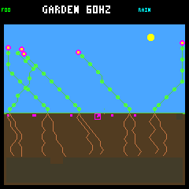 | 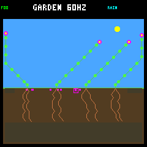 |
| Death, 435,420 | 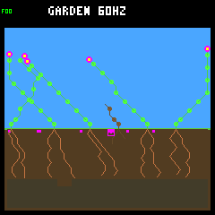 | 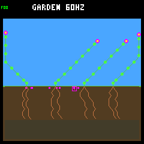 |

| Water example | Wide | Narrow matching world |
|---|---|---|
| Birth, 433,305 | 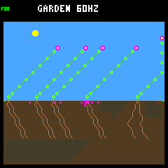 | 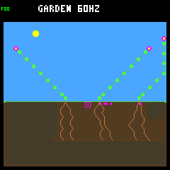 |
| Death, 434,220 | 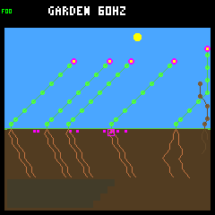 | 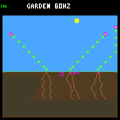 |

| Survivor example | Wide | Narrow matching world |
|---|---|---|
| Birth, 468,045 | 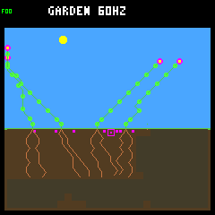 | 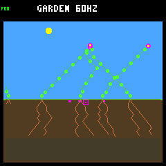 |
| Full day, 471,885 |  | 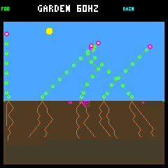 |

## Evidence and verification

The [numeric summary](seedling-resources-summary.json) retains selection, budgets,
checkpoints, per-step digests, provenance, trace hashes and image checksums.
The [compressed focal histories](seedling-resources-histories.json.gz) retain
all 891 focal samples (889 living, two terminal), including actual plant states,
resource ledgers and candidate bids. Its decompressed SHA-256 is
`32c2c1490cbdc7ef2a427d7519dfc40499a56420adc32578b60735b31aebb2a5`.
The summary SHA-256 is
`44311fe572ac58aad0e0d95f934fc55cfb1456f6f7d0ba77acc9d63cae444907`.

Six original and six repeated native traces match byte-for-byte. Across the six
worlds, the analyzer checks 196,614 ecology snapshots, 30,521 decision bids and
166 terminal receipts. All 774 daily states and complete birth/death histories
reproduce the frozen confirmation. All focal live budgets and whole observation
windows conserve resources exactly. The twelve image replays match audited world
hashes and framebuffer CRCs. Frozen C/header/shared-collector sources, both native
binaries and build flags match the confirmation; start/end dependency hashes
also match. Only the pre-existing scattering flag differs between builds.

Six unit cases cover deterministic selection/no invented counterpart, live
conservation and bid reconciliation, full-day conservation/overflow, malformed
or truncated traces, compact-export digests, and the retained focal histories
and PNGs. The archive test rechecks every focal live budget, terminal receipt and
whole-window balance without needing raw traces or native builds.
An independent offline pass
rechecks every raw trace, repeat hash, historical state, focal budget and PNG
checksum against the saved report. No C, firmware, ecology, model or default
changes were needed for this diagnostic.

All **106 default host tests**, **109 research tests**, standalone checks and the
SDL player smoke test pass, along with a pristine firmware build. Firmware
storage remains 257,596 bytes of flash and 223,004 bytes of main RAM, plus the
separate 8 KiB Core 1 reservation. No device flash was needed for this replay.

The complete raw trace bundle remains in ignored
`artifacts/garden-seasonal-seedling-resources`; the compact repo archive contains
focal histories, not all other plants' per-step data. Use the existing frozen
confirmation builds (`build-host` and `artifacts/build-host-seasonal-wide`):

```sh
docker compose run --rm -T firmware python3 -W error sim/garden_season_seedlings.py \
  plan --out artifacts/new-seedling-selection.json
cmp artifacts/new-seedling-selection.json benchmarks/garden-seasons/seedling-resources-selection.json
docker compose run --rm -T firmware python3 -W error sim/garden_season_seedlings.py \
  collect --out artifacts/new-seedling-resources
docker compose run --rm -T firmware python3 -W error sim/garden_season_seedlings.py \
  verify --out artifacts/new-seedling-resources
```

Output paths for `plan` and `collect` must not already exist. `verify` reads a
complete collection bundle and launches no native processes. Collection rejects
changed native sources, binaries or configurations: after implementation changes,
reproduce from the matching source/toolchain checkpoint rather than silently
relabeling a new simulation as this frozen evidence. To inspect portable focal
records without any native run, use
`gzip -dc benchmarks/garden-seasons/seedling-resources-histories.json.gz | jq .`.

## Follow-up

The [fixed first-day reserve counterfactual](seedling-reserve.md) now tests this
proposal against each selected wide plant's own unchanged history. Both failing
seedlings are rescued, but a later neighbor death and unchanged final population
counts prevent treating that result as a general ecological gain.

### Original next proposal

Discuss a small host-only counterfactual on these fixed examples: preserve a
maintenance reserve before accepting growth, then measure whether the failed
seedlings actually survive a day and whether the existing survivor is harmed.
Energy restraint must act before sunset; water restraint must not blindly veto
every root that could improve uptake. Define that tradeoff before implementing a
guard. Retain unchanged-world prefixes, neighbor outcomes and exact budgets;
do not interpret success on selected failures as a broadly qualified policy.

Keep wider scattering experimental and narrow scattering on device. Broader
renewal, diversity, living survivors' later reproduction and a general training
environment remain separate open questions.
